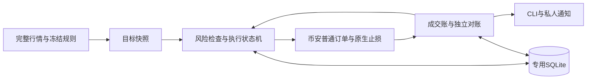
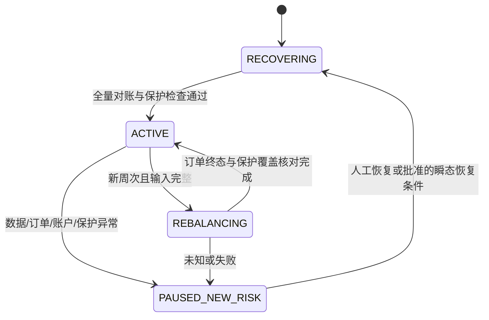

# North Star 草案 — 动量多空1号币安实盘

日期：2026-10-19。**状态：候选方案A，待Boss审批；不能据此开始业务实现或生产运行。** 依据：[已确认需求](requirements.md)、[研究证据](research.md)、[术语](glossary.md)。

## 1. 目标与架构立场

将冻结规则变成可复核的周频自动交易系统。唯一策略、唯一币安专用子账户、初始10,000美元等值USDT。运行时没有LLM交易决策。接受本金全损不取消原生止损、状态核对或资金隔离。

架构师视角为永续合约执行与可靠性工程：知识重点是订单状态、保证金、持久化和交易所协议；优先证明不会重复开仓、不会误认仓位归零；偏好单进程、少依赖；用故障结果解释设计。局限是不能凭架构证明策略未来盈利，也不能用模型代替账户实际权限和成交能力。

Finance主北极星的数据层/技术分析/策略层提供只读输入；本子系统承担新增Trading/Risk执行能力。回测仍是离线R&D，market.db继续云端独占写、company.db继续本地独占写。批准本子系统方向后，在主北极星补一段执行边界引用，不重构原四层体系。

## 2. 三个方案

|方案|结构与覆盖|主要收益|主要代价|判断|
|---|---|---|---|---|
|A：Finance专用执行器|共享信号→目标→持久化执行/保护/对账→币安；覆盖R1–R14|冻结规则表达直接，复用现有Python与通知，运维范围小|必须自行证明恢复与保护状态机正确|推荐|
|B：NautilusTrader内核|共享信号→策略适配→框架Risk/Execution/Cache→Binance adapter；R1–R14仍需适配验证|已有较完整的执行与恢复框架|版本与底层持久化复杂，策略成本/冷却仍需定制|A无法简洁通过故障验收时的备选|
|C：Freqtrade策略适配|共享信号→策略回调→Trade数据库/订单/止损管理→币安；R4/R5/R6需较多适配|现成交易循环与运维入口|逐笔交易语义、默认退出与止损风险口径可能改变冻结规则|不优先|

Hummingbot借鉴Controller/Executor分工，不将其本地止损当作交易所保护。三者研究依据见research.md，不把“支持Binance”当作需求覆盖测试通过。

## 3. 方案A边界

一个常驻Python进程管理串行交易状态；行情和账户事件异步接入。SQLite是单写者，状态变更经同一队列；网络等待不阻塞保护检查。不引入Redis、消息队列、微服务或网页。独立核对器使用独立计算逻辑，可在同进程调度，不与执行器共享“应该持有什么”的投影计算。

交易所决定实际订单与敞口，本地记录意图、策略成本、冷却和审计。两者不一致时保留差异并停新增，禁止覆盖其中一方制造一致。重启默认RECOVERING，完成全量核对才进入ACTIVE。

拟定实现目录：`trading/momentum_ls_01/`；真实运行状态放云端独立目录，使用`live.db`，不写market.db/company.db，不与研究CSV混存。具体文件和接口在批准后的实施计划冻结。

|模块|职责与输入输出|复用与边界|需求|
|---|---|---|---|
|M1 规则与目标|冻结配置＋完整信号＋账户调仓权益＋冷却→目标快照|复用评分/Fisher/资格，固定周锚点；不读密钥或下单|R1,R4|
|M2 交易所适配|公开元数据、签名查询、普通订单、Algo、用户流→标准化事件|薄封装官方协议，不持有策略决策；区分确定失败与未知|R2,R5,R6,R12,R13|
|M3 状态与成交账|持久化意图、逐笔成交、成本、持仓周期、冷却、周次|账本先落盘后发送；十进制金额，唯一键去重，禁止复制裸WAL主文件备份|R1,R6,R9,R14|
|M4 执行与保护|目标差额＋确认仓位→只减/新开/加仓/保护更替|单账户单writer；先退出/减仓再新增，保护未确认不继续新增|R3,R5,R6,R8,R11,R13|
|M5 对账与风险|交易所订单/Algo/成交/账户快照＋本地账→差异与准入状态|独立现金/库存核算，模式与保证金门，故障动作范围约束|R2,R3,R6,R7,R11,R12,R14|
|M6 运行与控制|时钟、状态、人工指令→调度、暂停、恢复、告警|CLI是控制入口，Telegram单向私人通知；不开放聊天消息执行交易|R8,R10,R11|

## 4. 策略身份与时钟

- 研究规则ID/版本不变。实盘另记录execution_revision及全部执行偏差。
- 信号取前一完整UTC日，14个完整日成交额与85个4h收盘价；先完整池评分，缺数据不能静默缩池重排。
- Fisher使用已收盘BTC原生周线，当前应生效周必须存在；周一00UTC收盘，04UTC生效。
- 调仓周次唯一键为strategy_id＋rule_version＋Monday04UTC。每个周次最多一个目标快照，目标重算不能当作新周次。
- 目标用调仓时一次确认的实际权益计算，受批准策略的空100%/多50%与空槽规则约束；不能每笔成交后重新计算全组合目标。
- 周内固定币数；只处理策略止损、已知退出、已批准故障处置。价格漂移不触发新增仓位上限或日内再平衡。
- **候选操作规则，随本架构审批：**首次启用等待下一个周一04UTC。正常调仓允许在`[04:00,04:05)UTC`发起新风险动作，使用经交易所时间校准的时钟；信号在窗口前准备，窗口开始核验完整性与账户事实。若过窗前未提交目标快照，本周不新造调仓；若已经提交，策略减仓/关多、已发送订单的恢复和保护收敛继续完成，但过窗后不发送新风险attempt。未发送目标记为过窗缺口。任何时候都不能补造旧开盘成交。临时中途建仓需单独指令并记录执行偏差。
- 冷却和同锚点换边按冻结规则。以交易所事件时间与调仓开始快照界定边界，边界不确定则本次不重入；不能把周日止损错误地延长为必须168小时。
- 不可变目标不是永久执行许可。每次发出增加风险的委托前，事务内重新检查最新持仓周期、冷却、保护状态、退出意图及许可版本。止损/故障退出/手动暂停会使排队意图失效；即使仍在同一周窗口，也不能按旧目标重新入场。待确认/UNKNOWN委托仍占用预算，不能同时给另一委托分配同一风险金额。

## 5. 订单与恢复

身份关系固定为`intent → attempt → venue order → fills`。事务中先保存意图、attempt及其唯一客户端ID，再发送请求。一个attempt只有一个永久客户端ID；旧attempt确定终态后才允许为已确认剩余量新建attempt，不依赖“当前未结订单唯一”实现幂等。提交未知进入UNKNOWN，查询普通/Algo订单、成交与仓位；单次查不到不是失败证明。不能仅以相同ID重发来假设交易所全历史去重；UNKNOWN超时只升级告警，不自动变成FAILED。

每笔成交以交易所原始唯一标识去重，部分成交即更新真实币数和成本。成交去重记录、累计成交量、持仓/成本/episode/冷却变化与保护待办在同一数据库事务提交，禁止留下“已去重但未入账”的崩溃窗口。撤单请求发出不等于已撤。旧普通单未明确终态时禁止替代委托，防止晚到成交越过目标。持仓周期归零须由成交与交易所仓位共同确认。

重启按以下顺序：取得单writer锁→加载未终态意图与周次→账户/普通单/Algo全量查询→补拉成交和资金流水→核对持仓与保护→解决差异→恢复已知动作。空数据库遇到非空账户不能自动接纳，更不能主动清仓。

恢复保存分页游标、重叠区间与完整性证据。交易所历史查询有保留期限；超出可恢复范围的备份须停在人工恢复态，不能假设没有旧成交。REST快照记录请求开始/结束及本地事件水位；与快照采集重叠的成交不能被晚到旧快照覆盖，必要时重新取稳定快照。

单向模式下换边必须先关闭旧方向并确认，按冻结规则当周禁止同币反向建仓。例行减仓阶段未完成时不进入增仓阶段；未知退出结果不能用新的反向委托抵消。

**候选执行规则：**普通增仓用有价格上限的IOC限价单，相对该意图创建时冻结的盘口中价偏离上限30bp；每次尝试仍验证盘口新鲜度，但不滚动重置参考价追涨杀跌。一个意图最多60秒、3次已确认剩余量尝试，且不得跨越周窗口新增。不同委托共享同一意图预算。未完成目标保留缺口并告警，不扩大其他币槽位，不换币补足。对退出使用只减仓路径；策略止损使用原生STOP_MARKET，不能因30bp预算而禁止止损退出。这些为工程候选参数，须盘口样例与故障测试验证后写入实施配置；不能称严格复制回测开盘价。

执行顺序固定：退出/减仓阶段→空头增仓阶段→多头增仓阶段，各阶段按冻结排名、同分symbol。20个满额槽位各耗尽60秒即20分钟，超过5分钟窗口；因此5分钟是新增风险截止时间，不是整篮完成承诺。计划须做全篮调度预算和临近窗口测试，报告确定性缺口及先空后多的执行偏差。若实测常态也难以完成，应调整窗口/执行方案并重新审批，不能为了凑齐而越窗追单。

## 6. 原生止损与竞态

空头止损为BUY方向的全仓位STOP_MARKET，触发价按当前持仓周期的加权成本×2，CONTRACT_PRICE，priceProtect=false。新触发价按合约tick处理，舍入规则及容许误差在计划中明确；不能默默变成更紧或更宽的百分比止损。

加仓后重算成本，减仓后成本不变。交易所entryPrice与独立成交账成本交叉核对。保护单保存symbol/position episode/成本版本/触发价/Algo身份，触发后追踪实际普通订单与成交，不能用“Algo已触发”当作“持仓已归零”。

保护更替不是原子操作，不能承诺零窗口：优先提交新保护并确认，再撤旧保护并确认；两张全平单短时共存的合法性、先后触发、已有仓位消失后的行为必须在demo验证。`protection_replace_supported`为显式上线硬门；demo能力试验及Boss掌握的生产验收需覆盖升/降成本与旧价先触发。未过门不得上线本策略或放行实盘加仓；若交易所不允许这种更替，应回到设计决定可接受替代，不自动改成先撤后挂。旧保护先触发造成提前退出，记为执行偏差，不能计作正确成本版本通过。

新开空头在首笔成交后立即建立保护；每次改变成本的成交、保护失效及退出后晚到残仓均启动保护版本核对。暂定从收到相关事件/发现差异起5秒内确认正确保护，保留交易所事件时间以计量发现延迟；超时停新增并重新核对，按已批准权限处理已知裸露或保护错误的仓位。5秒是本系统处置阈值，不是网络或交易所保证；既不是价格止损承诺，也不能防跳空。保护未确认前不继续追加新委托；既有剩余增仓单应撤销并等待终态，不假设撤销即无晚到成交。

如果止损与加仓并发：冻结该币动作→撤销尚可能增加风险的残余委托并确认→核对全部迟到成交→保护或平掉已知残仓。仅HTTP超时不代表已裸露；状态未知期间不得盲发反向单。平仓后清理旧Algo终态；清理未确认时禁止后续新持仓周期，避免旧止损打掉新仓。

暂停新增保留保护单和数据核对。不得用cancel-all作为统一暂停，因为保护单是需要保留的资产。保护器不可在系统暂停时恢复已被用户明确接管的交易。

## 7. 保证金、故障范围与会计

交易前读取并验证专用账户身份、USDT单资产、单向、全仓、2倍设置及合约可交易性。不自动修正账户模式，不自动提高杠杆。目标的1.0/1.5倍gross来自策略，杠杆设置不扩大目标。

实际余额、未实现盈亏、委托占用、维持保证金档位都进入准入检查。没有真实账户数据则结果是UNKNOWN。压力试验覆盖单币到止损、所有空头共同上涨、多空同时不利、资金费、退出延迟与周内漂移；输出强平可能早于策略止损的场景，不以“可亏完”把计算错误当通过。固定策略无法满足交易所当下要求时阻止新增并报告，禁止自动缩仓/改候选后声称原策略已执行。

压力结果分两维：①输入/计算/独立对拍VALID或UNKNOWN/FAIL；②各场景是否存活及强平距离。第一维是验收门；第二维是风险披露，已接受的全损场景不自动成为策略缩仓条件。交易所当前初始保证金、可用余额和合约规则是实际下单门；不得把“所有空头翻倍仍存活”当作新增的硬门槛。

账户级资金风险只告警及停新增；未批准账户级全平。受影响币的退出必须绑定明确故障证据、查清后的仓位及处置范围。范围按同一incident累计受影响集合与累计退出动作判断，不能仅看单条订单；共享根因影响全部仓位时，必须先升级为账户级人工决策，禁止for循环或拆多个incident绕过全平确认。原生策略止损不因多个币分别触发而被此故障权限门禁用。全平指令须人工明确发起、绑定账户和当前状态，最终操作由Boss掌握。

为避免“最后一只”的歧义，候选权限矩阵保守定义：任何故障动作若会清空全部剩余账户仓位，包含账户本来只有一只币，进入人工确认；原生策略止损及冻结策略的正常退出不受此故障门阻挡。独立小范围incident的多次退出也保留累计范围，不能借更换事件ID规避该规则。

故障自动减仓本身是实盘执行偏差，单独记账。它不触发周内递补。账户保证金阈值、恢复等待和通知节流应在书面计划中给出明确值与测试，不凭模糊“异常”触发交易。

钱包对账：期末钱包＝期初钱包＋已实现盈亏−手续费＋资金费＋净外部资金流＋其他明确归类调整。权益另加当时未实现盈亏。成交接口和资金流水重复列出的同一收支不得双计。未知差额保持未解释，不能归为资金费。外部资金流识别≠允许自动转账；没有充值/提现/主账户转移客户端能力。

会计权责：成交事实负责库存/成本，包含账户/产品/symbol/trade ID的键去重；钱包流水负责现金分项核对，用账户/incomeType/tranId等协议要求的复合键。成交中的佣金/已实现盈亏是现金分项的交叉证据，不二次入现金。流水保留币种，不能把非USDT手续费按1:1加总；同一时点对账及换算证据在实施计划固定。

## 8. 运维与资金边界

- 阿里云常驻服务使用专用环境、专用密钥和固定绝对状态目录，所有版本共用该目录的单实例锁，不能复制一份db启动第二个writer。首期仅批准一个运行主机；部署核查旧进程、重复服务和其他持有交易密钥的进程。具体IP、运行时和资源占用在部署准备时核查。
- 凭证不入Git、报告、日志或聊天；只记录环境变量名。交易凭证不含提现权限；服务器不持有能调入主账户资金的密钥。
- 持续保护核对与用户流、定期REST核对并行调度；交易动作依次执行，遵守IP和订单限额，为风险退出留容量。
- 日报显示真实权益/外部资金流/手续费/资金费/敞口/保护覆盖/差异/下一调仓。通知失败持久化并重试，交易状态不因此伪成功。通知通道长期不可用时停新增并保留原生保护。
- CLI至少有status、pause、reconcile、resume；暂停不是清仓。恢复必须重新核对，不能只翻一个布尔值。
- SQLite在线备份使用backup API，恢复演练包括磁盘损坏、旧备份、失去本地账本，演练不能把陈旧意图重新发出。
- 主账户创建/入金及生产启用由Boss完成；研发交付代码、验收证据与操作步骤。生产启动前的实际账户状态必须单独核对。

## 9. 模块依赖与建设路径

|顺序|交付|依赖|退出证据|可跳过|
|---|---|---|---|---|
|P0|只读冻结夹具与黑盒验收骨架|无|哈希一致；错误策略/缺周/缺池会被独立拒绝|否|
|P1|共享规则与完整信号快照|P0|同一输入/初始化下完整历史NAV、ledger、持仓、成本、冷却及止损与冻结金样本一致；新鲜度错误明确失败|否|
|P2|持久化账本与模拟交易所|P0|重复/乱序/部分成交/崩溃恢复，库存与现金独立对拍|否|
|P3|Binance适配＋原生保护＋执行|P1,P2|demo普通单/Algo协议、未知提交与更替竞态通过|否|
|P4|账户对账、保证金、控制与通知|P3|故障注入、权限范围、真实会计与暂停恢复通过|否|
|P5|只读shadow与生产上线包|P4|生产行情/账户能力证据、与实际周榜对拍、恢复与回滚手册|否|
|P6|Boss启动实盘后的观察验收|P5及上线审批|真实订单/成交/仓位/保护/净值证据；下一周调仓记录|否|

开发顺序优先建立可否决执行器的验证器。每个交付独立测试与review；最终dev-loop使用code-review high。完整测试和必要部署检查按变更影响执行，不把回测PASS当生产PASS。

demo不能证明生产流动性或真实保护成交。未自然发生的真实止损继续标未验证；不为验收主动制造亏损交易。实盘表现评价不自动扩容。

## 10. 需求覆盖

|需求|模块|验收重点|
|---|---|---|
|R1 冻结身份|M1,M3|哈希、配置、目标快照与研究金样本|
|R2 专用账户与资金|M2,M5|账户绑定、隔离与初始预算证据|
|R3 不补钱与保留止损|M4,M5|无转账路径，故障不扩大风险|
|R4 策略一致|M1|时间、池、预算、冷却与成本逐项对拍|
|R5 原生保护|M2,M4|首开、加减仓、触发、更替、终态清理|
|R6 恢复去重|M2,M3,M4,M5|未知提交、乱序成交与重启黑盒测试|
|R7 保证金|M5|真实档位＋独立压力场景，未知不通过|
|R8 人工控制|M6|pause保留保护，resume重新核对|
|R9 真实权益|M3,M5|独立现金/库存与交易所事实核对|
|R10 自动周调仓|M1,M6|唯一周次、错过窗口、首次启用|
|R11 故障权限|M4,M5,M6|受影响币与账户级动作隔离|
|R12 账户配置|M2,M5|全仓/单向/USDT/2倍读回|
|R13 止损源|M2,M4|CONTRACT_PRICE、priceProtect=false|
|R14 资金费|M3,M5|实盘收支不漏不重计，研究输出不变|

## 11. Pre-mortem与审批状态

|可能失败的原因|应对|剩余限制|
|---|---|---|
|成功提交却重试开出双仓|持久意图、UNKNOWN、交易所恢复|交易所长时间不可查询时只能停新增|
|加仓后止损失配|持仓周期/成本版本、保护更替、竞态演练|无法承诺原子开仓加止损|
|回测参数翻译错|金样本与独立验收先建|历史样本不证明未来盈利|
|多币上涨先强平|全仓压力、实时保证金与风险告警|原策略没有账户级硬止损，仍可能全损|
|备份恢复或双实例重放|单writer、身份/周次去重、恢复门|单机停机依赖交易所原生保护|

独立反向挑战及复核已完成，9项修订见[review.md](review.md)，未发现剩余架构文本阻塞。本草案中的实施完成度全部为0；已有信号内核只算复用素材。当前审批对象是方案A及本文件明确列出的执行边界。批准后再形成逐任务Files/Interfaces/TDD实施计划；未批准前不写业务实现。
