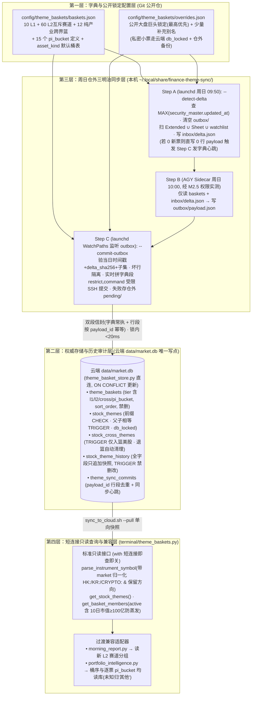

# North Star — 股票主题篮子分类系统架构方向

> **确立日期**: 2026-11-27
> **性质**: 子系统战略方向文档（对应 Linear `P-OWE-10`），经异构红队（Claude Fable）三轮源码与实盘审计闭环定稿（终审 `PASS WITH MINOR FIXES` 全部修入）
> **上位北极星对齐**: 主北极星（`docs/design/north-star.md`）第一层「数据层（Data Desk）」的基础分类字段与篮子归属底座
> **配套文档**: 需求 `docs/design/stock-theme-requirements.md`（R1–R12）｜ 研究 `docs/design/stock-theme-research.md`（D1–D5）｜ 术语 `docs/design/stock-theme-glossary.md`
> **更新频率**: 仅在架构方向性讨论后更新；实现中若发现方向需调整，必须回到本文档讨论，禁止在模块 plan 层面暗改方向

---

## 1. 选定方案总览

采用 **方案 A（终审定稿版）：本机仓外三明治隔离精标（AGY 订阅，周日运行）+ 云端双段信封幂等落库 + 本地纯只读短连接回拉**。

- **核心定位**：严守 Data Desk 数据层边界——只把「股票属于哪个 L1 大板块、哪个唯一 L2 互斥赛道篮子、哪几个纯产业跨界大主题篮子」干净、无双算、带变更历史地存进 `data/market.db` 并提供短连接只读查询接口；篮子涨跌幅、资金流向、齐涨率、拥挤度与组合 35% 敞口计算全部交由更上层模块负责（`R1`）。
- **四条铁律级工程原则**：
  1. **本地永不写 `data/market.db`，读连接即用即关**：`sync_to_cloud.sh:167-182` 一旦检测到本地库被任何进程打开（含只读句柄）或 `WAL` 非空即 `exit 1`。因此所有写入 **100% 只发往云端权威 `data/market.db`**；所有本地只读查询使用 `with` 短连接即查即关，云端提交成功后本进程零打开句柄再调 `./sync_to_cloud.sh --pull`。
  2. **仓外三目录物理分权 + 前置权限实测门控（M2.5）**：交换目录 `~/.local/share/finance-theme-sync/` 拆为 `inbox/`、`outbox/` 与 Sidecar 不可读写的 `pending/`（及 `db_locked_backup/`）。Step A 先清空 `outbox/` 再写带当日时间戳与 `delta_sha256` 的 `inbox/delta.json`；Step C 由 `launchd` `WatchPaths` 监听 `outbox/payload.json` 触发（消除休眠唤醒时钟竞态）。鉴于本机全局 `nonWorkspaceFileAccessPolicy=ALLOW`，在进入 M3 前设 **M2.5 半小时权限实测门控**：验证 Sidecar 读 `.env` 与跑 `ssh` 是否被拒；若全局配置放行仓外敏感文件，则降级为仅由 `launchd` 产出 `delta.json` 并推通知，由人工在受控会话内一键触发分类提交。
  3. **周日 10:00 错峰运行 + 零变更照常发心跳信封**：云端周六 `08:30/09:00` 刷池，本地周日 `09:00` 自动拉妥新池且周日云端写锁完全空闲。若当周无新票，Step A 直接在 `outbox/` 放入 0 行分类包，Step C 照常发送「最新字典 + 0 行分类」信封上云，确保云端心跳登记与 `overrides.json` 同步永不漏跑。
  4. **双段信封解耦幂等 + 禁用 `INSERT OR REPLACE`**：云端信封拆为两段——① **字典与锁定段**每次必幂等执行（`INSERT ... ON CONFLICT DO UPDATE`，**严禁使用 `INSERT OR REPLACE` 以免删父行误触发外键删跨界子表**）；② **新票分类行段**按 `payload_id`（分类行内容 SHA256，随 `pending/` 保存）经 `theme_sync_commits` 去重，重放时实时拼入最新字典段，断线重发既不丢新锁定也不报错。

---

## 2. 系统全景图与层间数据流

---

## 3. 领域术语与核心不变量

完整术语见 `docs/design/stock-theme-glossary.md`。系统由 **5 条数据库/代码硬不变量** 与 **1 条评审/健康检查软门控** 守护：

1. **互斥加总与父子严格相等不变量（`R2`）**：每连接强制 `PRAGMA foreign_keys = ON`；`CHECK` 锁死 `in_us_basket_calc = 1` 必有非空 `l1_id` 与 `l2_id`；`BEFORE INSERT/UPDATE` 触发器强制校验 `l2_id` 属 `tier='l2'`、**`l1_id` 严格等于该 `l2_id` 在 `theme_baskets` 中的 `parent_l1_id`**，`pi_bucket` 属 `tier='pi_bucket'`；`stock_cross_themes` 触发器仅允许 `in_us_basket_calc = 1` 标的关联 `tier='cross'` 且 `is_active=1` 篮子，当 `stock_themes.in_us_basket_calc` 变为 `0` 时触发器自动清理其跨界关联行。
2. **单一公司主代表与前缀防撞硬不变量（`P3`）**：美股通过 `security_master.share_class_of` ∪ 只读 `config/symbol_aliases.json` ∪ `overrides.json` 补充映射归一到唯一 `canonical_symbol`，并设活跃 `CIK` 部分唯一索引做二道防呆闸；跨市场主键强制规范化并由 `CHECK (asset_kind NOT IN ('crypto','non_us_equity') OR instr(symbol, ':') > 0)` 硬拦裸代码（Sheet 原始 `HKG:0700` / `0700` / `01810` 统一转为 4 位补零如 `HK:0700`、`HK:1810`；A 股转为 `CN:603259`；韩股转为 `KR:000660`；加密转为 `CRYPTO:BTC`）。
3. **异构资产物理隔离硬不变量（`R4, D2`）**：`asset_kind` 仅由 Step A 确定性判定（严禁模型填），默认 `pi_bucket` 由 `baskets.json` 的 `asset_kind_default_pi_bucket` 字典给出（不依赖待删旧分类器）；除 `'us_equity'` 主代表股外，其余全部类型一律 `CHECK (in_us_basket_calc = 0)`，且 `etf, fund_cef, crypto, custom_basket` 强制 `l2_id IS NULL`。
4. **双级锁定优先级与存量防漂移硬不变量（`R7`）**：优先级严格为 `overrides.json`（`source='override'`，公开大盘龙头） > 云端库内私有锁定（`source='db_locked'`，通过 `--lock-private` 加锁/`--unlock-private` 解锁，每次变更自动在仓外 `db_locked_backup/` 导出加密/本地备份） > 自动分类（`source='agy_llm'`）。日常周更对已有存量行只允许锁定段更新，新票段拒绝覆盖存量行。
5. **景气 `CODE_VERSION_SOURCES` 全集零触碰硬不变量（`R11`）**：新模块严禁修改 `terminal/prosperity/version.py:CODE_VERSION_SOURCES` 全部 11 项路径中的任一字节，也严禁被其 `import`；验收断言为 **实施前后 `main` 的 `code_version()` 完全相等**。
6. **成篮规模评审与禁删保护（`R3`）**：M1 新建篮子活跃代表股须 `≥ min_active_members`（默认 5 只，寡头赛道最低 4 只）；`theme_baskets` 触发器禁止 `DELETE` 任何行，且仍有活跃成员引用时拒绝将 `is_active` 置 `0`；日常市值波动导致跌破人数门槛由 `data_health.py` 报 `WARN`。

---

## 4. 各层详细定义

### 第一层：字典与公开锁定配置层（`config/theme_baskets/`）

- **职责**：Git 版本化管理「三层篮子字典 + 原 PI 15 粗桶字典 + 异构资产默认桶表」与「公开大盘龙头锁定表」。
- **不负责**：不存全池结果；**严禁写入个人私密中小盘持仓或观察名单**。
- **核心内容**：
  - `config/theme_baskets/baskets.json`：含 15 个 `tier='pi_bucket'` 条目（带 `sort_order`，含 `'ETF/宏观工具'` 与 `'其他'`）+ `asset_kind_default_pi_bucket` 映射表 + **10 个 L1 大板块** + **60 个 L2 互斥赛道**（带 `default_pi_bucket` 与 `sort_order`）+ **12 个纯产业跨界大主题**（上限 `≤ 18` 个）。
  - `config/theme_baskets/overrides.json`：公开大盘跨界龙头锁定表 + 少量补充别名（含 `effective_from`）。改动后随时运行 `--sync-config` 即时发空行信封同步上云。
- **关键决策**：对应 `R2, R3, R5, R7, R11` 与 `D1`。

### 第二层：权威存储与历史审计层（`src/data/theme_basket_store.py`）

- **职责**：独立模块直连 `data/market.db`，每连接执行 `PRAGMA foreign_keys = ON`，一律用 `INSERT ... ON CONFLICT DO UPDATE`（禁 `INSERT OR REPLACE`）维护 **5 张表**。
- **不负责**：代码守卫硬拒绝写本地生产 `DATA_DIR/market.db`。
- **5 张表精确契约（位于云端 `data/market.db`）**：
  1. `theme_baskets`：`basket_id PK`, `label_zh UNIQUE`, `tier CHECK ('l1','l2','cross','pi_bucket')`, `parent_l1_id`, `default_pi_bucket`, `sort_order INTEGER NOT NULL DEFAULT 0`, `min_active_members`, `narrative_start_date`, `inclusion_rule`, `exclusion_rule`, `is_active CHECK (0,1)`, `updated_at`（触发器禁止 `DELETE`，且有活跃成员时拒绝停用）。
  2. `stock_themes`：`symbol PK`（跨市场强制带 `HK:/KR:/CN:/CRYPTO:` 前缀）, `cik`, `asset_kind CHECK ('us_equity','etf','fund_cef','non_us_equity','crypto','custom_basket','other')`, `in_us_basket_calc CHECK (0,1)`, `is_superseded CHECK (0,1)`, `superseded_by`, `l1_id`, `l2_id`, `pi_bucket NOT NULL REFERENCES theme_baskets(basket_id)`, `business_note`, `profile_sector`, `profile_industry`, `company_name_snapshot`, `source CHECK ('override','db_locked','agy_llm')`, `agreement_status CHECK ('locked','dual_agreed','single_pass_weekly','needs_spot_check','disagreed')`, `assigned_at`, `updated_at`。
  3. `stock_cross_themes`：`(symbol, theme_id) PK`, `role CHECK ('core','platform_giant')`, `source`, `assigned_at`。
  4. `stock_theme_history`（全字段只追加快照日志，触发器禁止 `UPDATE/DELETE`）：`id PK AUTOINCREMENT`, `symbol`, `asset_kind`, `in_us_basket_calc`, `is_superseded`, `l1_id`, `l2_id`, `cross_themes_json`, `pi_bucket`, `source`, `effective_from`, `change_reason`, `changed_at`。
  5. `theme_sync_commits`：`payload_id PK`, `taxonomy_sha256`, `applied_at`, `inserted_count`, `updated_count`, `quarantined_count`。
- **关键决策**：对应 `R1, R4, R5, R9, R11` 与 `D2, D3`。

### 第三层：周日仓外三明治同步层（`scripts/theme_basket_sync.py` + `launchd`）

- **职责**：通过仓外三目录（`inbox/`、`outbox/`、Sidecar 不可访问的 `pending/`）与事件触发串接确定性前后置脚本与最小权限模型。
- **周日三段式流水线（`Asia/Shanghai`）**：
  1. **Step A（`launchd` 周日 `09:50`：`--detect-delta`）**：
     - 短连接检查本地 `MAX(security_master.updated_at)` 是否处于近 36 小时内（若周六云端池刷新失败或本地未拉取，先尝试一次 `--pull`，仍旧则记入摘要 `WARN` 后按现有库继续，不卡死字典同步）；
     - **先清空 `outbox/`**，汇总 `extended_membership` ∪ **宽松只读扫描 Google Sheet（代码+市场列，不可达标 `UNKNOWN`）** ∪ `company.db:watchlist`；
     - Python 确定性标准化市场前缀与 `asset_kind`。若当周 `missing_symbols` 与 `pivot_candidates` 均为空，直接向 `outbox/payload.json` 原子写入 0 行载荷立即唤醒 Step C 发字典心跳；否则原子写入带 `generated_date` 与 `delta_sha256` 的 `inbox/delta.json`。
  2. **Step B（AGY Sidecar 周日 `10:00`，或 M2.5 降级受控入口）**：
     - 读取 `baskets.json` 与当日 `inbox/delta.json`，原子写出 `outbox/payload.json`（回显 `delta_sha256`；新票标 `single_pass_weekly`；老票异动只给文本建议，`D4` 只报不改）。
  3. **Step C（`launchd` `WatchPaths` 监听 `outbox/payload.json` + 定时重试器：`--commit-outbox`）**：
     - 硬验 `delta.generated_date == 今日`、`payload.delta_sha256 == inbox.delta_sha256` 且提交代码 `⊆ inbox.missing_symbols`；
     - 内存临时库逐行预演全部约束与触发器（重放 `pending/` 时同样用最新字典重验），坏行移入隔离告警，合格行计算内容哈希 `payload_id`；
     - 实时读取最新 `baskets.json` + `overrides.json` 组装**双段信封**，经 `restrict,command="python3 /root/workspace/Finance/scripts/theme_basket_sync.py --apply-cloud-stdin"` 受限 SSH 发送云端：云端锁外备份，`flock -w 15` 拿锁 `<20ms` 执行「字典锁定段常执 + 新票行段按 `payload_id` 幂等插入」；若断网或锁忙，将合格分类行与 `payload_id` 存入仓外 `pending/` 待重试；
     - 云端成功后确认零打开句柄，调 `./sync_to_cloud.sh --pull` 并发送 Telegram 周摘要。
- **关键决策**：对应 `R5, R6, R8, R9` 与 `D2, D4, D5`。

### 第四层：短连接只读查询与兼容层（`terminal/theme_baskets.py`）

- **职责**：提供短连接只读 API、精确兼容晨报/PI，并接入 `data_health.py`。
- **核心接口契约**：
  1. `parse_instrument_symbol(raw_symbol, market="US") -> InstrumentRef`：结合 `market`（`US/HK/KR/CN/CRYPTO`）完成前缀补零标准化（如 `market="HK", raw="0700"` 或 `"HKG:0700"` → `lookup_key="HK:0700"`；`market="CRYPTO", raw="BTC"` → `"CRYPTO:BTC"`，根绝加密 `BTC` 误查美股 ETF），并保留 `wrapper_kind: 'equity'|'leaps'|'put'|'call'`。
  2. `get_stock_themes(symbol, market="US")`：短连接即查即关，返回完整分类记录。
  3. `get_basket_members(basket_id, *, scope="active", as_of=None, roles=("core", "platform_giant"))`：
     - `scope="active"`（默认）：返回 `in_us_basket_calc = 1 AND is_superseded = 0` 且满足「在活跃 `extended_membership` 内，**或** 曾进入 `extended_membership` 且当前 `security_master.eligible = 1`、近 10 天内 `historical_market_cap ≥ 100 亿美元`（直接利用 `market.db` 现成历史市值表救回 `GOOG`、`FOXA`、`NWSA` 等全部因 Screener 多股类抖动掉出的万亿/百亿巨头，同时过滤从未入主池的场外粉单与优先股，不受 21 天窗口过期影响！）」的主代表股；
     - `scope="as_of"`：结合 `extended_membership` 与 `stock_theme_history`（`effective_from <= as_of`）还原时点快照；早于 `MIN(stock_theme_history.effective_from)` 强制附带 `pit_basis = "backfill_approximate"` 与 `narrative_start_date`。
  4. **晨报与 PI 数据库单源兼容层**：
     - `morning_report.py`：读新 L2 赛道有序列表与分组；
     - `portfolio_intelligence.py`（传入标的附带 `market` 字段映射）：`bucket_order` 与逐票 `pi_bucket` **全部读自 `market.db`（`theme_baskets.tier='pi_bucket'` 按 `sort_order` 排序）**，遇任何未命中异常值强制兜底归 `'其他'` 并打日志告警，物理根绝双端不同步丢行。

---

## 5. 模块依赖图与建设路径

| # | 模块 | 物理落点 | 依赖 | 层级 | 可跳过 | 一句话职责与里程碑对齐 |
|---|---|---|---|---|---|---|
| **M1** | **篮子字典与锁定表定稿** | `config/theme_baskets/{baskets,overrides}.json` | 无 | 基础 | ❌ | 定稿 10 L1 + 60 L2 + 12 跨界篮 + 15 个 `pi_bucket` 与公开巨头锁定表，Boss 签字（**对应 S1**） |
| **M2** | **5 表存储引擎与体检接入** | `src/data/theme_basket_store.py` + `data_health.py` | M1 | 基础 | ❌ | 实现 5 张表、全部 `CHECK`/父子触发器/禁删触发器、`ON CONFLICT` 写入与 `data_health` 检查（`code_version` 恒等） |
| **M2.5** | **Sidecar 越权拦截前置实测** | 最小测试 Sidecar（半小时门控） | 无 | 基础 | ❌ | 实测验证零命令权限 Sidecar 读 `.env` 与跑 `ssh` 是否被系统拦截，决定 M5 采用全自动或半自动触发 |
| **M3** | **仓外三明治同步 CLI 与受限 SSH** | `scripts/theme_basket_sync.py` + 云端 `restrict,command` | M1, M2, M2.5 | 基础 | ❌ | 实现 `--detect-delta`、`--commit-outbox`（双段信封+`payload_id` 幂等+仓外 `pending/`）并实测云端 SQLite |
| **M4** | **第一版全池异构双盲精标落库** | 主控 Pass 1 + 异构 Fable Pass 2 → 云端 `market.db` | M1, M2, M3 | 核心 | ❌ | 完成全池异构双盲精标、逐票冻结存量 `pi_bucket`、写初始全字段历史行并 `--pull` 回本地（**对应 S2**） |
| **M5** | **周日三明治自动化部署试跑** | `launchd` (`09:50` + `WatchPaths`) + AGY Sidecar | M2.5, M3, M4 | 核心 | ❌ | 部署周日自动化流水线并跑通真实增量与 0 变更心跳试跑（**对应 S3**） |
| **M6** | **短连接 API 与晨报/PI 切换对拍** | `terminal/theme_baskets.py` + PI `market` 透传适配 | M2, M4, M5 | 核心 | ❌ | 上线短连接 API，切换晨报与 PI（真实持仓逐票对拍 `pi_bucket`，差异由 Boss 签字） |
| **M7** | **三代遗留栈清零（保 `code_version` 恒等）** | 删旧代码/CSV/3张幽灵表 + 改 `sync_to_cloud.sh` | M5, M6 | 核心 | ❌ | 下线云端旧 Step 7，删净 ~3,500 行旧代码、37 份 CSV、`sync_to_cloud.sh` 旧段与 3 张幽灵表；`market_store.py` 4 张空表 DDL 与 `settings.py:156,423-424` 3 个死常量统一挂单搭车删（**对应 S4**） |

---

## 6. 各层当前完成度

| 层 / 模块 | 当前完成度 | 关键缺口 |
|---|---|---|
| 第一层：字典与锁定表（M1） | 95%（待 Boss S1 签字） | 已产出 `baskets.json`（97 项：15 `pi_bucket` + 10 L1 + 60 L2 + 12 Cross）与 `overrides.json`（45 只公开龙头 + 10 条补充别名）及单测，待 Boss S1 审定 |
| 第二层：5 表存储与体检（M2） | 0% | 待在独立 worktree 中 TDD 实现 `theme_basket_store.py` |
| 第三层：M2.5 权限门控与三明治 CLI（M3） | 0% | 待跑半小时 Sidecar 越权实测并实现 `theme_basket_sync.py` |
| 第四层：首轮双盲精标、自动化与清债（M4–M7） | 0% | 待按 M4 → M5 → M6 → M7 顺序推进 |

---

## 7. 关键架构决策表

| 决策 | 内容 | 理由 | 对应需求 | 日期 |
|---|---|---|---|---|
| **三层篮子 + 15 粗桶同表入库** | `theme_baskets.tier` 含 `l1/l2/cross/pi_bucket`，桶序与触发器统一读库 | 彻底消除 Git 与数据库不同步导致的 PI 丢行，保 `40% NAV` 口径不变 | R2, R3, R10, D1 | 2026-11-27 |
| **本地禁写 + 短连接只读** | 只写云端权威 `market.db`；本地即查即关，禁用 `INSERT OR REPLACE` | 防本地 WAL/句柄卡死 `--pull`，防删父行误删跨界子表 | R1, R5, R9 | 2026-11-27 |
| **M2.5 权限前移门控 + 仓外三目录** | 开工前实测 Sidecar 权限边界；`WatchPaths` 触发 Step C；`pending` 隔离存放 | 消除全局 `ALLOW` 未验证假设与休眠唤醒 `launchd` 竞态 | R8, D5 | 2026-11-27 |
| **双段信封解耦幂等 + 零变更照发** | 字典段每次常执，新票段按 `payload_id` 去重；0 新票照发空行信封记心跳 | 兼顾云端心跳登记、`overrides` 同步与断线重发防丢锁定 | R7, R8, R9 | 2026-11-27 |
| **10 日历史市值 ≥100 亿防蒸发兜底** | `scope="active"` 纳入 `security_master.eligible=1` 且近 10 日市值达标代表股 | 彻底救回 `GOOG/FOXA/NWSA` 等超 21 天仍未回池的多股类巨头 | R4, R10 | 2026-11-27 |
| **跨市场前缀 CHECK + PI 透传 `market`** | 强制 `HK:/KR:/CN:/CRYPTO:` 前缀 CHECK，PI 查询传入 `market` | 根绝加密 `BTC` 撞名美股 ETF，保障跨市场持仓准确归桶 | R4, R10, D2 | 2026-11-27 |
| **`CODE_VERSION_SOURCES` 11 项相对恒等** | 实施前后 `code_version()` 相等；4 张空表 DDL 与 `settings.py` 3 个死常量搭车删 | 100% 不触发云端景气冻结链重算 | R11, R12 | 2026-11-27 |

---

## 8. 需求覆盖矩阵（验证 1）

| 需求编号 | 核心要求简述 | M1 字典 | M2 5表与体检 | M2.5 权限门控 | M3 同步 CLI | M4 双盲精标 | M5 周日自动化 | M6 API与切换 | M7 清旧栈 |
|---|---|:---:|:---:|:---:|:---:|:---:|:---:|:---:|:---:|
| **R1** | 限定 `market.db` 数据层底座，不算表现/拥挤度 | ✓ | ✓ | | | | | ✓ | |
| **R2** | L1 + L2 互斥 + 纯产业跨界篮（父子相等 TRIGGER） | ✓ | ✓ | | ✓ | ✓ | | | |
| **R3** | 交易共振切分，建篮人数门槛 + 禁删保护 | ✓ | ✓ | | | ✓ | | | |
| **R4** | `Extended ∪ Sheet ∪ watchlist`，前缀隔离 + 10日市值防蒸发 | ✓ | ✓ | | ✓ | ✓ | | ✓ | |
| **R5** | 废 CSV 双写，云端唯一写点，私密票 `db_locked` + 仓外备份 | ✓ | ✓ | | ✓ | | | | ✓ |
| **R6** | 第一版订阅主模型 + 异构盲审全池精细打标 | | | | ✓ | ✓ | | | |
| **R7** | `override > db_locked` 双级锁定，双段信封防丢锁定 | ✓ | ✓ | | ✓ | ✓ | | | |
| **R8** | 周日仓外三明治自动化 + 0变更心跳 + `WatchPaths` 防竞态 | | ✓ | ✓ | ✓ | | ✓ | | |
| **R9** | 外键常开、层级/前缀硬约束、逐票隔离与 `delta_sha256` 校验 | | ✓ | | ✓ | | | | |
| **R10** | 短连接 API（带 `market`、保留期权方向、`as_of`）+ 晨报/PI 兼容 | ✓ | ✓ | | | ✓ | | ✓ | |
| **R11** | 零触碰 `CODE_VERSION_SOURCES` 11 项，实施前后指纹恒等 | ✓ | ✓ | | ✓ | | | ✓ | ✓ |
| **R12** | 清零旧代码/CSV/3张幽灵表，4空表DDL+`settings.py` 3常量搭车删 | | | | | | | | ✓ |

---

## 9. 风险与应对（验证 2 & 验证 3）

### 9.1 Pre-mortem 推演（验证 2）

| 假想一年后死因 | 架构内置的硬应对机制 | 是否充分 |
|---|---|---|
| **1. 本机出差合盖错过周日窗口，唤醒后 `launchd` 竞态吃到上周旧包** | Step A 先清空 `outbox/` 并写当日日期，Step C 由 `WatchPaths` 触发且只认当日 `delta`；超 14 天无心跳由 `data_health.py` 亮 `WARN` | ✓ |
| **2. 全局 `ALLOW` 策略使无工作区 Sidecar 仍可读仓外 `.env`** | M2.5 前置半小时实测拦截效果，不通过则降级为 `launchd` 只产 `delta`、人工受控一键提交，绝不带未验证假设上线 | ✓ |
| **3. 多股类巨头掉出主池超过 3 周（如 `FOXA`、`GOOG`）在篮子中消失** | `scope="active"` 直接核查 `security_master.eligible=1` 且近 10 日 `historical_market_cap ≥ 100 亿美元`，不依赖固定天数窗口 | ✓ |
| **4. 加密 `BTC` 与同名美股 ETF 撞键，或删改行误删跨界子表** | 数据库 `CHECK` 强制跨市场带 `:` 前缀且 PI 透传 `market`；全模块禁用 `INSERT OR REPLACE` | ✓ |
| **5. 切换后 PI `40% NAV` 告警变味或未知桶静默丢行** | 15 个 `pi_bucket` 入库同源读取，存量票逐票冻结，未知值强制兜底 `'其他'` 并告警 | ✓ |

### 9.2 三轮异构 Fable 审查闭环记录（验证 3：`devin/claude-fable-5-2[1m]`）

1. **第一轮老兵挑刺（11 项）& 第二轮门禁初审（1 P0 + 3 P1 + 10 P2）**：均已闭合，并经第三轮独立复审逐条核实源码属实（0 P0）。
2. **第三轮终审复核（裁决：`PASS WITH MINOR FIXES`，1 P1 + 7 P2 + P3 文档收口）→ 已全部修入本定稿**：
   - **`P1-1`（21 天窗口救不回已满期的 `FOXA/NWSA` 及后续 `GOOG`）**：统一三份文档，将活跃防蒸发兜底改为 `security_master.eligible=1` 且近 10 日内 `historical_market_cap ≥ 100 亿美元`。
   - **`P2-1 & P2-2`（0 变更短路无处写心跳 & `payload_id` 跳过字典同步）**：取消本地短路（0 新票照发空行信封）；信封拆为「字典锁定段每次常执 + 新票分类行段按内容哈希 `payload_id` 去重」。
   - **`P2-3 & P2-4`（15 个 `pi_bucket` 入库同源 + 异构默认桶脱离旧分类器）**：`theme_baskets.tier` 新增 `'pi_bucket'`（带 `sort_order`），`baskets.json` 新增 `asset_kind_default_pi_bucket`。
   - **`P2-5`（休眠唤醒 `launchd` A/C 竞态）**：Step A 清空 `outbox/` 写当日时间戳，Step C 改用 `WatchPaths` 触发并硬核对当日 `delta`。
   - **`P2-6`（补齐父子相等触发器、跨市场 `:` 前缀 `CHECK`、退篮清跨界行与禁用 `INSERT OR REPLACE`）**：全部写入第二层表契约。
   - **`P2-7`（Sidecar 权限假设前移验证）**：新增 **M2.5 半小时权限实测门控**，前移至 M3 开工前。
   - **全部 P3 细节**：统一 `--commit-outbox` 命令名、PI 透传 `market` 与 `HK:/KR:/CN:/CRYPTO:` 归一细则、仓外隔离 `pending/`、`override > db_locked` 优先级与备份、`stock_theme_history` 全字段禁删改触发器、以及 M7 同步挂单 `settings.py:156,423-424` 三个旧常量。
