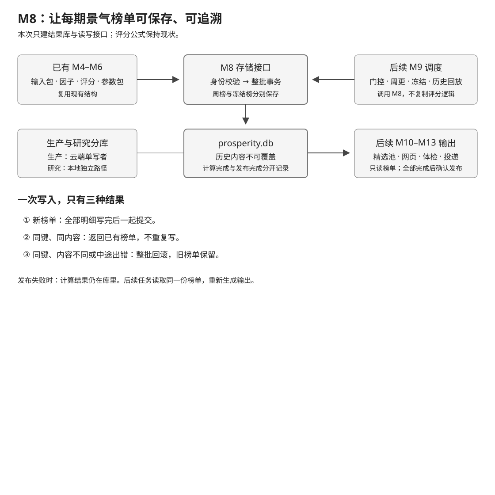
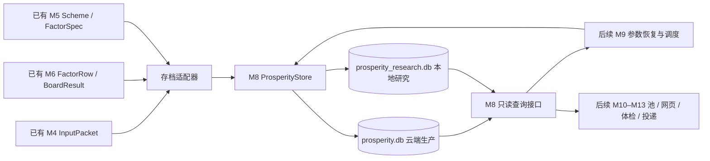
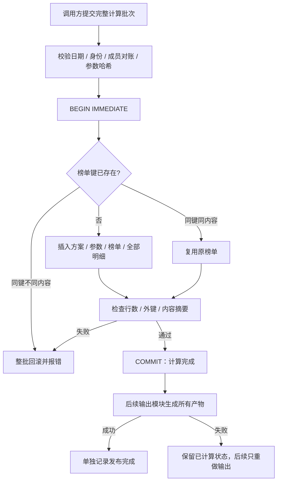

# 景气引擎 M8 prosperity.db 存储 Implementation Plan

**状态：2026-10-23 Boss 批准后实施完成；M8 本地验收通过，无新增全量失败。未提交/合并/推送/部署。**

**Goal:** 把已有景气内核的榜单、参数包和易变输入完整存档，提供 M9–M13 可复用的读写接口。
**Architecture:** 新建独立 SQLite store，接收现有 `InputPacket`、`FactorRow`、`BoardResult`。一个计算批次在一个事务中提交；历史内容不可覆盖，发布状态独立更新。生产与研究共用代码、显式指定不同数据库路径。
**Tech Stack:** Python 3.10、stdlib sqlite3 / dataclasses / json / hashlib、pytest；不引入 ORM 或迁移框架。
**Spec:** `docs/design/prosperity-engine-north-star.md:41`、`:107`、`:132`、`:168`、`:271`。
**北极星对齐:** 主北极星第二层「分析层 · 基本面」；景气北极星第三层的存储边界。直接完成 R8，支撑 R5/R7/R10/R11；不声称完成周更或 MVP。
**基线:** `3d6870c4`；分支 `worktree-prosperity-m8-storage`。2026-10-23 核对代码。

## 1. Boss 审批摘要

推荐：**独立 SQLite 长表 + 小型 JSON 字段，整批事务提交。**

本次交付可以证明：已有内核算出的结果，关闭数据库后重新打开，仍能逐字段读回；重复运行不增加重复榜；写到一半失败不留下半榜；发布失败保留计算结果。

本次不接 cron，不生成真实生产库，不跑历史重建，不发布网页或 Telegram，不替换 Premium。M9 负责真实运行的时间与门控；M10–M13 负责输出。M8 只提供它们需要的数据契约。

待审批的实现选择：

1. 九张表（2026-10-23 验收修订：原七张 + 共享输入两张），所有方案共用表结构。因子逐行存储，复杂归档和参数包存 JSON。
2. ~~一份榜单的输入按榜单保存~~。**2026-10-23 Boss 拍板改为每周一份**：同一周四方案与冻结副本共用 `input_set`/`stock_input`，按内容哈希复用。真实数据实测每周 34 MB → 12.3 MB。
3. 同键同内容为幂等成功；同键不同内容报错。禁止覆盖旧榜，禁止以本次运行时间自动生成新身份来绕过冲突。
4. 一批包含的全部方案一起提交。冻结日的周榜与季末榜一起提交。批次中任一失败，整批回滚。
5. 存储代码放 `src/data/`。内核不反向导入存储模块，保持已有 `code_version` 计算范围。



## 2. 架构图（Mermaid）



存储层不打开 `market.db`。名字等展示元数据由调用方传入，不能在读取历史榜时偷偷查询最新 profile。

## 3. 业务流程图（Mermaid）



所有 `BaseException` 路径都 rollback；退出进程后由 SQLite 事务恢复。写路径禁止嵌套事务及调用内部自行 commit 的 helper。

## 4. 已核实的复用点

以下行号是基线位置，执行前复核；不是给现有大文件增加新职责。

| 现有实现 | 精确接口 / 行号 | 本次用法 |
|---|---|---|
| 输入包 | `terminal/prosperity/types.py:102` `InputPacket` | 保留来源级 PIT、财季、可用日期、单位、质量标记 |
| 易变输入归档 | `terminal/prosperity/packet.py:104` `archive` 构造 | 原样保留 EPS 窗口、公告前预期、NTM、TTM、revision、unit_factor |
| 原始因子 | `terminal/prosperity/factors.py:43` `FactorRow` | 原始值、缺失原因、aux、labels 与 packet_flags |
| 评分结果 | `terminal/prosperity/kernel.py:240` `ScoredRow`；`:263` `BoardResult` | 所有行都存，包括 observe / excluded |
| 参数序列化 | `terminal/prosperity/kernel.py:70` `params_to_dict(p: ParamsPackage) -> dict`；`:77` `params_from_dict(d: Mapping) -> ParamsPackage` | 直接调用；读回必须验证内容哈希 |
| 方案身份 | `terminal/prosperity/schemes.py:114` `scheme_hash(scheme: Scheme, specs: Mapping[str, FactorSpec] = FACTOR_SPECS) -> str` | 存方案配置、其引用的 FactorSpec、变更说明；重用哈希算法 |
| 评分版本 | `terminal/prosperity/version.py:17`、`:38` `code_version(...) -> str` | 不改实现；存储模块不进入内核依赖 |
| 连接模式 | `src/data/market_store.py:919` 构造；`:931` `_get_conn()` | 沿用只读 URI、query_only、WAL、foreign_keys；不继承 MarketStore |
| 冻结与事务模式 | `src/data/market_store.py:2272` `commit_fmp_basket_valuations(self, rows, certify) -> int` | 借鉴同键内容比较、BEGIN IMMEDIATE、BaseException 回滚；不调用专属六篮子函数 |
| 测试夹具 | `tests/prosperity_fixtures.py:122` `qends`、`:131` `qin`、`:142` `eps_q`、`:161` `pkt` | 用合成输入跑现有内核生成存储夹具；不从其他测试模块导入 |

已存在的验收 CLI `scripts/prosperity_score.py:155` 构建输入、`:180` 调内核，当前输出是临时 JSONL。M8 不改其默认行为，也不把不完整 JSONL 当正式存档导入：它未保存完整输入包和参数包。M9 将直接调用库接口。

## 5. 替代方案

| 方案 | 优点 | 缺点 | 结论 |
|---|---|---|---|
| A. 独立 SQLite 长表 + JSON | 可按期、方案、股票、因子查询；事务和外键成熟；符合北极星 | 需要明确序列化和读回映射 | 推荐 |
| B. 每榜一个 JSON 文件 | 写入代码少 | 多方案事务、冻结参数查找、状态恢复都需额外索引与协议；不满足长表方向 | 不选 |
| C. 在 MarketStore 追加景气表 | 可使用已有连接 | 混合原始数据与派生数据所有权；耦合大 store 与版本哈希 | 不选 |

不引入通用 repository、ORM、跨库事务、自动迁移引擎或事件溯源系统。

## 6. 文件结构与范围

```text
src/data/prosperity_storage.py        新建：存储 DTO、输入投影、无损序列化、校验与内容摘要
src/data/prosperity_schema.sql        新建：v1 七张表、外键、唯一约束与索引
src/data/prosperity_store.py          新建：显式路径、连接、整批写入、查询、发布状态
 tests/prosperity_fixtures.py         修改：增加同源输入/因子/榜单的合成批次构造器
 tests/test_prosperity_storage.py     新建：序列化、契约、归档字段边界
 tests/test_prosperity_store.py       新建：SQLite 事务、幂等、查询、状态、损坏检测
 docs/design/prosperity-engine-north-star.md  实现验收后仅更新 M8 完成度
```

不改 MarketStore、评分公式、方案定义、sync_to_cloud.sh、生产配置。备份/同步注册与 cron 安装在 M9 部署计划中完成；M8 验收不生成需要同步的生产库。

## 7. 数据契约

### 7.1 Python 接口

以下类型定义于 `src/data/prosperity_storage.py`，全部 frozen dataclass。tuple 用作集合载体。JSON 内部 dict 不宣称深度不可变；适配器必须深拷贝，写入前重新校验与计算摘要。

```python
@dataclass(frozen=True)
class BoardKey:
    board_type: str                 # weekly | quarter_final
    as_of: str                      # YYYY-MM-DD
    scheme_hash: str
    code_version: str

@dataclass(frozen=True)
class BoardMeta:
    board_type: str
    quarter_label: Optional[str]    # weekly 可空；quarter_final 必须 YYYYQ[1-4]
    frozen_at: Optional[str]        # 冻结生效时点，带时区 ISO，入库标准化 UTC
    computed_at: str                # 实际计算时点，带时区 ISO，标准化 UTC
    git_sha: str                    # 运行代码提交；测试夹具允许固定 40 位值
    mode: str                      # live | replay
    members: Tuple[str, ...]        # 此次解析后的完整成员集合，不是仅成功建包者
    errors: Mapping[str, str]       # 每个没有生成评分输入的成员及原因
    source_evidence: Mapping[str, Any]  # 调用方的输入来源证据；格式见 7.3

@dataclass(frozen=True)
class StoredBoard:
    meta: BoardMeta
    board: BoardResult
    factors: Tuple[FactorRow, ...]
    stocks: Tuple[Mapping[str, Any], ...]  # 7.3 的固定投影；不是任意完整 InputPacket
    scheme: Scheme
    factor_specs: Mapping[str, FactorSpec]

@dataclass(frozen=True)
class PublicationState:
    computed: bool
    published_at: Optional[str]     # 无记录 / 未发布都是 None，computed 区分


def prepare_board(
    meta: BoardMeta, board: BoardResult, scheme: Scheme,
    packets: Sequence[InputPacket], factors: Sequence[FactorRow], *,
    names: Mapping[str, Optional[str]],
) -> StoredBoard: ...
```

`names` 的 key 必须等于成功成员集合；没有名称传 None，输出端显示代码并标名称缺失，不能自行读取新 profile 补历史。公司名是显示快照，不宣称历史点时字段。

`prepare_board` 把 members、factors、stocks 按 symbol 排序；scheme weights 等有业务顺序的 tuple 保持原顺序。BoardResult.rows 保留内核顺序，score 表增加 `row_index INTEGER NOT NULL` 与 `UNIQUE(board_id,row_index)`，读回按 row_index 重建。输入投影的序列统一为 JSON list；FactorRow、Scheme、FactorSpec、ParamsPackage 和 ScoredRow 中的 tuple 按类型恢复，避免 JSON list 与 tuple 往返不等。完整比较以 prepare_board 返回的规范形式为准。

Store 接口位于 `src/data/prosperity_store.py`：

```python
class ProsperityStore:
    def __init__(self, db_path: Path, *, read_only: bool = True): ...
    def __enter__(self) -> "ProsperityStore": ...
    def __exit__(self, exc_type, exc_value, traceback) -> None: ...
    def close(self) -> None: ...
    def save_batch(self, boards: Sequence[StoredBoard]) -> Tuple[BoardKey, ...]: ...
    def get_board(self, key: BoardKey) -> Optional[StoredBoard]: ...
    def list_boards(self, *, scheme_hash: str, code_version: str,
                    board_type: str, through: Optional[str] = None) -> Tuple[BoardKey, ...]: ...
    def get_frozen_params(self, *, scheme_hash: str, code_version: str,
                          as_of: str, effective_at: str) -> Optional[ParamsPackage]: ...
    def publication_state(self, key: BoardKey) -> PublicationState: ...
    def mark_published(self, keys: Sequence[BoardKey], *, published_at: str) -> None: ...
```

`get_board` 返回已存内容，不能要求方案仍在当前 `SCHEMES` 中。用存档的 Scheme 和 FactorSpec 验证 scheme_hash，不拿当前注册表替代历史注册表。

### 7.2 七张表

所有 JSON 使用 `sort_keys=True, separators=(",", ":"), ensure_ascii=False, allow_nan=False`。dict 顺序不影响比较；有序 tuple 的顺序保留。因子值保存完整浮点精度，不用展示时的 round。

**数值规范化契约（2026-10-23 审批补充）**：进入 SQL REAL 列的字段（raw_value、scheme_value、z、weight、contribution，以及 coverage/composite/base/trend_adj/score/within）在 prepare_board 和写前校验时统一转为有限 float，所有正负零统一为 `0.0`。整数（rank/count/row_index 等）和布尔字段严格保持各自类型，bool 不可当数值。读回按相同规则重建，再计算 content_hash；不能 round 或损失有效精度。JSON 归档、ParamsPackage 和 Scheme 的数值表示保留原值，现有 params_version、scheme_hash 算法不变。

| 表 | 关键列 / 约束 | 内容 |
|---|---|---|
| `scheme` | `scheme_hash TEXT PRIMARY KEY`、`scheme_id`、`config_json`、`factor_specs_json`、`description`、`changes_json` | 完整配置和因子定义；description/changes 是首次存档说明，不进入 scheme_hash。相同 hash 重用必须比较计算配置；仅说明文字改变不覆写、不报计算冲突 |
| `params` | `params_version TEXT PRIMARY KEY`、`scheme_hash REFERENCES scheme`、`code_version`、`as_of`、`payload_json` | 完整 ParamsPackage；hash 冲突或内容不符拒绝 |
| `input_set` | `input_set_id INTEGER PRIMARY KEY`；`UNIQUE(as_of,code_version,content_hash)` | 一周的输入归档头；content_hash 是全部 stock_input 行的 SHA-256。2026-10-23 验收修订 |
| `stock_input` | `PRIMARY KEY(input_set_id,symbol)`，input_set FK | `input_json` 保存 7.3 投影；`factor_meta_json` 保存 FactorRow 除 values/missing 外的全部字段。四方案与冻结副本共用一份 |
| `board` | `board_id INTEGER PRIMARY KEY`；`input_set_id` FK；`UNIQUE(board_type, as_of, scheme_hash, code_version)`；部分唯一索引 `(scheme_hash,code_version,quarter_label) WHERE board_type='quarter_final'`；`scheme_hash` FK；`params_version` FK；可空 `frozen_params_version` FK；索引 `(scheme_hash,code_version,board_type,as_of)` | scheme_id、quarter_label、frozen_at、computed_at、git_sha、mode、params_bootstrap、frozen_as_of、counts_json、members_json、errors_json、source_evidence_json、content_hash、stock_count、factor_count |
| `stock_period` | `PRIMARY KEY(board_id,symbol)`，board FK | name、sector、industry、current_fiscal、pit_basis 便于查询；读取时必须与共享输入逐字段一致 |
| `factor_value` | `PRIMARY KEY(board_id,symbol,factor)`；复合 FK → stock_period | raw_value、raw_missing、scheme_value、scheme_missing、z、weight、contribution、in_scheme（0/1）；缺失为 NULL，字典没有这个键与该键为 None 的差别由明确字段映射保留 |
| `score` | `PRIMARY KEY(board_id,symbol)`；复合 FK → stock_period；索引 `(board_id,rank)` | status、observe_reason、coverage、composite、base、trend_adj、score、grade、within_score、rank；family_scores_json、demotions_json、badges_json |
| `publication` | `board_id PRIMARY KEY REFERENCES board`、`published_at TEXT NOT NULL` | 仅保存发布成功回执；没有行表示尚未发布 |

`factor_value` 每个股票保存原始因子键与方案因子键的并集。增加四个存在位 `raw_present/raw_missing_present/scheme_present/scheme_missing_present`，还原 dict 时只重建原来存在的键。z/weight/contribution 为 None 代表原字典无键，原字典内不允许 None；合法 0 必须保存为 0。辅助指标 aux 保存在 factor_meta_json。该映射保证 F0、行业豁免和退化截面均不失真。

DDL 对 board_type、mode、pit_basis、status、grade、布尔列和非负 count/rank 设置 CHECK；rank 非空必须 >0。FK 默认 NO ACTION。首版不提供 UPDATE/DELETE 历史内容的 public API，不使用 REPLACE/UPSERT 覆盖历史。不可覆盖由 store 事务与身份校验保证；不声称能防止管理员直接修改 SQLite 文件。读回的摘要校验用于发现文件被改，不能代替数据来源认证。

Schema 用 `PRAGMA user_version=1`。新空库在一个事务中建表和设置版本。已有非空 user_version=0、未知版本、或 v1 缺表/列/关键唯一约束均拒绝打开；不自动改造其它库。用 sqlite_master / table_info / index_list / foreign_key_list 校验必要结构，不只检查版本号。

### 7.3 输入存档投影

stock_period 保留：

- InputPacket 的 symbol/as_of/membership_basis、sector/industry、current_fiscal/quarter_bucket、data_age_days/reported_this_week、price_asof/price_date、market_cap_asof/beta、pit/pit_basis、flags、listing_date。
- 每季只存 fiscal_date/fiscal_year/period/period_days/reported_currency/available_on/availability_basis/observed_on/labels/nulled。**不存 revenue、gross_profit、net_income、cash flow 等三表数值。**
- `archive` 完整深拷贝，保留当前 EPS 日期配对字段 `statement_fiscal`，以及其中的所有质量归因。
- `consensus.missing_reasons` 另存；当前 archive 未含这个字段。
- 公司名由调用方提供，保存其获取时点在 source_evidence；历史名缺失不阻塞评分存档。

适配器确认 archive 与 packet 的 eps/consensus 一致。生产 M4 输入缺少必需归档键时拒绝；不能用 `{}` 伪装完整。合成测试夹具需要构造真实同结构 archive。

`source_evidence` 固定 JSON 对象：`source_id: str`（非空，由调用方指向受控源）、`observed_at: Optional[str]`（UTC 时点）、`snapshot_sha256: Optional[str]`（有则严格 64 位 hex）、`profile_observed_at: Optional[str]`。live 要求 observed_at，且不晚于 as_of 所代表输入截止日期；replay 允许 observed_at 为空。M9 负责证据来源、冻结读取期间的一致性及门控。存储层不凭一个路径或 SHA 把 approximate 升级成 strict。

**可复现范围**：从存档 FactorRow + ParamsPackage 复现打分和拆解；从 archive 查看所用 EPS/预期。三表因子从原始源重新计算仍依赖 vintage/current 的可用性，不承诺 approximate 原始三表逐字节重放。

### 7.4 批次校验与幂等

写前统一检查：

- 非空批次；同一 as_of / code_version / mode / 成员集合 / errors / source_evidence；不同方案可以有不同观察和剔除状态。拒绝重复 BoardKey。
- 每板 packet、FactorRow、ScoredRow 的 symbol 无重复且集合相等。成功集合与 errors 不相交；两者并集必须等于 members。存储不擅自决定错误比例是否允许上线；M9 做发布门控。
- 每行日期等于 board.as_of；packet 与 FactorRow 的 sector/industry/current_fiscal/pit_basis 一致。`packet_leaks` 非空即拒绝。
- scheme_hash、scheme_id、code_version、params_version 和 frozen 依赖全部一致。counts 与各 status 实际数对账；rank 唯一连续，observe/excluded 不得带 rank。
- 所有数字只能是有限值或允许缺失的 None。bool 不能冒充数值。拒绝 NaN/Infinity，保留负分和大于 100 的分数（毛利率斜率加减分按原规则可越界）。
- quarter_final 必须带 quarter_label 和 frozen_at，且本批含同方案同日期同内容的 weekly；只有 board_type/quarter_label/frozen_at 等元数据可不同。冻结参数须为当期重新估计的参数，不能携带更早冻结参数的来源标记。M9 决定是否到了冻结日，M8 验证提交结构。
- weekly 的 frozen_at 为 None；quarter_label 可标其对应财报季。frozen_at 不晚于 computed_at，as_of 不晚于 frozen_at 对应 UTC 日期；历史回放实际计算时间不冒充冻结生效时间。

`content_hash` 为完整持久化计算内容的 SHA-256。包括输入证据、成员与错误、股票投影、全部原始/评分值、方案计算配置、参数及冻结元数据；排除 computed_at、git_sha、publication 和方案说明文字。相同内容重试不更新首次计算审计时间。只改变 observed_at/source_id 的重采样也视为输入证据变化，不能覆盖旧榜；正常重试先读取已计算榜，直接恢复输出。

`save_batch` 开始事务后检查全部已有键，再写新键。相同键必须校验旧明细的摘要，再比较新内容；不能只信 header 的 hash。任何冲突使本批新插入也回滚。返回键按输入顺序。

### 7.5 查询与发布状态

- 默认 read_only=True，路径必须显式传入。只读缺库报 FileNotFoundError，不 mkdir，不初始化、不迁移。URI `mode=ro` + `query_only=ON`。
- 写模式只初始化空的新库或打开经验证的 M8 v1 库；同线程单连接、上下文退出关闭。无需照搬 thread-local，多线程不在 M8 接口承诺内。
- `get_board` 在同一读事务重建 DTO：方案与参数哈希、counts、因子存在位、成员对账、content_hash 全验。内容损坏抛 ValueError，不返回空榜。
- `list_boards` 强制传 scheme_hash 和 code_version，不提供跨版本“猜最新”；日期升序，through 是包含该日期的上界。
- `get_frozen_params` 只选 quarter_final：同 scheme_hash/code_version，as_of ≤ 请求 as_of，frozen_at ≤ effective_at，且 frozen_at 的 UTC 日期 ≤ 请求 as_of。**按季末榜 as_of 取最新季度，frozen_at 只作平局**（2026-10-23 验收修订：原"按 frozen_at 降序"会让晚补算的旧季度压过新季度）。写入路径对引用冻结参数的榜单执行同一规则（frozen_at 日期 ≤ 榜单 as_of）。无记录返回 None（冷启动），有记录但损坏则报错，不能降级为 None。输入 effective_at 必须带时区并标准化 UTC。
- 同一 scheme_hash/code_version/quarter_label 只能有一份 quarter_final，由部分唯一索引和写前检查（`quarter_final_exists`）共同保证。
- frozen 引用必须指向库中已有或本批提交的 quarter_final 参数，且 frozen_as_of 与该榜一致；不允许把普通周榜的混合参数当下季冻结基准。
- `publication_state` 无榜返回 computed=False；有完整榜且无 publication 返回 computed=True/published_at=None；有回执返回时间。
- `mark_published` 在一个独立事务校验 keys 全存在且完整后插入回执；重复成功调用不更改首次时间；任何不存在/损坏键则整批不记成功。拒绝只读写入；published_at 不早于 computed_at。
- **调用方责任明确**：M9 限制历史补跑不能发布，M10–M13 全部必要输出完成后才调用 mark_published。M8 不通过日历“今天”推测业务周，不做外部发送，也不声称 SQLite 能与文件和 Telegram 原子提交。

## 8. 风险自证

| 风险 | 处理与验证 |
|---|---|
| 同日期的新输入覆盖历史 | 四元身份 + 内容摘要；同键变化报错；旧结果与状态保持不变 |
| 第四个方案失败但前三个已提交 | 全批单事务；在第三张板明细插入时触发 SQL ABORT，外部连接验证新板为 0 |
| 忘存参数或 EPS，未来无法解释 | 逐字段 round-trip；params_from_dict 校验；归档白名单/必需键测试 |
| 原始值、豁免值与 z 缺失混淆 | 同一 factor 行分列；存在位保持字典语义；覆盖 F0/行业豁免/退化截面 |
| 把已计算当成已发布 | publication 单独表；发布失败无回执，重试读取旧榜；不以文件存在推断成功 |
| 历史查询串到别的版本或未来参数 | 查询显式 hash/version/as_of/effective_at；不同版本与未来榜夹具 |
| 存储改动无意改变内核版本 | 模块放 src/data；内核不导入它；执行前后 code_version 相同并通过导入闭包测试 |
| 体积比北极星估计大 | 四方案输入重复与 rank 分布可能增大体积。用合成 1000 股 × 4 方案 × 8 周测 DB 大小/写读耗时，按实际行数外推年量；不沿用“几十 MB”未经验证的结论 |

若测得体积不适合现有云端磁盘预算，在批准前不自行改成跨方案快照层；把实测和最小去重方案交 Boss。M8 不引入删历史的保留策略。

## 9. 验收标准与需求覆盖

| 编号 | 可观察结果 | 对应任务 / 需求 |
|---|---|---|
| A1 | 新库重开可读；只读缺库不创建文件；未知/残缺 schema 拒绝 | T1 / R8 |
| A2 | 四方案所有输入投影、原始因子、z、权重、分数、缺失原因与内存相同 | T2–T3 / R8、R10 |
| A3 | 同键同内容重跑行数不变；同键变更旧数据不变并报错 | T3 / R5、R7 |
| A4 | 任一方案写失败，所有本次新增记录回滚；此前历史仍完整 | T3 / R8 |
| A5 | 周榜与冻结榜共存；冻结基准按版本与生效时点恢复；未来参数不泄漏 | T4 / R7、R11 |
| A6 | 发布失败保留已计算；成功后可识别；重复确认不改首次时间 | T5 / R7 |
| A7 | 删除/改坏一条参数或明细后读取明确失败；不返回空或换版本 | T3–T5 / R8 |
| A8 | 生产与研究用两个临时路径，相互不产生任何行；没有 market.db 写入 | T6 / 所有权 |
| A9 | 存档不含三表数值；EPS/预期/换算系数与质量标记齐全 | T2 / R2、R14 |
| A10 | 从存档原始因子和冻结参数重跑现有内核，与原榜单评分一致 | T6 / R8 |

## 10. 实施任务（默认主线程 inline）

每个任务遵循 RED → GREEN。下面的测试片段是待实现的验收，不是本次已经执行的测试。只有 Boss 批准后才写代码。每任务完成做 diff 检查点；git commit/push/merge 均需用户明确授权，未授权时保留未提交 diff。

### Task 1：连接、schema 与只读边界

**Files:** Create `src/data/prosperity_schema.sql`、`src/data/prosperity_store.py`；Test `tests/test_prosperity_store.py`。
**Interfaces:** 产出 ProsperityStore 构造、close 与 context manager（7.1）；内部加载 SQL，校验 v1 schema。其它方法随各任务加入，不放空方法。

- [x] Step 1：写失败测试：

```python
def test_readonly_missing_never_creates(tmp_path):
    path = tmp_path / "missing" / "prosperity.db"
    with pytest.raises(FileNotFoundError):
        ProsperityStore(path)
    assert not path.parent.exists()


def test_empty_database_can_reopen_readonly(tmp_path):
    path = tmp_path / "research.db"
    with ProsperityStore(path, read_only=False):
        pass
    with ProsperityStore(path):
        pass
    with sqlite3.connect(path) as conn:
        assert conn.execute("PRAGMA user_version").fetchone()[0] == 1
        assert conn.execute("PRAGMA foreign_key_check").fetchall() == []
```

- [x] Step 2：运行上述两个测试，确认因 store 未实现而失败。
- [x] Step 3：按 7.2 建七张表；实现只读连接、写库初始化和版本/结构检查。补未知版本、空壳 v1、打开非景气库、只读写入拒绝测试。
- [x] Step 4：运行 `python -m pytest tests/test_prosperity_store.py -q`，确认通过。
- [x] Step 5：检查 diff，仅包含 T1 文件；记录检查点。获授权才 commit，建议信息 `feat(prosperity): add isolated result store schema`。

### Task 2：存档适配与类型契约

**Files:** Create `src/data/prosperity_storage.py`；Modify `tests/prosperity_fixtures.py:122` 起的合成夹具区；Test `tests/test_prosperity_storage.py`。
**Interfaces:** 产出 BoardKey/BoardMeta/StoredBoard/PublicationState、prepare_board；消费 InputPacket、FactorRow、BoardResult 与 Scheme。测试 fixture `storage_batch(*, as_of: str = "2026-09-26", code_version: str = "test-v1", freeze: bool = False) -> Tuple[StoredBoard, ...]`。

fixture 用 qends/qin/eps_q/pkt 生成至少 12 只非退化样本；一只缺季，一只金融行业，一只 identity_unverified。每个 packet 的 archive 按 M4 实际结构填充，pit 显式给出三来源；用 compute_factor_row、score_board 跑四方案。freeze=True 时增加同内容 quarter_final，固定有效冻结时间和实际计算时间。source_id 使用 synthetic-fixture，不冒充真实数据。

- [x] Step 1：先写失败测试：

```python
def test_archive_retains_inputs_but_omits_statement_numbers():
    batch = storage_batch()
    stock = batch[0].stocks[0]
    assert "eps_window" in stock["archive"]
    assert "ntm" in stock["archive"]
    assert "unit_factor" in stock["archive"]
    assert "consensus_missing_reasons" in stock
    assert all("revenue" not in q and "gross_profit" not in q
               and "free_cash_flow" not in q for q in stock["quarters"])
```

- [x] Step 2：运行该测试，确认缺少适配器/夹具而失败。
- [x] Step 3：实现固定投影、数据校验、canonical JSON 和摘要。补 SQL 浮点字段 0/0.0/-0.0 规范化、整数/布尔类型不混淆、archive 缺键、日期泄漏、成员漏失、重复股票、NaN、输入对象事后被修改、EPS statement_fiscal 和缺失原因保留测试。
- [x] Step 4：运行 `python -m pytest tests/test_prosperity_storage.py -q`，确认通过。
- [x] Step 5：检查 diff 与 7.3 映射一致；获授权才 commit，建议信息 `feat(prosperity): define lossless board archive contract`。

### Task 3：整批事务、幂等和完整读回

**Files:** Modify `src/data/prosperity_store.py`、`src/data/prosperity_storage.py`；Test `tests/test_prosperity_store.py`。
**Interfaces:** `save_batch(boards) -> Tuple[BoardKey,...]`、`get_board(key) -> Optional[StoredBoard]`，签名见 7.1。

- [x] Step 1：失败测试：

```python
def test_round_trip_after_close_and_retry(tmp_path):
    path, batch = tmp_path / "research.db", storage_batch()
    with ProsperityStore(path, read_only=False) as store:
        keys = store.save_batch(batch)
        assert store.save_batch(batch) == keys
    with ProsperityStore(path) as store:
        assert tuple(store.get_board(k) for k in keys) == batch
    with sqlite3.connect(path) as conn:
        assert conn.execute("SELECT count(*) FROM board").fetchone()[0] == 4
```

- [x] Step 2：运行该测试，确认缺少写读接口而失败。
- [x] Step 3：实现明确列映射，普通 INSERT，BEGIN IMMEDIATE，读事务重建与验证。补 0/0.0/-0.0 关闭重开与幂等重试（hash 相同，参数/方案 hash 不变）、同键不同内容、跨版本共存、同一批新板与冲突旧板混合、无效 frozen 引用、损坏内容拒绝测试。故障注入用测试库 trigger `RAISE(ABORT, 'injected')` 在第三方案 score 插入时失败；从另一连接核对本批 board/stock/factor/params/scheme 全回滚。旧批记录不变。
- [x] Step 4：运行 storage/store 两个文件测试，确认通过。
- [x] Step 5：检查所有异常路径与事务边界；获授权才 commit，建议信息 `feat(prosperity): persist immutable board batches atomically`。

### Task 4：历史榜查询与冻结参数恢复

**Files:** Modify `src/data/prosperity_store.py`；Test `tests/test_prosperity_store.py`。
**Interfaces:** list_boards / get_frozen_params（7.1）。只有 params_from_dict 验证成功才返回参数。

- [x] Step 1：失败测试：

```python
def test_weekly_board_is_not_a_frozen_parameter_source(tmp_path):
    batch = storage_batch()
    with ProsperityStore(tmp_path / "research.db", read_only=False) as store:
        key = store.save_batch(batch)[0]
        assert store.get_frozen_params(
            scheme_hash=key.scheme_hash, code_version=key.code_version,
            as_of=key.as_of, effective_at="2026-09-26T08:30:00Z",
        ) is None
```

- [x] Step 2：运行，确认接口缺失而失败。
- [x] Step 3：实现严格版本、类型、日期、生效时点过滤。用 freeze=True 批次测周榜与季末榜共存、有效时点前后、未来榜排除、其它 scheme/code_version 排除、UTC offset 等价、损坏参数报错。用从参数恢复生成的下一周 BoardResult 测 frozen 依赖链读写。
- [x] Step 4：运行 `python -m pytest tests/test_prosperity_store.py -q`，确认通过。
- [x] Step 5：检查时间上界和排序；获授权才 commit，建议信息 `feat(prosperity): restore versioned frozen parameters`。

### Task 5：计算与发布状态分离

**Files:** Modify `src/data/prosperity_store.py`；Test `tests/test_prosperity_store.py`。
**Interfaces:** publication_state / mark_published（7.1）。不新增发送器或产物目录。

- [x] Step 1：失败测试：

```python
def test_publish_retry_preserves_first_receipt(tmp_path):
    with ProsperityStore(tmp_path / "research.db", read_only=False) as store:
        keys = store.save_batch(storage_batch())
        assert store.publication_state(keys[0]) == PublicationState(True, None)
        store.mark_published(keys, published_at="2026-10-23T09:00:00Z")
        store.mark_published(keys, published_at="2026-10-23T10:00:00Z")
        assert store.publication_state(keys[0]).published_at == "2026-10-23T09:00:00Z"
```

- [x] Step 2：运行，确认状态接口未实现而失败。
- [x] Step 3：实现独立回执事务。测不存在 key、混合合法/不存在 key、损坏榜、时间早于计算、无时区时间、只读写入、发布后重复 save_batch 不清除回执。fixture computed_at 固定早于回执时间。
- [x] Step 4：运行 `python -m pytest tests/test_prosperity_store.py -q`，确认通过。
- [x] Step 5：检查所有查询缺失/损坏的区分；获授权才 commit，建议信息 `feat(prosperity): separate computation and publication state`。

### Task 6：集成验收与交付

**Files:** Modify `tests/test_prosperity_store.py`；Modify `docs/design/prosperity-engine-north-star.md:271`、`:299`（仅完成度）；新增验收证据 `reports/prosperity/m8-storage-20261023/README.md`（日期随实际验收日）。
**Interfaces:** 复用已实现接口、现有 score_board、params_to_dict/from_dict；不新增生产 CLI。

- [x] Step 1：先写跨周冻结恢复与两库隔离失败测试：第一周冻结 → 读出参数 → 第二周评分 → 存取第二周 → 逐项比原始 BoardResult；本地 research 与模拟 production 两个 tmp_path 数据库行数互不影响。冻结后的预期参数变化应保留，财报参数继续使用上期冻结包。
- [x] Step 2：运行，若测试已通过则记录为集成验收，不伪造 RED；若失败，先定位映射/接口缺口再修复，不改评分公式。
- [x] Step 3：进行直接 SQLite 独立核对：手查成员数、缺失 NULL、z×weight 与存档 contribution、评分/排名、各表键集合。核对器不 import 存储 serializer/hash helper；不将“读写同错同过”当独立验证。
- [x] Step 4：执行下面的检查，记录命令、输出、失败归因和体积结果。修复本次引入的失败后，不重复无关检查。
- [x] Step 5：更新 M8 完成度，明确 M9 未做；获授权才 commit，建议信息 `docs(prosperity): record M8 storage acceptance`。

## 11. 执行与验证命令

使用主工作区 `.venv` 的绝对解释器路径，当前目录必须是 M8 worktree。示例 `python` 代表 `/Users/owen/CC workspace/Finance/.venv/bin/python`，不要依赖新 worktree 中不存在的虚拟环境。

```bash
python -m pytest tests/test_prosperity_storage.py tests/test_prosperity_store.py -q
python -m pytest tests/test_prosperity_*.py -q
python -m compileall -q src/data/prosperity_storage.py src/data/prosperity_store.py
python -m pytest tests/ -q
```

- 先跑目标测试和语法检查，再 `/code-review high`，核实并修复成立的发现；最后跑完整测试。
- 全量前检查忽略数据依赖。新 worktree 真库不可用时只读挂载需单独确认写入路径；先用原基线且相同数据环境建立失败对照。不得把数据缺件报成业务回归，也不能用历史 12 个失败计数替代本次证据。
- M8 单测/集成测只用 tmp_path，不依赖真实 `market.db`，不触发 API，不花外部 credits。
- 记录实现前后 code_version 与四方案 scheme_hash。只加存储文件应完全相同；若需要改内核数据结构，停止并回到计划评审。
- 性能验收用合成 1000 股 × 4 方案 × 8 周（约 320,000 因子行）。单独临时研究库，记录行数、page_count×page_size、WAL 大小、写入和完整读回时间；同一机器报告，不设无依据的秒数门槛。checkpoint 后外推年量时说明 52 周加约 4 份季末榜。保留体积证据供 M9 部署预算使用。
- 配图为审批文档，不属于产品页面。实施后的实际测试命令与输出见文末检查点和验收报告。

## 12. Global Constraints（原值照抄）

> 唯一键（board_type, as_of, scheme_hash, code_version），不可覆盖；修 bug 时 `code_version` 变化、改方案时 `scheme_hash` 变化，新旧并存，旧冻结榜永不改写。

> 财报类因子：周榜沿用上一次季末冻结榜的标准化参数包；季末冻结时重新估计。

> 预期类因子：同一时刻快照，每周重新估计。

> 冻结当天先重估财报类因子的参数包，当周周榜直接用新参数；季末榜就是这一份周榜的不可变拷贝，另标 `board_type = quarter_final`。

> 历史补跑默认只写库、不发布，不改当前池文件、网页和晨报读到的指针；只有 as_of 是本周时才发布。

> 研究产物不进生产库。

> 三表原始数值不复制：`strict` 行按财季键和 as_of 查 `fundamental_vintage`；`approximate` 行只能查当前表，这一点已由标签表明。

> 数据写入所有权：`market.db` 只允许云端写入；研究产物不写进本地 `market.db`。

> FMP 调用串行；云端 Python 3.10；开发在 worktree 里进行；周六 cron 共用 `market_db_writer` 锁，串行执行。

上述调度/发布/运维约束由对应后续模块落实，M8 接口不能绕开或伪称已部署。

## 13. 计划自审与审批门

- spec 覆盖：7.2–7.5 对应北极星输入归档、长表、不可覆盖、参数包、计算/发布分状态；验收 A1–A10 全有任务归属。
- 类型一致：写入与读回使用同一 StoredBoard；参数恢复返回现有 ParamsPackage；未存三表数值，所以不虚构可重建完整 InputPacket。
- 范围：M8 为独立库交付；M9 的生产路径、writer lock、备份两份、单向 pull、cron 与历史重建需要独立计划。
- 占位符：正文接口省略号是签名展示，实施步骤给出字段和行为；没有未定义的业务 fallback。
- 2026-10-23 Boss 已批准补充数值规范化契约并实施。进入 TDD；未授权 commit/push/merge/deploy，保留 worktree diff。


## 实施检查点（2026-10-23）

- T1：6 passed。T2：累计 24 passed。T3：累计 41 passed。T4：累计 44 passed。T5：累计 51 passed。
- T6：跨周恢复、独立 SQL 核对与两库隔离通过；规模实测与独立审查已完成，最终全量 4839 passed、12 failed、4 skipped，失败 ID 与基线完全一致。
- 数值规范化和三处审阅修复的 RED/GREEN 证据见 `reports/prosperity/m8-storage-20261023/README.md`。
- code_version 与四个 scheme_hash 均保持不变。只保留 diff，没有 commit/push/merge/deploy。
- 年体积线性估算约 1.56 GiB，高于早期假设；M9 部署前必须另核磁盘/备份预算。

最终目标测试 65 passed，景气全套 341 passed。Python 3.10 语法检查、compileall 与版本哈希检查通过。三处 P2 已修复并由原审阅者复核关闭；没有未处理的审阅发现。

## 验收修订（2026-10-23，Boss 验收后）

Boss 独立验收补跑 `/code-review high`，复现 4 处缺陷；另用真实快照实测容量。Boss 同意全部修复并采用"每周一份输入"。

| # | 问题 | 修复 | 测试 |
|---|---|---|---|
| 1 | 写入路径把冻结时间与计算时间比较，回放榜可引用当时尚未生效的冻结参数；与读取规则矛盾 | 写入同样要求 frozen_at 日期 ≤ 榜单 as_of | `test_replay_cannot_cite_a_freeze_that_was_not_effective_on_its_date` |
| 2 | 冻结参数按最晚 frozen_at 选，晚补算的旧季度压过新季度 | 按季末榜 as_of 选，frozen_at 只作平局 | `test_newest_quarter_freeze_wins_over_a_later_recomputed_older_one` |
| 3 | 同一季度可存两份季末榜 | 部分唯一索引 + 写前检查 | `test_one_quarter_final_board_per_quarter_label`、`test_quarter_final_unique_index_is_part_of_the_schema` |
| 4 | 超大整数抛 OverflowError 而非 ValueError | `real()` 捕获并转为 ValueError | `test_oversized_integer_is_a_validation_error_not_overflow` |
| 容量 | 输入存档在四方案与冻结副本中重复 | 新增 `input_set`/`stock_input`，按内容哈希每周一份；同批各方案输入必须逐字段一致 | `test_one_input_archive_per_week_shared_by_every_board` 等 4 项 |

先写 10 个失败测试并确认按原因失败（原 65 项仍过），再实现。原冲突测试改为四方案一起改名，否则先被新的输入一致性检查拦下、触发不到冲突分支。

剩余审查项不阻塞 M8，留给 M9 计划：读取时整榜复验偏慢；旧 code_version 的数据结构演进；两个进程并发初始化新库。

## Codex 审核修订（2026-10-23）

Codex P2：`get_frozen_params` 用未校验的 `frozen_at` 筛选候选，损坏的冻结榜会被当成冷启动。改为按季末榜 as_of 从新到旧逐个完整校验，校验通过后再判断生效时点，找到第一个生效的即返回；损坏即报错。回归测试 `test_corrupt_freeze_time_is_an_error_not_a_cold_start`。回滚测试补 `input_set`、`stock_input` 断言。M8 77 passed，全量无新增失败。
