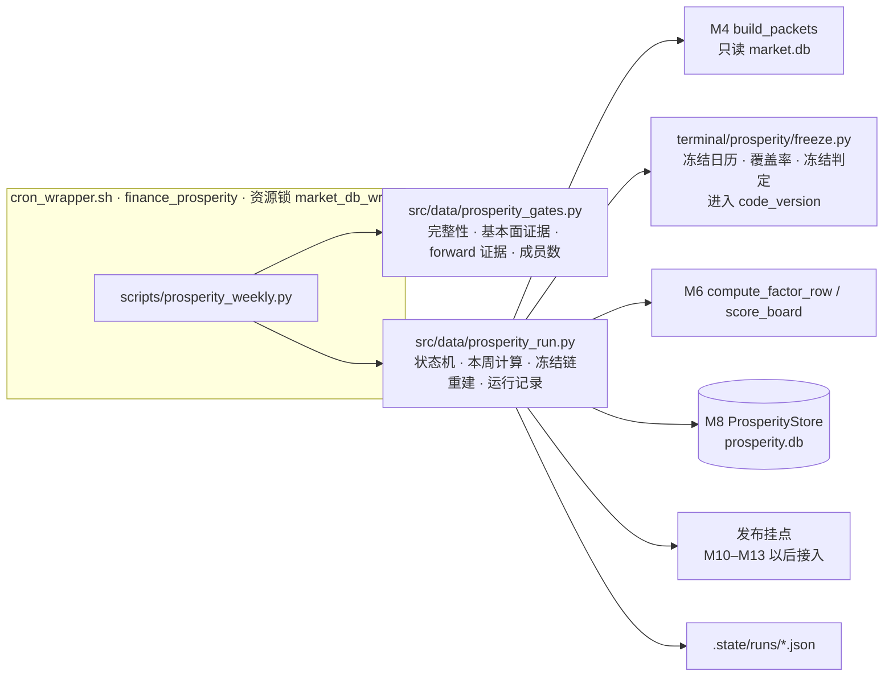
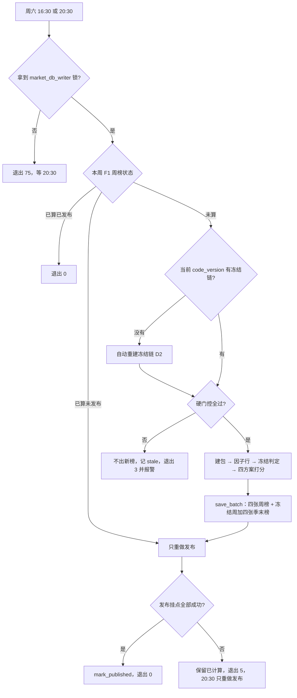

# 景气引擎 M9 周更调度、季末冻结与历史回放 Implementation Plan

**状态：2026-10-24 Boss 批准 D1–D4；同日按三轮审查修订（第一轮见 §14；第二轮见 §15；第三轮 1 项 P2 见 §16，Boss 已授权直接修订）。D5 已于同日定为 B + A，Task 8 已实现（未提交）。Boss 已授权实现 T0–T6。T0–T5 代码与合成测试已完成，T6 历史重建与独立验证已通过，本周 live（A8）等待基本面刷新；未提交、未部署。**

**Goal:** 让景气引擎每周六在云端自动算出四方案周榜，按规则冻结季末榜，并能用同一流程重建历史冻结榜。
**Architecture:** 纯规则（冻结日历、覆盖率判断）放进内核包，进入 `code_version`；门控与编排放 `src/data/`，不进入 `code_version`。CLI 由 `cron_wrapper.sh` 调起，所有写入只经 M8 `ProsperityStore.save_batch`。发布阶段只留挂点，M10–M13 再接产物。
**Tech Stack:** Python 3.10 标准库、现有 M4/M6/M8 接口、bash + flock、pytest。不引入调度框架。
**Spec:** `docs/design/prosperity-engine-north-star.md` 第三层（"周更流程""季末冻结""历史重建与方案上线""失败隔离与数据量"）、模块表 #10。
**北极星对齐:** 主北极星第二层「分析层 · 基本面」；景气北极星第三层。完成 R7，支撑 R11、R14、R15。
**基线:** main `9f229c71`（含 M8）；分支 `prosperity/m9-scheduler`，worktree `.worktrees/prosperity-m9`。2026-10-24 核对代码与云端。

## 1. Boss 决定（2026-10-24，均按推荐）

| # | 问题 | 决定 | 理由 |
|---|---|---|---|
| D1 | 历史回放存多少 | 只重建**冻结链**：每季只在候选周六（第 60 天起，到第 80 天或之后的第一个周六为止）算覆盖率，只存冻结那一周（周榜 + 季末榜）。不按北极星原文存 268 周 | 见 §2。北极星第三层"历史重建"一句在 T6 同步改写 |
| D2 | `code_version` 变了（云端每天 06:25 自动 pull）怎么办 | 周更先自动重建新版本的冻结链，再算本周 | 停更等人工会让每次改 `market_store.py` 都卡住周更；冷启动会让周榜换口径 |
| D3 | forward 软门控 | 内核按北极星改：快照距 as_of 不足 7 天，算本周快照，正常用；7–14 天（沿用上一周或上两周），挂 `forward_stale`；超过 14 天记缺失。本周快照没完成就沿用上周的，这时正好 7 天，会挂徽章 | 漏一周 forward 不该让预期族直接消失。改内核会换 `code_version`，所以 Task 0 排在任何回放之前 |
| D4 | live 周更怎么读到一致的 `market.db` | 全程持 `market_db_writer` 锁，直接只读 live 库 | 周六 16:30 后没有其他写库任务；每周拷快照要多写 1.4G，云端只剩 12G |

| D5 | 旧 `code_version` 的冻结链怎么控制体积 | **B + A**。B：云端只保留两个版本，即当前版本和上一个写过 live 周榜的版本。更早的版本先导出到本地并校验，Boss 确认后才从云端移除。A：备份改为 gzip。不采用 C | 实测 0.307 GB 结果库 gzip 后 84.5 MB（27.5%）。只做 A 每年仍增约 13.5 GB；B + A 让云端稳定在约 3 GB。C 收窄哈希范围后，未纳入哈希的改动会静默沿用旧冻结参数，属于 fails-open。下游 M10–M12 只读当前版本 |

D5 选项原文（2026-10-24 Boss 定 B + A）：A. 旧版本留云端，备份 gzip；B. 云端只留当前和上一个版本，更早的导出到本地后从云端移除，需要改 M8 契约；C. 收窄 `code_version` 覆盖范围，需要改 M5 版本规则。

## 2. 实测依据（2026-10-24）

- **回放耗时**：M8 真实回放冒烟（2024-08-17，817 只）建包 12.8s，写库 21.0s。268 周全量约 2.5–3 小时，不是北极星写的"十几分钟"。云端只有 2 核 3G 内存，可能更慢。
- **回放体积**：每周约 10–12 MB（M8 实测）。268 周约 **3.2 GB**。周更备份留 2 份，全量方案总计约 9.6 GB。云端剩余空间 **12G**（`df -h /`，35G/49G）。
- **版本变动频率**：`code_version` 覆盖 `market_store.py`、`config/settings.py` 等共享文件。2026-09 这些文件有 55 次提交。版本一变，旧冻结参数就不能用（`kernel.py:186` 校验 `params_code_mismatch`）。全量方案下，每次变动都要再花 3 小时、再加 3.2 GB，旧版本永不删除。
- **下游实际需要什么**：M10 精选池只读最新周榜。M11 网页读最新周榜和各季末榜。M12 体检报告的分层收益、IC、对照组都按季末榜算。没有下游需要历史周榜（M12 的"周榜换手率"可从上线后的 live 周榜开始算）。
- **版本变动按周计**：2026-08-01 起，`market_store.py` 有 26 次提交，分布在 6 个不同的周；景气包 29 次提交集中在 1 周。约每 2 周出一个新 `code_version`，即每年约 26 个。
- **容量（修订）**：M8 输入去重键含 `code_version`，版本之间不共享存档。本次实测每个版本的21季冻结链约 0.307 GB；按当前规模，每年约 26 × 0.307 + 0.69 ≈ 8.7 GB。乘以库本体加 2 份备份的 3 倍，每年约 **26 GB**，还没算 WAL 和临时快照。最坏情况（每周一个版本）约 50 GB。云端剩余 12G，所以必须做剩余空间检查（§8.3），并在部署前定 D5。
- **forward 快照写入方式**：云端 `fmp_forward_runs` 2026-10-24 状态为 `running`、`completed_at` 为空，但 `fmp_estimates` 已有 9,107 行 `snapshot_date=2026-10-24`。也就是说，运行还没完成，部分快照已经入库。`loader.py:50` 读取全部 weekly 行，`consensus.py:90` 取最新日期，所以未完成的快照会被用于打分。
- **候选周六**：第 80 天不一定是周六。2026Q2 的候选周六是第 60、67、74、81 天（8-29、9-05、9-12、9-19）；2026Q3 是第 66、73、80 天（12-05、12-12、12-19）。所以每季 3–4 个候选周。
- **冻结链规模（D1）**：2021Q2–2026Q2 共 21 季。每季 3–4 个候选周六，只建包算覆盖率，不打分。只在冻结周打分并存库。本次实测 21 次八榜存库、1271.15 秒（缓存优化前）、307,412,992 bytes。明细见 `reports/prosperity/m9-scheduler-20261024/history.json`。
- **上游门控证据**：基本面每周 `rc=1` 结束但数据已更新（`logs/cron_fundamental.log` 10-17 `FAIL rc=1`，同时 Premium 已发布）。质量报告 `data/quality/fundamentals-<UTC>.json` 有 `after.as_of` 与 `after.coverage.fundamental_ready.ratio`（10-17 为 0.960）。forward 有 `market.db:fmp_forward_runs`（`snapshot_date`、`status`，10-17 为 `complete`）。
- **锁**：`finance_fundamental` 与 `finance_forward` 已用 `FINANCE_CRON_RESOURCE_KEY=market_db_writer` + `LOCK_BUSY_RC=75`。`finance_market_data`（周二至周六 06:30）写 `market.db` 但不拿这把锁，所以手动回放要避开 06:00–08:30。

## 3. 架构图



依赖方向：编排依赖内核和存储；内核不导入编排；存储不读 `market.db`。

## 4. 业务流程图



## 5. 替代方案

| 方案 | 优点 | 缺点 | 结论 |
|---|---|---|---|
| A. 新 CLI + 小编排模块，cron_wrapper 调起 | 复用现有锁、日志、报警；可单测 | 多两个文件 | 推荐 |
| B. 扩展 `scripts/prosperity_score.py` | 少一个入口 | 那是只读验收 CLI，输出 JSONL；混入写库和状态会改它的契约 | 不选 |
| C. 通用调度器 / DAG | 可视化 | 北极星明确不做 DAG；维护负担 | 不选 |

冻结规则放内核包还是编排层：冻结日期决定季末参数包，进而决定之后每周的分数。放编排层时改规则不换 `code_version`，旧冻结榜会和新规则冲突（M8 每季每版本只允许一份季末榜）。所以放内核包。门控只决定"算不算"，不改分数，放编排层。

## 6. 风险自证

| 风险 | 处理 |
|---|---|
| 冻结判定偷看未来 | 覆盖率只用当周点时输入包。`frozen_at` 不再固定写 16:30，改记输入实际可知的截止时刻（§8.1）：live 记开始读库的时刻，replay 记 M4 的 vintage 截止（as_of 次日 00:00Z）。M8 写入路径已校验"冻结参数在榜单日期已生效" |
| 门控查询失败被当成通过（2026-07-29 earnings gate 教训） | 每项门控三态：通过 / 不通过 / 无法判断；后两者都不出新榜，原因写进运行记录 |
| 冻结周的周榜挂 `params_bootstrap` 徽章 | 现内核 `boot = frozen is None`（`kernel.py:350`），M8 也要求两者一致。冻结周按设计用当周截面重估参数，所以徽章含义是"参数取自本周截面"。不改内核；M11 网页按此解释显示 |
| 自动重建冻结链拖长持锁 | 冻结链估算 30–60 分钟；周六 16:30 后无其他写库任务。超过 2 小时就中止、记 stale、报警（数字在 T6 实测后定） |
| 回放内存超出云端 3G | `build_packets` 的 history 缓存只在本季未达标候选之间复用；决定冻结后、准备八榜前释放。原全链峰值 2.50 GiB；优化后933只最大季度复测峰值1.65 GiB，八榜业务内容一致 |
| 发布挂点为空时误标"已发布" | 没有注册任何发布步骤时不调用 `mark_published`，运行记录写 `publication_not_configured` |
| 并发初始化新库（M8 遗留） | cron 与手动运行都走 `cron_wrapper.sh finance_prosperity`，共用一把 job 锁 |
| 磁盘 | 每年约 26 GB（§2 修订），超过云端剩余 12G。处理：重建与备份前检查剩余空间（§8.3），不够就不写、退出 6、报警；部署前要求 Task 8（D5 = B + A）完成且剩余空间 ≥ 8G。另：云端现有 6 份 `market.db` 备份共约 8 GB（含 4 份手动快照），清理需 Boss 逐份确认，不在本计划范围 |
| 未完成的 forward 快照被用于打分 | 只用 `fmp_forward_runs` 中 `status=complete` 且完成时刻 ≤ 输入截止的快照（§8.1 forward 规则），再按 D3 判断年龄 |
| 残缺截面写成不可覆盖的季末榜 | 写任何榜之前都过输入健康检查（§8.3），重建和 live 共用同一套规则 |

为什么不更简单：不能只在周六跑一个脚本就完事。上游退出码不可信（§2），发布会失败需要能单独重做，`code_version` 又会频繁变化。这三点各需要一个机制，本计划只加这三个。

## 7. 文件结构

```text
terminal/prosperity/freeze.py        新建（进入 code_version）：冻结日历、覆盖率、冻结判定，纯函数
terminal/prosperity/config.py        修改：FREEZE_START_DAYS=60、FREEZE_FORCE_DAYS=80、FREEZE_COVERAGE=0.95、FORWARD_STALE_DAYS=14
terminal/prosperity/loader.py        修改（P1-1）：:50 读 forward 快照时联查 fmp_forward_runs，带上运行状态与完成时刻
terminal/prosperity/consensus.py     修改（D3、P1-1）：:90-98 与 :218 build_consensus 增加 cutoff 参数；先按完成时刻筛快照，再分档判断过期；返回值带 forward_stale
terminal/prosperity/types.py         修改（R2-3）：ConsensusInputs 增加 forward_stale: bool
terminal/prosperity/packet.py        修改（R2-3）：:71 build_packet 增加 cutoff 参数并传给 :83 build_consensus；:96-101 consensus.forward_stale 为真时加进 packet.flags
terminal/prosperity/inputs.py        修改（R2-3）：build_packets 增加 cutoff 参数，原样传给 build_packet
terminal/prosperity/kernel.py        修改（P2-6）：score_board 把 packet 的 forward_stale 透传成榜单徽章
src/data/prosperity_gates.py         新建：四项门控，三态结果
src/data/prosperity_run.py           新建：本周计算、冻结链重建、状态机、发布挂点、运行记录
scripts/prosperity_weekly.py         新建：CLI 与退出码
scripts/run_prosperity.sh            新建：cron 入口，计算前后备份 prosperity.db（保留 2 份）
sync_to_cloud.sh                     修改：--pull 增加 prosperity.db 一致快照下载（沿用 market.db 的快照 + sha256 + quick_check 做法）
tests/test_prosperity_freeze.py      新建
tests/test_prosperity_gates.py       新建
tests/test_prosperity_run.py         新建
docs/runbooks/prosperity-weekly.md   新建：运行、补跑、回放、恢复
docs/design/prosperity-engine-north-star.md  修改：D1/D3 结论与 M9 完成度
```

不改：M8 存储代码与 schema、`scripts/prosperity_score.py`、Premium 周更、晨报。

## 8. 契约

### 8.1 冻结规则（`terminal/prosperity/freeze.py`）

```python
def quarter_of(label: str) -> Tuple[date, date]: ...          # "2026Q3" → (季初, 季末)
def candidate_saturdays(label: str) -> Tuple[str, ...]: ...
    # 季末 +60 天起的每个周六，到第 80 天或之后的第一个周六为止（含）；每季 3–4 个
def due_quarter(as_of: str, frozen_labels: Collection[str]) -> Optional[str]: ...
    # as_of ≥ 该季第一个候选周六、且本版本尚未冻结的最早季度；没有则 None
def freeze_coverage(rows: Sequence[FactorRow], packets: Mapping[str, InputPacket],
                    scheme: Scheme, label: str) -> Tuple[float, int, int]: ...
    # 分母：F1 可排名行（kernel.rankable）；分子：packet.quarter_bucket ≥ label 的行
def freeze_decision(as_of: str, label: str, coverage: float) -> Optional[str]: ...
    # 季末+60 天起 coverage ≥ 0.95 → "coverage"；as_of ≥ 季末+80 天 → "forced"（第 80 天不是周六时，
    # 就是之后的第一个周六）；否则 None
```

- 季度按自然季。`quarter_bucket` 沿用 `packet.py:37`（财季日期前移 7 天再归季）。
- 四方案同一周一起冻结，覆盖率只按 F1 算。理由：一周一份输入（M8 `input_set`），季末榜要能横向比较。
- **输入截止时刻 `cutoff`**（P2-4）：live = 开始读库的 UTC 时刻（即 `observed_at`）；replay = as_of 次日 00:00Z，与 M4 `statements.py:68` 的 vintage 截止一致。20:30 才首次算成的周，`cutoff` 就是 20:30，不倒填 16:30。replay 要求 `cutoff ≤ 计算时刻`，否则拒绝（M8 `prosperity_storage.py:310` 的 `freeze_after_computation` 也会拦）；所以 replay 只能算已经过去的周六（§8.3 replay 入口限制）。
- 冻结周：四方案都 `score_board(frozen=None)`；存四张周榜 + 四张季末榜，`quarter_label` 为该季，`frozen_at = cutoff`。
- 非冻结周：每个方案用 `store.get_frozen_params(scheme_hash, code_version, as_of, effective_at=cutoff)`。replay 下上一季的 `frozen_at` 是某个周日 00:00Z，早于下一个周六，满足 M8 "frozen_at 日期 ≤ 榜单 as_of"。
- **forward 快照规则**（P1-1，进入 `code_version`）：
  1. 合格快照 = `fmp_forward_runs` 中 `run_kind='weekly'`、`status='complete'`、`completed_at ≤ cutoff` 的 `snapshot_date`。`running`、`failed` 和截止后才完成的快照一律不用。
  2. 在合格快照里取 ≤ as_of 的最新一份，再按 D3 判断年龄（as_of − snapshot_date，单位天）：0–6 天正常；7–14 天挂 `forward_stale`；超过 14 天记 `snapshot_stale` 缺失。快照都在周六，所以本周快照没完成就沿用上周的，这时正好 7 天，会挂徽章（A11）。
  3. `cutoff` 由 `build_packets → build_packet → build_consensus` 一路传下去；`consensus.forward_stale` 由 `build_packet` 写进 `packet.flags`，再由 `compute_factor_row` 复制到 `FactorRow.packet_flags`，最后由 `score_board` 变成榜单徽章。
  4. `fmp_forward_runs` 读失败或为空：预期族记缺失，原因 `forward_runs_unavailable`，不退回"取最新日期"。
  5. 历史快照 2026-07-13 至 2026-10-17 共 15 份，云端核对均为 `complete`，所以历史回放结果不受影响，只是 `code_version` 会变。

### 8.2 门控（`src/data/prosperity_gates.py`）

```python
@dataclass(frozen=True)
class GateResult:
    name: str
    status: str            # pass | fail | unknown
    detail: Mapping[str, Any]

def integrity(market_db: Path) -> GateResult: ...             # PRAGMA quick_check == "ok"
def fundamental_refreshed(quality_dir: Path, saturday: str, cutoff: datetime) -> GateResult: ...
    # 有一份 fundamentals-*.json：after.as_of 的 CST 日期 = 本周六，after.as_of ≤ cutoff，且 fundamental_ready.ratio ≥ 0.90
    # 报告完成时刻晚于 cutoff：结果为 fail，原因 report_after_snapshot（读库时刷新还没完成，不能用之后的报告替它证明）
    # 不看 exit_code/status（上游常年 rc=1）
def forward_state(store: MarketStore, saturday: str) -> GateResult: ...
    # 只写运行记录：本周 run 的 status 与完成时刻；实际用哪份快照由 §8.1 forward 规则决定
def member_floor(ranked_now: int, previous_ranked: Optional[int]) -> GateResult: ...
    # 上一份已存 F1 榜（周榜或季末榜，任一版本）的 ranked 数 × 0.90；没有上一份 → pass 并记 no_previous
```

硬门控 = integrity、fundamental_refreshed、member_floor。任一为 fail 或 unknown，本周不出新榜。forward 只写运行记录，实际处理在内核（D3、§8.1）。

**输入健康检查**（P2-3，写任何榜之前执行，live 与冻结链重建共用）：

```python
def input_health(meta: Mapping[str, Any], rows: Sequence[FactorRow], f1_ranked: int,
                 previous_ranked: Optional[int]) -> GateResult: ...
```

- `members_resolved > 0`，否则 fail。
- 建包与因子行错误合计 ≤ 成员数的 1%，否则 fail，列出代码与原因。M8 真实冒烟两次都是 0 错误（915 只、817 只），1% 约 9 只。
- F1 可排名数 > 0，且覆盖率分母 > 0，否则 fail。
- `member_floor`：live 对比上一份已存 F1 榜；重建对比本链上一季的季末榜。
- 重建中任一季 fail：该季及之后都不写，退出 6，运行记录列出原因。已写的季末榜不受影响。

### 8.3 运行入口（`src/data/prosperity_run.py`）

```python
def run_week(*, saturday: str, mode: str, market: MarketStore, store: ProsperityStore,
             quality_dir: Path, publishers: Sequence[Callable[[Tuple[BoardKey, ...]], None]],
             now: Callable[[], datetime]) -> RunOutcome: ...
def rebuild_freeze_chain(*, market: MarketStore, store: ProsperityStore, through: str,
                         start_quarter: str = "2021Q2") -> ChainOutcome: ...
```

- `mode="live"` 只允许 `saturday` 为本周六（CST）；`observed_at` = 开始读库的 UTC 时刻，CLI 可用 `--observed-at` 覆盖（只用于 T6 本地验收，见 §8.4）。M4 与 M8 都要求它的日期 ≤ as_of，所以周日补跑本周会被拒绝，按"漏一周"处理。
- 其他 as_of 一律 `mode="replay"`，只写库、不发布，不碰池文件和网页。
- **replay 入口限制**（R2-2）：所有 replay 入口（`--as-of`、`--rebuild-chain --through`、live 内部的自动重建）都只接受早于本周六的日期，即 as_of ≤ 本周六 − 7 天，并且 `cutoff ≤ 计算时刻`。本周键只留给 live 写。不满足就报参数错误，退出 4。原因有两个：非冻结周如果先由 replay 写了本周榜，live 会按"已算未发布"把 replay 榜直接发布出去；冻结周的 replay 截止是次日 00:00Z，晚于计算时刻，会被 M8 拒绝。
- `rebuild_freeze_chain` 按季推进，每季按 §8.1 `candidate_saturdays` 逐个周六评估（只评估 ≤ through 的），直到冻结。只有冻结周打分存库。已存在的季末榜跳过（M8 同键同内容幂等）。
- **live 自动重建的边界**（P1-2）：`run_week(mode="live")` 每次都先调重建，`through` = 本周六 − 7 天。本周是否冻结只由门控之后的 live 流程决定。原因：M8 内容哈希含 `mode` 和 `source_evidence`，replay 先写本周键，live 再写同键会报 `board_content_conflict`。
- **冻结链完整性**（R2-1，替代第一轮"已过第 80 天"的标准）：对截至 `through`、已经有候选周六 ≤ through 的每个季度，必须满足下面一条：
  1. 该季已有本版本的季末榜；或者
  2. 该季每个 ≤ through 的候选周六都已评估过且未达标。

  "已评估且未达标"的证据有两种：本版本该周已有 live 周榜且没有同季季末榜；或者已有通过输入健康检查、完整且校验有效的候选记录，判定为未达标。恢复时复用首次完成的证据，不再读取今日数据重判这个候选周。只有从未完成评估的候选周才允许 replay。
  **第三轮修正（R3-1）**：strict vintage 只约束三表，证券资格、earnings、profile 等仍可改变。同一 `code_version / as_of` 不保证输入相同，不能用它代替输入一致性检查。
  候选记录保存在结果库旁的 `<db_path>.state/candidates/`，生产库和研究库各自隔离。键为 `code_version + 四方案 scheme_hash 集合 + quarter_label + as_of`。记录包含 schema_version、原始 mode/cutoff/source_evidence、健康检查、分母代码与 quarter_bucket、覆盖率及判定；用现有 `canonical`（`prosperity_storage.py:89`）序列化并保存校验值。临时文件写完并同步后原子发布，同键已完成记录不可覆盖。文件损坏、键或校验值不符时退出 6，不能当作缺记录重新计算。
  **写入顺序与中断恢复**：
  1. 输入健康检查未过：只记本次失败，不产生“已评估”证据。
  2. 未达标：先原子保存候选记录，再继续下一周。源数据以后修正也不改该候选周的已完成结论。
  3. 达标或强制冻结：先准备并校验完整八榜，候选记录中保存各 `BoardKey` 的 M8 `content_hash`（`prosperity_storage.py:418`）与原始审计元数据，再调用 `save_batch`。八榜提交成功后，数据库中的季末榜即为完成依据。
  4. 达标记录存在但八榜未提交：恢复只处理这个候选周。重新准备八榜时沿用原 mode/cutoff/source_evidence，逐榜核对原内容哈希；全部一致才补写。输入已变则退出 6，原因 `recovery_input_changed`，保留证据并报告所需原始来源，不顺延冻结日，不覆盖记录，也不跳到下一季。`content_hash` 已排除 computed_at/git_sha；其余审计字段沿用首次记录，避免仅因重试时钟不同产生假冲突。
  例：8-29 首次完整评估为 94/100，后来两只未到季度的股票失去证券资格，今日重算虽会变成 94/98，恢复仍复用 8-29 未达标证据。若 8-29 已达标但入库前中断，则用原八榜内容哈希约束恢复；原输入不可恢复时显式停止。
  A6 的保证是：已完成评估的结论不变；未提交八榜在输入一致时恢复出相同业务内容，实际 computed_at/git_sha 保留各次真实值。首次完成证据之前发生的中断不宣称已有固定结果。
- **剩余空间检查**（P2-5）：重建、每周写库和备份之前都检查。剩余空间 < max(2 GB, 3 × 当前 `prosperity.db` 大小) 就不写，退出 6，报警。
- **候选周证据**（P2-8、R3-1）：重建和 live 在每个候选周六（§8.1 `candidate_saturdays`，含第 80 天之后的强制周）保存上述不可覆盖的候选记录；运行记录引用其路径和校验值。A9 读取候选记录，不把失败尝试当成完成证据。约 900 只 × 4 周 × 21 季，几 MB，只写 JSON，不进库。状态目录属于恢复所需数据，须与结果库一同备份、拉取和恢复；恢复副本不得混用另一研究库的证据。
- 名称：`names` 取 `security_master` 当前名称，`source_evidence.profile_observed_at` 记读取时刻（M8 契约 7.3：显示快照，不宣称点时）。
- 运行记录：每次尝试写一个 JSON（`<db_path>.state/runs/<as_of>-<unique_id>.json`），含 code_version、各门控三态、冻结判定与覆盖率、写入的 BoardKey、耗时、退出码。不新建数据库表（M8 schema v1 拒绝未知结构）。

### 8.4 CLI 与退出码（`scripts/prosperity_weekly.py`）

```text
--live                     本周六周更（cron 用）
--observed-at ISO-UTC      仅与 --live 同用：指定读库快照的时刻（T6 本地验收用）；必须带时区、不晚于当前时刻、CST 日期等于本周六
--as-of YYYY-MM-DD         补跑某个已过去的周六，只写库；必须 ≤ 本周六 − 7 天
--rebuild-chain [--through YYYY-MM-DD]   重建当前 code_version 的冻结链；through 默认且最大为本周六 − 7 天
--db PATH                  必填，显式指定 prosperity.db 或 prosperity_research.db
--market-db PATH           默认 data/market.db
--quality-dir PATH         默认 data/quality（本地验收时显式指定从云端取回的报告目录）
```

| 退出码 | 含义 |
|---|---|
| 0 | 已算已发布，或已算且发布挂点为空 |
| 3 | 硬门控或输入健康检查未过，未出新榜（stale） |
| 4 | 参数错误 |
| 5 | 已算，发布失败（20:30 只重做发布） |
| 6 | 冻结链重建失败、超时或剩余空间不足 |
| 75 | 锁忙（由 cron_wrapper 返回） |

cron 两条（CST，`CRON_TZ=Asia/Shanghai`）：

```cron
30 16 * * 6 FINANCE_CRON_RESOURCE_KEY=market_db_writer FINANCE_CRON_LOCK_BUSY_RC=75 /root/workspace/Finance/scripts/cron_wrapper.sh finance_prosperity cron_prosperity.log /root/workspace/Finance/scripts/run_prosperity.sh
30 20 * * 6 FINANCE_CRON_RESOURCE_KEY=market_db_writer FINANCE_CRON_LOCK_BUSY_RC=75 /root/workspace/Finance/scripts/cron_wrapper.sh finance_prosperity cron_prosperity.log /root/workspace/Finance/scripts/run_prosperity.sh
```

## 9. 验收标准

| 编号 | Boss 能看到的结果 | 任务 |
|---|---|---|
| A1 | 给定季末与覆盖率序列，冻结日期与手算一致：第 60 天前不冻结；≥95% 的第一个周六冻结；第 80 天或之后第一个周六强制并记实际覆盖率（2026Q2 强制周是 9-19 第 81 天） | T1 |
| A2 | 任一硬门控查询报错、文件缺失或字段缺失时，结果是 unknown，本周不出新榜 | T2 |
| A3 | 16:30 已算、发布失败 → 20:30 不重算，只重做发布；已发布 → 直接退出 0 | T3 |
| A4 | `--as-of` 历史周只写库；池文件、发布挂点都未被调用 | T3 |
| A5 | 换一个 code_version 后，周更先重建到上周的冻结链，再用新链的参数打分；旧版本榜单行数不变；版本切换恰逢冻结周时，本周键只由 live 写入，不报冲突 | T4 |
| A6 | 冻结链中断后复用已完成候选证据；待提交八榜的内容哈希一致时补写，业务内容与原准备结果相同（computed_at/git_sha 保留实际审计值）；源数据已变则 `recovery_input_changed` 退出 6，不改变冻结日 | T4 |
| A7 | 真实数据：本地只读重建 2021Q2–2026Q2 冻结链，列出每季冻结日、冻结方式、覆盖率；耗时、峰值内存、库体积有数 | T6 |
| A8 | 真实数据：在某个周六基本面刷新完成后，先取质量报告，再拉 market.db 快照，用 `--observed-at` 跑一次 live；报告完成时刻早于快照时刻；四方案周榜存库，读回与内存相同 | T6 |
| A9 | 独立核对：不 import 冻结模块，用运行记录里全部候选周的证据重算 21 季的覆盖率与首次达标日，结果与库里的冻结日一致；另抽 3 季各 20 只，直接查 SQL 核对 `quarter_bucket` | T6 |
| A10 | 云端首个自然周六：16:30 日志 OK，`prosperity.db` 有本周四张周榜，备份 ≤2 份 | T7 |
| A11 | 本周 forward 运行为 running 或 failed、上周为 complete 时，打分用上周快照（7 天）并挂 `forward_stale`；从真实 `build_packets` 入口走到最终 `ScoredRow.badges` 都能看到这个徽章 | T0 |
| A15 | 本周或未来的 `--as-of`、`--rebuild-chain --through` 被拒绝（退出 4），生产库里本周键只有 live 写入 | T5 |
| A16 | 质量报告完成时刻晚于读库截止时，基本面门控为 fail（`report_after_snapshot`） | T2 |
| A12 | 建包错误超过 1%、F1 可排名数为 0 或分母为 0 时，不写任何榜；冻结链停在该季 | T2、T4 |
| A13 | 20:30 首次算成的冻结周，`frozen_at` 是 20:30 的实际时刻；replay 冻结周的 `frozen_at` 是 as_of 次日 00:00Z | T3、T4 |
| A14 | 剩余空间不足时，不写库、不备份，退出 6 | T5 |
| A17 | 候选周已记录 94/100 未达标后，即使证券资格变更使今日重算成为 94/98，恢复仍复用原结论；损坏、错版本或错方案证据不被使用，生产/研究状态隔离 | T4、T5 |
| A18 | 备份为 gzip，解压后 `quick_check` 通过，sha256 与备份时的 sqlite backup 副本一致；候选状态目录在同一备份集合内；保留最新 2 份 | T8 |
| A19 | 归档导出只含指定版本：导出库各表按版本计行数，与源库同版本行数完全相等；源库其他版本行数不变；导出库能被 M8 正常读回各榜，`content_hash` 与源库一致 | T8 |
| A20 | 移除入口只接受已通过本地校验的归档清单（版本、各表行数、导出库 sha256）；清单缺失或不符时退出 4，不动库。拒绝移除当前版本和上一个 live 版本。移除后两个保留版本的榜单与 `content_hash` 不变，`quick_check` 通过 | T8 |
| A21 | 云端没有任何自动执行的移除路径；剩余空间低于阈值时只报警，提示可归档的版本和预计释放空间 | T8 |

## 10. 实施任务（默认主线程 inline，每任务一个检查点）

### Task 0（D3、P1-1、P2-6）：forward 只用已完成快照、两档过期、徽章透传

**Files:** Modify `terminal/prosperity/config.py`、`terminal/prosperity/loader.py:50-52`、`terminal/prosperity/consensus.py:84-98,218-236`、`terminal/prosperity/types.py`（`ConsensusInputs`）、`terminal/prosperity/packet.py:71-101`、`terminal/prosperity/inputs.py:16`、`terminal/prosperity/kernel.py:330`（`score_board` 初始化 badges 处），以及 `build_consensus` / `build_packet` / `build_packets` 的现有调用方（`scripts/prosperity_score.py`、S1 工具和测试；实施前 grep 列全）；Test `tests/test_prosperity_consensus.py`、`tests/test_prosperity_loader.py`、`tests/test_prosperity_packet.py`、`tests/test_prosperity_kernel.py`。

`cutoff` 是必填关键字参数，不设默认值，避免漏传时退回"取最新快照"。replay 调用方传 as_of 次日 00:00Z；live 调用方传 `observed_at`。

- [x] Step 1：失败测试：
  - consensus：合格快照 6 天前 → 正常无徽章；7 天前 → 可用且 `forward_stale=True`；14 天前 → 可用且 stale；15 天前 → `snapshot_stale` 缺失。
  - consensus：本周快照对应的运行为 `running` / `failed` / `completed_at` 晚于 cutoff，上周 `complete` → 选上周快照，`forward_stale=True`。
  - loader：临时库里放两份快照，一份 complete、一份 failed → 读出两份及各自状态与完成时刻；`fmp_forward_runs` 为空 → 预期族缺失，原因 `forward_runs_unavailable`。
  - 端到端（A11）：用 `tests/test_prosperity_loader.py` 的 `seed_db` 建临时 market.db，写入 10-17 complete、10-24 running 两份快照，调用真实的 `build_packets(..., cutoff=...)` → `compute_factor_row` → `score_board`，断言 `packet.flags`、`FactorRow.packet_flags` 和 `ScoredRow.badges` 三处都有 `forward_stale`，且所用快照是 10-17。
- [x] Step 2：跑，确认上述用例按预期原因失败。
- [x] Step 3：loader 联查 `fmp_forward_runs`；consensus 按 §8.1 forward 规则选快照并返回 `forward_stale`；packet 把它写进 flags；inputs 传 cutoff；kernel 在 badges 初始化时，若 `"forward_stale" in row.packet_flags` 就加上该徽章。
- [x] Step 4：景气全套测试通过；记录新旧 `code_version`。
- [ ] Step 5：检查点。commit 需授权：`feat(prosperity): use completed forward snapshots and tolerate one missed week`。

### Task 1：冻结规则纯函数

**Files:** Create `terminal/prosperity/freeze.py`；Modify `terminal/prosperity/config.py`；Test `tests/test_prosperity_freeze.py`。

- [x] Step 1：失败测试：

```python
def test_freeze_window_for_2026q3():
    assert freeze_decision("2026-11-28", "2026Q3", 0.99) is None        # 第 59 天
    assert freeze_decision("2026-12-05", "2026Q3", 0.94) is None
    assert freeze_decision("2026-12-05", "2026Q3", 0.95) == "coverage"
    assert freeze_decision("2026-12-19", "2026Q3", 0.40) == "forced"    # 第 80 天

def test_forced_freeze_falls_on_the_first_saturday_after_day_80():
    assert candidate_saturdays("2026Q2") == ("2026-08-29", "2026-09-05", "2026-09-12", "2026-09-19")
    assert freeze_decision("2026-09-12", "2026Q2", 0.40) is None         # 第 74 天
    assert freeze_decision("2026-09-19", "2026Q2", 0.40) == "forced"     # 第 81 天
    assert candidate_saturdays("2026Q3") == ("2026-12-05", "2026-12-12", "2026-12-19")

def test_due_quarter_skips_frozen():
    frozen = set(quarter_labels("2021Q2", "2026Q2"))
    assert due_quarter("2026-12-05", frozen) == "2026Q3"
    assert due_quarter("2026-12-05", frozen | {"2026Q3"}) is None
```

- [x] Step 2：跑，确认因模块不存在而失败。
- [x] Step 3：实现 §8.1；补覆盖率分母只含 F1 可排名行、`quarter_bucket` 为 None 计入分母不计入分子、跨年季度、漏冻结的旧季度先于新季度。
- [x] Step 4：`pytest tests/test_prosperity_freeze.py tests/test_prosperity_schemes.py -q` 通过（后者检查 code_version 覆盖范围）。
- [ ] Step 5：检查点。commit：`feat(prosperity-m9): quarter freeze calendar and coverage rule`。

### Task 2：门控

**Files:** Create `src/data/prosperity_gates.py`；Test `tests/test_prosperity_gates.py`。

- [x] Step 1：失败测试：质量报告 `exit_code=1` 但日期对、ratio 0.96、完成时刻早于 cutoff → pass；完成时刻晚于 cutoff → fail，原因 `report_after_snapshot`（A16）；日期是上周 → fail；文件损坏 / 缺 `after` → unknown；`quick_check` 抛错 → unknown；ranked 800 vs 上周 900 → fail（< 810）。`input_health`：成员 0 → fail；100 只中 2 只建包失败 → fail；F1 可排名 0 → fail；1 只失败 → pass 并列出代码。
- [x] Step 2：跑，确认失败。
- [x] Step 3：实现 §8.2，含 `input_health`。质量报告时间按 `after.as_of` 的 UTC 时刻换成 CST 日期再比较。
- [x] Step 4：通过。
- [ ] Step 5：检查点。commit：`feat(prosperity-m9): fail-closed weekly gates`。

### Task 3：本周计算与状态机

**Files:** Create `src/data/prosperity_run.py`；Test `tests/test_prosperity_run.py`。

**Interfaces:** Consumes M4 `build_packets`、M6 `compute_factor_row`/`score_board`、M8 `prepare_board`/`save_batch`/`publication_state`/`mark_published`/`get_frozen_params`、T1、T2。测试注入假的建包函数（返回 `tests/prosperity_fixtures.py` 的合成 packet），不读真 `market.db`。

- [x] Step 1：失败测试：
  - 首次运行存四张周榜；再跑一次不重算（计数器验证建包未被调用）。
  - 发布挂点抛错 → 退出 5、已计算、未发布；再跑只调发布，成功后 `published_at` 有值。
  - 发布挂点为空 → 退出 0、未调用 `mark_published`、运行记录 `publication_not_configured`。
  - 硬门控 fail → 不调 `save_batch`，退出 3。
  - 冻结周 → 同一批 8 张榜；下一周的周榜 `frozen_as_of` 指向它。
  - 冻结周 16:30 锁忙、20:30 首次算成 → `frozen_at` 等于 20:30 那次的 `observed_at`（A13）。
  - 输入健康检查 fail → 不调 `save_batch`，退出 3（A12）。
  - `--as-of` 历史周 → mode replay，发布挂点从未被调用。
- [x] Step 2：跑，确认失败。
- [x] Step 3：实现 `run_week` 与运行记录。
- [x] Step 4：通过；景气全套通过。
- [ ] Step 5：检查点。commit：`feat(prosperity-m9): weekly run with separate compute and publish states`。

### Task 4：冻结链重建与版本切换

**Files:** Modify `src/data/prosperity_run.py`；Test `tests/test_prosperity_run.py`。

- [x] Step 1：失败测试：
  - 三个合成季度、可控覆盖率 → 季末榜日期与 A1 规则一致，非冻结周不存库；replay 季末榜 `frozen_at` = as_of 次日 00:00Z（A13）。
  - 每个通过健康检查的候选周先原子保存不可覆盖记录，运行记录引用其校验值；失败尝试不成为完成证据（A9 前置）。
  - 第二季存库时注入异常 → 原准备八榜内容哈希已保存；输入不变时重跑补写同一冻结日与业务内容（A6）。
  - 第二季建包错误超过 1% → 第二季及之后不写，第一季保留，退出 6（A12）。
  - 库里只有旧 code_version 的链 → `run_week` 先重建到上周，再打分；旧版本行数不变（A5）。
  - 版本切换恰逢冻结周（本周是某季第 60 天后首个达标周）→ 重建不写本周键；live 写入本周 8 张榜，无 `board_content_conflict`（A5）。
  - 中断后重跑（R2-1、R3-1，A6）：合成季度 8-29 达标，候选记录发布后、save_batch 前注入异常；随后以 9-12 为本周跑 live → 用原审计元数据准备八榜并核对内容哈希，一致才在 8-29 补写冻结，9-12 用该参数，不在 9-12 冻结。
  - 数据修正（A17）：8-29 首次 94/100 未达标并保存记录；再改证券资格为 94/98 → 恢复不调用该周建包函数，保留未达标结论。
  - 待提交输入漂移（A6）：达标记录已保存、八榜未提交；修改 earnings、证券资格或因子输入 → 退出 6 / recovery_input_changed，该季及之后不写，原证据保持不变。
  - 候选记录损坏、校验值不符或身份错配 → fail-closed；临时文件不算完成记录；同键相同记录幂等、不同记录拒绝。备份恢复后仍识别原证据，研究库证据不能进入生产链。
  - live 周榜即证据：8-29 有本版本 live 周榜（未冻结）、9-05 没有 → 只 replay 9-05，不重算 8-29。
  - 10-24 这类日期（上一季还没到第一个候选周六）→ 链判定为完整，不触发评估。
  - 强制周：四个候选周都未达标 → 在 9-19（第 81 天）强制冻结，候选证据含全部 4 周。
  - 重建超时 → 退出 6，本周不出新榜。
- [x] Step 2：跑，确认失败。
- [x] Step 3：实现 `rebuild_freeze_chain` 和候选记录的保存、校验与恢复；复用 M8 `canonical` / `content_hash`，不重写内容哈希逻辑。`run_week` 开头按 §8.3 的完整性标准检查当前版本，需要时重建到上周。
- [x] Step 4：通过。
- [ ] Step 5：检查点。commit：`feat(prosperity-m9): rebuild the freeze chain per code version`。

### Task 5：CLI、cron 入口与备份

**Files:** Create `scripts/prosperity_weekly.py`、`scripts/run_prosperity.sh`；Modify `sync_to_cloud.sh`；Test `tests/test_prosperity_run.py`（CLI 参数与退出码）。

- [x] Step 1：失败测试：`--live` 与 `--as-of` 互斥；缺 `--db` → 4；非周六日期 → 4；`--live` 在非周六运行 → 4；`--as-of` 本周六或未来 → 4；`--rebuild-chain --through` 本周六 → 4（A15）；`--observed-at` 无时区、晚于当前时刻、CST 日期不是本周六，或不与 `--live` 同用 → 4；剩余空间检查注入"不足" → 不写库、不备份、退出 6（A14）。
- [x] Step 2：跑，确认失败。
- [x] Step 3：实现 CLI（含 `--quality-dir`、`--observed-at` 与 replay 日期限制）与剩余空间检查（`shutil.disk_usage`）。`run_prosperity.sh` 写库前用 sqlite backup API 备份 `prosperity.db`，连同其 `.state/candidates/` 保存为同一备份集合，校验后保留最新 2 份。`sync_to_cloud.sh --pull` 增加 prosperity.db 及匹配的候选状态：云端一致快照 → sha256 → 本地 quick_check 与候选记录校验 → 发布匹配副本；不得仅替换库而混用旧状态。先 grep 现有备份实现并复用（`scripts/build_company_concept_registry.py:1428 _backup_sqlite`）。
- [x] Step 4：通过；`bash -n` 两个脚本。
- [ ] Step 5：检查点。commit：`feat(prosperity-m9): weekly CLI, cron entry and backups`。

### Task 6：真实数据验收（本地，只读）

本周 live 验收在某个周六 15:05 CST 之后执行，此时 `finance_fundamental` 已结束（日志在 `logs/cron_fundamental.log`）。原因：live 要求快照的 CST 日期等于本周六，质量报告又必须在快照之前完成。

- [ ] Step 1：先确认 `cron_fundamental.log` 本周已有结束行（OK 或 FAIL rc=1 都算）。从云端只读复制本周的质量报告（`data/quality/fundamentals-<UTC>.json`）到 `/tmp/m9-quality/`，记录源路径、文件时间、`after.as_of` 和 sha256。
- [ ] Step 2：再用 `./sync_to_cloud.sh --pull` 拉 `market.db`，记下云端快照时刻和 sha256，确认报告 `after.as_of` 早于快照时刻。worktree 用 symlink 只读挂载 live 数据（见记忆 `project_worktree_needs_live_data_symlink`）。
- [ ] Step 3：用 `--live --observed-at <快照时刻> --quality-dir /tmp/m9-quality --db /tmp/prosperity_research_m9.db` 跑一次。硬门控照常生效。四方案存库并读回比对（A8）。live 会先自动重建到上周，所以这一步同时产出全链，记录每季冻结日、方式、覆盖率、耗时、峰值 RSS、库体积（A7）。用实测体积复核 §2 的年容量（D5 已定 B + A，见 §1）。
- [x] Step 4：独立核对脚本不 import `freeze.py`：用运行记录所引用、校验有效的全部已完成候选记录，重算 21 季的覆盖率与首次达标日，和库里的冻结日比较；再抽 3 季各 20 只，直接对固定快照查 SQL，核对 `quarter_bucket`（A9）。
- [x] Step 5：`/code-review high`，修复成立的发现；再跑景气全套与全量测试，失败 ID 与基线对照。证据放 `reports/prosperity/m9-scheduler-<日期>/`。更新北极星 D1/D3 与 M9 完成度。


**已完成的历史验收（2026-10-24）**：12:27 UTC+8 拉取后的固定只读快照独立完成21季、168榜读回核对；21季冻结日和60个源库财季日期独立检查通过。最大季度缓存优化复测与原八榜业务内容一致。A8仍需按上面的“报告先、快照后”顺序另取当日刷新完成后的输入，不能用历史验收快照替代。

### Task 8（D5）：gzip 备份与按版本归档

2026-10-24 Boss 授权实现。改 M8 契约：云端 `prosperity.db` 不再保存全部历史，完整历史 = 云端两个保留版本 + 本地归档。历史榜仍不被改写，只换存放位置。同步改写北极星"冻结不可覆盖"一节（`prosperity-engine-north-star.md:152`、`:321`）。

**Files:** Modify `src/data/prosperity_backup.py`；Create `scripts/prosperity_archive.py`；Modify `scripts/prosperity_weekly.py`（报警文案）；Test `tests/test_prosperity_backup.py`、`tests/test_prosperity_archive.py`。

- [x] Step 1：失败测试，覆盖 A18–A21。
- [x] Step 2：跑，确认失败。
- [x] Step 3：实现。
  - 备份：沿用现有 sqlite backup 副本，再 gzip，记录未压缩副本 sha256（A18）。
  - `export --version V --out PATH`：只读源库，把版本 V 的所有行与对应候选记录导出为独立库和清单。
  - `verify --manifest`：在本地副本上按 A19 核对库与状态文件 SHA256、行数和 `content_hash`，通过后在清单里写入本地校验结果。清单自带校验值，手改会被拒绝。
  - `remove --manifest PATH`：校验清单后，在一个事务里删除版本 V 的行，再 `VACUUM`。执行前先做一次完整备份。保留集合由库内 live 周榜推出，不接受手动传入（A20）。
  - 移除不进 cron，每次由 Boss 手动确认后执行（A21）。
- [x] Step 4：通过；景气全套 436 passed。真实 21 季库私有副本冒烟：export 168 s、verify 151 s、remove 156 s，峰值 RSS 约 0.68 GB。
- [ ] Step 5：检查点。commit：`feat(prosperity-m9): gzip backups and per-version archive`。

### Task 7：部署（每一步单独请 Boss 确认）

前提：Task 8 已完成；云端剩余空间 ≥ 8G。

1. merge 到 main 并 push。
2. 云端 git pull 后，手动跑一次 `--rebuild-chain`（避开 06:00–08:30），核对冻结日与本地一致。
3. 安装两条 cron（§8.4），不动其他条目；crontab 先备份。
4. 首个自然周六 16:30 后核对 A10。

## 11. 执行命令

解释器用主工作区 `/Users/owen/CC workspace/Finance/.venv/bin/python`，目录为 M9 worktree。

```bash
python -m pytest tests/test_prosperity_freeze.py tests/test_prosperity_gates.py tests/test_prosperity_run.py -q
python -m pytest tests/test_prosperity_*.py -q
python -m pytest tests/ -q
```

## 12. Global Constraints（原值照抄）

> **触发**：固定 cron 周六 16:30 CST，20:30 补跑一次。**计算与发布分两个状态**记在 `prosperity.db`：本周榜已算完且已发布 → 退出 0；已算完但未发布 → 跳过计算，只从库里重做发布（池文件、网页、体检报告）；都没有 → 走完整流程。

> **拿锁**：`market_db_writer`，保证读 `market.db` 时没有写入任务；锁忙返回 75，交给 20:30 补跑。

> **硬门控**（任一不满足：不出新榜，沿用旧榜并标 stale）：`market.db` 完整性检查通过；本周六基本面刷新确实跑过（看本周质量报告与覆盖率记录，不看退出码）；可排名成员数 ≥ 上周的 90%。

> **软门控（forward）**：本周快照覆盖率够 → 正常用；缺失但上一份在 14 天内 → 用上一份，预期族标 `forward_stale`；更旧 → 预期族记缺失、按覆盖率摊权。

> 季末后第 60 天起，第一个覆盖率 ≥95% 的周六冻结；第 80 天强制冻结并标注实际覆盖率。覆盖率 = 可排名成员中"当前财季"已到达该季的比例。

> 冻结当天先重估财报类因子的参数包，**当周周榜直接用新参数**；季末榜就是这一份周榜的不可变拷贝，另标 `board_type = quarter_final`。

> 唯一键（board_type, as_of, scheme_hash, code_version），不可覆盖；修 bug 时 `code_version` 变化、改方案时 `scheme_hash` 变化，新旧并存，旧冻结榜永不改写。

> **历史重建 = 逐周回放同一流程**：2021-09 起每个周六算一次，季末榜按同一冻结规则自然产生；不写单独的回测代码；逐行标 approximate / strict。约 260 周 × 4 方案，纯计算十几分钟。（D1 已批：改为"逐季回放同一流程，只存冻结周"；北极星此句与耗时数字在 T6 按实测改写）

> **`--as-of` 补跑**：计算规则与幂等性同正常周六，但**历史补跑默认只写库、不发布**，不改当前池文件、网页和晨报读到的指针；只有 as_of 是本周时才发布。

> 研究产物不进生产库。

> 独立 job，失败不影响 Premium 与晨报；晨报读到的池文件停在上一版，由 8 天新鲜度检查报出；失败记录复用 `cron_wrapper.sh`。

> `prosperity.db` 每年约 50 万行因子值 + 20 万行分数，几十 MB；备份按新规则留 2 份；本地用 `sync_to_cloud.sh` 单向拉只读副本。（M8 实测每年约 0.69 GB）

> FMP 调用串行；云端 Python 3.10；开发在 worktree 里进行；周六 cron 共用 `market_db_writer` 锁，串行执行。

## 13. 自审

- spec 覆盖：门控（T2）、冻结（T1）、计算与发布分状态（T3）、`--as-of` 只写库（T3）、历史回放（T4）、cron 两条（T5/T7）、备份与单向拉（T5）。M9 不做池文件、网页、体检、投递，发布挂点留给 M10–M13。
- 占位符：§6 的"2 小时超时"在 T6 实测后定，已写明来源；其余无 TBD。
- 类型一致：`run_week`/`rebuild_freeze_chain` 只用 M8 已存在的公开方法（`prosperity_store.py:88,120,125,139,172,180`）和 M6 `score_board(rows, scheme, *, frozen, as_of, code_version)`。
- 已知不做：`MarketStore.known_as_of` 时点语义修复（ongoing 里单列，M4 用自己的 `_latest_vintage`，不阻塞 M9）；`code_version` 覆盖范围过宽（列为风险，不在本计划改）。

## 14. 审查修订（2026-10-24）

外部审查提出 2 项 P1、6 项 P2。主线程逐条对照代码核实，全部成立。P1-1 另在云端核实：2026-10-24 的 forward 运行为 `running`，`fmp_estimates` 已有 9,107 行当天快照。

| # | 问题 | 修订 | 位置 | 验收 |
|---|---|---|---|---|
| P1-1 | forward 门控只记录状态，`loader.py:50` 和 `consensus.py:90` 仍会用未完成的快照 | 只用 `complete` 且完成时刻 ≤ 截止的快照，再按 D3 判断年龄；读运行表失败就记缺失 | §8.1、T0 | A11 |
| P1-2 | 自动重建可能先用 replay 写本周键，live 再写同键报冲突；"上一季已冻结"的完整性标准在 10-24 不成立 | live 自动重建只到上周；完整性按"已过第 80 天的季度"判断 | §8.3、T4 | A5 |
| P2-3 | 重建在硬门控之前执行，残缺截面可能写成不可覆盖的季末榜 | 新增输入健康检查，写任何榜之前执行，重建与 live 共用 | §8.2、T2、T4 | A12 |
| P2-4 | 固定 16:30 会让 `frozen_at` 早于输入实际可知的时刻 | live 记录实际读库时刻；replay 用 M4 的 vintage 截止（as_of 次日 00:00Z） | §8.1、T3、T4 | A13 |
| P2-5 | 磁盘预算漏算了版本升级后新增的冻结链 | 重算为每年约 26 GB；写库前检查剩余空间；新增 D5，部署前定 | §1、§2、§8.3、T5、T7 | A14 |
| P2-6 | `forward_stale` 到不了榜单徽章 | `score_board` 透传；测试断言最终 `ScoredRow.badges` | T0 | A11 |
| P2-7 | 本地 live 验收缺质量报告，会 unknown→退出 3 | 从云端取同一周的报告，记来源，用 `--quality-dir` 传入；硬门控不放宽 | §8.4、T6 | A8 |
| P2-8 | 只存冻结周，无法证明冻结日是首次达标日 | 每个候选周的覆盖率证据写进运行记录；独立脚本用这些证据重算 21 季，并抽样对固定快照查 SQL | §8.3、T4、T6 | A9 |

## 15. 第二轮审查修订（2026-10-24）

第二轮审查提出 1 项 P1、5 项 P2。主线程逐条对照代码与日历核实，全部成立：`packet.py:83` 调 `build_consensus` 时确实不传截止时刻；`prosperity_storage.py:310` 会拒绝 `frozen_at` 晚于计算时刻；2026Q2 的候选周六是第 60、67、74、81 天。

| # | 问题 | 修订 | 位置 | 验收 |
|---|---|---|---|---|
| R2-1（P1） | "已过第 80 天"的完整性标准会把中断的冻结链判成完整，live 随后在更晚的周六冻结 | 每个已有候选周六 ≤ through 的季度，要么已有季末榜，要么每个候选周六都有未达标证据（本版本周榜）；缺证据的周六用 replay 重新评估 | §8.3、T4 | A6 |
| R2-2 | `--as-of` 和 `--rebuild-chain --through` 仍能写本周键 | 所有 replay 入口只接受 ≤ 本周六 − 7 天，且 cutoff ≤ 计算时刻；本周键只留给 live | §8.1、§8.3、§8.4、T5 | A15 |
| R2-3 | T0 漏了 packet 层：截止时刻传不到 consensus，过期标记进不了 packet.flags | 补 `types.py`、`packet.py`、`inputs.py` 及调用方；`cutoff` 为必填参数；端到端测试从真实 `build_packets` 入口跑到榜单徽章 | §7、§8.1、T0 | A11 |
| R2-4 | A11 与"7 天正常"矛盾：沿用上周快照正好 7 天 | D3 分档改为 0–6 天正常、7–14 天 `forward_stale`、超过 14 天缺失；快照都在周六，所以只要本周快照没用上就会挂徽章 | §1 D3、§8.1、T0 | A11 |
| R2-5 | 候选周漏了第 80 天之后的强制周六 | 新增 `candidate_saturdays`：从第 60 天起，到第 80 天或之后第一个周六为止；补第 80 天不是周六的测试 | §1 D1、§2、§8.1、§8.3、T1、T4 | A1 |
| R2-6 | 较新的质量报告可能替刷新前的快照通过门控；CLI 没有 `--observed-at` | 门控要求报告 `after.as_of` ≤ cutoff；T6 先取报告、再拉快照；CLI 增加 `--observed-at`（只能与 `--live` 同用，并做校验） | §8.2、§8.4、T2、T5、T6 | A8、A16 |

D3 的改动只是把"正好 7 天"归到 stale 一档，与 Boss 批准的意图一致：漏一周就挂徽章，漏两周以上就记缺失。

## 16. 第三轮审查修订（2026-10-24）

Boss 授权直接修订剩余 P2。真实 `resolve_members` 与 `rankable` 的合成复现确认：固定 as_of 和因子行，只修改当前证券资格，覆盖率由 94/100 变为 94/98；三表 strict vintage 不能保证整个输入不变。

| # | 问题 | 修订 | 位置 | 验收 |
|---|---|---|---|---|
| R3-1（P2） | 缺周榜就重算候选周，会把数据修正带来的新结论当作原评估结果 | 持久保存并复用已完成候选证据；达标待提交时用原审计元数据与 M8 内容哈希约束恢复；输入改变则停止并保留证据 | §8.3、T4、T5、T6 | A6、A9、A17 |

该轮最初只修订方案。Boss 随后明确授权实现 T0–T6；当前实现与验收状态见页首，部署仍独立审批。
