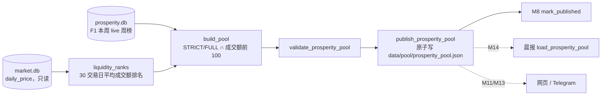
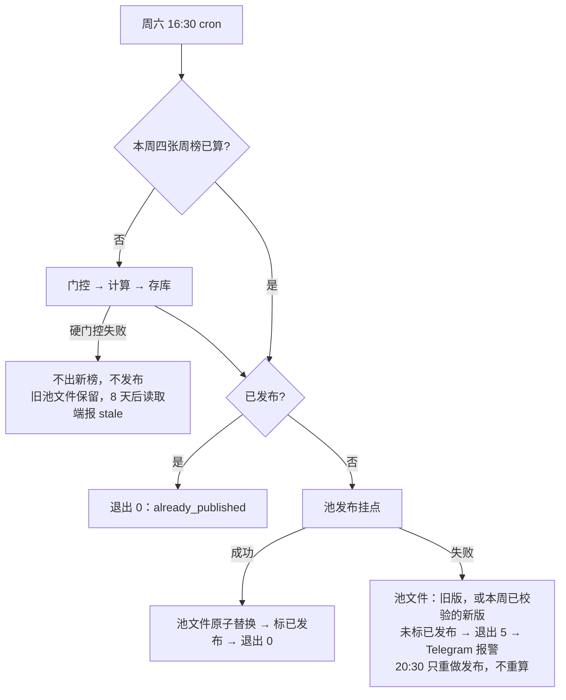

# 景气引擎 M10 精选池文件 Implementation Plan

**状态：2026-11-01 Boss 批准；T1–T4 完成（A1–A8 通过，证据 `reports/prosperity/m10-pool-20261101/`）。T5 审查与部署待做。第一轮审查 3 个 P2 已修订（见 §14）。**

**Goal:** 每周六 live 周榜算完后，把 F1 周榜里"STRICT/FULL 且成交额前 100"的股票写成 `data/pool/prosperity_pool.json`，带校验和新鲜度检查，供 M11–M14 读取。
**Architecture:** 新模块 `src/data/prosperity_pool.py` 只读 `prosperity.db` 周榜和 `market.db` 价格，生成、校验、原子发布池文件。它作为 M9 留下的发布挂点接入 `run_week`，只在 live 周运行。该模块不进 `code_version`，不改打分，不重建历史榜。
**Tech Stack:** Python 3.10 标准库、sqlite3、现有 M8 `ProsperityStore` / `MarketStore`、pytest。
**Spec:** `docs/design/prosperity-engine-north-star.md` 第四层 §4.1（本分支已按 2026-11-01 Boss 决定改写）、模块表 #11。
**北极星对齐:** 主北极星第二层「分析层 · 基本面」；景气北极星第四层「输出」。完成 R9，支撑 S2（"精选池文件通过校验"）。
**基线:** main `4324997d`；分支 `prosperity/m10-pool`，worktree `.worktrees/prosperity-m10`。云端 `code_version` `13e5f9d5183f1b8e`，F1 `scheme_hash` `3f268258d997bbdc`。

## 1. Boss 决定（2026-11-01）

| # | 问题 | 决定 |
|---|---|---|
| D1 | 流动性过滤放在哪层 | 只在选池时过滤。打分仍在全池上做，不改 `code_version` |
| D2 | 成交额前 100 在什么范围里排 | 该周榜全部成员（$10B+ 扩展池），用同一份 `market.db` 可复现 |
| D3 | 合格的要不要再截到 N 只 | 不截。STRICT/FULL ∩ 成交额前 100 全部进池，不足不补 |
| D4 | 10-31 周榜要不要补发 | 不补。云端首个正式池文件在 2026-11-07 16:30 产生 |
| D5 | 成交额口径 | 照原站：截至 as_of 最近 30 个交易日的平均日成交额（close × volume），30 天内少于 5 天有数据的不排名 |

背景：原站对比（2026-11-01）显示，同一批股票上 F0 与原站 B 方案排序相关 0.68–0.91；但不过滤时我们前 40 只约 3/4 不在原站池内，10-31 前 40 有 16 只能源股。

## 2. 实测依据（2026-11-01，云端只读）

- **10-31 F1 周榜试算**：成员 899，可排名 848，STRICT+FULL 249。成交额前 100 内的 STRICT+FULL 共 45 只（STRICT 17）。窗口 2026-09-21 至 10-30，共 30 个交易日。前 10：SNDK、CVX、MU、STX、AVGO、XOM、VLO、VRT、LRCX、AMD。
- **22 个冻结周榜回放**（2021-09-04 至 2026-10-31）：每期 26–50 只，STRICT 8–23 只。全量计算 8.5 秒。
- **交易日判定**：`daily_price` 在假日有零星行（2025-01-09、2025-01-20 等日期只有 `^VIX` 一行）。所以不能用 `DISTINCT date`。改用"当天至少一半成员有价格"判定交易日。
- **拆股**：成交额 = close × volume。未回溯调整的拆股前后，价格和成交量反向变化，乘积不变（KLAC 类问题不影响本指标）。
- **覆盖率**：近期 F1 可排名 / 成员：10-31 0.943，08-29 0.934，05-30 0.922，03-21 0.929。北极星第 388 行把精选池输入覆盖率门槛定为 90%。
- **价格新鲜度**：周六 06:30 `finance_market_data` 写入周五价格；周六 16:30 发布时窗口最后一天应为周五。
- **锁与写入方**：云端 `prosperity.db` 只由 `finance_prosperity` 写；池文件也只由它写。`premium_pool.json` 是 root 600 权限，池文件同样由 root 写。

## 3. 架构图



依赖方向：`prosperity_pool.py` 依赖 M8 存储类型和 `MarketStore`；M9 `prosperity_run.py` 不依赖它，只通过 `publishers` 参数接收一个可调用对象。CLI 负责组装。

## 4. 业务流程图



## 5. 替代方案

| 方案 | 优点 | 缺点 | 选择 |
|---|---|---|---|
| A. 池模块作为 M9 发布挂点，在 live 周更里发布（选定） | 复用 M9 "已算/已发布"两态和 20:30 重试；不加 cron；发布失败有退出码和报警 | 周更进程多一步读价格（约 0.4 秒） | ✓ |
| B. 单独 cron 在 16:30 之后读库生成池文件 | 与周更解耦 | 多一个 cron 条目和一份发布状态，违背北极星"只有两个 cron 条目" | |
| C. 打分前按成交额过滤 | 更像原站 | Boss 已否决（D1）：改内核、重建 21 季冻结链、M12 重跑 | |

成交额数据源另比较过 `dollar_volume.db`：它只存每日全市场前 200、不是 30 日平均、历史不可复现，不选。

原子写不与 `premium_pool.py` 共用：Premium 仍在生产运行，M15 会归档。为一处约 20 行的写文件逻辑去改生产代码，收益小于风险。

## 6. 风险自证

- **最大风险：池文件内容错，但校验通过，下游当真。** 应对：①真实数据验收用只依赖 sqlite3、不 import 本模块的独立脚本重算 10-31 池，逐只比对（Task 4）；独立脚本用 SPY 交易日历，实现用"一半成员"规则，两种判定互相校验；②校验器逐行检查 grade、成交额排名、排序、计数与覆盖率。
- **第二风险：发布挂点每周失败，周更退出 5。** 这是 fail-closed：榜单照常入库，未标已发布，Telegram 报警，20:30 重试只发布。磁盘上的池文件是上一版，或本周已校验的新版（8.2「失败语义」）；读取端不会看到半写或未校验的文件。可能原因（价格缺失、覆盖率 <90%、磁盘故障）都需要人工看，不该静默放行。
- **覆盖率门余量不大。** 近四个冻结周可排名覆盖率 0.922–0.943，离 0.90 只有 2–4 个百分点。哪周掉到 0.90 以下，池发布就失败（退出 5），旧池文件保留。这是北极星定的门槛，本 plan 不改；如果实际频繁触发，再回北极星讨论。
- **第三风险：价格数据过期却照常排名。** 应对：窗口凑不满 30 个交易日 → `liquidity_window_short`；窗口最后一天距 as_of 超过 7 天 → `liquidity_prices_stale`。两者都让发布失败。
- **为什么不更简单：** 只在晨报里临时过滤成交额，会让池文件、网页、体检报告三处口径不一致；把过滤写进池文件，下游只读一份。

## 7. 文件结构

```
src/data/prosperity_pool.py          新建：成交额排名、选池、校验、读取、原子发布、发布挂点工厂
scripts/prosperity_weekly.py         修改：新增 --pool-path；给出时组装池发布挂点
scripts/run_prosperity.sh            修改：exec 行加 --pool-path "$PROJECT_DIR/data/pool/prosperity_pool.json"
tests/prosperity_fixtures.py         修改：新增 seed_prices()、weekdays()
tests/test_prosperity_pool.py        新建：Task 1–3 的单元与集成测试
tests/test_prosperity_weekly_cli.py  修改：--pool-path 组装测试
tests/test_run_prosperity_wrapper.py 修改：断言 cron 入口传 --pool-path
reports/prosperity/m10-pool-20261101/ 新建：acceptance.py、verify_pool.py、README.md、验收输出
docs/runbooks/prosperity-weekly.md   修改：发布边界、故障与恢复
ARCHITECTURE.md                      修改：prosperity 行加 M10
docs/design/prosperity-engine-north-star.md  修改：§4.1 已改；验收后改模块表 #11 与现状表
docs/CHANGELOG.md                    修改：M10 一行
```

`terminal/prosperity/version.py` 的 `CODE_VERSION_SOURCES` 不动。新模块不被任何哈希文件 import。

## 8. 契约

### 8.1 常量

```python
POOL_NAME = '景气精选池'
POOL_SCHEMA_VERSION = 1
POOL_MAX_AGE_DAYS = 8
POOL_PATH = Path(os.environ.get('FINANCE_PROSPERITY_POOL_PATH', str(DATA_DIR / 'pool' / 'prosperity_pool.json')))
POOL_SCHEME_ID = 'F1'
POOL_GRADES = ('STRICT', 'FULL')
LIQUIDITY_TOP = 100
LIQUIDITY_DAYS = 30
LIQUIDITY_MIN_DAYS = 5
LIQUIDITY_LOOKBACK_CALENDAR_DAYS = 70   # 30 个交易日约 42 个日历日，留出假日余量
LIQUIDITY_MAX_LAG_DAYS = 7
COVERAGE_MIN = 0.90
```

### 8.2 函数

```python
@dataclass(frozen=True)
class LiquidityResult:
    as_of: str                       # 计算时用的榜单日期；build_pool 要求与周榜 as_of 相同
    window: Tuple[str, ...]          # 升序、不重复的 30 个交易日
    averages: Mapping[str, float]    # symbol → 平均日成交额（美元）
    ranks: Mapping[str, int]         # symbol → 1..n；平均值降序，同值按代码

def liquidity_ranks(market: MarketStore, symbols: Sequence[str], as_of: str) -> LiquidityResult
def criteria_payload() -> dict
def build_pool(stored: StoredBoard, liquidity: LiquidityResult, *, generated_at: str) -> dict
def validate_prosperity_pool(payload, *, now: datetime | None = None, check_freshness: bool = True) -> None
def load_prosperity_pool(path=POOL_PATH, *, now=None) -> dict
def publish_prosperity_pool(payload: dict, path=POOL_PATH, *, now=None) -> Path
def pool_publisher(*, store: ProsperityStore, market: MarketStore, path: Path, now=utcnow) -> Callable[[Tuple[BoardKey, ...]], None]
```

**`liquidity_ranks` 规则：**
1. 交易日 = `as_of − 70 天 < date ≤ as_of` 内，`symbols` 中至少一半有 `daily_price` 行的日期，取最近 30 个。
2. 不足 30 个 → `ValueError('liquidity_window_short')`。最近一天距 as_of 超过 7 天 → `ValueError('liquidity_prices_stale')`。
3. 在这 30 天内，每只股票取 `AVG(close × volume)`，只算 `close > 0` 且 `volume ≥ 0` 的行；有效天数 <5 的不排名。
4. 排名：平均值降序，同值按代码升序。

**`build_pool` 规则：**
1. `stored` 必须是 F1、`weekly`、`mode == 'live'` 的周榜，且 `scheme_hash` 等于当前 F1 哈希；否则 `ValueError('pool_source_invalid')`。
2. 价格窗口必须绑定这张榜（审查 P2-2），任一不满足 → `ValueError('pool_liquidity_mismatch')`：`liquidity.as_of == stored.board.as_of`；`window` 恰好 30 个、升序、不重复；`window[-1] ≤ as_of` 且 `as_of − window[-1] ≤ 7 天`；`as_of − window[0] < 70 天`；`ranks` 的代码都在 `stored.meta.members` 里。
3. 成员 = `rows` 中 `status == 'ranked'`、`grade ∈ POOL_GRADES`、`liquidity.ranks.get(symbol, ∞) ≤ 100` 的行，按周榜 `rank` 升序。
4. 合格为零时 `members = []`，照常返回。

**池文件结构：**

```json
{
  "schema_version": 1,
  "name": "景气精选池",
  "as_of": "2026-11-07",
  "generated_at": "2026-11-07T08:49:16Z",
  "criteria": {"scheme_id": "F1", "scheme_hash": "3f268258d997bbdc", "grades": ["STRICT", "FULL"],
               "liquidity": {"metric": "avg_dollar_volume", "trading_days": 30, "min_days": 5, "top": 100}},
  "source": {"board_type": "weekly", "code_version": "13e5f9d5183f1b8e", "computed_at": "...", "content_hash": "..."},
  "universe": {"name": "extended", "count": 899, "symbols_sha256": "<64 hex>"},
  "coverage": {"ranked": {"covered": 848, "total": 899, "ratio": 0.943},
               "liquidity_ranked": {"covered": 898, "total": 899, "ratio": 0.999},
               "eligible": 249, "selected": 45, "trading_window": ["2026-09-28", "2026-11-06"]},
  "members": [{"symbol": "SNDK", "name": "...", "sector": "...", "industry": "...", "rank": 1, "grade": "STRICT",
               "score": 97.4, "family_scores": {"accel": 0.0}, "badges": [], "dollar_volume_rank": 7,
               "avg_dollar_volume": 13.0e9}]
}
```

`universe` 来自周榜 `meta.members`。`eligible` = 可排名且 STRICT/FULL 的数量（不看成交额）。

**校验（任一不满足即拒绝；检查顺序：schema/name → criteria → 日期解析 → 新鲜度 → 其余结构，所以过期文件一律报 stale）：**
- `schema_version`、`name` 不符 → `ValueError`。`criteria != criteria_payload()` → `RuntimeError`（读取端映射为 criteria mismatch）。
- `as_of` 是合法日期；`generated_at` 带时区。
- `check_freshness=True` 时：`generated_at` 不晚于现在 5 分钟、不早于 8 天；`as_of` 距现在（CST 日期）不超过 8 天且不在未来 → 否则 `TimeoutError`。
- `universe.count` 为正整数，`symbols_sha256` 为 64 位十六进制。
- `coverage.ranked` 与 `coverage.liquidity_ranked`：`total == universe.count`，`0 ≤ covered ≤ total`，`ratio == covered/total`，`ratio ≥ 0.90`。
- `coverage.selected == len(members)`，`0 ≤ selected ≤ eligible ≤ ranked.covered`。
- `trading_window` 是两个日期 `[start, end]`，且 `start < end ≤ as_of`、`as_of − end ≤ 7 天`、`as_of − start < 70 天`（审查 P2-2：旧价格窗口配新榜单日期必须被拒）。示例里 11-07 的榜对应窗口 09-28 至 11-06。
- 每个成员：代码大写、不重复；`grade ∈ POOL_GRADES`；`rank` 为正整数且严格递增；`score` 有限；`1 ≤ dollar_volume_rank ≤ 100`；`avg_dollar_volume` 有限且 >0；`badges` 是字符串列表。

**读取：** `load_prosperity_pool` 返回 `{**payload, 'available': True, 'reason': None}`，或 `{'available': False, 'reason': r, 'members': []}`，`r` 为 `prosperity_pool_missing` / `prosperity_pool_criteria_mismatch` / `prosperity_pool_stale` / `prosperity_pool_invalid`。

**发布：** 先校验（含新鲜度），写同目录临时文件，fsync，读回再校验，`os.replace`，再 fsync 目录（目录 fsync 写成独立函数 `_fsync_dir`，便于故障注入）。

**失败语义（审查 P2-1 修订）。** 池文件是可以随时从库重建的派生产物。保证的是"读取端只会看到一份完整、已校验的文件"，不保证"失败时文件一定是旧版"：

| 失败发生在 | 磁盘上的池文件 | 周榜发布状态 | 周更结果 | 重试（20:30 或手动） |
|---|---|---|---|---|
| `os.replace` 之前（校验、写临时文件、读回、replace 本身） | 旧版不动，临时文件删除 | 未标记 | 退出 5 | 重新建池并发布 |
| `os.replace` 之后（目录 fsync） | **本周新版已可见**（内容已校验），但替换是否落盘未确认 | 未标记 | 退出 5 | 再建池、再替换（内容相同，只有 `generated_at` 不同），成功后标记 |
| 挂点成功、`mark_published` 失败 | 本周新版 | 未标记 | 退出 5 | 同上 |

- 第二、三行退出 5 的含义是"发布未确认"，不是"文件没变"。此时可见的是本周已校验的池，下游读到它是正确的。
- 重试是幂等的：同一张周榜、同一份 `market.db` 得到同样的成员，只有 `generated_at` 变化。
- 不做回滚：回滚本身要再写一次文件，同样可能失败，而且会把正确的本周池换回上周的。

**发布挂点：** `pool_publisher(...)(keys)` 在 `keys` 中找 F1 `weekly` 键（必须恰好一个，否则 `ValueError('pool_source_missing')`），`store.get_board` 读回，算成交额排名，建池，发布。它不调用 `mark_published`；`run_week._publish` 在所有挂点成功后统一标记。

### 8.3 CLI

- `scripts/prosperity_weekly.py` 新增 `--pool-path PATH`。给出时组装 `publishers=(pool_publisher(store=store, market=market, path=args.pool_path, now=now),)`；不给时 `publishers=()`，行为与现在相同（`publication_not_configured`）。
- 任何模式都接受 `--pool-path`。`run_week` 只在 live 模式调用挂点，`--as-of` 与 `--rebuild-chain` 不会写池文件。这样 `run_prosperity.sh --rebuild-chain` 带着固定参数也能正常运行。
- 本地 live 验收不传 `--pool-path`，所以不会写池文件，也不会把研究库标成已发布。
- 退出码不变：发布失败仍是 5。

## 9. 验收标准

| # | 标准 | 任务 |
|---|---|---|
| A1 | 成交额排名：忽略只有少数成员有行的日期；同值按代码；<5 天不排名；窗口不足报 `liquidity_window_short`；价格过期报 `liquidity_prices_stale`；拆股前后价量反向变化时平均成交额不变；结果带 `as_of` | T1 |
| A2 | 选池：BELOW、observe、成交额 >100 的行不进池；按周榜排名排序；合格为零时空 `members` 仍通过校验；新榜配旧价格窗口（`as_of` 不同、窗口末日落后 >7 天、窗口不足 30 天）报 `pool_liquidity_mismatch` | T2 |
| A3 | 校验：8.2 列出的每类错误都被拒绝；`generated_at` 新鲜但 `as_of` 超过 8 天被判 stale；`trading_window` 末日晚于 `as_of` 或落后 >7 天被判 invalid；`os.replace` 前失败时原文件字节不变；目录 fsync 失败时抛错、文件为已校验的新版、无临时文件残留 | T2 |
| A4 | live 周更带池挂点：退出 0，池文件可读且 `available`，四张周榜 `published_at` 有值；价格缺失时退出 5、池文件不变、榜单已存；补上价格后再跑只做发布并成功；目录 fsync 失败时退出 5、未标记，故障解除后再跑退出 0 并标记；`mark_published` 失败时退出 5，再跑退出 0；replay 周不写池文件 | T3 |
| A5 | CLI 给 `--pool-path` 才组装挂点；cron 入口固定传 `--pool-path …/data/pool/prosperity_pool.json` | T3 |
| A6 | 真实数据（本地只读快照）：10-31 池 = 45 只、STRICT 17 只、窗口 2026-09-21 至 10-30；独立脚本逐只核对代码、周榜排名、成交额排名，全部一致 | T4 |
| A7 | 22 个历史冻结周榜按同一规则生成，每期只数与 2026-11-01 试算一致（26–50）。关闭新鲜度后：2022-12 起 17 期通过完整校验；2021-09 至 2022-09 的 5 期可排名覆盖率 0.834–0.891，预期被 0.90 覆盖率门拒绝（记录在案，不算验收失败） | T4 |
| A8 | `code_version` 仍为 `13e5f9d5183f1b8e`；景气全套测试通过；全量测试与 main 基线按失败 nodeid 比对（审查 P2-3）：**新增失败集合为空**，基线失败集合逐项列明（nodeid + 失败原因摘要），消失的失败逐项说明原因 | T4 |
| A9 | 云端首个自然周六 2026-11-07：16:30 日志 OK 且 `publication=published`；池文件通过 `load_prosperity_pool`；`publication` 表有 11-07 四行；20:30 运行显示 `already_published` | T5 |

## 10. 实施任务（主线程 inline，每任务一个检查点）

### Task 1：成交额排名

**Files:**
- Create: `src/data/prosperity_pool.py`（常量、`LiquidityResult`、`liquidity_ranks`）
- Modify: `tests/prosperity_fixtures.py`（新增 `weekdays`、`seed_prices`）
- Test: `tests/test_prosperity_pool.py`

**Interfaces:**
- Consumes: `MarketStore(db_path, read_only=True)`、`MarketStore.upsert_daily_prices(symbol, rows)`（`src/data/market_store.py:1219`）、`seed_db`（`tests/prosperity_fixtures.py:22`）
- Produces: `liquidity_ranks(market, symbols, as_of) -> LiquidityResult`

- [x] Step 1：写失败测试

```python
# tests/prosperity_fixtures.py 追加
def weekdays(end, n):
    d, out = date.fromisoformat(end), []
    while len(out) < n:
        if d.weekday() < 5:
            out.append(d.isoformat())
        d -= timedelta(days=1)
    return out[::-1]


def seed_prices(path, rows):
    """rows: {symbol: [(date, close, volume), ...]}, written with MarketStore's own writer."""
    w = MarketStore(db_path=path)
    for symbol, points in rows.items():
        w.upsert_daily_prices(symbol, [{'date': d, 'open': c, 'high': c, 'low': c, 'close': c, 'volume': v}
                                       for d, c, v in points])
    w.close()
    return Path(path)
```

```python
# tests/test_prosperity_pool.py
import pytest
from src.data.market_store import MarketStore
from tests.prosperity_fixtures import seed_db, seed_prices, weekdays

DAYS = weekdays('2026-10-30', 35)
SYMBOLS = [f'S{i:04d}' for i in range(20)]


def market(tmp_path, rows):
    return MarketStore(db_path=seed_prices(seed_db(tmp_path / 'market.db'), rows), read_only=True)


def flat(volume_of):
    return {s: [(d, 10.0, volume_of(i)) for d in DAYS] for i, s in enumerate(SYMBOLS)}


def test_window_ignores_dates_few_members_traded(tmp_path):
    from src.data.prosperity_pool import liquidity_ranks
    rows = flat(lambda i: 1000 * (i + 1))
    rows['S0000'] = rows['S0000'] + [('2026-10-25', 10.0, 5)]          # stray Sunday row
    out = liquidity_ranks(market(tmp_path, rows), SYMBOLS, '2026-10-31')
    assert out.window == tuple(DAYS[-30:]) and out.as_of == '2026-10-31'


def test_rank_by_average_ties_by_symbol_and_old_spike_ignored(tmp_path):
    from src.data.prosperity_pool import liquidity_ranks
    rows = flat(lambda i: 1000 * (i + 1))
    rows['S0003'] = [(d, 10.0, 10**9) for d in DAYS[:5]] + [(d, 10.0, 1) for d in DAYS[5:]]
    rows['S0018'] = [(d, 10.0, 20000) for d in DAYS]                   # ties S0019
    out = liquidity_ranks(market(tmp_path, rows), SYMBOLS, '2026-10-31')
    assert [out.ranks['S0018'], out.ranks['S0019']] == [1, 2]
    assert out.ranks['S0003'] == 20


def test_fewer_than_five_days_is_unranked(tmp_path):
    from src.data.prosperity_pool import liquidity_ranks
    rows = flat(lambda i: 1000)
    rows['S0005'] = [(d, 10.0, 10**9) for d in DAYS[-4:]]
    out = liquidity_ranks(market(tmp_path, rows), SYMBOLS, '2026-10-31')
    assert 'S0005' not in out.ranks and len(out.ranks) == 19


def test_unadjusted_split_keeps_dollar_volume(tmp_path):
    from src.data.prosperity_pool import liquidity_ranks
    rows = flat(lambda i: 1000)
    rows['S0007'] = [(d, 100.0 if d < DAYS[-10] else 10.0, 100 if d < DAYS[-10] else 1000) for d in DAYS]
    out = liquidity_ranks(market(tmp_path, rows), SYMBOLS, '2026-10-31')
    assert out.averages['S0007'] == pytest.approx(10000.0)


@pytest.mark.parametrize('as_of,days,reason', [
    ('2026-10-31', DAYS[-20:], 'liquidity_window_short'),
    ('2026-11-14', DAYS, 'liquidity_prices_stale'),
])
def test_window_fails_closed(tmp_path, as_of, days, reason):
    from src.data.prosperity_pool import liquidity_ranks
    rows = {s: [(d, 10.0, 1000) for d in days] for s in SYMBOLS}
    with pytest.raises(ValueError, match=reason):
        liquidity_ranks(market(tmp_path, rows), SYMBOLS, as_of)
```

- [x] Step 2：`pytest tests/test_prosperity_pool.py -v` → 预期 FAIL（`ModuleNotFoundError: src.data.prosperity_pool`）
- [x] Step 3：按 8.1/8.2 写常量、`LiquidityResult`、`liquidity_ranks`。读库用 `market._get_conn()`（与 `prosperity_run.py:169` 同法），SQL 用参数绑定，`symbols` 先去重排序。
- [x] Step 4：`pytest tests/test_prosperity_pool.py -v` → 预期全部 PASS
- [x] Step 5：`git add src/data/prosperity_pool.py tests/prosperity_fixtures.py tests/test_prosperity_pool.py && git commit -m "feat(prosperity-m10): 30-day average dollar-volume ranks"`

### Task 2：选池、校验、读取、原子发布

**Files:**
- Modify: `src/data/prosperity_pool.py`（`criteria_payload`、`build_pool`、`validate_prosperity_pool`、`load_prosperity_pool`、`publish_prosperity_pool`）
- Test: `tests/test_prosperity_pool.py`

**Interfaces:**
- Consumes: `LiquidityResult`（Task 1）；`StoredBoard`（`src/data/prosperity_storage.py:52`）；`storage_batch`（`tests/prosperity_fixtures.py:266`）；`SCHEMES`、`scheme_hash`（`terminal/prosperity/schemes.py:104,114`）
- Produces: 8.2 中的五个函数

- [x] Step 1：写失败测试

```python
from datetime import datetime, timezone
from dataclasses import replace
import json

NOW = datetime(2026, 10, 31, 9, tzinfo=timezone.utc)


def f1_board(as_of='2026-10-31'):
    from tests.prosperity_fixtures import storage_batch
    return next(b for b in storage_batch(count=20, as_of=as_of) if b.board.scheme_id == 'F1')


def liq(board, illiquid=(), *, as_of=None, window=None):
    from src.data.prosperity_pool import LiquidityResult
    from tests.prosperity_fixtures import weekdays
    symbols = sorted(board.meta.members)
    ranks = {s: (150 + i if s in illiquid else i + 1) for i, s in enumerate(symbols)}
    return LiquidityResult(as_of or board.board.as_of, tuple(window or weekdays('2026-10-30', 30)),
                           {s: 1e9 / r for s, r in ranks.items()}, ranks)


def eligible(board):
    return [r for r in board.board.rows if r.status == 'ranked' and r.grade in ('STRICT', 'FULL')]


def test_pool_keeps_strict_full_inside_top_100_in_rank_order():
    from src.data.prosperity_pool import build_pool, validate_prosperity_pool
    board = f1_board()
    best = eligible(board)[0].symbol
    pool = build_pool(board, liq(board, illiquid={best}), generated_at='2026-10-31T08:50:00Z')
    expected = [r.symbol for r in eligible(board) if r.symbol != best]
    assert [m['symbol'] for m in pool['members']] == expected
    assert pool['coverage']['eligible'] == len(eligible(board)) and pool['coverage']['selected'] == len(expected)
    validate_prosperity_pool(pool, now=NOW)


def test_zero_eligible_is_a_valid_empty_pool():
    from src.data.prosperity_pool import build_pool, validate_prosperity_pool
    board = f1_board()
    pool = build_pool(board, liq(board, illiquid=set(board.meta.members)), generated_at='2026-10-31T08:50:00Z')
    assert pool['members'] == [] and pool['coverage']['selected'] == 0
    validate_prosperity_pool(pool, now=NOW)


def test_build_rejects_non_f1_board():
    from tests.prosperity_fixtures import storage_batch
    from src.data.prosperity_pool import build_pool
    board = next(b for b in storage_batch(count=20, as_of='2026-10-31') if b.board.scheme_id == 'F0')
    with pytest.raises(ValueError, match='pool_source_invalid'):
        build_pool(board, liq(board), generated_at='2026-10-31T08:50:00Z')


@pytest.mark.parametrize('kwargs', [
    {'as_of': '2026-10-24'},                                         # ranks computed for another board date
    {'window': weekdays('2026-10-23', 30)},                          # last price day 8 days before as_of
    {'window': weekdays('2026-11-02', 30)},                          # window ends after as_of
    {'window': weekdays('2026-10-30', 29)},                          # not a full 30-day window
])
def test_build_rejects_liquidity_not_bound_to_board(kwargs):
    from src.data.prosperity_pool import build_pool
    board = f1_board()
    with pytest.raises(ValueError, match='pool_liquidity_mismatch'):
        build_pool(board, liq(board, **kwargs), generated_at='2026-10-31T08:50:00Z')


def valid_pool():
    from src.data.prosperity_pool import build_pool
    board = f1_board()
    return build_pool(board, liq(board), generated_at='2026-10-31T08:50:00Z')


@pytest.mark.parametrize('mutate,reason', [
    (lambda p: p.update(name='Wrong'), 'prosperity_pool_invalid'),
    (lambda p: p['criteria'].update(scheme_hash='0' * 16), 'prosperity_pool_criteria_mismatch'),
    (lambda p: p['criteria']['liquidity'].update(top=40), 'prosperity_pool_criteria_mismatch'),
    (lambda p: p['members'][0].update(grade='BELOW'), 'prosperity_pool_invalid'),
    (lambda p: p['members'][0].update(dollar_volume_rank=101), 'prosperity_pool_invalid'),
    (lambda p: p['members'].append(dict(p['members'][0])), 'prosperity_pool_invalid'),
    (lambda p: p['members'].reverse(), 'prosperity_pool_invalid'),
    (lambda p: p['coverage'].update(selected=p['coverage']['selected'] + 1), 'prosperity_pool_invalid'),
    (lambda p: p['coverage']['ranked'].update(covered=1, ratio=1 / p['universe']['count']), 'prosperity_pool_invalid'),
    (lambda p: p.update(generated_at='2026-10-22T08:00:00Z'), 'prosperity_pool_stale'),
    (lambda p: p.update(as_of='2026-10-17'), 'prosperity_pool_stale'),
    (lambda p: p['coverage'].update(trading_window=['2026-09-14', '2026-10-23']), 'prosperity_pool_invalid'),
    (lambda p: p['coverage'].update(trading_window=['2026-09-21', '2026-11-02']), 'prosperity_pool_invalid'),
])
def test_loader_rejects(tmp_path, mutate, reason):
    from src.data.prosperity_pool import load_prosperity_pool
    payload = valid_pool()
    assert len(payload['members']) >= 2
    mutate(payload)
    path = tmp_path / 'prosperity_pool.json'
    path.write_text(json.dumps(payload, ensure_ascii=False))
    assert load_prosperity_pool(path, now=NOW)['reason'] == reason


def test_publish_round_trip_and_pre_replace_failure_keeps_old_file(tmp_path, monkeypatch):
    import src.data.prosperity_pool as pool
    from src.data.prosperity_pool import load_prosperity_pool, publish_prosperity_pool
    path = tmp_path / 'pool' / 'prosperity_pool.json'
    assert load_prosperity_pool(path, now=NOW)['reason'] == 'prosperity_pool_missing'
    good = valid_pool()
    publish_prosperity_pool(good, path, now=NOW)
    before = path.read_bytes()
    assert load_prosperity_pool(path, now=NOW)['available'] is True
    with pytest.raises(ValueError):
        publish_prosperity_pool({**good, 'name': 'Wrong'}, path, now=NOW)       # rejected before writing
    def broken_replace(src, dst):
        raise OSError('replace failed')
    monkeypatch.setattr(pool.os, 'replace', broken_replace)
    with pytest.raises(OSError):
        publish_prosperity_pool({**good, 'generated_at': '2026-10-31T08:55:00Z'}, path, now=NOW)
    assert path.read_bytes() == before
    assert sorted(p.name for p in path.parent.iterdir()) == ['prosperity_pool.json']


def test_directory_fsync_failure_leaves_validated_new_file(tmp_path, monkeypatch):
    import src.data.prosperity_pool as pool
    from src.data.prosperity_pool import load_prosperity_pool, publish_prosperity_pool
    path = tmp_path / 'pool' / 'prosperity_pool.json'
    publish_prosperity_pool(valid_pool(), path, now=NOW)
    def broken_fsync(directory):
        raise OSError('fsync failed')
    monkeypatch.setattr(pool, '_fsync_dir', broken_fsync)
    newer = {**valid_pool(), 'generated_at': '2026-10-31T08:55:00Z'}
    with pytest.raises(OSError):
        publish_prosperity_pool(newer, path, now=NOW)
    loaded = load_prosperity_pool(path, now=NOW)
    assert loaded['available'] is True and loaded['generated_at'] == '2026-10-31T08:55:00Z'
    assert sorted(p.name for p in path.parent.iterdir()) == ['prosperity_pool.json']
```

- [x] Step 2：`pytest tests/test_prosperity_pool.py -v` → 预期 Task 2 新测试 FAIL（`ImportError: build_pool`），Task 1 测试仍 PASS
- [x] Step 3：按 8.2 实现。`symbols_sha256` 与 `premium_pool.py:54-56` 同法（排序后 `\n` 连接再 SHA256）。`name/sector/industry` 取 `stored.stocks` 中同代码的行。`family_scores`、`badges` 原样转成 JSON 兼容的 dict/list。原子写参照 `premium_pool.py:202-229` 的步骤，临时文件前缀 `.prosperity_pool.`；目录 fsync 抽成模块级 `_fsync_dir(directory: Path) -> None`，`publish_prosperity_pool` 通过模块名调用它（测试用 monkeypatch 注入失败）。窗口与 `as_of` 的日期关系在 `build_pool` 和校验器里共用一个私有函数 `_window_error(as_of, start, end) -> str | None`。
- [x] Step 4：`pytest tests/test_prosperity_pool.py -v` → 预期全部 PASS
- [x] Step 5：`git add src/data/prosperity_pool.py tests/test_prosperity_pool.py && git commit -m "feat(prosperity-m10): build, validate and atomically publish the pool file"`

### Task 3：发布挂点、CLI、cron 入口

**Files:**
- Modify: `src/data/prosperity_pool.py`（`pool_publisher`）
- Modify: `scripts/prosperity_weekly.py:31-44`（`--pool-path`）、`:86-93`（组装 `publishers`）
- Modify: `scripts/run_prosperity.sh:24-26`（exec 行加 `--pool-path`）
- Test: `tests/test_prosperity_pool.py`、`tests/test_prosperity_weekly_cli.py`、`tests/test_run_prosperity_wrapper.py`

**Interfaces:**
- Consumes: `run_week(..., publishers=...)`（`src/data/prosperity_run.py:337`）、`_publish` 的调用约定（`:322-334`：挂点接收键元组，全部成功后才 `mark_published`）、`ProsperityStore.get_board` / `publication_state`
- Produces: `pool_publisher(*, store, market, path, now) -> Callable[[Tuple[BoardKey, ...]], None]`；CLI 参数 `--pool-path`

- [x] Step 1：写失败测试

```python
# tests/test_prosperity_pool.py 追加
from src.data.prosperity_store import ProsperityStore

LIVE_NOW = datetime(2026, 10, 24, 9, tzinfo=timezone.utc)


def builder(market, as_of, **kwargs):
    from tests.prosperity_fixtures import storage_inputs
    packets, _, _, _ = storage_inputs(as_of=as_of, count=20)
    packets = [replace(p, quarter_bucket='2026Q2') for p in packets]
    return packets, {'members_resolved': len(packets), 'errors': {}}


@pytest.fixture
def live(tmp_path):
    quality = tmp_path / 'quality'
    quality.mkdir()
    (quality / 'fundamentals-now.json').write_text(json.dumps({'after': {
        'as_of': '2026-10-24T07:00:00Z', 'coverage': {'fundamental_ready': {'ratio': .96}}}}))
    db = seed_db(tmp_path / 'market.db')
    return tmp_path, db, quality


def run(tmp_path, db, quality, mode='live', saturday='2026-10-24'):
    from src.data.prosperity_pool import pool_publisher
    from src.data.prosperity_run import run_week
    path = tmp_path / 'pool' / 'prosperity_pool.json'
    market = MarketStore(db_path=db, read_only=True)
    try:
        with ProsperityStore(tmp_path / 'result.db', read_only=False) as store:
            out = run_week(saturday=saturday, mode=mode, market=market, store=store, quality_dir=quality,
                           publishers=(pool_publisher(store=store, market=market, path=path, now=lambda: LIVE_NOW),),
                           now=lambda: LIVE_NOW, version='test-m10', start_quarter='2026Q3',
                           packet_builder=builder)
            published = [store.publication_state(k).published_at for k in out.keys]
    finally:
        market.close()
    return out, path, published


def test_live_week_publishes_pool_then_marks(live):
    from src.data.prosperity_pool import load_prosperity_pool
    tmp_path, db, quality = live
    seed_prices(db, {f'S{i:04d}': [(d, 10.0, 1000 * (i + 1)) for d in weekdays('2026-10-23', 35)]
                     for i in range(20)})
    out, path, published = run(tmp_path, db, quality)
    assert out.exit_code == 0 and out.detail['publication'] == 'published'
    assert all(published)
    assert load_prosperity_pool(path, now=LIVE_NOW)['available'] is True


def test_missing_prices_exit_5_then_retry_publishes_only(live):
    tmp_path, db, quality = live
    out, path, published = run(tmp_path, db, quality)
    assert out.exit_code == 5 and 'liquidity_window_short' in out.error
    assert not path.exists() and not any(published)
    seed_prices(db, {f'S{i:04d}': [(d, 10.0, 1000) for d in weekdays('2026-10-23', 35)] for i in range(20)})
    again, path, published = run(tmp_path, db, quality)
    assert again.exit_code == 0 and set(again.keys) == set(out.keys) and all(published) and path.exists()


def test_directory_fsync_failure_exits_5_then_retry_marks(live, monkeypatch):
    import src.data.prosperity_pool as pool
    from src.data.prosperity_pool import load_prosperity_pool
    tmp_path, db, quality = live
    seed_prices(db, {f'S{i:04d}': [(d, 10.0, 1000) for d in weekdays('2026-10-23', 35)] for i in range(20)})
    real = pool._fsync_dir
    def broken(directory):
        raise OSError('fsync failed')
    monkeypatch.setattr(pool, '_fsync_dir', broken)
    out, path, published = run(tmp_path, db, quality)
    assert out.exit_code == 5 and 'fsync failed' in out.error and not any(published)
    assert load_prosperity_pool(path, now=LIVE_NOW)['available'] is True     # validated new file is visible
    monkeypatch.setattr(pool, '_fsync_dir', real)
    again, _, published = run(tmp_path, db, quality)
    assert again.exit_code == 0 and again.detail['publication'] == 'published' and all(published)


def test_mark_published_failure_exits_5_then_retry_marks(live, monkeypatch):
    tmp_path, db, quality = live
    seed_prices(db, {f'S{i:04d}': [(d, 10.0, 1000) for d in weekdays('2026-10-23', 35)] for i in range(20)})
    real = ProsperityStore.mark_published
    def broken(self, keys, *, published_at):
        raise RuntimeError('mark failed')
    monkeypatch.setattr(ProsperityStore, 'mark_published', broken)
    out, path, published = run(tmp_path, db, quality)
    assert out.exit_code == 5 and 'mark failed' in out.error and not any(published) and path.exists()
    monkeypatch.setattr(ProsperityStore, 'mark_published', real)
    again, _, published = run(tmp_path, db, quality)
    assert again.exit_code == 0 and all(published)


def test_replay_week_never_writes_pool(live):
    tmp_path, db, quality = live
    seed_prices(db, {f'S{i:04d}': [(d, 10.0, 1000) for d in weekdays('2026-10-16', 35)] for i in range(20)})
    out, path, _ = run(tmp_path, db, quality, mode='replay', saturday='2026-10-17')
    assert out.exit_code == 0 and not path.exists()
```

```python
# tests/test_prosperity_weekly_cli.py 追加
@pytest.mark.parametrize('extra,count', [([], 0), (['--pool-path', 'POOL'], 1)])
def test_cli_pool_path_configures_publisher(tmp_path, monkeypatch, extra, count):
    from scripts import prosperity_weekly as cli
    from tests.prosperity_fixtures import seed_db
    from src.data.prosperity_run import RunOutcome
    captured = {}
    def week(**kw):
        captured.update(kw)
        return RunOutcome(0)
    monkeypatch.setattr(cli, 'run_week', week)
    db = seed_db(tmp_path / 'market.db')
    extra = [str(tmp_path / 'pool.json') if x == 'POOL' else x for x in extra]
    assert cli.main(['--live', '--db', str(tmp_path / 'r.db'), '--market-db', str(db)] + extra,
                    now=lambda: NOW) == 0
    assert len(captured['publishers']) == count
    assert not (tmp_path / 'pool.json').exists()
```

```python
# tests/test_run_prosperity_wrapper.py 追加
def test_cron_entry_passes_pool_path(tmp_path):
    words = run(tmp_path, with_venv=False)
    i = words.index('--pool-path')
    assert words[i + 1] == str(tmp_path / 'data' / 'pool' / 'prosperity_pool.json')
```

- [x] Step 2：`pytest tests/test_prosperity_pool.py tests/test_prosperity_weekly_cli.py tests/test_run_prosperity_wrapper.py -v` → 预期新测试 FAIL（`ImportError: pool_publisher`；CLI `KeyError: 'publishers'`；wrapper `ValueError: '--pool-path' is not in list`）
- [x] Step 3：实现 `pool_publisher`（8.2「发布挂点」）；CLI 加 `--pool-path`（`type=Path`，默认 `None`），在 `ProsperityStore` 打开后组装并传给 `run_week`；`run_prosperity.sh` exec 行加 `--pool-path "$PROJECT_DIR/data/pool/prosperity_pool.json"`。
- [x] Step 4：上面三个测试文件全部 PASS；再跑 `pytest tests/test_prosperity_run.py -q` 确认 M9 行为不变
- [x] Step 5：`git add src/data/prosperity_pool.py scripts/prosperity_weekly.py scripts/run_prosperity.sh tests/test_prosperity_pool.py tests/test_prosperity_weekly_cli.py tests/test_run_prosperity_wrapper.py && git commit -m "feat(prosperity-m10): wire the pool file into the live weekly publish hook"`

### Task 4：真实数据验收与文档（本地只读）

**Files:**
- Create: `reports/prosperity/m10-pool-20261101/acceptance.py`、`verify_pool.py`、`README.md`，以及验收输出 `pool-20261031.json`、`history.json`、`verify.txt`、`baseline-pytest.txt`、`branch-pytest.txt`、`failure-diff.txt`
- Modify: `docs/runbooks/prosperity-weekly.md`、`ARCHITECTURE.md:62`、`docs/design/prosperity-engine-north-star.md`（模块表 #11、现状表"输出"行）、`docs/CHANGELOG.md`

- [x] Step 1：取快照。在 worktree 运行 `"/Users/owen/CC workspace/Finance/.venv/bin/python" scripts/sync_prosperity.py --db /tmp/m10/prosperity.db`；`market.db` 用主仓库 `data/market.db`（2026-11-01 09:00 拉取，含 10-30 价格）。记录两个文件的 SHA256。
- [x] Step 2：`acceptance.py` 只读打开两库：①对 10-31 F1 live 周榜调用 `liquidity_ranks` + `build_pool`，用 `now=2026-11-01` 校验，写 `pool-20261031.json`；②对 22 个 F1 周榜（`code_version` 13e5f9d5，含 replay）逐期建池：replay 周榜先用 `dataclasses.replace(stored, meta=replace(stored.meta, mode='live'))` 绕过来源检查（只在验收脚本里这样做，生产代码不留开关），再以 `check_freshness=False` 校验；每期写只数、STRICT 数、可排名覆盖率、校验结果到 `history.json`。
- [x] Step 3：`verify_pool.py` 只用 sqlite3，不 import `src`/`terminal`：以 SPY 交易日取窗口，重算 10-31 成交额排名与入池名单，与 `pool-20261031.json` 逐只比对代码、周榜排名、成交额排名、窗口。预期 45 只、STRICT 17 只、窗口 2026-09-21 至 10-30，差异 0。输出写 `verify.txt`。
- [x] Step 4：`python3 -c "from terminal.prosperity.version import code_version; print(code_version())"` → `13e5f9d5183f1b8e`；`pytest tests/test_prosperity_*.py tests/test_run_prosperity_wrapper.py -q` 全过。全量回归按失败 nodeid 比对（审查 P2-3）：
  - 基线：未改代码的本 worktree（= main `4324997d`）已跑 `pytest -q -rfE --tb=no -p no:cacheprovider`，输出存 `reports/prosperity/m10-pool-20261101/baseline-pytest.txt`；失败 nodeid 与原因摘要逐项写进 README。
  - 本分支：用同一命令、同一解释器（`/Users/owen/CC workspace/Finance/.venv/bin/python`）、同一 worktree 再跑，存 `branch-pytest.txt`。
  - 比对：分别从两份输出提取 `^(FAILED|ERROR) ` 行的 nodeid，存 `failure-diff.txt`，含"新增 / 消失 / 共有"三组。验收要求**新增为空**；消失的逐项写明原因（例如被本分支修好，或属于数据随时间变化）。
- [x] Step 5：更新文档：runbook「发布边界」改为"live 周更发布池文件；不传 `--pool-path` 时不发布"，「故障与恢复」退出码 5 一行补池发布的常见原因（`liquidity_window_short`、`liquidity_prices_stale`、覆盖率 <90%）；ARCHITECTURE 第 62 行加 `prosperity_pool.py`；北极星模块表 #11 标 ✅ 与验收证据路径；CHANGELOG 加一行。
- [x] Step 6：`git add reports/prosperity/m10-pool-20261101 docs/runbooks/prosperity-weekly.md ARCHITECTURE.md docs/design/prosperity-engine-north-star.md docs/CHANGELOG.md docs/plans/2026-11-01-prosperity-m10-pool.md && git commit -m "docs(prosperity-m10): acceptance evidence and runbook"`

### Task 5：审查与部署（每一步单独请 Boss 确认）

1. `/code-review high` 审本分支 diff，按核实结果修正；再跑 Task 4 Step 4 的测试。
2. Boss 确认后 merge 到 main；再确认后 push。
3. 云端不手动操作：周二至周六 06:25 自动 pull。要赶上 11-07 首发，须在 11-07 06:25 前 push。pull 后只读核对：`git log -1`、`code_version` = `13e5f9d5183f1b8e`、`bash -n scripts/run_prosperity.sh`。crontab 不改。
4. 2026-11-07 16:30 后核对 A9：`logs/cron_prosperity.log`、池文件 `load_prosperity_pool`、`publication` 表、20:30 `already_published`。

## 11. 执行命令

```bash
cd "/Users/owen/CC workspace/Finance/.worktrees/prosperity-m10"
PY="/Users/owen/CC workspace/Finance/.venv/bin/python"
"$PY" -m pytest tests/test_prosperity_pool.py -v
"$PY" -m pytest tests/test_prosperity_*.py tests/test_run_prosperity_wrapper.py -q
```

## 12. Global Constraints（原值照抄）

- 北极星第四层：「把 `prosperity.db` 里的结果变成三种产物。**不负责**：计算任何分数（只读 `prosperity.db`）；晨报怎么用池（第五层）。三种产物都只读库、可以随时重新生成，所以都不入库。」
- 北极星 §4.1：「**"合格股票为零"≠"不可用"**：计算成功但没有 STRICT/FULL 时照常发布空 `members`，并在 `coverage` 里写明合格数为 0；这属于有效结果，不触发 Premium 回退。只有门控或校验失败才算不可用。」
- 北极星 §4.1：「校验复用 `src/data/premium_pool.py` 的模式：schema、覆盖率 ≥0.90、原子发布、四种不可用原因。**新鲜度同时看 `generated_at` 和 `as_of`**（as_of 距今 ≤8 天），防止今天补跑出来的历史榜被当成新鲜。硬门控失败的那周不发布新文件。」
- 北极星第三层：「**`--as-of` 补跑**：计算规则与幂等性同正常周六，但**历史补跑默认只写库、不发布**，不改当前池文件、网页和晨报读到的指针；只有 as_of 是本周时才发布。」
- 北极星第三层：「独立 job，失败不影响 Premium 与晨报；晨报读到的池文件停在上一版，由 8 天新鲜度检查报出；失败记录复用 `cron_wrapper.sh`。」
- M9 运行手册：「`market.db` 只读；云端 `data/prosperity.db` 是生产结果库。」
- M9 运行手册：「当前发布挂点为空 … M10–M13 接入后仍遵循全部发布成功才 `mark_published`。」
- Finance CLAUDE.md：「所有涉及开发代码的任务，一律使用 git 和 worktree 进行开发管理」；记忆：「不可擅自 merge 或 push，等 Boss 指示」。
- 记忆（overview）：云端 Python 3.10。
- 记忆（反模式 2026-06-02 / 2026-07-29）：验证数据缺失必须 fail-closed；门控输出不能把"数据不可用"渲染成放行。

## 13. 自审

- **spec 覆盖**：§4.1 路径与字段 → 8.2 池文件结构（T2）；criteria fail-closed → 校验与读取（T2）；STRICT/FULL ∩ 成交额前 100、不截 → `build_pool`（T2）、`liquidity_ranks`（T1）；合格为零 → A2；覆盖率 ≥0.90、原子发布、四种原因 → T2；新鲜度双看 → A3；硬门控失败不发布、`--as-of` 不发布 → M9 已有行为，A4 回归；全部成功才标记 → A4；模块表 #11 → T4。
- **占位符**：无 TBD/TODO；测试代码已贴；T4 的脚本行为已逐条写明输入、输出与预期值。
- **类型一致**：`LiquidityResult(window, averages, ranks)` 在 T1 定义，T2 测试按同顺序构造；`pool_publisher(*, store, market, path, now)` 在 8.2、T3 测试、CLI 组装中一致；`load_prosperity_pool(path, *, now)` 的四种原因在 8.2 与 T2 测试一致。

## 14. 审查修订（2026-11-01，第一轮：3 个 P2，无 P1）

| # | 问题 | 修订 | 位置 | 验收 |
|---|---|---|---|---|
| P2-1 | `os.replace` 后目录 fsync 失败时新文件已可见，原文"原文件不动"不成立 | 分三种失败写明语义：替换前失败旧文件不动；替换后（目录 fsync）或 `mark_published` 失败时，本周已校验的新版可见、未标记、退出 5，重试幂等补齐；不做回滚。`_fsync_dir` 独立便于注入；新增替换失败、目录 fsync 失败、`mark_published` 失败三个故障注入测试 | §4、§6、§8.2「失败语义」、T2、T3 | A3、A4 |
| P2-2 | 价格窗口未绑定榜单日期，旧 `LiquidityResult` 配新榜可通过 | `LiquidityResult` 加 `as_of`；`build_pool` 要求同一 as_of、恰好 30 天、末日 ≤ as_of 且落后 ≤7 天，否则 `pool_liquidity_mismatch`；文件校验检查 `trading_window` 与 as_of 的关系；示例改为 09-28 至 11-06 | §8.2、T1、T2 | A1、A2、A3 |
| P2-3 | 只比较失败数会漏掉"一消一增" | 按失败 nodeid 比对，新增集合须为空，基线 12 个失败逐项列明原因，消失项逐项说明 | §9 A8、T4 Step 4 | A8 |

## 15. 执行记录（2026-11-01）

| 任务 | commit | 证据 |
|---|---|---|
| T1 成交额排名 | `aae6a04d` | 6 个测试先失败（`ModuleNotFoundError`）后通过 |
| T2 选池、校验、读取、原子发布 | `7e810fca` | 22 个新测试先失败（`ImportError`）后通过；文件 `source` 另记周榜 `content_hash` |
| T3 发布挂点、CLI、cron 入口 | `77c65614` | 8 个新测试先失败（`ImportError` / 未知参数 / 入口缺参数）后通过；景气全套 474 passed；`bash -n` 通过 |
| T4 真实数据验收与文档 | 本 commit | A6：10-31 池 45 只、STRICT 17，独立脚本差异 0；A7：22 期只数与试算一致，2022-12 起 17 期校验通过，早期 5 期按 0.90 门拒绝（预期）；A8：`code_version` 13e5f9d5，全量新增失败 0 / 消失 0 |
