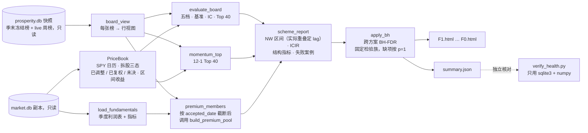
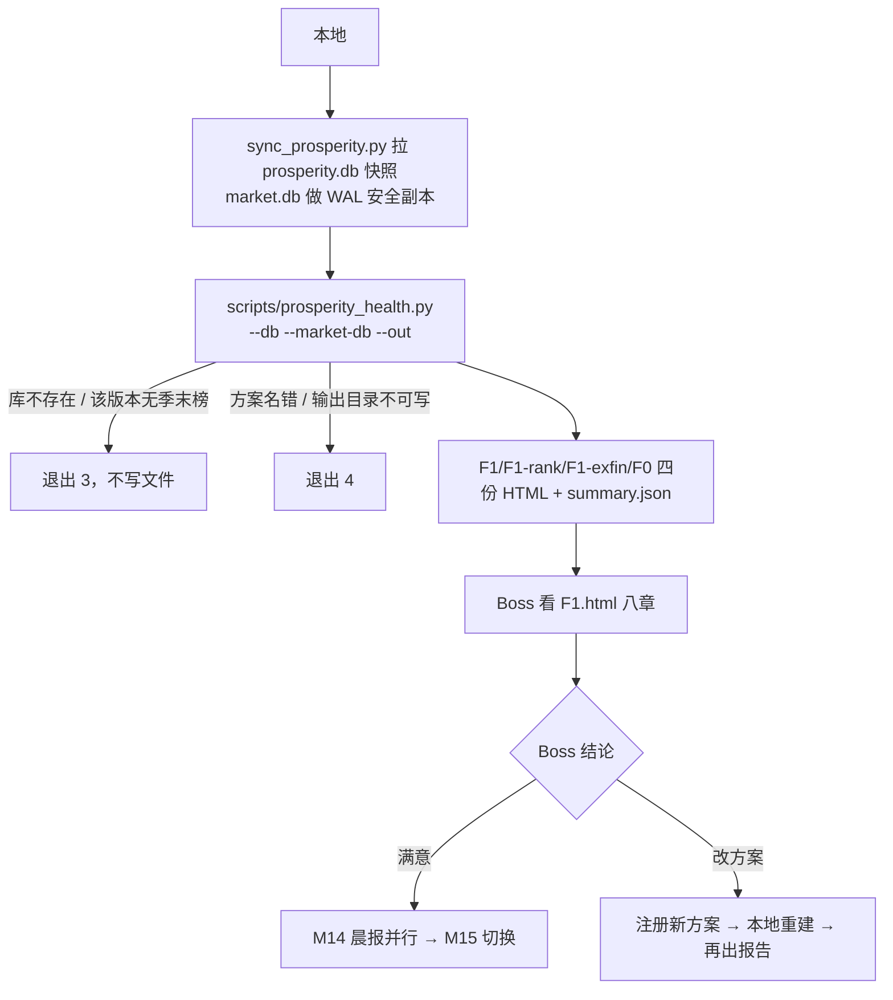

# 景气引擎 M12 体检报告 Implementation Plan

**状态：2026-11-01 Boss 批准实施。第一轮审查 1 个 P1、3 个 P2 已修订（见 §13）。**

**Goal:** 本地一条命令读 `prosperity.db` 快照和 `market.db`，为每个方案生成一份格式固定的 HTML 体检报告（北极星 §4.3 八章），另出 `summary.json` 供独立核对。
**Architecture:** 新模块 `backtest/research/prosperity_health.py`（研究侧，与 M7 `prosperity_s1.py` 同目录）负责计算（价格与区间收益、逐期分档、统计、对照组、结构指标），`backtest/research/prosperity_health_html.py` 负责渲染，`scripts/prosperity_health.py` 是 CLI。两个库都只读。不进 `code_version`，不改打分，不碰云端。
**Tech Stack:** Python 3.10 兼容、sqlite3、numpy、scipy（已有依赖）；复用 `newey_west_tstat`、`build_premium_pool`、`detect_split_like_jumps`；HTML 内联 SVG，无外部资源。
**Spec:** `docs/design/prosperity-engine-north-star.md` §4.3（体检报告）、模块表 #13；需求 R11、S3。
**北极星对齐:** 主北极星第二层「分析层 · 基本面」；景气北极星第四层「输出」。完成 R11、S3（MVP 验收项）。
**基线:** main `4feaa8d2`；分支 `prosperity/m12-health-report`，worktree `.worktrees/prosperity-m12`。云端 `code_version` `13e5f9d5183f1b8e`。

## 1. Boss 决定（2026-11-01）

| # | 问题 | 决定 |
|---|---|---|
| D1 | 做到哪一步 | 只做生成器和本地命令。季末冻结后云端自动生成、Telegram 投递，并入 M13 |
| D2 | 怎么评估 M10 精选池 | 照北极星原文：五档 + 扩展池均值、动量 Top N、Premium 三个对照组。不单列精选池（STRICT/FULL ∩ 成交额前 100） |
| D3 | 收益口径 | 价格收益（`daily_price` 收盘价，只做拆股调整，不含分红）。报告头部写明 |
| D4 | 持有期内价格提前结束 | 一律记"收益未知"，不进统计；头部列名单和收益覆盖率。不建人工并购名单 |

D2 补充：北极星的 Top N 取原值 N = 40。"本方案 Top 40"（STRICT/FULL 按排名取前 40）在第 3 章和对照组并列一行，供与动量 Top 40 同口径比较；第 4–7 章本来就以 Top N 为对象。第 3 章所有行只用**共同有效期**（Top 40、动量、Premium 都有值的期），避免动量缺前两期造成样本差异（审查建议）。

D4 改动北极星 §4.3 收益口径一句（原文"并购退出按最后价格近似"），D1 改动 §4.3 生成时机（生产侧并入 M13）。T6 一并改文档。

## 2. 实测依据（2026-11-01，云端与本地只读）

- **季末冻结榜**：`code_version` 13e5f9d5 下每个方案 21 期，as_of 2021-09-04 至 2026-08-29。F1 可排名 661–871 只，STRICT 49–77 只。另有 1 张 live 周榜（2026-10-31）。旧版本 1d24cbda 的 21 期不用。
- **`frozen_at`**：回放冻结榜都是 as_of 次日 00:00Z（周日）。起点 = 之后第一个交易日（周一）。
- **持有期**：本地价格到 2026-10-30。以 63/126/189 个交易日为 1/2/3 季，F1 已满期数 1 季 20、2 季 19、3 季 18。2026-08-29 一期全部进行中。
- **冻结间隔不等**：相邻冻结榜起点相隔 48–76 个交易日（63、72、53、63、63、76、48 …），不是固定 63。实际重叠：1/2/3 季持有期最多与之后 1/2/3 期重叠。所以 Newey-West 滞后阶数按实际窗口算，不用 h−1（审查 P2）。
- **价格提前结束**：3 季窗口里可排名行只有 4 只 5 行（AXIA、BLD、CTRA、EA），不到 0.1%。
- **无价格成员**：每期约 31–33 个成员在 `daily_price` 里一行都没有（ATVI、HES、SIVB 等），都是 observe，不在分档里，但在扩展池基准里。这些列入幸存者偏差名单。
- **拆股记录三态（审查 P1 后重测）**：自 2021-02 起 `fmp_stock_splits` 有 115 条比例 ≠ 1 的记录。按 §8.3 规则 2 试跑：**已调整 8 条**（BKNG 25:1、CVNA 5:1、FDX 1.241、KLAC 10:1、DD 1:3、CRWD 4:1、APH 2:1、CTVA 1333:200）；**确认已复权 85 条**；**未决 22 条**。日期错开的有 CVNA（价格跳 05-04，FMP 记 05-08）、DD（06-18 / 06-24）、APH（08-27 / 09-03）、FDX（05-27 / 06-01）。未决的有两类：一是小比例记录（IBM、BDX、O 等，比例 1.01–1.10，窗口内日常波动就超过比例的一半，无法区分）；二是 MNST 2:1（窗口内 0.501、1.994、0.506 三次跳变）和 HON（1.95、0.511）。F1 可排名行的收益窗口跨过未决记录的：1/2/3 季分别 13/18/23 行，共 13,078–14,736 行，约 0.1–0.2%，涉及 BBD、BDX、CNQ、HON、IBM、LEN、MNST、O、TRI、ZBH。
- **为什么不复用 `terminal/financial_history.apply_recorded_splits`**：它只看 FMP 日期当天，抓不到上面 4 处日期错开的；25% 容差会把已复权的小比例记录（BDX 41:40、GE 1253:1000）再调一次；找不到就当已复权，会放过 2:1 记录配 100→40 这类断点。
- **复权规则交叉检查预览**：另用"事件窗口首尾收盘比"法分类，与规则 2 有 10 条不同（IBM、BHP、EHC、BN、GE ×2、BWA、J、BDX 2026-02-10、MNST）。A7b 逐条列出并做敏感性检验。
- **无记录的疑似拆股**：可排名行的持有期内 1 处（QXO 2024-07-30，60.5→12.05，≈1/5）。其他单日超过 2 倍或不到一半的变动 7 处（GL、AGL、MRNA 等，多为真实事件；AVB 2026-08-18 成交量为 0，可疑），保留收益，列入附录。
- **预期族**：F1 的 `surprise` 每期有 z（覆盖约 77%），`revision` 只有 2026-08-29 一期有 z。按北极星两者都标 UNKNOWN。
- **对照组数据**：SPY 从 2021-02-10 起，12-1 动量要 252 个交易日，从 2022-03-19 那期起才有（19 期）。Premium 需要的季度利润表都有 `accepted_date`（缺失只有 2 行）。`metrics_quarterly` 的 4 季 CAGR 是当前值，不是点时值，所以重算的 Premium 标 approximate。
- **云端 Premium**：`premium_pool.json` as_of 2026-10-30，成员 47，universe 899，与 10-31 live 周榜成员数相同，可用来核对重算适配器。
- **耗时预估**：M10 读 22 张周榜加计算共 8.5 秒。本报告读 84 张冻结榜，加载约 1,300 只的价格，预计 1–2 分钟。

## 3. 架构图



依赖方向：`prosperity_health.py` 依赖 M8 读取（`ProsperityStore`、`StoredBoard`）、`MarketStore`、`terminal.selection_compass.build_premium_pool`、`backtest.pipeline.primitives.evaluation.newey_west_tstat`、`terminal.financial_history.detect_split_like_jumps`。景气内核与 M9/M10 都不依赖它。

## 4. 业务流程图



## 5. 替代方案

| 方案 | 优点 | 缺点 | 选择 |
|---|---|---|---|
| A. 新模块读冻结榜，逐期算分档收益，复用现有统计函数（选定） | 直接用不可变的冻结榜，与生产同口径；纯函数好测；生产侧以后可原样调用 | 要自写价格窗口与复权逻辑 | ✓ |
| B. 把冻结榜转成因子面板，套 `backtest/pipeline` 的 `EvaluationEngine` | 现成的 IC、NAV、报告 | 它按日调仓、带 IS/OOS 切分，不认识季末榜、`frozen_at` 起点和持有期重叠；适配层比方案 A 还大 | |
| C. 在 `reports/` 下写一次性脚本 | 最快 | 违反北极星"研究侧与生产侧同一份代码"；下次季末无法复用 | |

复权不复用 `apply_recorded_splits`（理由见 §2）。也不改它：它服务 deep analysis 的图表，改它超出本模块范围。

## 6. 风险自证

- **最大风险：价格缺陷污染档位均值，报告看着正常但结论错。** KLAC 未复权会让它的季度收益变成 −90%，单只就能把一档的均值拉低约 0.5pp。应对：①拆股记录分三态，只有"恰好一次跳变且与比例吻合"才调整，"窗口内没有足够大的变动"才认定已复权，其余一律未决、跨过它的收益记未知（审查 P1）；测试覆盖日期差、2:1 配 100→40、5:4 配 100→80；②无记录的疑似拆股记"收益未知"；③其他大幅单日变动保留收益但列入附录，Boss 能看到；④独立核对分两部分：A7a 按同一规则另写一套实现，重算 F1 全部数字；A7b 用不依赖单日阈值的另一种分类法交叉检查，逐条列出分歧，并给出档位均值对规则的敏感度。
- **第二风险：前视。** 起点用 `frozen_at` 之后第一个交易日收盘价；动量只用 ≤ as_of 的价格；Premium 重算只给 `accepted_date`（缺失用 `filing_date`）≤ as_of 的季度。CAGR 指标是当前值，所以标 approximate。
- **第三风险：报告被过度解读。** 头部写 n、approximate 占比、"不作上线门槛"、价格收益不含分红；期数 <5 不给区间；Newey-West 滞后按实际重叠期数定，不低估标准误；跨方案做 BH-FDR，检验族固定，未估计项按 p=1 计入；预期族只给 UNKNOWN（n=x）。
- **为什么不更简单：** 不做复权会被 8 处未复权拆股直接污染；不做点时截断，Premium 对照会用到未来财报。这两处是最少必要的复杂度。

## 7. 文件结构

```
backtest/research/prosperity_health.py          新建：数据视图、PriceBook、逐期评估、统计、对照组、结构指标、报告汇总
backtest/research/prosperity_health_html.py     新建：summary → 自包含 HTML（固定八章 + 附录，内联 SVG）
scripts/prosperity_health.py           新建：CLI（只读两个库，写 --out 目录）
tests/test_prosperity_health.py        新建：T1–T4 单元测试
tests/test_prosperity_health_cli.py    新建：T5 端到端测试（合成库）
reports/prosperity/m12-health/         新建：README.md、verify_health.py、premium_check.py、四份 HTML、summary.json、核对输出
docs/runbooks/prosperity-weekly.md     修改：新增"体检报告（本地）"一节
docs/design/prosperity-engine-north-star.md  修改：§4.3 收益口径与生成时机、模块表 #13、各层完成度
ARCHITECTURE.md                        修改：prosperity 行加 M12
docs/CHANGELOG.md                      修改：M12 一行
```

`terminal/prosperity/version.py` 的 `CODE_VERSION_SOURCES` 不动。新模块不在任何哈希路径下，也不被哈希文件 import。

## 8. 契约

### 8.1 常量

```python
TOP_N = 40
HORIZONS = (1, 2, 3)                 # 季
QUARTER_DAYS = 63                    # 每季交易日
TIERS = 5
MIN_PERIODS = 5                      # 期数 < 5 不给区间
MIN_IC_STOCKS = 10                   # 一期有效收益 < 10 只不算 IC
MOMENTUM_LOOKBACK = 252
MOMENTUM_SKIP = 21
PRICE_SLACK_DAYS = 5                 # 终点 / 回看价格最多可早于目标日 5 个交易日
SPLIT_SEARCH_DAYS = 5                # 事件窗口 = FMP 拆股日 ±5 个交易日
SPLIT_ADJUST_MIN = 1.2               # max(f, 1/f) < 1.2 的记录只能判"已复权"或"未决"，不调整
SPLIT_MATCH_TOL = 0.15               # |ln(跳变比 × f)| < min(0.15, |ln f| / 2) 才算同一次拆股
LARGE_MOVE = 2.0                     # 单日 > 2 倍或 < 1/2 进附录
CALENDAR_SYMBOL = 'SPY'
POOL_GRADES = ('STRICT', 'FULL')
CHAPTERS = ('分层前瞻收益', 'IC', '对照组', '与价格动量的重叠度', '行业集中度', '换手率', '失败案例', '短史因子')
```

### 8.2 数据视图

```python
@dataclass(frozen=True)
class Row:
    symbol: str
    status: str                      # ranked / observe / excluded
    grade: Optional[str]
    rank: Optional[int]
    score: Optional[float]
    sector: Optional[str]
    pit_basis: str
    beta: Optional[float]            # 来自冻结榜存档的 packet beta
    breakdown: Mapping[str, Mapping[str, Optional[float]]]   # factor → {raw, z, weight, contribution}
    family_scores: Mapping[str, Optional[float]]
    badges: Tuple[str, ...]

@dataclass(frozen=True)
class BoardView:
    scheme_id: str; scheme_hash: str; code_version: str
    as_of: str; quarter_label: Optional[str]; frozen_at: Optional[str]
    board_type: str; mode: str
    rows: Tuple[Row, ...]            # 全部行，按存储顺序

def board_view(stored: StoredBoard) -> BoardView
```

**方案 universe** = `status != 'excluded'` 的行（F1-exfin 剔除金融后的范围）。扩展池基准、动量、Premium 都在这个范围里算。

### 8.3 价格

```python
class PriceBook:
    def __init__(self, *, closes: Mapping[str, Sequence[Tuple[str, float]]],
                 splits: Mapping[str, Sequence[Tuple[str, float]]], calendar: Sequence[str])
    @classmethod
    def load(cls, market: MarketStore, symbols: Iterable[str]) -> 'PriceBook'
    calendar: Tuple[str, ...]
    adjustments: Tuple[Tuple[str, str, float], ...]     # (symbol, 跳变日, 拆股比)，按代码、日期排序
    split_events: Tuple[Tuple[str, str, float, str], ...]   # (symbol, FMP 日期, 比例, adjusted/already_adjusted/unresolved)，按代码、日期排序
    def start_index(self, frozen_at: str) -> Optional[int]
    def close_at(self, symbol: str, i: int) -> Optional[float]
    def jumps(self, symbol: str, start_i: int, end_i: int) -> List[dict]   # {date, ratio, kind}
    def window_return(self, symbol: str, start_i: int, end_i: int) -> Tuple[Optional[float], str]
```

规则：
1. **日历** = `CALENDAR_SYMBOL` 在 `daily_price` 里的日期，升序。`load` 只读 `daily_price`（`close > 0`）和 `fmp_stock_splits`。
2. **拆股三态**（构造时对每只股票做一次，审查 P1）。对每条 `f = numerator/denominator ≠ 1` 的记录：
   - **事件窗口**：k = 日历中第一个 ≥ FMP 日期的位置，窗口 = `[calendar[k−5], calendar[k+5]]`（两端截到日历范围内）。FMP 日期早于日历首日或晚于日历末日的记录跳过，不进 `split_events`。
   - **候选跳变**：该股相邻两个价格点、且后一点日期落在窗口内的比值 r（用原始收盘价）。`d = |ln f|`；`|ln r| ≥ d / 2` 的叫"够大的跳变"。
   - 判定，依次检查：

   | 状态 | 条件 | 处理 |
   |---|---|---|
   | `unresolved` | 窗口内没有任何价格点 | 不调整 |
   | `already_adjusted` | 没有够大的跳变 | 不调整 |
   | `adjusted` | `max(f, 1/f) ≥ 1.2`，恰好一个够大的跳变，且 `\|ln(r·f)\| < min(0.15, d/2)` | 该跳变后一点之前的收盘价全部除以 f，记入 `adjustments` |
   | `unresolved` | 其余（比例不吻合、多次跳变、比例 < 1.2 但有够大的波动） | 不调整 |

   - 全部记录及状态写入 `split_events`。多条 `adjusted` 记录按日期从新到旧依次调整。
   - 例：2:1 记录配 100→40（r = 0.4，`|ln 0.8| = 0.22 ≥ 0.15`）→ `unresolved`；5:4 记录配 100→80（f = 1.25 ≥ 1.2，`|ln 1| = 0`）→ `adjusted`，收益 0。
3. **`start_index(frozen_at)`** = 日历中第一个严格晚于 `frozen_at` 的 UTC 日期的位置；没有则 `None`。
4. **`close_at(symbol, i)`** = 该股在 `[calendar[i−5], calendar[i]]` 内最后一个复权收盘价；没有则 `None`。
5. **`jumps`** 扫 `(start_i, end_i]` 内相邻两点（复权后）。`terminal.financial_history.detect_split_like_jumps` 对这两点给出结论的记 `split_suspect`；否则比值 > 2 或 < 0.5 的记 `large_move`。只对比值超出 0.55–1.8 的两点调用该函数（与它自己的跳过条件相同）。
6. **`window_return`** 的原因按顺序判定，第一个命中即返回：

| 原因 | 条件 | 收益 |
|---|---|---|
| `no_price` | 该股没有任何价格行 | None |
| `no_start_price` | `calendar[start_i]` 当天没有收盘价 | None |
| `ended_early` | 该股最后一个价格日期早于 `calendar[end_i]` | None |
| `price_gap` | `close_at(symbol, end_i)` 为 None | None |
| `split_unresolved` | 该股某条 `unresolved` 记录的事件窗口与收益窗口相交：`窗口起 ≤ calendar[end_i]` 且 `窗口止 > calendar[start_i]` | None |
| `split_suspect` | 窗口内有 `split_suspect` 跳变 | None |
| `ok` | 其余 | `close_at(end) / close(start) − 1` |

### 8.4 逐期评估与统计

```python
@dataclass(frozen=True)
class PeriodResult:
    as_of: str; horizon: int
    status: str                      # complete / in_progress / not_started
    start: Optional[str]; end: Optional[str]
    returns: Mapping[str, Tuple[Optional[float], str]]     # universe 每只
    tiers: Mapping[str, int]                                # ranked 每只 → 0..4
    baseline: Optional[float]                               # universe 有效收益等权均值
    tier_excess: Mapping[int, Optional[float]]
    spread: Optional[float]                                 # Q1 − Q5
    ic: Optional[float]
    top: Tuple[str, ...]                                    # 本方案 Top 40
    top_excess: Optional[float]
    coverage: Mapping[str, Tuple[int, int]]                 # {'ranked': (有效, 总), 'universe': (有效, 总)}

def assign_tiers(symbols_by_rank: Sequence[str]) -> Dict[str, int]
def top_symbols(view: BoardView) -> Tuple[str, ...]
def evaluate_board(view: BoardView, prices: PriceBook, *, horizon: int) -> PeriodResult
def overlap_lag(windows: Sequence[Tuple[int, int]]) -> int     # (start_i, end_i) 日历位置
def interval(values: Sequence[float], *, lag: int) -> dict
def ic_summary(ics: Sequence[float], *, lag: int) -> dict
def monotonic(means: Sequence[Optional[float]]) -> bool
```

`PeriodResult` 另带 `start_i: Optional[int]`、`end_i: Optional[int]`（日历位置），供 `overlap_lag` 使用。

- **分档**：ranked 行按 `rank` 升序，第 i 只（0 起）进档 `floor(i × 5 / n)`。分档在看收益之前完成，收益未知不改变档位。
- **Top 40**：ranked 且 grade ∈ STRICT/FULL 的行按 `rank` 取前 40。
- **状态**：`start_index` 为 None → `not_started`（其余字段为空）。`start_i + 63h` 超出日历 → `in_progress`，终点取日历最后一天，照算但不进统计。否则 `complete`。
- **超额**：档位（或 Top 40、对照组）有效收益的等权均值 − 当期 baseline。档内无有效收益 → None。
- **IC**：ranked 行有效收益 ≥ 10 只时，`spearmanr(−rank, return)`。
- **`overlap_lag`**（审查 P2）：窗口按 start 升序，`lag = max_i #{j > i : start_j < end_i}`；没有窗口时为 0。每个序列的 lag 用该序列实际用到的期算（档位用该持有期全部 `complete` 期；第 3 章用共同有效期）。真实数据预期 1/2/3 季 = 1/2/3。
- **`interval`**：`n < 5` → `{'n', 'mean', 'lag'}`（`n = 0` 时 `mean = None`）。否则 `t, p = newey_west_tstat(values, lag)`；`t ≠ 0` 时 `se = mean / t`，区间 `mean ± t_{0.975, n−1} · se`，返回 `{'n','mean','se','lo','hi','t','p','lag'}`；`t == 0` 时只返回 `{'n','mean','t','p','lag'}`。
- **`ic_summary`**（审查 P2，北极星"IC 与 ICIR"）：`interval(ics, lag=lag)` 的全部字段，另加 `sd`（样本标准差，ddof = 1）和 `icir = mean / sd`。ICIR 是每期值，**不年化**（持有期重叠，年化没有意义），HTML 注明。`n < 5` 或 `sd == 0` 时 `icir = None`；`n < 2` 时 `sd = None`。
- **`monotonic`**：五档均值全部有值且严格递减。

### 8.5 对照组与结构指标

```python
def momentum_top(view: BoardView, prices: PriceBook) -> Optional[Tuple[str, ...]]
def load_fundamentals(market: MarketStore, symbols: Iterable[str]) -> Dict[str, dict]   # {symbol: {'income': [...], 'metrics': [...]}}
def premium_members(view: BoardView, fundamentals: Mapping[str, dict], *, as_of: str) -> dict
def concentration(view: BoardView, symbols: Sequence[str]) -> dict    # {top_sector, max_share, hhi}
def turnover(previous: Sequence[str], current: Sequence[str]) -> float
def failure_cases(pairs: Sequence[Tuple[BoardView, PeriodResult]], *, limit: int = 10) -> List[dict]
def short_history(views: Sequence[BoardView], scheme: Scheme) -> List[dict]
```

- **动量 12-1**：t0 = 日历中 ≤ as_of 的最后一天。t0 位置 < 252 → None（历史不足）。universe 每只取 `close_at(t0−21) / close_at(t0−252) − 1`；任一价格缺失，或 `[t0−252, t0]` 内有 `split_suspect` 跳变或相交的 `unresolved` 拆股记录，该股不参与。降序（同值按代码）取前 40。
- **第 3 章对照组表**：每个持有期只用**共同有效期**（`complete`，且 Top 40、动量 Top 40、Premium 三组的超额都有值）。行：本方案 Top 40、动量 Top 40、Premium（approximate）、扩展池等权（只给平均收益，超额恒为 0），以及两条配对差"Top 40 − 动量"、"Top 40 − Premium"。每行给期数、平均收益、平均超额、NW 区间（lag 由共同有效期算）。表头写共同有效期的期数与 as_of 范围。这些 p 值是描述性的，不进 BH 检验族。
- **Premium**：对 universe 每只，只保留 `(accepted_date or filing_date)[:10] ≤ as_of` 的利润表行（按日期降序）；指标行只保留日期在这些利润表日期里的行；覆盖状态一律 `'ok'`。用这个适配器调用 `build_premium_pool(store=..., symbols=universe, as_of=as_of, beta_observations={symbol: row.beta}, min_fundamental_coverage=0.0, min_beta_coverage=0.0)`，返回 `{'members': 代码元组, 'coverage': ..., 'basis': 'approximate'}`。覆盖门设 0 是因为这里是回看对照，实际覆盖率照写。
- **重叠度**：每期 `|Top 40 ∩ 动量 Top 40|`，动量为 None 的期不算。
- **行业集中度**：Top 40 的最大 sector 及占比、HHI = Σ 占比²；sector 缺失记为"未知"。
- **换手率**：相邻季末榜 Top 40：`1 − |前 ∩ 后| / |前|`。周榜：live 周榜按 as_of 排序后相邻计算；不足 2 张时记 `{'n': 张数}`。
- **失败案例**：所有 `complete` 的 3 季结果里，grade = STRICT 且收益有效的行，按收益升序取前 10；每条带期、收益、超额、分数、排名、徽章、各族小分和每个因子的 raw/z/weight/contribution。
- **短史因子**：方案里 family = `expectation` 的因子。对每个因子：`periods` = 至少一行 ranked 有 z 的冻结榜期数；`latest_coverage` = 最新一期 ranked 行中有 z 的比例；`verdict` = `'UNKNOWN'`。方案没有预期族因子时返回空列表。

### 8.6 汇总、BH 与 summary.json

```python
def scheme_report(views: Sequence[BoardView], weekly: Sequence[BoardView], prices: PriceBook,
                  fundamentals: Mapping[str, dict]) -> dict
def bh_adjust(p_values: Sequence[Optional[float]]) -> List[Optional[float]]
def apply_bh(reports: Mapping[str, dict]) -> dict     # 写入 p_bh，返回 {'family': m, 'estimated': k}
```

- **BH 检验族**（审查 P2）= 本次运行所有方案 × 3 个持有期的"Q1−Q5 价差"与"IC 均值"两类检验，**族大小固定**（默认 4 × 3 × 2 = 24）。`bh_adjust` 把没有 p 值的检验（期数 < 5）按 p = 1 填入，对全部 m 项调用 `scipy.stats.false_discovery_control(method='bh')`，只给原本有 p 值的项写回 `p_bh`，缺项的 `p_bh` 保持 None，HTML 显示"UNKNOWN"。例：12 项中只有一项 p = 0.04 → 校正后 0.48。头部写"检验族 m 项，其中 k 项有 p 值，未估计项按 p = 1 计入"。档位与对照组的 p 值只给原值，报告注明"描述性"。
- **报告头部字段**：方案代码、`scheme_hash`、`code_version`、冻结榜期数与 as_of 范围、每个持有期的已满期数、ranked 行 approximate 占比、ranked 行收益覆盖率（按持有期）、universe 收益覆盖率、两个库的 SHA256、价格最后日期、生成时间、BH 检验族大小 m 与有 p 值的项数 k，以及三条固定说明："不作上线门槛"、"价格收益，不含分红"、"期数约 20，置信区间宽"。
- **附录**：①收益未知名单（代码、期、持有期、原因、最后价格日期），只列 ranked 行；②无价格成员（代码、出现期数），作为幸存者偏差说明；③大幅单日变动（ranked 行已测窗口内，`large_move`，按代码、日期去重）；④拆股记录处理结果（`split_events` 中属于 universe 的，分三态列出；`adjusted` 带实际跳变日）。
- `summary.json` = `{'generated_at', 'inputs': {...}, 'bh_family': {'family': m, 'estimated': k}, 'schemes': {scheme_id: report}}`，report 含 §8.4–8.6 的全部数字与逐期明细。

### 8.7 HTML

- 每方案一个文件 `<out>/<scheme_id>.html`。`<title>` = `景气体检 · <scheme_id>`。CSS 内联，沿用 `terminal/html_report.py` 的暖色变量；不加载任何外部脚本、样式或字体。
- 头部卡片 + 固定八章（标题依次为 `CHAPTERS`，前面编号 1–8）+ 附录。逐期明细放在 `<details>` 里。
- 第 1 章一张内联 SVG：横轴 1/2/3 季，每组 5 根柱（Q1–Q5 平均超额），带 95% 区间须线和零线；没有区间的柱不画须线。每个区间旁注 NW lag。第 2 章一张逐期 IC 柱图（3 季），下附表格：每个持有期的 IC 均值、标准差、ICIR（注"每期值，未年化"）、NW 区间、p、p_bh。
- 数字格式：收益与超额为百分比两位小数；p 值三位小数；`None` 显示为"—"；进行中的期标"进行中"。
- 单文件 ≤ 5MB。

### 8.8 CLI

```
scripts/prosperity_health.py --db PROSPERITY_DB --market-db MARKET_DB --out DIR
                             [--schemes F1,F1-rank,F1-exfin,F0] [--code-version V]
```

- `--code-version` 默认是当前代码的 `code_version()`。
- 两个库都用只读方式打开（`ProsperityStore(read_only=True)`、`MarketStore(read_only=True)`）。
- 退出码：0 成功；3 库文件不存在，或某个方案在该版本下没有季末冻结榜（不写任何文件）；4 方案名不在注册表，或 `--out` 指向已存在的非目录。
- 输出写到 `--out`（不存在则创建），覆盖同名文件。

## 9. 验收标准

| # | 标准 | 任务 |
|---|---|---|
| A1 | 价格：起点为 `frozen_at` 之后第一个交易日；7 种原因各有测试；拆股三态：日期差 ≤5 天、比例吻合的单次跳变被调整（含 5:4 配 100→80，收益 0）；窗口内无够大变动的判已复权、不动；2:1 配 100→40（比例不吻合）、多次跳变、小比例配大波动判未决，跨过的收益记 `split_unresolved`；无记录的疑似拆股记 `split_suspect`；>2 倍单日变动收益照算并被 `jumps` 列出 | T1 |
| A2 | 逐期：分档在收益之前按排名定；excluded 行不进基准；超额、Q1−Q5、IC 与手算一致；进行中与未开始不进统计；`overlap_lag` 在不等间隔起点上按实际重叠计数（含间隔 50 天、持有 63 天的样本）；`interval` 与 `newey_west_tstat(values, lag)` 一致；ICIR = 均值 / 样本标准差，未年化，期数 <5 或零方差为 None；期数 <5 不给区间 | T2 |
| A3 | 结构：Top 40 只取 STRICT/FULL；集中度与 HHI、季度与周换手、失败案例（只取 STRICT、带拆解）、短史因子（UNKNOWN + 期数；F0 为空）与手算一致 | T3 |
| A4 | 对照组：动量跳过最近 21 天、只用 ≤ as_of 价格、历史不足返回 None；Premium 只用 as_of 前已披露的季度，beta 取存档值，结果标 approximate；第 3 章各行只用共同有效期，期数一致；BH 族大小固定，缺项按 p = 1 计入、自身 `p_bh` 为 None（12 项中只有 p = 0.04 → 0.48） | T4 |
| A5 | CLI：四份 HTML 各含头部三条固定说明和八章标题（顺序固定）；`summary.json` 字段齐全；两个库运行前后 SHA256 不变；退出码 3/4 情形不写文件；HTML 无外部资源、≤5MB | T5 |
| A6 | 真实数据：四个方案都生成成功；F1 已满期数 1/2/3 季 = 20/19/18；动量对照从 2022-03-19 期起；1/2/3 季 NW lag = 1/2/3；拆股三态逐条列入附录，并与 §2 的全表试跑（调整 8、已复权 85、未决 22；§2 含不在榜单里的代码）逐条对照，差异只能来自代码范围；记录耗时与峰值内存 | T6 |
| A7a | 独立重算（F1）：`verify_health.py` 不 import `src`/`terminal`/`backtest`，用"一半成员有价格"日历、按 §8.3 规则另写一套三态复权，重算起点、逐期收益与原因、基准、五档超额、Q1−Q5、IC、ICIR、NW lag 与区间、动量 Top 40、重叠、HHI、换手、未知名单、BH；集合完全一致，数值差 ≤1e-9 | T6 |
| A7b | 复权规则交叉检查：`verify_health.py` 另用"事件窗口首尾收盘比"法分类全部拆股记录（与 §8.3 不共用单日阈值），逐条列出两法分歧及其价格序列；把分歧记录分别按"全部记未知"和"按另一法处理"重算 F1 五档超额与 Q1−Q5，报告最大变化。该项是敏感性报告，不设通过门槛 | T6 |
| A8 | Premium 适配器：用 2026-10-31 live 周榜成员与存档 beta、as_of 2026-10-30，重算结果与云端 `premium_pool.json`（47 只）比对；差异逐只列原因 | T6 |
| A9 | `code_version` 仍为 `13e5f9d5183f1b8e`；景气测试全过；全量测试与 main 基线按失败 nodeid 比对，新增失败为空 | T6 |

## 10. 实施任务（主线程 inline，每任务一个检查点）

### Task 1：价格与区间收益

**Files:**
- Create: `backtest/research/prosperity_health.py`（常量、`PriceBook`）
- Test: `tests/test_prosperity_health.py`

**Interfaces:**
- Consumes: `tests/prosperity_fixtures.weekdays(end, n)`（`tests/prosperity_fixtures.py:284`）；`terminal.financial_history.detect_split_like_jumps(prices)`（`terminal/financial_history.py:380`，参数为 `[(date, close)]`，返回说明字符串列表）
- Produces: `PriceBook`（§8.3）

- [ ] Step 1：写失败测试

```python
"""M12 health report: prices, per-board evaluation, structure, controls."""
import pytest

from tests.prosperity_fixtures import weekdays

CAL = weekdays('2027-12-31', 600)


def book(closes, splits=None):
    from backtest.research.prosperity_health import PriceBook
    return PriceBook(closes=closes, splits=splits or {}, calendar=CAL)


def rising(base=10.0):
    return [(d, base + k) for k, d in enumerate(CAL)]


def test_start_is_first_trading_day_after_the_freeze_date():
    b = book({'A': rising()})
    assert CAL[b.start_index('2026-09-27T00:00:00Z')] == '2026-09-28'
    assert CAL[b.start_index('2026-09-26T08:30:00Z')] == '2026-09-28'
    assert b.start_index(CAL[-1] + 'T08:30:00Z') is None


def test_window_return_and_unknown_reasons():
    s = CAL.index('2026-09-28')
    e = s + 63
    full = rising()
    gap = [p for p in full if not (CAL[e - 10] <= p[0] <= CAL[e])]
    b = book({'A': full, 'B': full[:e - 3], 'C': gap, 'D': full[s + 1:], 'E': []})
    ret, why = b.window_return('A', s, e)
    assert why == 'ok' and ret == pytest.approx(full[e][1] / full[s][1] - 1)
    assert b.window_return('B', s, e) == (None, 'ended_early')
    assert b.window_return('C', s, e) == (None, 'price_gap')
    assert b.window_return('D', s, e) == (None, 'no_start_price')
    assert b.window_return('E', s, e) == (None, 'no_price')
    assert b.window_return('ZZZ', s, e) == (None, 'no_price')


def test_recorded_split_matched_within_five_days_small_factor_left_alone():
    k = [(d, 100.0) for d in CAL[:250]] + [(d, 10.0) for d in CAL[250:]]
    g = [(d, 50.0) for d in CAL]
    b = book({'K': k, 'G': g}, {'K': [(CAL[254], 10.0)], 'G': [(CAL[100], 1.253)]})
    assert b.window_return('K', 240, 260) == (pytest.approx(0.0), 'ok')
    assert b.window_return('G', 90, 110) == (pytest.approx(0.0), 'ok')
    assert b.adjustments == (('K', CAL[250], 10.0),)
    assert [e[3] for e in b.split_events] == ['already_adjusted', 'adjusted']


def test_reverse_split_and_already_adjusted_series():
    r = [(d, 10.0) for d in CAL[:250]] + [(d, 30.0) for d in CAL[250:]]
    flat = [(d, 10.0) for d in CAL]
    b = book({'R': r, 'N': flat}, {'R': [(CAL[247], 1 / 3)], 'N': [(CAL[200], 10.0)]})
    assert b.window_return('R', 240, 260) == (pytest.approx(0.0), 'ok')
    assert b.window_return('N', 190, 210) == (pytest.approx(0.0), 'ok')
    assert b.adjustments == (('R', CAL[250], pytest.approx(1 / 3)),)


def test_five_for_four_split_is_adjusted():
    """Review P1 case 2: a 1.25 record with a matching 100→80 step; true price return is 0."""
    p = [(d, 100.0) for d in CAL[:250]] + [(d, 80.0) for d in CAL[250:]]
    b = book({'P': p}, {'P': [(CAL[250], 1.25)]})
    assert b.window_return('P', 240, 260) == (pytest.approx(0.0), 'ok')
    assert b.adjustments == (('P', CAL[250], 1.25),)


def test_unmatched_or_ambiguous_records_are_unresolved_not_assumed_adjusted():
    """Review P1 case 1: a 2:1 record with 100→40 is a real break, never 'already adjusted'."""
    two = [(d, 100.0) for d in CAL[:250]] + [(d, 40.0) for d in CAL[250:]]
    multi = ([(d, 100.0) for d in CAL[:248]] + [(d, 50.0) for d in CAL[248:249]]
             + [(d, 100.0) for d in CAL[249:251]] + [(d, 50.0) for d in CAL[251:]])
    small = [(d, 100.0) for d in CAL[:250]] + [(d, 90.0) for d in CAL[250:]]
    b = book({'T': two, 'M': multi, 'S': small},
             {'T': [(CAL[250], 2.0)], 'M': [(CAL[250], 2.0)], 'S': [(CAL[250], 1.05)]})
    assert b.adjustments == ()
    assert [e[3] for e in b.split_events] == ['unresolved'] * 3
    for s in ('T', 'M', 'S'):
        assert b.window_return(s, 240, 260) == (None, 'split_unresolved')
    assert b.window_return('T', 200, 240)[1] == 'ok'            # window ends before the event window
    assert b.window_return('T', 256, 300) == (pytest.approx(0.0), 'ok')   # starts after it


def test_unexplained_split_like_jump_is_unknown_and_large_moves_are_listed():
    q = [(d, 60.0) for d in CAL[:250]] + [(d, 12.0) for d in CAL[250:]]
    v = [(d, 100.0) for d in CAL[:250]] + [(d, 40.0) for d in CAL[250:]]
    b = book({'Q': q, 'V': v})
    assert b.window_return('Q', 240, 260) == (None, 'split_suspect')
    assert b.window_return('Q', 251, 270)[1] == 'ok'
    assert b.window_return('V', 240, 260) == (pytest.approx(-0.6), 'ok')
    assert b.jumps('V', 240, 260) == [{'date': CAL[250], 'ratio': pytest.approx(0.4), 'kind': 'large_move'}]
```

- [ ] Step 2：`pytest tests/test_prosperity_health.py -v` → 预期 FAIL（`ModuleNotFoundError: backtest.research.prosperity_health`）
- [ ] Step 3：按 §8.1、§8.3 写常量与 `PriceBook`。内部每只股票存 `dates`（ISO 字符串）与复权后 `closes`（numpy 数组），用 `bisect` 定位。`load` 用参数绑定分批查询 `daily_price`，`symbols` 去重排序；日历查询 `CALENDAR_SYMBOL`。
- [ ] Step 4：`pytest tests/test_prosperity_health.py -v` → 预期全部 PASS
- [ ] Step 5：`git add backtest/research/prosperity_health.py tests/test_prosperity_health.py && git commit -m "feat(prosperity-m12): price book with tolerant split adjustment"`

### Task 2：逐期评估与统计

**Files:**
- Modify: `backtest/research/prosperity_health.py`（`Row`、`BoardView`、`board_view`、`PeriodResult`、`assign_tiers`、`top_symbols`、`evaluate_board`、`overlap_lag`、`interval`、`ic_summary`、`monotonic`）
- Test: `tests/test_prosperity_health.py`

**Interfaces:**
- Consumes: `PriceBook`（T1）；`newey_west_tstat(values, lag) -> (t, p)`（`backtest/pipeline/primitives/evaluation.py:316`）；`StoredBoard`（`src/data/prosperity_storage.py`：`meta`、`board.rows: ScoredRow`、`stocks`）
- Produces: §8.2、§8.4 的全部签名

- [ ] Step 1：写失败测试（追加）

```python
def row(symbol, rank=None, *, status='ranked', grade='FULL', sector='Technology', score=None,
        pit='approximate', beta=None, breakdown=None):
    from backtest.research.prosperity_health import Row
    return Row(symbol=symbol, status=status, grade=grade if status == 'ranked' else None, rank=rank,
               score=score if score is not None else (100.0 - rank if rank else None), sector=sector,
               pit_basis=pit, beta=beta, breakdown=breakdown or {}, family_scores={}, badges=())


def view(rows, *, as_of='2026-09-26', frozen_at='2026-09-27T00:00:00Z', board_type='quarter_final',
         mode='replay'):
    from backtest.research.prosperity_health import BoardView
    return BoardView(scheme_id='F1', scheme_hash='h', code_version='v', as_of=as_of, quarter_label='2026Q2',
                     frozen_at=frozen_at, board_type=board_type, mode=mode, rows=tuple(rows))


def stepped(r, s):
    """Flat at 10 through calendar index s, then 10 × (1 + r)."""
    return [(d, 10.0 if k <= s else 10.0 * (1 + r)) for k, d in enumerate(CAL)]


def test_tiers_are_fixed_by_rank():
    from backtest.research.prosperity_health import assign_tiers
    assert list(assign_tiers(list('abcdefghij')).values()) == [0, 0, 1, 1, 2, 2, 3, 3, 4, 4]
    assert list(assign_tiers(list('abcdefg')).values()) == [0, 0, 1, 2, 2, 3, 4]


def test_board_tiers_baseline_excess_ic_and_top():
    from backtest.research.prosperity_health import evaluate_board
    s = CAL.index('2026-09-28')
    rets = {f'R{i}': (10 - i) / 100 for i in range(10)}
    rets.update(O1=0.0, O2=0.0)
    closes = {k: stepped(v, s) for k, v in rets.items()}
    closes['X'] = stepped(0.5, s)
    rows = [row(f'R{i}', i + 1) for i in range(10)]
    rows += [row('O1', status='observe'), row('O2', status='observe'), row('X', status='excluded')]
    out = evaluate_board(view(rows), book(closes), horizon=1)
    base = sum(rets.values()) / 12
    assert out.status == 'complete' and out.start == '2026-09-28' and out.end == CAL[s + 63]
    assert out.baseline == pytest.approx(base) and 'X' not in out.returns
    assert out.tier_excess[0] == pytest.approx(0.095 - base)
    assert out.tier_excess[4] == pytest.approx(0.015 - base)
    assert out.spread == pytest.approx(0.08) and out.ic == pytest.approx(1.0)
    assert out.top == tuple(f'R{i}' for i in range(10))
    assert out.top_excess == pytest.approx(0.055 - base)
    assert out.coverage == {'ranked': (10, 10), 'universe': (12, 12)}


def test_unknown_return_keeps_its_tier_and_ic_needs_ten():
    from backtest.research.prosperity_health import evaluate_board
    s = CAL.index('2026-09-28')
    closes = {f'R{i}': stepped((10 - i) / 100, s) for i in range(1, 10)}
    rows = [row(f'R{i}', i + 1) for i in range(10)]
    out = evaluate_board(view(rows), book(closes), horizon=1)
    assert out.tiers['R0'] == 0 and out.returns['R0'] == (None, 'no_price')
    assert out.tier_excess[0] == pytest.approx(0.09 - out.baseline)
    assert out.ic is None and out.coverage['ranked'] == (9, 10)


def test_unfinished_window_is_in_progress_and_future_freeze_not_started():
    from backtest.research.prosperity_health import evaluate_board
    s = len(CAL) - 100
    closes = {f'R{i}': stepped(0.01 * i, s) for i in range(10)}
    rows = [row(f'R{i}', i + 1) for i in range(10)]
    out = evaluate_board(view(rows, frozen_at=CAL[s - 1] + 'T08:30:00Z'), book(closes), horizon=3)
    assert out.status == 'in_progress' and out.start == CAL[s] and out.end == CAL[-1]
    later = evaluate_board(view(rows, frozen_at=CAL[-1] + 'T08:30:00Z'), book(closes), horizon=1)
    assert later.status == 'not_started' and later.tier_excess == {} and later.start is None


def test_overlap_lag_counts_actual_overlap_on_uneven_starts():
    """Review P2: freezes 50 trading days apart still overlap a 63-day window."""
    from backtest.research.prosperity_health import overlap_lag
    starts = [0, 63, 113, 189, 237]                  # gaps 63, 50, 76, 48
    assert overlap_lag([(s, s + 63) for s in starts]) == 1
    assert overlap_lag([(s, s + 126) for s in starts]) == 2
    assert overlap_lag([(s, s + 189) for s in starts]) == 3
    assert overlap_lag([(s, s + 63) for s in (0, 63, 126)]) == 0
    assert overlap_lag([]) == 0


def test_interval_uses_newey_west_with_the_given_lag():
    from scipy.stats import t as t_dist
    from backtest.pipeline.primitives.evaluation import newey_west_tstat
    from backtest.research.prosperity_health import interval
    xs = [0.02, -0.01, 0.03, 0.01, 0.00, 0.04, -0.02, 0.02]
    t, p = newey_west_tstat(xs, 2)
    mean = sum(xs) / len(xs)
    se = mean / t
    half = t_dist.ppf(0.975, len(xs) - 1) * se
    assert interval(xs, lag=2) == pytest.approx(
        {'n': 8, 'mean': mean, 'se': se, 'lo': mean - half, 'hi': mean + half, 't': t, 'p': p, 'lag': 2})
    assert interval(xs[:4], lag=0) == {'n': 4, 'mean': pytest.approx(sum(xs[:4]) / 4), 'lag': 0}
    assert interval([], lag=0) == {'n': 0, 'mean': None, 'lag': 0}


def test_icir_is_mean_over_sample_sd_and_not_annualized():
    import statistics
    from backtest.research.prosperity_health import ic_summary
    ics = [0.05, 0.02, -0.01, 0.04, 0.03, 0.06]
    out = ic_summary(ics, lag=1)
    assert out['sd'] == pytest.approx(statistics.stdev(ics))
    assert out['icir'] == pytest.approx(statistics.fmean(ics) / statistics.stdev(ics))
    assert out['lag'] == 1 and out['n'] == 6
    assert ic_summary([0.03] * 6, lag=1)['icir'] is None
    assert ic_summary(ics[:4], lag=1)['icir'] is None


def test_monotonic_requires_strictly_falling_complete_tiers():
    from backtest.research.prosperity_health import monotonic
    assert monotonic([0.03, 0.01, 0.0, -0.01, -0.02])
    assert not monotonic([0.03, 0.01, 0.01, -0.01, -0.02])
    assert not monotonic([0.03, None, 0.0, -0.01, -0.02])


def test_board_view_reads_a_stored_board():
    from backtest.research.prosperity_health import board_view
    from tests.prosperity_fixtures import storage_batch
    stored = next(b for b in storage_batch(freeze=True) if b.meta.board_type == 'quarter_final'
                  and b.board.scheme_id == 'F1')
    v = board_view(stored)
    assert v.board_type == 'quarter_final' and v.frozen_at == stored.meta.frozen_at
    assert [r.symbol for r in v.rows] == [r.symbol for r in stored.board.rows]
    ranked = [r for r in v.rows if r.status == 'ranked']
    first = ranked[0]
    src = next(r for r in stored.board.rows if r.symbol == first.symbol)
    assert first.rank == src.rank and first.grade == src.grade
    assert set(first.breakdown) == set(src.z) | set(src.missing)
```

- [ ] Step 2：`pytest tests/test_prosperity_health.py -v` → 新增用例 FAIL（`ImportError`）
- [ ] Step 3：按 §8.2、§8.4 实现。`board_view` 从 `stored.stocks` 取 sector、pit_basis、beta，从 `ScoredRow` 的 `values/z/weights/contributions` 拼 `breakdown`（键 = 方案因子：`values`、`z`、`missing` 的并集）。`evaluate_board` 的 universe 与 ranked 定义见 §8.2、§8.4。
- [ ] Step 4：`pytest tests/test_prosperity_health.py -v` → 全部 PASS
- [ ] Step 5：`git commit -am "feat(prosperity-m12): per-board tiers, excess, IC/ICIR and overlap-aware Newey-West"`

### Task 3：结构指标、失败案例、短史因子

**Files:**
- Modify: `backtest/research/prosperity_health.py`（`concentration`、`turnover`、`failure_cases`、`short_history`）
- Test: `tests/test_prosperity_health.py`

**Interfaces:**
- Consumes: `BoardView`、`PeriodResult`、`top_symbols`（T2）；`SCHEMES`、`FACTOR_SPECS`（`terminal/prosperity/schemes.py`，`FactorSpec.family`）
- Produces: §8.5 中这四个签名

- [ ] Step 1：写失败测试（追加）

```python
def test_top_concentration_and_turnover():
    from backtest.research.prosperity_health import concentration, top_symbols, turnover
    rows = [row(f'S{i}', i + 1, sector='Energy' if i < 30 else 'Technology') for i in range(50)]
    rows[5] = row('S5', 6, grade='BELOW')
    top = top_symbols(view(rows))
    assert len(top) == 40 and 'S5' not in top and top[-1] == 'S40'
    c = concentration(view(rows), top)
    assert c == pytest.approx({'top_sector': 'Energy', 'max_share': 29 / 40,
                               'hhi': (29 / 40) ** 2 + (11 / 40) ** 2})
    assert turnover(top, top[10:]) == pytest.approx(10 / 40)


def test_failures_are_worst_strict_three_quarter_returns_with_breakdown():
    from backtest.research.prosperity_health import evaluate_board, failure_cases
    s = CAL.index('2026-09-28')
    br = {'revenue_accel': {'raw': 0.3, 'z': 1.2, 'weight': 0.22, 'contribution': 0.264}}
    rows = [row('W', 1, grade='STRICT', breakdown=br), row('F', 2, grade='FULL'), row('G', 3, grade='STRICT')]
    rows += [row(f'R{i}', i + 4) for i in range(7)]
    rets = {'W': -0.30, 'F': -0.40, 'G': 0.10, **{f'R{i}': 0.0 for i in range(7)}}
    v = view(rows)
    res = evaluate_board(v, book({k: stepped(x, s) for k, x in rets.items()}), horizon=3)
    out = failure_cases([(v, res)], limit=10)
    assert [f['symbol'] for f in out] == ['W', 'G']
    assert out[0]['return'] == pytest.approx(-0.30) and out[0]['breakdown'] == br
    assert out[0]['as_of'] == '2026-09-26' and out[0]['excess'] == pytest.approx(-0.30 - res.baseline)


def test_expectation_factors_are_unknown_with_period_count():
    from backtest.research.prosperity_health import short_history
    from terminal.prosperity.schemes import SCHEMES
    z = {'surprise': {'raw': 0.1, 'z': 0.5, 'weight': 0.05, 'contribution': 0.025},
         'revision': {'raw': None, 'z': None, 'weight': None, 'contribution': None}}
    nz = {'surprise': {'raw': None, 'z': None, 'weight': None, 'contribution': None}}
    old = view([row('A', 1, breakdown=z), row('B', 2, breakdown=nz)], as_of='2026-05-30')
    new = view([row('A', 1, breakdown=nz), row('B', 2, breakdown=nz)], as_of='2026-08-29')
    assert short_history([old, new], SCHEMES['F1']) == [
        {'factor': 'surprise', 'periods': 1, 'latest_coverage': 0.0, 'verdict': 'UNKNOWN'},
        {'factor': 'revision', 'periods': 0, 'latest_coverage': 0.0, 'verdict': 'UNKNOWN'}]
    assert short_history([old, new], SCHEMES['F0']) == []
```

- [ ] Step 2：`pytest tests/test_prosperity_health.py -v` → 新增用例 FAIL
- [ ] Step 3：按 §8.5 实现。`short_history` 的因子顺序取方案 `weights` 中的顺序；`latest` 指 as_of 最大的一期。
- [ ] Step 4：`pytest tests/test_prosperity_health.py -v` → 全部 PASS
- [ ] Step 5：`git commit -am "feat(prosperity-m12): concentration, turnover, failure cases, short-history factors"`

### Task 4：对照组与汇总

**Files:**
- Modify: `backtest/research/prosperity_health.py`（`momentum_top`、`load_fundamentals`、`premium_members`、`scheme_report`、`bh_adjust`、`apply_bh`）
- Test: `tests/test_prosperity_health.py`

**Interfaces:**
- Consumes: `build_premium_pool(*, store, symbols, as_of, beta_observations, min_fundamental_coverage, min_beta_coverage)`（`terminal/selection_compass.py:349`；store 需要 `get_coverage(dataset)`、`get_income(symbol, limit)`、`get_metrics(symbol, limit)`，行按日期降序）；`MarketStore.get_income/get_metrics(symbol, limit=0)`（`src/data/market_store.py:1294`、`:1326`）
- Produces: §8.5、§8.6 中这些签名

- [ ] Step 1：写失败测试（追加）

```python
def test_momentum_12_1_skips_last_month_and_needs_a_year():
    from backtest.research.prosperity_health import momentum_top
    t0 = len(CAL) - 60
    closes = {f'M{i:02d}': [(d, 10.0 if k < t0 - 200 else 10.0 * (1 + i / 100)) for k, d in enumerate(CAL)]
              for i in range(45)}
    closes['SPIKE'] = [(d, 10.0 if k < t0 - 10 else 17.0) for k, d in enumerate(CAL)]
    rows = [row(s, k + 1) for k, s in enumerate(sorted(closes))]
    top = momentum_top(view(rows, as_of=CAL[t0]), book(closes))
    assert top == tuple(f'M{i:02d}' for i in range(44, 4, -1))
    assert momentum_top(view(rows, as_of=CAL[200]), book(closes)) is None


def quarter_rows(eps, accepted):
    """Six fiscal quarters 2025Q1..2026Q2, newest first, as MarketStore.get_income returns them."""
    ends = ['2025-03-31', '2025-06-30', '2025-09-30', '2025-12-31', '2026-03-31', '2026-06-30']
    labels = [('2025', 'Q1'), ('2025', 'Q2'), ('2025', 'Q3'), ('2025', 'Q4'), ('2026', 'Q1'), ('2026', 'Q2')]
    income = [{'date': d, 'fiscal_year': fy, 'period': p, 'eps_diluted': e, 'revenue': 100.0 + k,
               'net_income': 10.0 + k, 'accepted_date': a + ' 16:00:00', 'filing_date': a}
              for k, (d, (fy, p), e, a) in enumerate(zip(ends, labels, eps, accepted))]
    metrics = [{'date': d, 'revenue_cagr_4q': 0.2, 'net_income_cagr_4q': 0.2} for d in ends]
    return {'income': income[::-1], 'metrics': metrics[::-1]}


ACCEPTED = ['2025-05-01', '2025-08-01', '2025-11-01', '2026-02-20', '2026-05-01', '2026-08-05']


def test_premium_recomputed_point_in_time_with_archived_beta():
    from backtest.research.prosperity_health import premium_members
    funds = {'A': quarter_rows([1.0, 1.0, 1.0, 1.0, 1.0, 1.5], ACCEPTED),
             'B': quarter_rows([1.0, 1.0, 1.0, 1.0, 1.0, 1.5], ACCEPTED)}
    rows = [row('A', 1, beta=1.5), row('B', 2, beta=1.2)]
    after = premium_members(view(rows, as_of='2026-08-08'), funds, as_of='2026-08-08')
    assert after['members'] == ('A',) and after['basis'] == 'approximate'
    before = premium_members(view(rows, as_of='2026-07-31'), funds, as_of='2026-07-31')
    assert before['members'] == ()


def test_bh_uses_the_fixed_family_and_keeps_missing_tests_unknown():
    """Review P2: one estimated p = .04 in a family of 12 → .48, not .04."""
    from backtest.research.prosperity_health import bh_adjust
    out = bh_adjust([0.04] + [None] * 11)
    assert out[0] == pytest.approx(0.48) and out[1:] == [None] * 11
    assert bh_adjust([0.01, 0.04, None]) == [pytest.approx(0.03), pytest.approx(0.06), None]


def test_scheme_report_and_bh_family():
    from backtest.research.prosperity_health import CHAPTERS, apply_bh, scheme_report
    s = CAL.index('2026-09-28')
    closes = {f'R{i}': stepped((10 - i) / 100, s) for i in range(10)}
    views = [view([row(f'R{i}', i + 1) for i in range(10)])]
    rep = scheme_report(views, [], book(closes), {})
    assert rep['header']['periods'] == 1 and rep['header']['complete'] == {'1': 1, '2': 1, '3': 1}
    assert list(rep['chapters']) == list(CHAPTERS)
    assert rep['chapters']['换手率']['weekly'] == {'n': 0}
    assert rep['chapters']['对照组']['common_periods'] == {'1': 0, '2': 0, '3': 0}   # no fundamentals: Premium empty
    assert set(rep['chapters']['IC']['3']) >= {'mean', 'sd', 'icir', 'lag', 'n'}
    bh = apply_bh({'F1': rep, 'F0': scheme_report(views, [], book(closes), {})})
    assert bh == {'family': 12, 'estimated': 0}
```

注：`test_scheme_report_and_bh_family` 中族大小 = 2 方案 × 3 持有期 × 2 类检验 = 12；期数 1 < 5，所以 12 项都没有 p 值（`estimated` = 0），`p_bh` 全为 None。

- [ ] Step 2：`pytest tests/test_prosperity_health.py -v` → 新增用例 FAIL
- [ ] Step 3：按 §8.5、§8.6 实现。Premium 适配器写成模块内的小类 `_PitFundamentalStore`，只有 `get_coverage`、`get_income`、`get_metrics` 三个方法。`scheme_report` 的 `chapters` 按 `CHAPTERS` 顺序组装；对照组每期用与档位相同的起点、终点和基准。
- [ ] Step 4：`pytest tests/test_prosperity_health.py -v` → 全部 PASS
- [ ] Step 5：`git commit -am "feat(prosperity-m12): momentum and point-in-time Premium controls, report assembly"`

### Task 5：HTML 渲染与 CLI

**Files:**
- Create: `backtest/research/prosperity_health_html.py`（`render(report, *, scheme_id, inputs, bh_family) -> str`）
- Create: `scripts/prosperity_health.py`（`main(argv=None) -> int`）
- Test: `tests/test_prosperity_health_cli.py`

**Interfaces:**
- Consumes: `scheme_report`、`apply_bh`、`board_view`、`PriceBook.load`、`load_fundamentals`（T1–T4）；`ProsperityStore(path, read_only=True).list_boards/get_board`（`src/data/prosperity_store.py:120-137`）；`scheme_hash(SCHEMES[id])`；`code_version()`
- Produces: CLI（§8.8）、HTML（§8.7）

- [ ] Step 1：写失败测试

```python
"""M12 CLI: synthetic prosperity.db + market.db → four HTML reports and summary.json."""
import hashlib
import json

import pytest

from src.data.prosperity_store import ProsperityStore
from tests.prosperity_fixtures import seed_db, seed_prices, storage_batch, weekdays

DAYS = weekdays('2027-07-30', 560)


def sha(p):
    return hashlib.sha256(p.read_bytes()).hexdigest()


@pytest.fixture()
def dbs(tmp_path):
    db = tmp_path / 'prosperity.db'
    with ProsperityStore(db, read_only=False) as store:
        store.save_batch(storage_batch(freeze=True, quarter_label='2026Q2'))
        store.save_batch(storage_batch(as_of='2026-10-03', freeze=True, quarter_label='2026Q3'))
    rows = {f'S{i:04d}': [(d, 10.0 + k * 0.01 * (i + 1), 1000) for k, d in enumerate(DAYS)] for i in range(12)}
    rows['SPY'] = [(d, 400.0 + k * 0.1, 10**6) for k, d in enumerate(DAYS)]
    market = seed_prices(seed_db(tmp_path / 'market.db'), rows)
    return db, market


def run(dbs, out, *extra):
    from scripts.prosperity_health import main
    db, market = dbs
    return main(['--db', str(db), '--market-db', str(market), '--out', str(out),
                 '--code-version', 'test-v1', *extra])


def test_writes_four_fixed_format_reports_and_keeps_databases_unchanged(dbs, tmp_path):
    from backtest.research.prosperity_health import CHAPTERS
    before = [sha(p) for p in dbs]
    out = tmp_path / 'out'
    assert run(dbs, out) == 0
    assert [sha(p) for p in dbs] == before
    summary = json.loads((out / 'summary.json').read_text())
    assert list(summary['schemes']) == ['F1', 'F1-rank', 'F1-exfin', 'F0']
    assert summary['bh_family'] == {'family': 24, 'estimated': 0}      # 2 periods < 5: no p values
    for scheme in summary['schemes']:
        html = (out / f'{scheme}.html').read_text()
        positions = [html.index(f'{k}. {title}') for k, title in enumerate(CHAPTERS, 1)]
        assert positions == sorted(positions)
        for note in ('不作上线门槛', '价格收益，不含分红', '置信区间宽'):
            assert note in html
        assert '<script src' not in html and '<link' not in html and 'url(' not in html
        assert len(html.encode()) <= 5 * 1024 * 1024
    assert summary['schemes']['F1']['header']['periods'] == 2


def test_input_and_argument_errors_write_nothing(dbs, tmp_path):
    out = tmp_path / 'out'
    assert run(dbs, out, '--schemes', 'F9') == 4
    from scripts.prosperity_health import main
    db, market = dbs
    assert main(['--db', str(db), '--market-db', str(market), '--out', str(out),
                 '--code-version', 'other']) == 3
    assert main(['--db', str(tmp_path / 'missing.db'), '--market-db', str(market), '--out', str(out)]) == 3
    assert not out.exists()
```

- [ ] Step 2：`pytest tests/test_prosperity_health_cli.py -v` → 预期 FAIL（`ModuleNotFoundError: scripts.prosperity_health`）
- [ ] Step 3：按 §8.7、§8.8 实现。CLI 顺序：解析参数并校验方案名 → 检查两个库存在 → 读全部所需冻结榜与 live 周榜（任一方案为空 → 3）→ 加载价格与基本面 → 逐方案 `scheme_report` → `apply_bh` → 算两个库 SHA256 → 最后才创建 `--out` 并写文件。渲染全部用 `html.escape`。
- [ ] Step 4：`pytest tests/test_prosperity_health_cli.py tests/test_prosperity_health.py -v` → 全部 PASS
- [ ] Step 5：`git add backtest/research/prosperity_health_html.py scripts/prosperity_health.py tests/test_prosperity_health_cli.py && git commit -m "feat(prosperity-m12): fixed-format HTML health report and local CLI"`

### Task 6：真实数据验收与文档

**Files:**
- Create: `reports/prosperity/m12-health/{README.md, verify_health.py, premium_check.py}` 与运行输出
- Modify: `docs/runbooks/prosperity-weekly.md`、`docs/design/prosperity-engine-north-star.md`、`ARCHITECTURE.md`、`docs/CHANGELOG.md`

- [ ] Step 1：只读快照。`"$PY" scripts/sync_prosperity.py --db /tmp/m12/prosperity.db`；`sqlite3 "$MAIN/data/market.db" ".backup /tmp/m12/market.db"`（WAL 安全）。两份都跑 `PRAGMA quick_check`，记 SHA256 与时刻。
- [ ] Step 2：用 `/usr/bin/time -l` 运行 `scripts/prosperity_health.py --db /tmp/m12/prosperity.db --market-db /tmp/m12/market.db --out reports/prosperity/m12-health/out`，记耗时与峰值内存（A6）。
- [ ] Step 3：写 `verify_health.py`（只 import 标准库、sqlite3、numpy；Spearman、NW、BH 自写）。
  - A7a：用"一半成员有价格"日历，按 §8.3 规则另写三态复权，对 F1 重算 A7a 所列各项，与 `summary.json` 比对，输出 `verify.txt`，预期 `differences: 0`。
  - A7b：另用"事件窗口首尾收盘比"法分类全部拆股记录。R = 窗口末收盘 / 窗口前一日收盘；`|ln R| < |ln f| / 3` 判已复权；`max(f, 1/f) ≥ 1.2` 且 `|ln(R·f)| < |ln f| / 3` 判需调整；其余未决。逐条列出与生产规则的分歧（预期约 10 条，见 §2）及其窗口价格；对分歧记录分别"全部记未知"和"按另一法处理"重算 F1 五档超额与 Q1−Q5，输出 `split-sensitivity.txt`，写明最大变化。
- [ ] Step 4：只读取得云端 `data/pool/premium_pool.json` 副本；`premium_check.py` 用生产函数 `premium_members` 在 10-31 live 周榜（as_of 2026-10-30）上重算，先比 universe SHA256，再逐只比成员，差异写 `premium-check.txt` 并逐只写原因（A8）。
- [ ] Step 5：回归（A9）：`code_version()` = `13e5f9d5183f1b8e`；`pytest tests/test_prosperity_*.py tests/test_run_prosperity_wrapper.py -q`；全量 `pytest -q -rfE --tb=no -p no:cacheprovider` 与 main 基线逐 nodeid 比对。
- [ ] Step 6：文档。runbook 加"体检报告（本地）"一节（快照、命令、退出码、怎么读）；北极星 §4.3 改收益口径（D3、D4）与生成时机（D1），模块表 #13 与完成度表更新；ARCHITECTURE prosperity 行加 M12；CHANGELOG 一行。README 记输入快照、A6–A9 结果（含 A7b 敏感性结论）。
- [ ] Step 7：`git add reports/prosperity/m12-health docs ARCHITECTURE.md && git commit -m "docs(prosperity-m12): acceptance evidence, runbook and north-star updates"`

### Task 7：审查与交付

- [ ] `/code-review high` 审 `main..prosperity/m12-health-report`；先核实技术上是否成立，再修。
- [ ] 修完重跑 T6 Step 2–5，更新证据。
- [ ] 把 F1 报告交给 Boss 看（桌面端内联显示，或给文件路径）。
- [ ] Boss 选：merge 回 main / 保留分支。不自动 merge、不 push。

## 11. Global Constraints

（摘自北极星 §4.3 与第三、四层，原文照抄；D1、D3、D4 的改动见 §1）

- 每个方案一份自包含 HTML，**格式固定**，头部写方案 hash、期数 n、approximate 占比，以及"不作上线门槛"的说明。
- 按季末冻结榜分五档，**从 `frozen_at` 后第一个交易日收盘价起算**（不是从财季末），看之后 1/2/3 季收益（3 季对应原站持有期）相对池均值的超额。逐期统计后对约 20 个期值做 t 区间；重叠持有期用 Newey-West；多方案比较用 BH-FDR。复用 `backtest/event_study/stats.py`、`evaluation.py`。
- 对照组：扩展池等权均值；价格动量 Top N（12-1，因 `daily_price` 从 2021-02 起，2022-03 之后才有）；Premium 池（用 `selection_compass` 纯函数在同一套点时输入上重算，标 approximate）。
- 短史因子：forward 族标 UNKNOWN（n=x），不给显著性结论。
- 用 `daily_price` 复权收盘价，所有档位和对照组用同一个起点。持有期未满的样本不进完整窗口统计，单独标"进行中"。
- 没有任何价格的历史成员也列入未知名单，作为幸存者偏差说明。
- 三种产物都只读库、可以随时重新生成，所以都不入库。
- 研究产物不进生产库。
- 报告格式固定、头部写 n 和"不作上线门槛"；权重只取先验并注明出处；方案 hash 与变更日志；多方案 BH-FDR。
- 本模块额外约束：两个库只读；`code_version` 不变；不改云端、不装 cron、不发 Telegram；Python 3.10 兼容；不加新依赖。

## 12. 自审

1. **spec 覆盖**：§4.3 八章 → T2（1 章；2 章 IC 与 ICIR）、T4（3 章，共同有效期）、T3（4–8 章，4 章重叠在 T4 汇总时用 T3 的 Top 40 与 T4 的动量）；头部与收益口径 → T4 `scheme_report` + T5 渲染；收益覆盖率与未知名单 → T1 原因 + T4 附录；Newey-West 重叠 → T2 `overlap_lag`；BH → T4 `bh_adjust`；固定格式 → T5 测试顺序断言。
2. **占位符**：无 TBD；输出目录名固定为 `reports/prosperity/m12-health/`。
3. **类型一致**：`PriceBook.window_return` 返回 `(Optional[float], str)`，T2 `PeriodResult.returns` 同型；`top_symbols` 返回 `Tuple[str, ...]`，T3 `turnover` 与 T4 动量同型；`premium_members` 返回 dict 的 `members` 为元组，T4 测试按元组断言；`interval(values, *, lag)` 在 T2 定义、T4 `ic_summary` 与第 3 章复用；`apply_bh` 返回 `{'family', 'estimated'}`，T4 与 T5 测试一致。

## 13. 审查记录

### 第一轮（2026-11-01，外部审查 1×P1 + 3×P2，全部接受并逐条复现）

| # | 意见 | 复现 | 修订 |
|---|---|---|---|
| P1 | 未匹配到拆股不能视为已复权 | `detect_split_like_jumps` 对 100→40、100→80 都返回空；原规则下 2:1 配 100→40 算 −60%，5:4 配 100→80 被跳过、算 −20% | §8.3 规则 2 改三态，新增 `split_unresolved`；5:4 可调整（门槛 1.5 降到 1.2）；测试补两例和多次跳变、小比例配大波动；真实数据重测：调整 8、已复权 85、未决 22，影响可排名行约 0.1–0.2%（§2）；独立核对拆成 A7a（同规则另写）和 A7b（另一种分类法 + 敏感性），不只复制同一阈值 |
| P2 | 固定 h−1 滞后遗漏实际重叠 | 起点间隔 48–76 个交易日；1/2/3 季实际最多重叠之后 1/2/3 期，h=1 原用 lag 0 | 新增 `overlap_lag`，lag 按实际窗口计数；测试用 63、50、76、48 不等间隔；A6 断言真实 lag = 1/2/3 |
| P2 | BH 实际检验族与标注不一致 | 只传有效 p：0.04 校正后仍为 0.04；固定 12 项、缺项填 1：0.48 | 新增 `bh_adjust`：族大小固定，缺项按 p = 1 计入、自身保持 UNKNOWN；头部写 m 与 k |
| P2 | 第 2 章漏掉 ICIR | 北极星 §4.3 第 2 条"逐期 Spearman IC 与 ICIR" | 新增 `ic_summary`：ICIR = 均值 / 样本标准差，不年化，期数 < 5 或零方差为 None；进 summary、HTML、A7a |

审查对三处提问的意见：Top 40 保留，第 3 章改用共同有效期（已改 §1、§8.5）；自写复权成立（按 P1 修正）；北极星两处修订在范围内。
