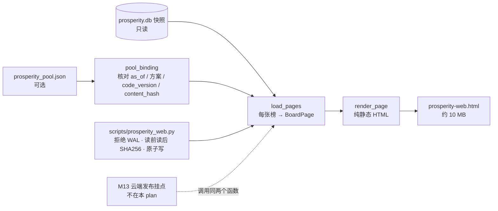

# 景气引擎 M11 网页最小版 Implementation Plan

**状态：2026-11-03 已实现，审查修订见 §16。2026-11-02 Boss 批准（含选池第一档同步修订，Boss 确认新选池规则由其拍板）。第一轮审查 1 个 P1、3 个 P2 已修订（见 §13）；选池规则同步见 §14；选池 plan 审查后追加"池文件计数对照原榜"（`board_mismatch`），见 §15（2026-11-02 Boss 让 finance-8b 会话一起改，并批准 §15）。开工顺序：选池第一档改动（`prosperity/pool-q1`）先合并 main，M11 再从新 main 开工。**

**Goal:** 本地一条命令读 `prosperity.db` 快照，生成一个纯静态 HTML 榜单页：最新周榜 + 全部季末冻结榜，四个方案，靠目录链接切换方案和期数。
**Architecture:** 新模块 `src/data/prosperity_web.py` 把每张榜整理成行视图，再渲染成一个 HTML 文件。CLI `scripts/prosperity_web.py` 加快照检查（拒绝 WAL、读前读后比 SHA256）。库只读，不进 `code_version`，不改打分，不碰云端。云端生成与 Telegram 投递属于 M13，直接调用本模块的两个函数。
**Tech Stack:** Python 3.10 标准库、sqlite3、现有 M8 `ProsperityStore`、M10 `validate_prosperity_pool` / `criteria_payload` / `board_mismatch`（选池第一档改动新增）、pytest。页面无 JS、无外部资源。
**Spec:** `docs/design/prosperity-engine-north-star.md` §4.2（网页榜单）、模块表 #12；需求 R10、S2"网页可访问"。
**北极星对齐:** 主北极星第二层「分析层 · 基本面」；景气北极星第四层「输出」。完成 R10 的 MVP 部分。
**基线:** 2026-11-03 开工时把本分支 rebase 到 main `f29a05ef`（`1d35d702` 选池第一档合并 + 文档提交）；A6 全量测试基线在 rebase 后、写代码前的 `5fabac95` 上跑。分支 `prosperity/m11-web`，worktree `.worktrees/prosperity-m11`。`code_version` `13e5f9d5183f1b8e`，F1 `scheme_hash` `3f268258d997bbdc`。

## 1. Boss 决定（2026-11-02）

| # | 问题 | 决定 |
|---|---|---|
| D1 | 手机端 Telegram 能否跑 JS | 不能。页面不用 JS，切方案和期数靠页内链接 |
| D2 | 行范围 | 88 张榜所有行全放，约 10 MB，电脑打开。**超出北极星 5 MB 预算，本 plan 同步改北极星 §4.2** |
| D3 | 默认显示 | 每张榜默认只展开 STRICT/FULL；BELOW、观察、排除行收在折叠块里（`<details>`，不需要 JS） |
| D4 | 入池标记 | 在 F1 最新周榜上标出入池股票和成交额排名；池文件与该榜对不上时不标，并在榜头写明原因 |
| D5 | 数据包质量标记（如 `stale_current_fiscal`） | 最小版不显示 |

## 2. 实测依据（2026-11-02，读 11-01 快照 `/tmp/m12/prosperity.db`，sha256 前 16 位 `ca0aa05a7cfccf75`）

- **榜单数**：当前 `code_version` 下 4 方案 × 21 张季末榜（2021Q2–2026Q2，as_of 2021-09-04 至 2026-08-29）+ 4 张 live 周榜（2026-10-31）= **88 张**。
- **行数**：72,580 行。按状态：F1 / F1-rank 各可排名 16,455、观察 1,690；F1-exfin 可排名 12,919、观察 1,266、排除 3,960；F0 可排名 16,968、观察 1,177。
- **10-31 F1 周榜**：899 行；STRICT 55、FULL 194、BELOW 599、观察 51。
- **页面大小试算**：所有行写成静态表格约 **9.8 MB**（名称截到 28 字时）。只放 STRICT/FULL 约 2.8 MB。
- **读取耗时**：`ProsperityStore.get_board` 每张约 0.9 秒，88 张约 80 秒。
- **四族小分**：F1 三方案有 成长 / 加速 / 质量 / 预期 四族；F0 没有预期族。
- **徽章来源**（`terminal/prosperity/kernel.py:322-374`、`terminal/prosperity/factors.py:130,308`）：
  - 内核徽章：`pe_redflag`、`ntm_loss`、`ntm_gate_unknown`、`forward_stale`、`gm_slope_missing`、`industry_unknown`、`params_bootstrap`。
  - `params_bootstrap` 是整张榜的属性（`kernel.py:352` 的 `boot` 对全榜相同），放在榜头，不放在行内。
  - 降级原因（`demotions`）：`net_margin_down`、`new_listing_gate`、`ntm_not_above_ttm`。
  - 因子标签（`FactorRow.labels`）：`eps_turnaround`、`eps_ttm_turnaround`、`semiannual_period` 显示；`listing_date_unknown`、`eps_split_retrospective` 属于数据质量，按 D5 不显示。
  - 点时等级：`stock_period.pit_basis == 'approximate'` 显示"近似"。
- **观察原因**：`identity_unverified`、`low_coverage`、`insufficient_quarters`；内核另有 `no_scorable_factor`、`universe_excluded`（`kernel.py:335,342`）。
- **池文件**：选池第一档改动（Boss 2026-11-02 拍板：第一档 ∩ STRICT/FULL ∩ 成交额前 100）验收时生成 `reports/prosperity/pool-q1-20261102/pool-20261031.json`，as_of 2026-10-31，**36 只**；现在还不存在。它来自同一张 10-31 F1 周榜，`source.content_hash` 仍是 `305f4393…`。旧规则的 M10 验收副本（45 只）会因 `criteria` 不符被新校验器拒收，不再用于验收。2026-11-02 用旧副本核对：可排名 848，第一档 = 前 170 名，45 只里 36 只在第一档。

## 3. 架构图



依赖方向：`prosperity_web.py` 依赖 M8 存储类型、M10 池校验、`terminal.prosperity.schemes`。没有模块依赖它，`version.py` 的 `CODE_VERSION_SOURCES` 不动。

## 4. 业务流程图（Boss 视角）

```mermaid
flowchart TD
  A[电脑打开 prosperity-web.html] --> B[页首：生成时间、库哈希、code_version、各方案 hash]
  B --> C[目录矩阵：行=期数，列=方案<br>每格一个链接]
  C --> D[默认第一节：F1 最新周榜]
  D --> E[STRICT/FULL 表格展开<br>入池行标 ✓ 和成交额排名]
  E --> F[点"其余 N 行"折叠块<br>看 BELOW、观察、排除及原因]
  D --> G[榜头"同期其他方案"链接<br>一键切到 F1-rank / F1-exfin / F0 同期]
  C --> H[点任一季末榜 → 跳到该节<br>每节有"回目录"链接]
```

## 5. 替代方案

| 方案 | 优点 | 缺点 | 选择 |
|---|---|---|---|
| A. 单文件纯静态，页内锚点切换，`<details>` 折叠非 S/F 行（选定） | 无 JS，手机和电脑都能看；一个文件；Telegram 附件直接打开 | 约 10 MB，打开慢几秒 | ✓ |
| B. 单文件 + 内联 JSON + JS 切换 | 约 3 MB，切换不滚动 | 手机端 Telegram 跑不了 JS（D1），手机上只剩默认视图 | |
| C. 每个方案一个文件 | 单文件小 | 切方案要换文件，不满足"可切方案"；M13 要发 4 个附件 | |

渲染性能：每节加 CSS `content-visibility: auto`，浏览器只渲染可见节，10 MB 页面首屏不卡。

样式不复用 `backtest/research/prosperity_health_html.py` 的 CSS：`src/` 不反向依赖 `backtest/`。主题变量约 15 行，直接写。

## 6. 风险自证

- **最大风险：页面显示的分数或评级和库里不一致，Boss 照着看错。** 应对：真实数据验收用独立脚本 `verify_web.py`，只用标准库 `sqlite3` + `html.parser`，不 import `src`/`terminal`，直接查表重建 72,580 行，与 HTML 逐行逐列比对（排名、代码、评级或观察原因、分数、四族小分、徽章集合、入池标记、成交额排名），目标差异 0；再做篡改验收（分数、成交额排名各一次）。
- **第二风险：入池标记标错期或标错股票。** 应对分两层：
  - 期：只在 F1 最新周榜、且池文件 `as_of`、`criteria`、`source.code_version`、`source.content_hash` 四项都与该榜一致时才标。
  - 计数（§15）：池文件自报的可排名数、第一档切点、合格数、股票池名单，用 `board_mismatch` 与原榜重算值比对。只靠文件自洽拦不住"改人数抬高切点，再塞档外股票"（选池 plan 审查复现：10-31 可排名 848 改 899，切点 170 变 180，排名 178 的 TER 混进来）。
  - 股票（审查 P2-2）：`source.content_hash` 只证明池文件来自哪张榜，不覆盖 `members`。所以逐成员核对：代码在榜内，`status == 'ranked'`，评级属于 STRICT/FULL，且 `rank`、`grade` 与榜内一致。
  - 任一不符就整张榜不标，并在榜头写"未标入池：原因"。池文件缺失或校验失败同样写明原因，不静默。
  - 已知局限：M11 不读 `market.db`，所以不能复核"第一档 ∩ STRICT/FULL ∩ 成交额前 100 的股票是否都进了池"（完整性）。这由池模块的生成逻辑和选池改动的验收负责。"排名在第一档以内"由第 2 步 `validate_prosperity_pool`（成员排名 ≤ 文件切点）加第 3b 步 `board_mismatch`（文件切点 = 原榜切点）共同保证。
- **第三风险：读到正在写的库。** 应对：沿用 M12 的规则，CLI 只接受自包含快照：有 WAL 内容退出 4；读前读后 SHA256 不同退出 6；两种情况都不写文件。
- **第四风险：输出覆盖输入（审查 P1）。** `--out` 与 `--db` 相同时，两次哈希都一致，最后 `os.replace` 会把库换成 HTML。应对：读任何输入之前，比较规范化路径（`Path.resolve()`）；`--out` 等于库文件、库的 `-wal` / `-shm` / `.state`、或池文件时退出 4，不写文件。照 `scripts/prosperity_weekly.py:51-56` 的同类检查写。
- **未知徽章代码**：内核以后新增徽章时，页面按原代码显示，不丢弃；测试覆盖这一点。
- **为什么不更简单**：只截图或只导出 CSV 不满足"可切方案和期数"；只放最新周榜不满足"各季末榜"。

## 7. 验收标准（Boss 不看代码也能判断）

| # | 检查 | 通过条件 |
|---|---|---|
| A1 | 单元测试 | `tests/test_prosperity_web.py`、`tests/test_prosperity_web_cli.py` 全部通过 |
| A2 | 真实数据生成 | 11-01 快照生成成功，退出码 0；88 节；记录耗时、峰值内存、文件大小（≤12 MB） |
| A3 | 独立核对 | `verify_web.py`：72,580 行全部比对，差异 0；HTML 副本改一处分数 → 差异 ≥1、退出 1；HTML 副本只改一个成交额排名 → 差异 ≥1、退出 1 |
| A4 | 入池标记 | 用新规则池文件 `pool-q1-20261102/pool-20261031.json`：F1 10-31 节标 36 只，名单和成交额排名与池文件逐值一致。四种负例都应 0 只、榜头写原因：①池文件 as_of 改成 10-24；②把一个成员的代码换成榜内评级为 BELOW 的 `BMNR`，来源哈希不动；③把一个成员的评级 STRICT↔FULL 对调；④选池验收产物 `pool-q1-20261102/pool-20261031-ter.json`（可排名数改 899、切点改 180、加入排名 178 的 TER），榜头写"池文件与本榜不符（ranked）" |
| A4b | 输出不覆盖输入 | `--out` 等于 `--db` 或 `--pool` 时退出 4，两个输入文件 SHA256 不变 |
| A5 | 页面检查 | 无 `<script`；外部 src/href 0 处；Chrome headless 1200 px 截图：目录、F1 首节、折叠块、深色模式各一张 |
| A6 | 全量测试 | 全套 pytest 与 main 基线对比，无新增失败 |

## 8. 文件结构

```
src/data/prosperity_web.py              新建：行视图、入池核对、HTML 渲染
scripts/prosperity_web.py               新建：CLI（快照检查、原子写）
tests/test_prosperity_web.py            新建：Task 1–2
tests/test_prosperity_web_cli.py        新建：Task 3
reports/prosperity/m11-web-20261102/    新建：verify_web.py、README.md、截图、验收输出（HTML 本体不入库，gitignore）
docs/design/prosperity-engine-north-star.md  修改：§4.2 载体/大小预算/MVP 段（D1、D2）；模块表 #12；现状表
docs/runbooks/prosperity-weekly.md      修改：加"本地生成网页"一段
ARCHITECTURE.md                         修改：prosperity 行加 M11
docs/CHANGELOG.md                       修改：M11 一行
```

## 9. 契约

### 9.1 常量

```python
WEB_SCHEMES = ('F1', 'F1-rank', 'F1-exfin', 'F0')   # 目录列顺序，与 M12 DEFAULT_SCHEMES 相同
FAMILIES = (('growth', '成长'), ('accel', '加速'), ('quality', '质量'), ('expectation', '预期'))
SHOWN_LABELS = ('eps_turnaround', 'eps_ttm_turnaround', 'semiannual_period')
BOARD_BADGES = ('params_bootstrap',)                # 只放榜头
BADGE_TEXT = {
    'pe_redflag': 'PE红旗', 'ntm_loss': '预期亏损', 'ntm_gate_unknown': 'NTM待验',
    'forward_stale': '预期过期', 'gm_slope_missing': '无毛利斜率', 'industry_unknown': '行业未知',
    'net_margin_down': '降级·净利率降', 'new_listing_gate': '降级·新上市', 'ntm_not_above_ttm': '降级·NTM≤TTM',
    'eps_turnaround': '扭亏', 'eps_ttm_turnaround': 'TTM扭亏', 'semiannual_period': '半年报',
    'approximate': '近似PIT',
}
REASON_TEXT = {
    'identity_unverified': '身份未核实', 'low_coverage': '因子覆盖不足', 'insufficient_quarters': '季数不足',
    'no_scorable_factor': '无可打分因子', 'universe_excluded': '方案排除',
}
RED_BADGES = {'pe_redflag', 'ntm_loss', 'net_margin_down', 'new_listing_gate', 'ntm_not_above_ttm'}
```

不在表里的代码按原文显示。

### 9.2 数据结构与函数

```python
@dataclass(frozen=True)
class WebRow:
    symbol: str
    name: Optional[str]
    sector: Optional[str]
    status: str                        # ranked / observe / excluded
    rank: Optional[int]
    grade: Optional[str]               # STRICT / FULL / BELOW；非 ranked 为 None
    score: Optional[float]
    observe_reason: Optional[str]
    family_scores: Mapping[str, float]
    badges: Tuple[str, ...]            # 代码；顺序：内核徽章（去掉 BOARD_BADGES）→ 降级 → SHOWN_LABELS → 'approximate'；去重
    pool_rank: Optional[int]           # 入池时为成交额排名，否则 None

@dataclass(frozen=True)
class BoardPage:
    scheme_id: str
    scheme_hash: str
    code_version: str
    board_type: str                    # weekly / quarter_final
    mode: str                          # live / replay
    as_of: str
    quarter_label: Optional[str]
    frozen_at: Optional[str]
    params_bootstrap: bool
    counts: Mapping[str, int]          # ranked / observe / excluded / STRICT / FULL / BELOW
    rows: Tuple[WebRow, ...]           # ranked 按 rank 升序；其后观察、排除按代码升序
    pool_note: Optional[str]           # 只在 F1 最新周榜上非空：'入池 N 只' 或 '未标入池：<原因>'

def pool_binding(pool: Optional[dict], stored) -> Tuple[Mapping[str, int], str]
def board_page(stored, *, pool_ranks: Mapping[str, int] = {}, pool_note: Optional[str] = None) -> BoardPage
def load_pages(store: ProsperityStore, *, code_version: str, pool: Optional[dict] = None,
               pool_error: Optional[str] = None) -> List[BoardPage]
def section_id(page: BoardPage) -> str            # f'{scheme_id}-{"w" if weekly else "q"}-{as_of}'
def render_page(pages: Sequence[BoardPage], *, generated_at: str, source: Mapping[str, str]) -> str
```

**`pool_binding` 规则**（返回 `(symbol → 成交额排名, 榜头说明)`）：
1. `pool is None` → `({}, '未标入池：未提供池文件')`。
2. `validate_prosperity_pool(pool, check_freshness=False)` 抛错 → `({}, '未标入池：池文件校验失败（<异常类名>）')`。本地快照可能已过 8 天，所以不查新鲜度；与榜的绑定由第 3 步保证。
3. 榜级绑定。以下任一不符 → `({}, '未标入池：池文件与本榜不符（<字段名>）')`，按此顺序检查，报第一个不符的字段：`stored` 是 F1 live 周榜（字段名 `board`）；`pool['as_of'] == stored.board.as_of`（`as_of`）；`pool['criteria'] == criteria_payload()`（`criteria`）；`pool['source']['code_version'] == stored.board.code_version`（`code_version`）；`pool['source']['content_hash'] == content_hash(stored)`（`content_hash`）。
3b. 计数绑定（§15）。`field = board_mismatch(pool, stored)`；非 None → `({}, f'未标入池：池文件与本榜不符（{field}）')`。字段名取值 `as_of` / `content_hash` / `universe` / `ranked` / `tier_cut` / `eligible`，由 `board_mismatch` 按此顺序返回第一个不符项。放在第 3 步之后；第 3 步已先查 as_of 和 content_hash，所以正常情况下这里只会报后四项（选池改动审查后，`board_mismatch` 自己也查这两项，2026-11-02）。`board_mismatch` 不查成员，第 4 步照做。
4. 成员绑定（审查 P2-2）。对每个成员 `m`，在 `stored.board.rows` 里按代码找到行 `r`。以下任一不符 → `({}, '未标入池：池成员与本榜不符（<symbol>）')`，报第一个不符的成员：`r` 存在；`r.status == 'ranked'`；`r.grade in POOL_GRADES`；`m['rank'] == r.rank`；`m['grade'] == r.grade`。
5. 全部一致 → `({m['symbol']: m['dollar_volume_rank'] for m in members}, f'入池 {len(members)} 只（第一档 ∩ STRICT/FULL ∩ 成交额前 100，as_of {as_of}）')`。

**`load_pages` 规则：**
1. 对 `WEB_SCHEMES` 每个方案：`list_boards(weekly)` 取 as_of 最大的一张（"最新周榜"），再加 `list_boards(quarter_final)` 全部，按 as_of 降序。一张一张读，读完转成 `BoardPage` 就释放 `StoredBoard`。
2. 入池核对只对 F1 的最新周榜做。`pool_error` 非空（CLI 读文件失败）时，说明写 `'未标入池：' + pool_error`。
3. 某方案没有任何榜：跳过，目录该列写"无榜"。

**`render_page` 结构：**
1. 页首：标题"景气榜单"、`generated_at`、`source`（库 SHA256 前 16 位、`code_version`、池文件 SHA256 前 16 位或"无"）、各方案 `scheme_hash`；一段说明：评级定义、"本页无脚本，用目录链接切换"。
2. 目录矩阵：第一行"最新周榜"，其后按季度标签降序；列 = `WEB_SCHEMES`；格子 = 链接 `#<section_id>`，显示 as_of。
3. 每张榜一个 `<section id=...>`：榜头（方案、类型、as_of、季度标签、`frozen_at`、mode、各状态计数、`params_bootstrap` 时写"参数自举"、`pool_note`）；"同期其他方案"链接；"回目录"链接。
4. 主表 = STRICT 与 FULL 行。列：排名、代码、名称、行业（sector）、评级、分数（1 位小数）、成长、加速、质量、预期（整数，缺失写"—"）、徽章；F1 最新周榜多两列"入池"（✓）与"成交额排名"。
5. 其余行放 `<details><summary>其余 N 行（BELOW a / 观察 b / 排除 c）</summary>`，同样列；"评级"列对观察和排除行写中文原因。
6. 所有文本经 `html.escape`；无 `<script>`；无外部资源；颜色变量放 `:root`，深色模式按 `prefers-color-scheme` 和 `data-theme` 两处定义。

### 9.3 CLI

```
scripts/prosperity_web.py --db SNAPSHOT --out FILE.html [--pool POOL.json] [--code-version V]
```

| 退出码 | 情况 | 是否写文件 |
|---|---|---|
| 0 | 写成功 | 是（同目录临时文件 → `os.replace`） |
| 3 | 库不存在；或当前 `code_version` 下没有任何榜 | 否 |
| 4 | `--out` 是目录或父目录不存在；`--out` 规范化路径等于库文件、库的 `-wal` / `-shm` / `.state`、或 `--pool`（审查 P1，读任何输入前检查）；库有 WAL 内容 | 否 |
| 6 | 读前读后库 SHA256 不同，或读完出现 WAL | 否 |

`--pool` 读不到或不是合法 JSON：不算错误，传 `pool_error`，页面写原因，退出 0。

## 10. 任务

### Task 1：行视图与入池核对

**Files:**
- Create: `src/data/prosperity_web.py`（9.1 常量、`WebRow`、`BoardPage`、`pool_binding`、`board_page`、`load_pages`、`section_id`）
- Test: `tests/test_prosperity_web.py`

**Interfaces:**
- Consumes: `ProsperityStore.list_boards / get_board`（`src/data/prosperity_store.py:120-137`）；`StoredBoard.board.rows / .stocks / .factors / .meta`；`content_hash`（`src/data/prosperity_storage.py`）；`validate_prosperity_pool`、`criteria_payload`（`src/data/prosperity_pool.py:89,185`）；`board_mismatch(pool, stored) -> Optional[str]`（选池第一档改动新增，开工时在新 main 上 grep 核对行号）；fixture `storage_batch`（`tests/prosperity_fixtures.py:266`）。
- Produces: 9.2 的 `pool_binding`、`board_page`、`load_pages`、`section_id`。

- [ ] Step 1：写失败测试

```python
import copy, json
from src.data.prosperity_pool import build_pool, LiquidityResult
from src.data.prosperity_store import ProsperityStore
from src.data.prosperity_web import load_pages, pool_binding, board_page, section_id
from tests.prosperity_fixtures import storage_batch, weekdays

@pytest.fixture()
def store(tmp_path):
    db = tmp_path / 'prosperity.db'
    with ProsperityStore(db, read_only=False) as s:
        s.save_batch(storage_batch(freeze=True, quarter_label='2026Q2'))
        s.save_batch(storage_batch(as_of='2026-10-03', freeze=True, quarter_label='2026Q3'))
    with ProsperityStore(db) as s:
        yield s

def test_pages_cover_latest_weekly_and_every_quarter_final(store):
    pages = load_pages(store, code_version='test-v1')
    assert [(p.scheme_id, p.board_type, p.as_of) for p in pages[:3]] == [
        ('F1', 'weekly', '2026-10-03'), ('F1', 'quarter_final', '2026-10-03'), ('F1', 'quarter_final', '2026-09-26')]
    assert len(pages) == 4 * 3
    assert len({section_id(p) for p in pages}) == len(pages)

def test_every_row_kept_once_ranked_first_by_rank(store):
    for p in load_pages(store, code_version='test-v1'):
        ranked = [r for r in p.rows if r.status == 'ranked']
        assert [r.rank for r in ranked] == sorted(r.rank for r in ranked)
        assert p.rows[:len(ranked)] == tuple(ranked)
        assert len({r.symbol for r in p.rows}) == len(p.rows) == 12
        assert p.counts['ranked'] + p.counts['observe'] + p.counts['excluded'] == 12

def test_board_badge_moves_to_header_and_labels_follow_rules(store):
    p = load_pages(store, code_version='test-v1')[0]
    assert p.params_bootstrap is True
    assert all('params_bootstrap' not in r.badges for r in p.rows)
    assert all(b not in ('listing_date_unknown', 'eps_split_retrospective', 'identity_unverified')
               for r in p.rows for b in r.badges)
    obs = [r for r in p.rows if r.status == 'observe']
    assert {r.observe_reason for r in obs} >= {'insufficient_quarters', 'identity_unverified'}

F1 = scheme_hash(SCHEMES['F1'])

@pytest.fixture()
def pool_store(tmp_path):
    # count=20: 18/20 ranked = 0.90 clears the M10 coverage floor; count=12 gives 10/12 and is rejected (review P2-3)
    db = tmp_path / 'pool.db'
    with ProsperityStore(db, read_only=False) as s:
        s.save_batch(storage_batch(count=20))
        s.save_batch(storage_batch(as_of='2026-10-03', count=20))
    with ProsperityStore(db) as s:
        yield s

def boards(s):
    old, new = (s.get_board(k) for k in s.list_boards(scheme_hash=F1, code_version='test-v1', board_type='weekly'))
    return old, new

def pool_for(stored):
    return build_pool(stored, fake_liquidity(stored), generated_at=stored.board.as_of + 'T09:00:00Z')

def test_pool_marks_only_when_bound(pool_store):
    old, stored = boards(pool_store)
    pool = pool_for(stored)
    ranks, note = pool_binding(pool, stored)
    assert ranks == {m['symbol']: m['dollar_volume_rank'] for m in pool['members']} and note.startswith('入池')
    # a pool that is valid on its own but belongs to another week
    assert pool_binding(pool_for(old), stored) == ({}, '未标入池：池文件与本榜不符（as_of）')
    bad = copy.deepcopy(pool); bad['source']['content_hash'] = '0' * 64
    assert pool_binding(bad, stored) == ({}, '未标入池：池文件与本榜不符（content_hash）')
    assert pool_binding(None, stored) == ({}, '未标入池：未提供池文件')
    assert pool_binding({'schema_version': 9}, stored)[1].startswith('未标入池：池文件校验失败')
    # only as_of edited: the trading window no longer fits, so the validator rejects it first
    bad = copy.deepcopy(pool); bad['as_of'] = '2026-09-26'
    assert pool_binding(bad, stored)[1].startswith('未标入池：池文件校验失败')

def test_pool_members_must_match_the_board(pool_store):
    _, stored = boards(pool_store)
    pool = pool_for(stored)
    rows = {r.symbol: r for r in stored.board.rows}
    outsider = next(s for s, r in sorted(rows.items())
                    if r.symbol not in {m['symbol'] for m in pool['members']}
                    and (r.status != 'ranked' or r.grade == 'BELOW'))
    bad = copy.deepcopy(pool); bad['members'][0]['symbol'] = outsider   # source hash untouched
    validate_prosperity_pool(bad, check_freshness=False)                # the M10 validator alone lets it through
    assert pool_binding(bad, stored) == ({}, f'未标入池：池成员与本榜不符（{outsider}）')
    bad = copy.deepcopy(pool); m = bad['members'][0]
    m['grade'] = 'FULL' if m['grade'] == 'STRICT' else 'STRICT'
    assert pool_binding(bad, stored) == ({}, f"未标入池：池成员与本榜不符（{m['symbol']}）")

def test_pool_counts_must_match_the_board(pool_store):
    # §15: the file alone cannot prove its ranked count; board_mismatch recomputes it from the board
    _, stored = boards(pool_store)
    pool = pool_for(stored)
    bad = copy.deepcopy(pool); stat = bad['coverage']['ranked']
    stat.update(covered=stat['total'], ratio=1.0)        # 18 → 20; ceil(20/5) is still 4, so the file stays consistent
    validate_prosperity_pool(bad, check_freshness=False)
    assert pool_binding(bad, stored) == ({}, '未标入池：池文件与本榜不符（ranked）')

def test_pool_note_only_on_f1_latest_weekly(pool_store):
    _, stored = boards(pool_store)
    pages = load_pages(pool_store, code_version='test-v1', pool=pool_for(stored))
    noted = [p for p in pages if p.pool_note]
    assert [(p.scheme_id, p.board_type) for p in noted] == [('F1', 'weekly')]
    assert noted[0].pool_note.startswith('入池')
```

`fake_liquidity(stored)` 是测试内的辅助函数：窗口 = `weekdays(as_of 前一天, 30)`；全部成员按代码升序，成交额依次递减，排名 1..20，构造 `LiquidityResult`。2026-11-02 已在合成库上试过：count=20 时 18 只可排名、旧规则池 9 只、校验通过；新规则下第一档 = 前 4 名（S0018、S0019、S0016、S0017，均为 STRICT/FULL），池 4 只（finance-8b 会话在 `prosperity/pool-q1` 上试算，M11 开工时在新 main 上复跑确认）；另一周的池自身合法；把成员换成观察行 `S0001` 后 M10 校验器仍放行。

- [ ] Step 2：`pytest tests/test_prosperity_web.py -v` → 预期 FAIL（`ModuleNotFoundError: src.data.prosperity_web`）
- [ ] Step 3：最小实现。按 9.2 规则写。徽章组装：`r.badges` 去掉 `BOARD_BADGES` → `r.demotions` → `factor_row.labels ∩ SHOWN_LABELS`（保持 `SHOWN_LABELS` 顺序）→ `stocks[symbol]['pit_basis'] == 'approximate'` 时加 `'approximate'`；`dict.fromkeys` 去重。`params_bootstrap` 取 `stored.board.params_bootstrap`。
- [ ] Step 4：`pytest tests/test_prosperity_web.py -v` → PASS
- [ ] Step 5：`git add src/data/prosperity_web.py tests/test_prosperity_web.py && git commit -m "feat(prosperity-m11): board pages and pool binding for the web page"`

### Task 2：HTML 渲染

**Files:**
- Modify: `src/data/prosperity_web.py`（加 `render_page` 与 CSS）
- Test: `tests/test_prosperity_web.py`

**Interfaces:**
- Consumes: Task 1 `BoardPage`、`WebRow`、`section_id`。
- Produces: `render_page(pages, *, generated_at, source) -> str`。

- [ ] Step 1：写失败测试

```python
import re
from html.parser import HTMLParser
from src.data.prosperity_web import render_page, BADGE_TEXT

def test_page_is_static_and_self_contained(pages):
    html = render_page(pages, generated_at='2026-11-02T00:00:00Z', source={'db_sha256': 'a' * 64, 'code_version': 'test-v1'})
    assert '<script' not in html.lower()
    assert not re.search(r'(src|href)\s*=\s*["\']?(https?:)?//', html)
    ids = re.findall(r'<section id="([^"]+)"', html)
    assert ids == [section_id(p) for p in pages]
    for target in re.findall(r'href="#([^"]+)"', html):
        assert target in ids or target == 'toc'

def test_strict_full_open_others_folded(pages):
    html = render_page(pages, generated_at='x', source={})
    first = html.split('<section id=')[1]
    main, folded = first.split('<details>', 1)
    assert all(g in ('STRICT', 'FULL') for g in re.findall(r'<td class="g">(\w+)', main))
    assert '其余' in folded and '季数不足' in folded

def test_badges_in_chinese_unknown_codes_kept(pages):
    row = replace(pages[0].rows[0], badges=('pe_redflag', 'brand_new_code'))
    page = replace(pages[0], rows=(row,) + pages[0].rows[1:])
    html = render_page([page], generated_at='x', source={})
    assert BADGE_TEXT['pe_redflag'] in html and 'brand_new_code' in html

def test_text_is_escaped(pages):
    row = replace(pages[0].rows[0], name='A<b>&Co')
    html = render_page([replace(pages[0], rows=(row,))], generated_at='x', source={})
    assert 'A&lt;b&gt;&amp;Co' in html and 'A<b>' not in html

def test_pool_columns_only_on_noted_board(pages_with_pool):
    html = render_page(pages_with_pool, generated_at='x', source={})
    sections = html.split('<section id=')[1:]
    assert '成交额排名' in sections[0] and '✓' in sections[0]
    assert all('成交额排名' not in s for s in sections[1:])

def test_dark_mode_tokens_present(pages):
    html = render_page(pages, generated_at='x', source={})
    assert 'prefers-color-scheme: dark' in html and ':root[data-theme="dark"]' in html
```

`pages` / `pages_with_pool` fixture 复用 Task 1 的 `store` 与 `load_pages`。

- [ ] Step 2：`pytest tests/test_prosperity_web.py -v -k "page or badge or escaped or pool_columns or dark"` → 预期 FAIL（`ImportError: render_page`）
- [ ] Step 3：最小实现。按 9.2「`render_page` 结构」拼字符串：表格单元用 `<td>`，评级单元 `<td class="g">`；分数 `f'{x:.1f}'`，小分 `f'{x:.0f}'`，缺失 `—`；徽章 `<span class="b">` / `<span class="b r">`（红色）。CSS：主题变量、`section{content-visibility:auto;contain-intrinsic-size:auto 1500px}`、表格容器 `overflow-x:auto`、`body` 显式背景。
- [ ] Step 4：`pytest tests/test_prosperity_web.py -v` → PASS
- [ ] Step 5：`git commit -m "feat(prosperity-m11): static HTML renderer"`

### Task 3：CLI

**Files:**
- Create: `scripts/prosperity_web.py`
- Test: `tests/test_prosperity_web_cli.py`

**Interfaces:**
- Consumes: Task 1–2；`_sha`（`src/data/prosperity_backup.py:36`）；`code_version()`（`terminal/prosperity/version.py`）。
- Produces: `main(argv) -> int`（9.3 退出码）。

- [ ] Step 1：写失败测试

```python
def run(db, out, *extra):
    from scripts.prosperity_web import main
    return main(['--db', str(db), '--out', str(out), '--code-version', 'test-v1', *extra])

def test_writes_one_page_and_leaves_db_unchanged(db, tmp_path):
    before = sha(db)
    assert run(db, tmp_path / 'web.html') == 0
    assert sha(db) == before
    assert (tmp_path / 'web.html').read_text().count('<section id=') == 12
    assert not list(tmp_path.glob('*.tmp*'))

def test_input_errors_write_nothing(db, tmp_path):
    assert run(tmp_path / 'missing.db', tmp_path / 'a.html') == 3
    assert run(db, tmp_path / 'a.html', '--code-version', 'nope') == 3
    assert run(db, tmp_path) == 4                          # --out is a directory
    assert run(db, tmp_path / 'no' / 'a.html') == 4
    assert not (tmp_path / 'a.html').exists()

def test_output_may_not_overwrite_an_input(db, tmp_path):
    pool = tmp_path / 'pool.json'; pool.write_text('{}')
    before = (sha(db), sha(pool))
    assert run(db, db) == 4
    assert run(db, tmp_path / 'prosperity.db-wal') == 4
    assert run(db, pool, '--pool', str(pool)) == 4
    assert run(db, tmp_path / '.' / 'prosperity.db') == 4              # same file via another spelling
    assert (sha(db), sha(pool)) == before
    assert not (tmp_path / 'prosperity.db-wal').exists()

def test_wal_content_is_refused(db, tmp_path):
    (tmp_path / 'prosperity.db-wal').write_bytes(b'x')
    assert run(db, tmp_path / 'a.html') == 4

def test_db_changed_while_reading(db, tmp_path, monkeypatch):
    import scripts.prosperity_web as cli
    real = cli.load_pages
    def load_then_touch(*a, **k):
        out = real(*a, **k); db.write_bytes(db.read_bytes() + b'\0'); return out
    monkeypatch.setattr(cli, 'load_pages', load_then_touch)
    assert run(db, tmp_path / 'a.html') == 6 and not (tmp_path / 'a.html').exists()

def test_unreadable_pool_is_reported_not_fatal(db, tmp_path):
    (tmp_path / 'pool.json').write_text('{not json')
    assert run(db, tmp_path / 'a.html', '--pool', str(tmp_path / 'pool.json')) == 0
    assert '未标入池：池文件无法读取' in (tmp_path / 'a.html').read_text()
```

- [ ] Step 2：`pytest tests/test_prosperity_web_cli.py -v` → 预期 FAIL（`ModuleNotFoundError: scripts.prosperity_web`）
- [ ] Step 3：最小实现。顺序：参数检查（含输出路径冲突：`out = args.out.resolve()`，与 `{db, db-wal, db-shm, db.state, pool}` 的 `resolve()` 比较）→ 库存在 → WAL 检查（`_wal_bytes` 三行，照 `scripts/prosperity_health.py:42-44` 写一份）→ 读前 SHA256 → 读池文件（失败记 `pool_error='池文件无法读取'`）→ `load_pages` → 读后 SHA256 与 WAL 再查 → `render_page` → 同目录 `tempfile.NamedTemporaryFile(delete=False)` 写入、`os.replace`。`source` 写库 SHA256、`code_version`、池文件 SHA256。stderr 打一行摘要：节数、行数、字节数、耗时。
- [ ] Step 4：`pytest tests/test_prosperity_web_cli.py tests/test_prosperity_web.py -v` → PASS
- [ ] Step 5：`git commit -m "feat(prosperity-m11): CLI with snapshot checks and atomic write"`

### Task 4：真实数据验收与文档

**Files:**
- Create: `reports/prosperity/m11-web-20261102/verify_web.py`、`README.md`、`verify.txt`、截图
- Modify: `.gitignore`（加 `reports/prosperity/m11-web-*/out/`）、9 节列出的 4 份文档

- [ ] Step 1：独立核对脚本 `verify_web.py`。只用 `sqlite3`、`json`、`html.parser`、`hashlib`，不 import 本仓库。它直接查 `board`、`score`、`stock_period`、`stock_input` 表，自己重建每节的期望行：排名、代码、评级或中文原因、分数 1 位小数、四族整数、徽章中文集合（规则照 9.1 自写一份）、入池标记与成交额排名（审查 P2-4）。入池部分自写一份绑定：读池 JSON，核对 as_of 与 `source.code_version`；从 `score` 表自算可排名数 n、切点 `-(-n // 5)`、合格数（`rank ≤ 切点` 且评级 STRICT/FULL），从 `board.members_json` 自算成员数与 `sha256('\n'.join(sorted(members)))`，与池文件 `coverage.ranked.covered`、`coverage.tier_cut`、`coverage.eligible`、`universe` 比对（§15）；再逐成员核对代码在 `score` 表、`status='ranked'`、评级与排名一致；任一不符则该节期望 0 个 ✓；按 symbol 取 `dollar_volume_rank`，与 HTML 该行"成交额排名"单元逐值比较，非入池行该单元必须为空。解析 HTML 后逐节逐行比对，输出 `checked N rows, M pool ranks; differences: K`，K>0 退出 1。`content_hash` 不在独立脚本里重算（它是 M8 规范化 JSON 的哈希，重写一份等于复制实现），由单元测试覆盖。
- [ ] Step 2：生成。`PY=…/.venv/bin/python`；`/usr/bin/time -l "$PY" scripts/prosperity_web.py --db /tmp/m12/prosperity.db --out reports/prosperity/m11-web-20261102/out/prosperity-web.html --pool reports/prosperity/pool-q1-20261102/pool-20261031.json`（选池改动验收产物，开工前确认存在）。记退出码、耗时、峰值 RSS、文件大小（A2）。
- [ ] Step 3：核对与篡改（A3、A4、A4b）。
  - 跑 `verify_web.py` → 差异 0；F1 10-31 节 36 个 ✓。
  - HTML 篡改：副本改一个分数 → 差异 ≥1、退出 1；另一副本只改一个成交额排名 → 差异 ≥1、退出 1。
  - 池文件负例，各复制一份重新生成：①as_of 改 2026-10-24；②一个成员代码换成 `BMNR`（10-31 F1 评级 BELOW），来源哈希不动；③一个成员评级 STRICT↔FULL 对调；④直接用 `reports/prosperity/pool-q1-20261102/pool-20261031-ter.json`（不再复制修改）。四份都应 F1 首节 0 个 ✓、榜头写原因（④为 `ranked`），核对脚本对四份也都通过。
  - `--out` 指向快照库或池文件 → 退出 4，两个文件 SHA256 不变。
- [ ] Step 4：页面检查（A5）。grep `<script` 与外部链接为 0；Chrome headless 截图 1200 px：页首目录、F1 首节、展开的折叠块、深色模式（`--force-dark-mode` 或加 `data-theme="dark"` 的副本）。
- [ ] Step 5：文档。北极星 §4.2：载体改为"纯静态 HTML，无 JS，页内链接切换"（D1）；大小预算改为"全部行约 10 MB，电脑打开为主"（D2）；MVP 段补 D3–D5；模块表 #12 与现状表标 M11 本地生成器完成，云端生成与投递仍在 M13。runbook 加本地生成命令。ARCHITECTURE、CHANGELOG 各一行。
- [ ] Step 6：`git commit -m "docs(prosperity-m11): real-data acceptance, north-star §4.2, runbook"`

### Task 5：审查与全量测试

- [ ] Step 1：`/code-review high` 审本分支 diff；逐条核实再改。
- [ ] Step 2：全量 pytest，与开工基线 main（选池改动合并后的提交）比对失败集合（A6），输出存 `reports/prosperity/m11-web-20261102/`。
- [ ] Step 3：给 Boss 三选一：merge / PR / 保留分支。不自动 merge、不 push。

## 11. Global Constraints

- 所有开发必须对齐北极星（`docs/design/north-star.md`）；模块级 plan 必须注明对应北极星哪一层。
- 代码开发一律用 git 和 worktree。
- 研究产生的数据禁止本地写入 `market.db`；本模块对 `prosperity.db` 只读。
- `prosperity.db` 云端单写者；本地只用 `sync_to_cloud.sh` / `sync_prosperity.py` 拉的只读副本。
- 输出层"只读库、可以随时重新生成，所以不入库"（北极星第四层）。
- 不改 `code_version`、不改打分、不重建历史榜。
- 不可擅自 merge 或 push，等 Boss 指示。
- 云端 Python 3.10：不用 3.11+ 语法。

## 12. 自审

1. **spec 覆盖**：§4.2 MVP 列表——排名、代码、名称、sector、评级、分数、各族小分、徽章 → Task 1–2；可切方案和期数 → Task 2 目录矩阵与"同期其他方案"；最新周榜 + 各季末榜 → Task 1 `load_pages`；Telegram 投递 → M13（本 plan 不做，已在 Architecture 写明）。分数拆解、8 季序列、NTM/TTM PE 与 β 属于完整版，不在本 plan。
2. **占位符**：Task 1 测试里的 `fake_liquidity` 已写明实现方式；入池测试的 `scheme_hash` 已填实（`F1 = scheme_hash(SCHEMES['F1'])`）。
3. **类型一致**：`pool_binding` 返回 `(Mapping, str)`，`load_pages` 用它填 `pool_ranks` 与 `pool_note`；`render_page` 只读 `BoardPage` / `WebRow` 字段；CLI 测试 monkeypatch 的 `cli.load_pages` 要求 CLI 用 `from src.data.prosperity_web import load_pages` 的模块级名字。

## 13. 第一轮审查修订（2026-11-02）

| # | 级别 | 问题 | 核实 | 修订 |
|---|---|---|---|---|
| 1 | P1 | `--out` 与 `--db` 相同时，参数检查和两次哈希都通过，`os.replace` 用 HTML 覆盖库 | 成立（读 9.3 契约确认） | 9.3 退出 4 增加输出路径冲突（库、`-wal`/`-shm`/`.state`、池文件），读任何输入前检查；§6 第四风险；Task 3 新测试 `test_output_may_not_overwrite_an_input`；A4b |
| 2 | P2 | `source.content_hash` 不覆盖 `members`，换成 BELOW 股票仍通过全部绑定条件 | 成立（合成库复现：成员换成观察行 `S0001`，M10 校验器放行） | 9.2 `pool_binding` 新增第 4 步成员绑定；§6 第二风险；Task 1 新测试 `test_pool_members_must_match_the_board`；A4 负例 ②③ |
| 3 | P2 | 12 只夹具只有 10 只可排名（83.3% < 90%）；只改 as_of 先触发交易窗口错误 | 成立（复现：`pool_ranked_coverage_below_floor: 10/12 < 0.9`；count=20 → 18/20 通过；只改 as_of → `pool trading window not bound to as_of`） | 入池测试改用 count=20 的 `pool_store`；日期绑定用另一周自身合法的池；只改 as_of 保留为"校验失败"分支 |
| 4 | P2 | 独立核对漏查成交额排名 | 成立 | Task 4 Step 1 逐值比较 `dollar_volume_rank`，非入池行必须为空；A3 加只改一个成交额排名的篡改 |

## 14. 选池规则改为第一档后的同步修订（2026-11-02）

来源：finance-8b 会话转达 Boss 2026-11-02 拍板。新规则：F1 最新周榜中，排名 ≤ ceil(可排名数 / 5)（第一档）、评级 STRICT/FULL、成交额前 100，三条都满足的全部进池。10-31 池从 45 只变为 36 只。实现在分支 `prosperity/pool-q1`（worktree `.worktrees/prosperity-pool-q1`，plan `docs/plans/2026-11-02-prosperity-pool-q1.md`，2026-11-02 尚未批准）。

本会话核对：用旧 M10 副本算，可排名 848，第一档前 170 名，45 只里 36 只在第一档，与转达一致。

| 位置 | 改动 |
|---|---|
| 文件头基线 | 开工时换成选池改动合并后的 main |
| §2 池文件 | 改用 `reports/prosperity/pool-q1-20261102/pool-20261031.json`（36 只，来源哈希不变）；旧 45 只副本会被新校验器按 `criteria` 拒收 |
| §6 已知局限 | 完整性口径改为"第一档 ∩ STRICT/FULL ∩ 成交额前 100"；第一档上限由 `validate_prosperity_pool` 检查 |
| A4、Task 4 Step 2–3 | 45 → 36；`--pool` 换新路径 |
| §9.2 第 5 步榜头文字 | "第一档 ∩ STRICT/FULL ∩ 成交额前 100" |
| Task 1 夹具说明 | 合成榜池 9 只 → 4 只（开工时复跑确认） |
| Task 5 Step 2 | 基线换成开工时的 main |

不变：`pool_binding` 的榜级和成员绑定规则；A4 三个负例（改 as_of、换 `BMNR`、对调评级）仍然成立，因为它们都不改成员的 `rank` 字段，新校验器会放行，由成员绑定拦下。M11 不读 `criteria` 的内部字段，只与 `criteria_payload()` 整体比较，所以规则变化不改 M11 代码。（本段"不改 M11 代码"已被 §15 更正。）

## 15. 池文件计数对照原榜（2026-11-02）

来源：选池第一档 plan 第一轮审查 P2-1（`prosperity/pool-q1` plan §13）。Boss 2026-11-02 让 finance-8b 会话把选池 plan 与本 plan 一起改。

问题：新校验器只能证明池文件自洽。池文件把 `coverage.ranked` 从 848 改成 899、`tier_cut` 从 170 改成 180，再加入排名 178 的 TER（FULL，成交额第 96），TER 的排名、评级和 `source.content_hash` 都是真的。校验器和本 plan 原有的榜级、成员绑定全部放行，网页会给 TER 打 ✓。

| 位置 | 改动 |
|---|---|
| Tech Stack、Task 1 Interfaces | 新增依赖 `board_mismatch(pool, stored) -> Optional[str]`（选池改动提供） |
| §6 第二风险 | 新增"计数"一层；已知局限改为"第 2 步加第 3b 步共同保证第一档上限" |
| §9.2 `pool_binding` | 新增第 3b 步：`board_mismatch` 非 None → `未标入池：池文件与本榜不符（<字段名>）` |
| Task 1 测试 | 新增 `test_pool_counts_must_match_the_board`（合成榜 ranked 18 改 20，校验器放行，`pool_binding` 报 `ranked`）。合成榜上 ceil(18/5) = ceil(20/5)，抬高切点的完整攻击由 A4 ④ 用真实数据覆盖 |
| A4、Task 4 Step 3 | 新增负例 ④：选池验收产物 `pool-20261031-ter.json` |
| Task 4 Step 1 | `verify_web.py` 的独立绑定加计数比对，否则负例 ④ 下核对脚本会期望 37 个 ✓ |

不变：页面结构、CLI、其他验收项。负例 ④ 的文件由选池改动 Task 2 生成，开工前确认存在。

## 16. 实现后的审查修订（2026-11-03）

CC `/code-review high` 10 条与 Codex 审查 3 条都已修，记录在 `reports/prosperity/m11-web-20261102/README.md`。改到本 plan 契约的有四处：

| 位置 | 原文 | 现在 | 来源 |
|---|---|---|---|
| 9.1 徽章、9.2 `WebRow.badges` | 每行按 `pit_basis == 'approximate'` 加"近似PIT" | 整张榜每行都是 approximate 时，只在榜头写"本榜全部为近似 PIT"，行内不显示；混合榜仍逐行显示（`BoardPage.all_approximate`）。11-01 快照上 84 张季末榜全是 approximate，4 张 live 周榜全是 live | Boss 2026-11-03（Codex 建议），页面 11.35 → 10.25 MB |
| 9.2 `load_pages` 第 1 步 | "最新周榜"= as_of 最大的周榜 | 只取 `mode='live'` 的最新周榜；没有就不放这一节 | CC 审查 |
| 9.2 `render_page` 第 1 步 | 页首无入池说明 | 库中没有 F1 live 周榜时，页首写"未标入池：库中无 F1 live 周榜"，并附池文件错误；标了入池的榜头加"✓ 仅表示该期池文件与本榜匹配，未验证当前新鲜度。" | Codex P2 |
| 9.2 `render_page` 第 4 步 | 分数 1 位小数（四舍五入） | 向下取一位小数，页首写明 | CC 审查（64.99 FULL 显示成 65.0） |

CLI 的输出守卫（9.3 退出码 4）改为：`--db` 先解析符号链接；已存在的文件按 `samefile` 比较；尚不存在的 `-wal/-shm/.state` 按"同一目录 + NFC 规范化后不分大小写"比较（CC 审查：硬链接、大小写；Codex P1：符号链接 `--db`；Codex P2：Unicode NFC/NFD）。
