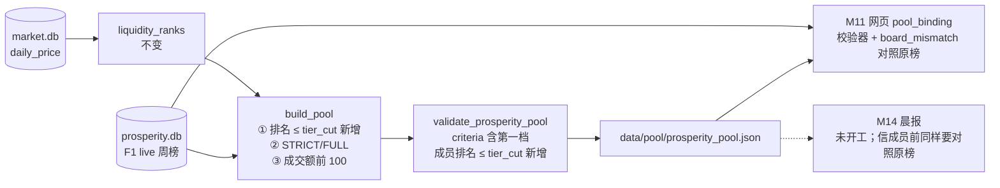
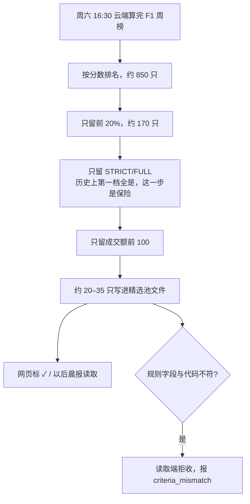

# 景气精选池选池规则：第一档 ∩ STRICT/FULL ∩ 成交额前 100 Implementation Plan

**状态：已完成。2026-11-02 Boss 批准（含第一轮审查 2 个 P2 修订，见 §13；M11 plan §15 同步修订一并批准）；实现后两轮审查共 8 条已修（§14、§15）；merge main `1d35d702` 并 push。云端 11-07 首发核对见 runbook。**

**Goal:** 精选池只收 F1 周榜第一档（排名前 20%）里、评级 STRICT/FULL、成交额前 100 的股票。
**Architecture:** 只改 `src/data/prosperity_pool.py`：`build_pool` 多一道排名门，`criteria` 写明第一档，`validate_prosperity_pool` 拒收超出文件自报切点的成员；新增 `board_mismatch(pool, stored)`，用原榜重算可排名数、切点和合格数，供能读原榜的读取端（M11 `pool_binding`）核对。打分、`code_version`、`prosperity.db`、发布挂点都不动。
**Tech Stack:** Python 3.10 标准库、pytest；验收复用 M10 `acceptance.py` 与 M12 `prosperity_health.py` 的收益函数。
**Spec:** `docs/design/prosperity-engine-north-star.md` §4.1（本 plan 同步修订）；需求 R9。
**北极星对齐:** 主北极星第二层「分析层 · 基本面」；景气北极星第四层「输出」§4.1 精选池文件（R9）。
**基线:** main `b539dd18`；分支 `prosperity/pool-q1`，worktree `.worktrees/prosperity-pool-q1`。`code_version` `13e5f9d5183f1b8e`，F1 `scheme_hash` `3f268258d997bbdc`。

## 1. Boss 决定（2026-11-02）

| # | 问题 | 决定 |
|---|---|---|
| D1 | 精选池规则 | F1 最新周榜里同时满足三条的全部进池：① 第一档（排名前 20%）② STRICT/FULL ③ 成交额前 100。不设 N，不足不补 |
| D2 | 第一档怎么切 | 与 M12 体检报告同一规则：排名 ≤ ceil(可排名数 / 5) |
| D3 | 池子大小预期 | 需求 5 由"约 30–50"改为"约 20–35" |
| D4 | 实施顺序 | 本改动先合并；M11 网页从新 main 开工，验收用本 plan 生成的 36 只池文件 |

决定依据（只读试算，2026-11-02，`/tmp/m12-pool/`，输入同 M12 快照）：第一档里成交额前 100 的部分，持有 3 季比扩展池均值多涨 +11.3%，18 期赢 14 期；旧规则精选池里在第一档以外的 5–22 只，3 季平均 −0.7%，18 期只赢 6 期。样本 18 期，结论方向可信，数值误差大。

## 2. 实测依据（2026-11-02，读 `/tmp/m12/prosperity.db` 与 `/tmp/m12/market.db`，与 M12 同一快照）

- **10-31 F1 live 周榜**：可排名 848，第一档前 170 名。170 只全是 STRICT/FULL。新规则池 **36 只**（STRICT 17，最大排名 159）。旧规则 45 只。
- **36 只**：SNDK、CVX、MU、STX、AVGO、XOM、VLO、VRT、LRCX、AMD、GLW、TSM、PLTR、TXN、COHR、SMCI、NVDA、MDT、HPE、MRVL、AMAT、AAPL、APP、ADI、CIEN、WFC、KLAC、ARM、ALAB、NU、CAT、NFLX、V、AMGN、SNOW、COST。行业：科技 24、能源 3、金融 3、工业 2、医疗 2、通信 1、必需消费 1。
- **22 个 F1 周榜回放**（2021-09-04 至 2026-10-31）：每期 **18–36 只**，依次为 21、24、31、21、23、21、18、25、24、31、24、30、32、25、31、30、28、34、31、36、34、36。22 期第一档里没有 BELOW。
- **排名连续**：`prosperity_storage.py:402` 写库时强制 `sorted(ranks) == 1..n`，所以 `ceil(n/5)` 就是第一档最后一名的排名。
- **与 M12 第一档一致**：`backtest/research/prosperity_health.py:280-282` `assign_tiers` 的 tier 0 只数，在 n = 1、4、5、6、18、848、871 时分别为 1、1、1、2、4、170、175，与 `ceil(n/5)` 相同。
- **测试夹具**（`storage_batch(count=20)` 的 F1 榜）：可排名 18，第一档前 4 名，STRICT/FULL 共 9 只（排名 1–9）。新规则池 4 只（S0018、S0019、S0016、S0017）。
- **池文件尚未发布过**：云端 `data/pool/prosperity_pool.json` 不存在，云端代码停在 `ab572de`（10-25）。不需要迁移旧文件。
- **读取端**：只有 `scripts/prosperity_weekly.py:19` 引用 `pool_publisher`；M11 plan（`prosperity/m11-web` `dcbbf761`）通过 `validate_prosperity_pool` 与 `criteria_payload` 核对池文件，再逐成员核对排名与评级。`premium_pool.py` 的同名 `criteria_payload` 与本模块无关。
- **文件自报的人数无法单靠文件核对**（审查 P2-1，2026-11-02 复现）：10-31 真实可排名 848、切点 170。把池文件 `coverage.ranked` 改成 899 / ratio 1、`tier_cut` 改成 180，再加入排名 178 的 TER（FULL，成交额第 96），排名、评级、`source.content_hash` 都是真的。校验器只能检查自洽，会放行；M11 的成员核对也会放行。必须读原榜才能拦住。

## 3. 架构图



依赖方向不变：`prosperity_pool.py` 依赖 M8 存储与方案注册表；`prosperity_weekly.py` 依赖它。本模块不在 `code_version` 里（模块头注释），`terminal/prosperity/version.py` 不动。

## 4. 业务流程图（Boss 视角）



## 5. 替代方案

| 方案 | 优点 | 缺点 | 选择 |
|---|---|---|---|
| A. 排名门 ceil(n/5)，写进 criteria，校验器拒收档外成员（选定） | 与 M12 体检报告同一批股票，回测数字直接适用；读取端能发现规则不符 | 第一档只数随榜大小浮动 | ✓ |
| B. 固定排名门（如前 170 名） | 简单 | 可排名数从 661 到 871 浮动，固定名次与体检报告的第一档对不上 | |
| C. 按分数门（如分数 ≥ 某值） | 不依赖榜大小 | 分数分布每期不同，没有回测依据 | |
| D. 只改 `build_pool`，不改校验与 criteria | 改动最少 | 旧规则文件和篡改文件都能通过校验，M11 会照标 ✓ | |

`schema_version` 保持 1：池文件从未发布过，且 criteria 变化已让旧文件 fail-closed（`prosperity_pool.py:197-198`）。

## 6. 风险自证

- **最大风险：第一档切点和体检报告不一致，精选池的实际表现和 Boss 看到的数字对不上。** 应对：`tier_cut` 用 `ceil(n/5)`，单元测试锁死 7 个 n 的结果（与 M12 `assign_tiers` 相同）；验收 A4 用生产 `build_pool` 在 21 张季末榜上复算收益，必须与 `/tmp` 试算逐期一致。
- **第二风险：第一档以外的成员混进池子。** 分两层拦：
  - 文件自洽（`validate_prosperity_pool`）：`tier_cut == ceil(ranked.covered/5)`、`eligible ≤ tier_cut`、每个成员 `rank ≤ tier_cut`。三条各配一个负例，改动前必须失败。
  - 对照原榜（`board_mismatch`，审查 P2-1）：文件自报的 `ranked.covered`、`tier_cut`、`eligible`、`universe` 必须等于从原榜重算的值。前一层只能证明文件自洽；改人数再加档外成员，只有这一层拦得住。单元测试覆盖四个字段；真实数据用 TER 负例验收（A3b）。
  - M11 `pool_binding` 必须调用 `board_mismatch`。这是对已批准的 M11 plan 的追加要求，已写进 M11 plan §15（2026-11-02，Boss 让本会话一起改）。M14 若要信池成员，也要对照原榜，写进北极星 §4.1。
- **第三风险：11-07 首发用旧规则。** origin/main 已含 M10，云端下次 06:25 自动 pull 后，周六 16:30 会按当时代码发布。本分支合并并 push 早于 2026-11-07 06:25 CST，首发即新规则；晚于这个时间，首发是旧规则 45 只文件，没有读取方，下周自动改正。合并与 push 仍需 Boss 逐步确认。
- **为什么不更简单**：方案 D 少改校验器，但 M11 的入池标记和以后的晨报都依赖校验器判断文件可信，规则必须写进文件并被校验。

## 7. 验收标准（Boss 不看代码也能判断）

| # | 检查 | 通过条件 |
|---|---|---|
| A1 | 单元测试 | `tests/test_prosperity_pool.py` 全部通过；新增负例改动前失败、改动后通过 |
| A2 | 10-31 真实池 | 生产代码生成 `pool-20261031.json`：36 只、STRICT 17、`tier_cut` 170、窗口 2026-09-21 至 10-30、`source.content_hash` 前缀 `305f4393`，并以 `now=2026-11-01T04:00Z` 通过完整校验 |
| A3 | 独立核对 | `verify_pool.py`（只用 sqlite3，SPY 交易日历）逐只比对代码、排名、评级、成交额排名、`tier_cut`、`coverage.ranked.covered`：差异 0。篡改两份副本：末位成员排名改成 171 → 差异 ≥1、退出 1；删一个成员 → 差异 ≥1、退出 1 |
| A3b | 改人数负例（TER） | 10-31 池副本：`coverage.ranked` 改为 899 / ratio 1，`tier_cut` 改为 180，`eligible` 不变，按排名追加 TER（排名 178、FULL、成交额第 96，其余字段取自原榜），`selected` +1。`validate_prosperity_pool` 放行（证明文件层拦不住）；`board_mismatch` 返回 `'ranked'`；`verify_pool.py` 差异 ≥1、退出 1 |
| A4 | 回放与收益 | 22 期只数与 §2 列表逐期相同。21 张季末榜按 horizon × as_of 与试算基准逐项比对：期数；每期只数与超额；均值、95% 区间上下限、t、p、跑赢次数。容差：只数、期数、跑赢次数完全相同；浮点数差 ≤ 1e-12。基准汇总为 +2.92% / +9.13% / +11.29%，跑赢 12/20、14/19、14/18。篡改基准副本两份：改一期超额 +0.001、改 3 季区间下限 +0.001 → 各差异 ≥1、退出 1 |
| A5 | 回归 | `code_version` 仍为 `13e5f9d5183f1b8e`；景气全套通过；全量 pytest 与 main `b539dd18` 基线比，新增失败 0 |
| A6 | 文档 | 当前态文档里不再有旧规则描述和旧只数（§8 列出的位置）；历史 plan 与 M10 证据不改 |

## 8. 文件结构

```
src/data/prosperity_pool.py                  修改：POOL_TIERS、tier_cut、criteria、build_pool、校验、board_mismatch
tests/test_prosperity_pool.py                修改：Task 1 测试
reports/prosperity/pool-q1-20261102/         新建：README.md、verify_pool.py、pool_returns.py、tamper_ter.py、
                                              pool-20261031.json、pool-20261031-ter.json（A3b 篡改样本，M11 A4 ④ 直接使用）、
                                              history.json、verify.txt、returns.txt、tamper.txt、
                                              trial/q1_liq.py、trial/q1_liq.json（试算基准原样归档）、
                                              baseline/branch pytest 输出（路径与 M11 plan 约定，不改名）
docs/design/prosperity-engine-north-star.md  修改：§4.1 第 177–180 行；模块表 #11（第 278 行）；现状表输出行（第 305 行）；决策表精选池来源（第 328 行）
docs/design/prosperity-engine-requirements.md 修改：第 47 行"约 30–50" → 约 20–35
docs/runbooks/prosperity-weekly.md           修改：第 110 行选池规则
ARCHITECTURE.md                              修改：第 62 行 M10 描述
docs/CHANGELOG.md                            修改：新增一行
```

## 9. 契约

### 9.1 常量与函数（`src/data/prosperity_pool.py`）

```python
POOL_TIERS = 5      # 放在 LIQUIDITY_TOP（:30）之后；第一档 = 前 1/5，与 M12 assign_tiers 同规则

def tier_cut(n_ranked: int) -> int:
    """第一档最后一名的排名：ceil(n/5)。排名写库时保证连续（prosperity_storage.py:402）。"""
    return -(-n_ranked // POOL_TIERS)

def criteria_payload() -> dict:      # :89，新增 'tier'
    return {'scheme_id': ..., 'scheme_hash': ..., 'grades': list(POOL_GRADES),
            'tier': {'tiers': POOL_TIERS, 'keep': 1},
            'liquidity': {...}}       # 原样
```

### 9.2 `build_pool`（:123）

- 第 134 行之后加 `cut = tier_cut(len(ranked))`。
- 第 135 行改为 `graded = sorted((r for r in ranked if r.rank <= cut and r.grade in POOL_GRADES), key=lambda r: r.rank)`。`eligible` 的含义随之变为"第一档内的 STRICT/FULL"。
- 第 155–158 行 `coverage` 加 `'tier_cut': cut`。
- 成交额过滤（:139–141）、成员字段、`source`、`universe` 不变。

### 9.3 `validate_prosperity_pool`（:185）

- 第 236–238 行之后加：`cut = coverage.get('tier_cut')`；`not _is_int(cut) or cut != tier_cut(coverage['ranked']['covered']) or eligible > cut` → `ValueError('pool tier cut invalid')`。
- 第 256 行 `rank > coverage['ranked']['covered']` 改为 `rank > cut`，报错文字不变。
- 新检查放在覆盖率门（:224–234）之后，覆盖率不足仍先报 `pool_*_coverage_below_floor`。

### 9.4 `board_mismatch`（新增，放在 `validate_prosperity_pool` 之后）

```python
def board_mismatch(pool: dict, stored) -> Optional[str]:
    """Fields the pool file reports about its board, recomputed from the board itself.

    validate_prosperity_pool only proves the file is self-consistent; a reader that can open the
    board must call this too. Returns the first mismatched field name, or None. Assumes the pool
    already passed validate_prosperity_pool and is bound to `stored` by as_of / content_hash.
    """
```

按顺序检查，返回第一个不符的字段名：
1. `'universe'`：`pool['universe']['count'] == len(set(stored.meta.members))`，且 `symbols_sha256` 等于 `build_pool` 同算法（:149–150、:154）对 `stored.meta.members` 的结果。
2. `'ranked'`：`pool['coverage']['ranked']['covered'] == n`，`n` 为 `stored.board.rows` 里 `status == 'ranked'` 的行数。
3. `'tier_cut'`：`pool['coverage']['tier_cut'] == tier_cut(n)`。
4. `'eligible'`：`pool['coverage']['eligible']` 等于原榜里 `rank ≤ tier_cut(n)` 且 grade 属于 `POOL_GRADES` 的行数。

成员是否在榜、排名与评级是否一致，由 M11 已有的成员核对负责；切点已与原榜对上后，校验器的 `rank ≤ tier_cut` 就等于 `rank ≤ 真实切点`。

## 10. 任务

### Task 1：第一档排名门与校验

**Files:**
- Modify: `src/data/prosperity_pool.py:29-30, 89-93, 134-135, 155-158, 236-238, 256`，并在 :272 后新增 `board_mismatch`
- Test: `tests/test_prosperity_pool.py`

**Interfaces:**
- Consumes: `storage_batch(count=20)`（`tests/prosperity_fixtures.py:266`）、现有辅助 `f1_board`、`liq`、`eligible`、`valid_pool`（`tests/test_prosperity_pool.py:76-133`）。
- Produces: `POOL_TIERS`、`tier_cut(n_ranked) -> int`、新 `criteria_payload()`、`coverage['tier_cut']`、`board_mismatch(pool, stored) -> Optional[str]`。

- [ ] Step 1：写失败测试。替换 `test_pool_keeps_strict_full_inside_top_100_in_rank_order`（:89-97），并新增：

```python
def first_tier(board):
    from src.data.prosperity_pool import tier_cut
    cut = tier_cut(sum(r.status == 'ranked' for r in board.board.rows))
    return [r for r in eligible(board) if r.rank <= cut]


def test_pool_keeps_first_tier_strict_full_inside_top_100_in_rank_order():
    from src.data.prosperity_pool import build_pool, validate_prosperity_pool
    board = f1_board()
    tier = first_tier(board)
    assert 0 < len(tier) < len(eligible(board))           # fixture: 4 of 9 STRICT/FULL in the first tier
    best = tier[0].symbol
    pool = build_pool(board, liq(board, illiquid={best}), generated_at='2026-10-31T09:10:00Z')
    expected = [r.symbol for r in tier if r.symbol != best]
    assert [m['symbol'] for m in pool['members']] == expected
    assert pool['coverage']['eligible'] == len(tier) and pool['coverage']['selected'] == len(expected)
    assert pool['coverage']['tier_cut'] == 4
    validate_prosperity_pool(pool, now=NOW)


def test_liquid_strict_full_outside_first_tier_never_enter():
    from src.data.prosperity_pool import build_pool, validate_prosperity_pool
    board = f1_board()
    tier = {r.symbol for r in first_tier(board)}
    outside = {r.symbol for r in eligible(board)} - tier
    assert outside                                        # S/F names ranked 5–9, all inside the top 100
    pool = build_pool(board, liq(board, illiquid=tier), generated_at='2026-10-31T09:10:00Z')
    assert pool['members'] == [] and pool['coverage']['eligible'] == len(tier)
    validate_prosperity_pool(pool, now=NOW)


@pytest.mark.parametrize('n,cut', [(1, 1), (4, 1), (5, 1), (6, 2), (18, 4), (848, 170), (871, 175)])
def test_tier_cut_matches_health_report_first_tier(n, cut):
    # values equal tier-0 counts of backtest/research/prosperity_health.py assign_tiers (checked 2026-11-02);
    # literal so the cloud suite does not need scipy
    from src.data.prosperity_pool import tier_cut
    assert tier_cut(n) == cut
```

在 `test_loader_rejects` 的参数表（:135-149）加四行：

```python
    (lambda p: p['criteria']['tier'].update(tiers=4), 'prosperity_pool_criteria_mismatch'),
    (lambda p: p['coverage'].update(tier_cut=p['coverage']['tier_cut'] + 1), 'prosperity_pool_invalid'),
    (lambda p: p['coverage'].update(eligible=p['coverage']['tier_cut'] + 1), 'prosperity_pool_invalid'),
    (lambda p: p['members'][-1].update(rank=p['coverage']['tier_cut'] + 1), 'prosperity_pool_invalid'),
```

最后两行是文件层的拦截：旧校验器只要求 `eligible ≤ ranked.covered`、`rank ≤ ranked.covered`（18），会放行。

对照原榜（审查 P2-1），文件头加 `import copy`：

```python
def test_board_mismatch_catches_what_the_file_alone_cannot():
    from src.data.prosperity_pool import board_mismatch, build_pool, validate_prosperity_pool
    board = f1_board()
    pool = valid_pool()
    assert board_mismatch(pool, board) is None

    bad = copy.deepcopy(pool)
    stat = bad['coverage']['ranked']
    stat.update(covered=stat['total'], ratio=1.0)        # 18 → 20; ceil(20/5) is still 4
    validate_prosperity_pool(bad, now=NOW)               # self-consistent: the file alone passes
    assert board_mismatch(bad, board) == 'ranked'

    bad = copy.deepcopy(pool)
    bad['universe']['symbols_sha256'] = '0' * 64
    assert board_mismatch(bad, board) == 'universe'

    bad = copy.deepcopy(pool)
    bad['coverage']['tier_cut'] = 5
    assert board_mismatch(bad, board) == 'tier_cut'

    thin = build_pool(board, liq(board, illiquid={first_tier(board)[0].symbol}),
                      generated_at='2026-10-31T09:10:00Z')   # selected 3, eligible 4
    bad = copy.deepcopy(thin)
    bad['coverage']['eligible'] = 3
    validate_prosperity_pool(bad, now=NOW)
    assert board_mismatch(bad, board) == 'eligible'
```

合成榜可排名 18、成员 20，ceil(18/5) = ceil(20/5) = 4，所以"改人数后切点变大"的完整攻击要用真实数据复现（A3b，TER）。

- [ ] Step 2：`.venv/bin/python -m pytest tests/test_prosperity_pool.py -v` → 预期 FAIL：`ImportError: cannot import name 'tier_cut'` / `'board_mismatch'`；参数化行报 `KeyError: 'tier'` / `KeyError: 'tier_cut'`。
- [ ] Step 3：按 §9 实现（含 §9.4）。
- [ ] Step 4：`.venv/bin/python -m pytest tests/test_prosperity_pool.py tests/test_run_prosperity_wrapper.py -v` → PASS。`valid_pool()` 现在是 4 只，`test_loader_rejects` 的 `len >= 2` 前提仍成立。
- [ ] Step 5：`git add src/data/prosperity_pool.py tests/test_prosperity_pool.py && git commit -m "feat(prosperity-pool): keep only the first tier (rank ≤ ceil(n/5)); board_mismatch for readers"`

### Task 2：真实数据验收与文档

**Files:**
- Create: `reports/prosperity/pool-q1-20261102/` 下 §8 所列文件
- Modify: §8 所列 5 份文档

**Interfaces:**
- Consumes: Task 1；`reports/prosperity/m10-pool-20261101/acceptance.py`（`--market-db --db --out`，用生产 `build_pool`，写 `pool-20261031.json` 与 `history.json`）；M12 `PriceBook`、`board_view`、`evaluate_board`、`group_excess`、`_series`（`backtest/research/prosperity_health.py:76,231,311,294,515`）。

- [ ] Step 1：确认输入并归档试算基准。
  - `shasum -a 256 /tmp/m12/prosperity.db /tmp/m12/market.db` 前缀为 `ca0aa05a7cfccf75` / `e60d78c3e02ae949`，两个 `-wal` 为 0 字节。快照不在时按 M12 README 重建，并更新本 plan 的哈希。
  - 把 `/tmp/m12-pool/q1_liq.py` 和 `q1_liq.json` 原样复制到 `$R/trial/`，README 记 `q1_liq.json` 的 SHA256。基准取 `stats[h]['stats']['q1_liq']`（n、mean、lo、hi、t、p、wins）和 `stats[h]['rows']` 的 `as_of`、`n_q1_liq`、`q1_liq`。
  - `/tmp/m12-pool` 已被清掉时：在 main `b539dd18` 的 detached worktree 里，把 `q1_liq.py` 的 `ROOT` 指向它，重跑约 40 秒，产物同样归档。不能用本分支代码生成基准。
- [ ] Step 2：生成（A2、A4 只数）。`R=reports/prosperity/pool-q1-20261102`；`"$PY" reports/prosperity/m10-pool-20261101/acceptance.py --market-db /tmp/m12/market.db --db /tmp/m12/prosperity.db --out $R`。检查 `pool-20261031.json` 与 `history.json` 符合 A2 和 §2 列表。复用 M10 脚本，不另写。
- [ ] Step 3：独立核对（A3、A3b）。
  - 从 M10 复制 `verify_pool.py`，加三处：`n_ranked = SELECT COUNT(*) FROM score WHERE board_id=? AND status='ranked'`、`cut = -(-n_ranked // 5)`；期望名单加 `rank <= cut`；比对 `pool['coverage']['tier_cut'] == cut` 与 `pool['coverage']['ranked']['covered'] == n_ranked`。只用 sqlite3，不 import 本仓库。输出 `verify.txt`。
  - 对两份 A3 篡改副本各跑一次，记录退出码。
  - `tamper_ter.py`：按 A3b 从 `pool-20261031.json` 造 TER 副本，写入 `pool-20261031-ter.json` 并提交（M11 plan A4 ④ 直接读这个路径，不改名）。TER 的 name、sector、industry、score、family_scores、badges 取自原榜，`dollar_volume_rank`、`avg_dollar_volume` 取自生产 `liquidity_ranks`。依次调用生产 `validate_prosperity_pool(check_freshness=False)` 与 `board_mismatch`，再用这份副本跑 `verify_pool.py`。三项结果写 `tamper.txt`，与 A3b 不符则退出 1。
- [ ] Step 4：收益复算（A4）。`pool_returns.py --baseline $R/trial/q1_liq.json`：
  - 读 21 张 F1 季末榜，取同日周榜（M10 回放方式：`replace(meta, mode='live')`），用生产 `build_pool` + `liquidity_ranks` 出池。
  - 用 M12 函数（`evaluate_board`、`group_excess`、`_series`）算每个 horizon 每期的超额，再算 n、mean、lo、hi、t、p、跑赢次数。
  - 与基准按 (horizon, as_of) 逐项比较：两边 as_of 集合必须相同；每期只数与 `n_q1_liq` 相同；每期超额与 `q1_liq` 差 ≤ 1e-12；汇总的整数项相同，浮点项差 ≤ 1e-12。逐项写 `returns.txt`，末行 `checked N values; differences: K`，K > 0 退出 1。
  - 篡改验收：基准副本两份（一期超额 +0.001；3 季 `lo` +0.001），各跑一次，必须差异 ≥1、退出 1。退出码写进 `returns.txt` 附注。
- [ ] Step 5：文档。
  - 北极星 §4.1 第 177–180 行：步骤改为三步（先第一档 ceil(n/5)，再 STRICT/FULL，再成交额前 100）；回放只数改为 18–36；"需求 5：约 30–50"改为"约 20–35，2026-11-02 修订"；补一句依据（第一档 ∩ 成交额前 100 3 季 +11.3%，档外部分 −0.7%，证据目录）。
  - 北极星 §4.1 校验段（第 183 行）后加一句：池文件自报的可排名数和切点只能自洽校验；读取端要信成员名单，必须用 `board_mismatch` 对照原榜（M11 已接入，M14 照做）。
  - 决策表第 328 行：规则加"第一档"；修订日期加 2026-11-02。
  - 模块表第 278 行、现状表第 305 行：规则文字与只数（10-31 池 36 只）。
  - 需求文档第 47 行：约 20–35（2026-11-02 Boss 修订）。
  - runbook 第 110 行、ARCHITECTURE 第 62 行：规则文字。
  - CHANGELOG：新增"景气精选池改为第一档 ∩ STRICT/FULL ∩ 成交额前 100"一行，含 36 只、A3 差异 0、证据目录。
  - 完成后 grep：`grep -rn "26–50\|约 30–50\|STRICT/FULL ∩ 成交额前 100\|STRICT/FULL ∩ 周榜成员" --include='*.md' . | grep -v "docs/plans/\|reports/\|docs/handoffs/"` 只剩说明历史的句子。
- [ ] Step 6：README 写输入快照哈希、命令、A2–A4 结果。`git add reports/prosperity/pool-q1-20261102 docs ARCHITECTURE.md && git commit -m "docs(prosperity-pool): first-tier rule acceptance, north-star §4.1, runbook"`

### Task 3：审查与全量测试

- [ ] Step 1：`/code-review high` 审本分支 diff；逐条核实再改。
- [ ] Step 2：`code_version()` 仍为 `13e5f9d5183f1b8e`；景气全套 `pytest tests/test_prosperity_*.py tests/test_run_prosperity_wrapper.py -q`；全量 `pytest -q -rfE --tb=no -p no:cacheprovider` 与 main `b539dd18` 基线比失败集合，输出存证据目录（A5）。
- [ ] Step 3：给 Boss 三选一：merge / PR / 保留分支。不自动 merge、不 push。合并后告诉 M11 开工者合并提交号，并确认 `pool-20261031.json` 与 `pool-20261031-ter.json` 两个路径存在。M11 plan 的配套修订（`pool_binding` 第 3b 步调用 `board_mismatch`、A4 ④、`verify_web.py` 计数比对）已在 2026-11-02 由本会话写进 `prosperity/m11-web` 的 §15，不再另行转达。M11 会话（finance-ad）已不在线时，告诉 Boss。

## 11. Global Constraints（原值照抄）

- 北极星第四层：「把 `prosperity.db` 里的结果变成三种产物。**不负责**：计算任何分数（只读 `prosperity.db`）；晨报怎么用池（第五层）。三种产物都只读库、可以随时重新生成，所以都不入库。」
- 北极星 §4.1：「**"合格股票为零"≠"不可用"**：计算成功但没有 STRICT/FULL 时照常发布空 `members`，并在 `coverage` 里写明合格数为 0；这属于有效结果，不触发 Premium 回退。只有门控或校验失败才算不可用。」
- 北极星 §4.1：「过滤只发生在选池这一步，打分仍在全池上做，不改 `code_version`、不重建历史榜。」
- 北极星 §4.1：「校验复用 `src/data/premium_pool.py` 的模式：schema、覆盖率 ≥0.90、原子发布、四种不可用原因。」
- Finance CLAUDE.md：「所有涉及开发代码的任务，一律使用 git 和 worktree 进行开发管理」；记忆：「不可擅自 merge 或 push，等 Boss 指示」。
- 记忆（overview）：云端 Python 3.10。
- 记忆（反模式 2026-06-02 / 2026-07-29）：验证数据缺失必须 fail-closed；门控输出不能把"数据不可用"渲染成放行。
- 记忆（P3 纯度）：研究产生的数据禁止本地写入 `market.db`；本改动对两个库只读。

## 12. 自审

1. **spec 覆盖**：D1 规则 → Task 1 `build_pool`；D2 切点 → `tier_cut` 与参数化测试、A4 收益复算；D3 → Task 2 Step 5 需求文档与北极星；D4 → Task 3 Step 3 通知 M11、证据路径与 M11 plan 约定一致；criteria fail-closed → 参数化 `criteria_mismatch` 行；档外成员 → 文件层三条参数化行 + `board_mismatch` 四字段测试 + A3b。
2. **占位符**：无 TBD；`pool_returns.py`、`verify_pool.py`、`tamper_ter.py` 写明了输入、算法、比较项、容差和期望值。
3. **类型一致**：`tier_cut(int) -> int` 在 `build_pool`、校验器、`board_mismatch`、测试中同签名；`coverage['tier_cut']` 为 int，校验用 `_is_int`（:172）；`board_mismatch` 返回 `Optional[str]`，取值 `'universe' / 'ranked' / 'tier_cut' / 'eligible'`，与 Task 3 交给 M11 的消息格式一致；测试辅助 `first_tier` 只依赖已有 `eligible`（:85）。
4. **陷阱自查**（记忆 `feedback_plan_self_audit_blind_spots`）：验收门槛——M10 `acceptance.py` 对早期 5 期按 0.90 覆盖率拒绝属预期，只看只数；无新增 import 进 try 块；文档旧数字已 grep 列位置；独立核对比到每期值和区间，并有篡改验收（第 10 类）；读取端绑定原榜已列为 M11 追加要求；输入快照 WAL 为空并记哈希。

## 13. 第一轮审查修订（2026-11-02）

| # | 级别 | 问题 | 核实 | 修订 |
|---|---|---|---|---|
| 1 | P2 | 切点用池文件自报的 `ranked.covered` 计算；改人数后档外股票能进池，M11 成员核对也放行 | 成立。10-31 真实榜：可排名 848、切点 170；自报改 899 后切点 180，排名 178 的 TER（FULL，成交额第 96）满足其余全部条件 | 新增 `board_mismatch`（§9.4）对照原榜重算四个字段；Task 1 新测试；A3b 真实负例，样本存为 `pool-20261031-ter.json` 供 M11 使用；`verify_pool.py` 比对 `ranked.covered`；Architecture、§2、§3、§6 改写"读取端不动"的说法；北极星 §4.1 加读取端规则；M11 plan 同步修订（`prosperity/m11-web` §15，Boss 让本会话一起改） |
| 2 | P2 | A4 只比三个汇总均值和胜率，没比逐期值和区间 | 成立。`/tmp/m12-pool/q1_liq.json` 有 21 期逐期超额与完整统计，只数与 §2 一致 | Task 2 Step 1 把基准原样归档到 `trial/`，并写明丢失时的重建办法；Step 4 按 (horizon, as_of) 逐项比较，写明容差；两份基准篡改副本必须失败；A4 改写 |

## 14. 实现后 `/code-review high` 修订（2026-11-02）

审查对象：`prosperity/pool-q1` `312e9b9b` 对比 main。共 7 条，逐条核实后全部处理。

| # | 问题 | 核实 | 处理 |
|---|---|---|---|
| 1 | 北极星 §4.1 写"成员名单用 `board_mismatch` 核对"、"M11 已经接入"，都不属实 | 成立：函数不查成员；M11 只有 plan | 北极星、runbook、ARCHITECTURE、CHANGELOG 改为"两步：`board_mismatch` 查榜级计数，读取端再逐成员核对"；M11 写成"plan 已写入，尚未实现"；docstring 写明不查成员 |
| 2 | `board_mismatch` 不核对 as_of 和来源哈希，靠调用方先绑定榜 | 成立：改 as_of 或 content_hash 后返回 None | 函数开头先查 `as_of`、`content_hash`，各配一个负例。M11 plan 的榜级绑定在它之前，字段顺序不冲突 |
| 3 | A5 的三份 pytest 证据未提交 | 成立 | 随本次修订提交；README 写明基线来源，以及 `4b07d03d..b539dd18` 无 `.py` 改动 |
| 4 | `pool_returns.py` 遇到空池那一期会在格式化时崩溃 | 成立：输入 None 时抛 TypeError | 加 `_pct`；把一期改成 None 实测，报 DIFF、计 1 处差异，不再崩溃 |
| 5 | `POOL_TIERS` 与 M12 `TIERS` 是两处常量，测试只用字面量 | 成立 | 新增 `test_tier_cut_equals_health_report_tier_zero_count`（`importorskip('scipy')`）：断言两常量相等，n = 1..1000 时 `tier_cut` 与 `assign_tiers` tier 0 只数一致 |
| 6 | `criteria.tier.keep` 写进文件，但没有代码读它 | 成立 | 删去 `keep`，只留 `tiers`。池文件和 TER 样本按新 criteria 重新生成，A2–A4 全部重跑，结果不变 |
| 7 | 需求文档 R9 仍写"Top N" | 成立 | R9 改为新规则，注明原"Top N"。§12 自审的 grep 漏了"Top N"；其余几处"Top N"指体检报告的 Top 40 对照组和风险描述，保留 |

## 15. 第二轮实现审查（2026-11-02，审到 `23bdffef`）

| # | 级别 | 问题 | 核实 | 处理 |
|---|---|---|---|---|
| 1 | P2 | 收益核对器把 NaN 当作零差异：`abs(NaN − x) > TOL` 恒为假 | 成立。CLI 复现：computed 的 3 季下限、单期超额改 NaN，差异 0、退出 0 | 新增 `_same`：None 只配 None，整数项严格比 int，浮点项先要求有限再比容差；六个非有限/类型负例都退出 1；从头重算，135 值差异 0 |
