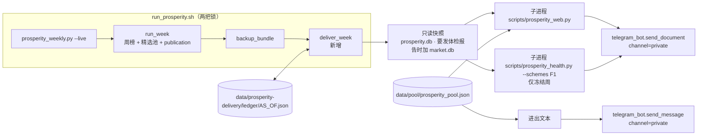
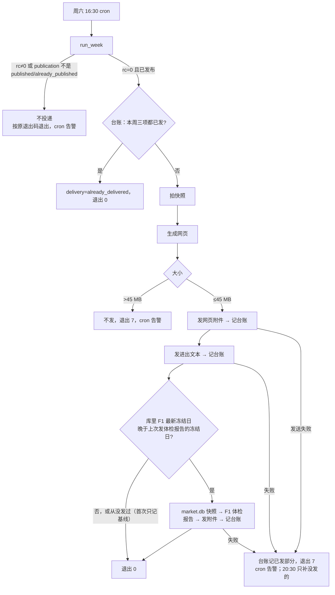

# 景气引擎 M13 Telegram 投递 Implementation Plan

**状态：已完成，2026-11-05 合并本地 main（6b1dd8cf），待 push。Plan Reviewer 两轮（§12–13）、code review 两轮（§14–15）均已处理。**

**Goal:** 每周六 live 周更发布成功后，云端把网页（M11）发到 Boss 的 Telegram 私聊，附精选池进出；冻结周另附 F1 体检报告（M12）。
**Architecture:** 新模块 `src/data/prosperity_delivery.py` 在周更之后单独执行一步。它先给 `prosperity.db`（冻结周加上 `market.db`）拍只读快照，再用子进程调用现有的 `scripts/prosperity_web.py` 和 `scripts/prosperity_health.py`，然后用 `src/telegram_bot.py` 发送。每周一个 JSON 台账，用来防止重复发送、支持补发。入口 `scripts/prosperity_weekly.py` 加 `--delivery-dir`；`scripts/run_prosperity.sh` 固定传这个参数。crontab 不改。不进 `code_version`，不改打分、精选池或 `publication` 表。
**Tech Stack:** Python 3.10 标准库（sqlite3、subprocess、json）、现有 `src/telegram_bot.py`、pytest。
**Spec:** `docs/design/prosperity-engine-north-star.md` §4.2（访问方式、MVP 最小版）、§4.3（生成时机）、模块表 #14。
**北极星对齐:** 景气北极星第四层「输出」。完成 R10 的"随时可访问"，满足 S2 的"网页可访问"。体检报告投递支撑 S3。M13 做完，MVP（S1 + S2 + S3）就齐了。
**基线:** main `817007dd`；分支 `prosperity/m13-delivery`，worktree `.worktrees/prosperity-m13`。`code_version` `13e5f9d5183f1b8e`。

## 1. Boss 决定（2026-11-03）

| # | 问题 | 决定 |
|---|---|---|
| D1 | 投递挂在哪里 | 周更成功后单独加一步（方案 B）。失败只告警，20:30 自动补发，不影响精选池的发布状态 |
| D2 | 消息内容 | 网页附件 + 一行说明（日期、STRICT/FULL 只数、池只数）；另发一条短文本，列本周新进池和移出池的代码 |
| D3 | 体检报告范围 | 冻结周只发 F1 |
| D4 | 上线节奏 | 先试发一份，确认手机能打开；M13 等 11-07 M10 首发核对通过后再 merge，首次自然投递在 11-14 |

默认设置（Boss 没有反对）：发私聊；网页超过 12 MB 只告警，照常发；超过 45 MB 不发并告警；生成的文件保留最近 2 周，台账一直保留。

## 2. 实测依据（2026-11-03）

- **网页**：11-01 快照（`/tmp/m12/prosperity.db`，sha256 前 16 位 `ca0aa05a7cfccf75`）生成 `/tmp/m13/prosperity-web-20261031.html`，88 节、72,580 行、10,249,963 字节，70.97 秒，峰值 RSS 0.78 GB。
- **体检报告**：M12 验收为四个方案共 229 秒，峰值 RSS 1.27 GB（`reports/prosperity/m12-health/README.md:30`）。`--schemes F1` 仍会计算四个方案，因为 BH 族固定包含全部方案（`scripts/prosperity_health.py:78`），所以耗时基本不变。
- **快照要求**：两个 CLI 都拒绝有 WAL 内容的库（退出 4），读前读后还会比较 SHA256（`scripts/prosperity_web.py:91-105`、`scripts/prosperity_health.py:68-108`）。生产库 `prosperity.db` 是 WAL 模式（`src/data/prosperity_store.py:60`）。
- **发送**：`send_document(file_path, caption, channel='group', max_retries=3)`，`timeout=60` 写死在函数里（`src/telegram_bot.py:108-150`）。发出的文件名就是本地文件名（`files={"document": handle}`），所以每周文件名要带日期，私聊历史里才分得清。**默认 channel 是 group**，投递必须显式传 `private`。caption 不带 parse_mode（issue016 已修）；`send_message` 固定用 legacy Markdown（`:86-90`）。Bot API 单个文件上限 50 MB，caption 上限 1024 字符。
- **周更输出**：`run_week` 返回 `RunOutcome(exit_code, keys, error, detail)`。live 周发布成功时 `detail['publication']` 是 `published`，20:30 重跑时是 `already_published`（`src/data/prosperity_run.py:322-334`）。冻结周的 `keys` 包含 `board_type='quarter_final'`、as_of 为本周六的键（`:361-365`、`:385-399`）。
- **冻结时间**：季末后 60–80 天（`terminal/prosperity/config.py:17-18`）。2026Q3 的候选周六是 12-05 到 12-19，所以第一份自动体检报告最早在 12-05。
- **退出码**：现有 0 / 3 门控 / 4 参数 / 5 发布未确认 / 6 错误。cron_wrapper 遇到非零就发 Telegram 告警（`scripts/cron_wrapper.sh:102-111`）。
- **锁**：`prosperity_weekly.py` 在 `finance_prosperity` 和 `market_db_writer` 两把锁内运行（`scripts/run_prosperity.sh:10-19`）。周六 16:30 之后没有别的 `market_db_writer` 任务，投递多占锁几分钟不影响别人。
- **未知项 1：云端上传带宽。** 10 MB 按 1 Mbps 算要 80 秒，会超过 60 秒超时。T6 上线前实测。
- **未知项 2：云端有没有 scipy。** 体检报告 import 了 numpy 和 scipy（`backtest/research/prosperity_health.py:16-18`）。numpy、pandas 已确认在：M9 在云端系统 `python3` 上跑，它 import 的 `src/data/market_store.py:27`、`src/indicators/beta.py:8-9` 都用到了。只有 scipy 没核实。T6 上线前跑 `python3 -c "import backtest.research.prosperity_health, backtest.research.prosperity_health_html"`。
- **冻结在哪一周出现**：冻结不一定出现在本周键里。`run_week` 会先用 `rebuild_freeze_chain` 回放之前漏掉的候选周六（`prosperity_run.py:373-375`、`:278-300`），回放冻结出的季末榜 as_of 是更早的周六，只出现在 `detail['chain_keys']`（`:400-401`）。已存在周榜那条路径（`:361-366`）根本没有 `chain_keys`。所以投递改为读库：F1 最新季末冻结榜的 as_of，与台账里上次发送体检报告时记下的冻结日比较。

## 3. 架构图



依赖方向：`prosperity_delivery.py` 依赖 `prosperity_pool.load_prosperity_pool` 和 `telegram_bot`，只通过子进程调用两个 CLI，不 import 它们。`prosperity_run.py` 不依赖投递模块。

## 4. 业务流程图



Boss 看到的是：周六傍晚私聊里收到一个 HTML 附件，下面一条进出文本；每季一次再多一个 F1 体检报告附件。没收到时，cron 告警会说明是 rc 7，20:30 会自动补发。

## 5. 替代方案

| 方案 | 做法 | 优点 | 缺点 | 选择 |
|---|---|---|---|---|
| A 发布挂点 | 作为 `run_week` 的第三个 publisher | 复用 `publication` 表防止重复发送 | Telegram 故障会让精选池被判"未发布"（rc 5），两种状态混在一起 | |
| **B 周更后单独一步** | 见上图 | 发布和投递各管各的；20:30 自动补发 | 要加一个小台账 | ✓ D1 |
| C 单独一条 cron | 另装一条定时任务 | 完全分开 | crontab 只能整表覆盖写；锁要另配 | |

生成方式：**用子进程调用现有 CLI**，不在进程内直接调库函数。理由：(1) 两个 CLI 的快照检查、原子写入和退出码都已经验收过，按 core.md"用 wrapper 调用，不重写"；(2) 子进程退出后内存就释放（0.78 GB / 1.27 GB），周更主进程不会越占越多。

## 6. 风险自证

- **最大风险：上传超时。** 带宽不够时，三次重试都会失败，每周都发不出去。对策：T1 给 `send_document` 加可选的 `timeout` 参数（默认保持 60，旧调用不变），投递传 300；T6 上线前在云端实测一次上传耗时。
- **第二风险：重复发送。** 16:30 成功、20:30 再跑时如果再发一次，私聊里会出现两份。对策：台账按项记录（`web`、`pool_text`、`health`），每发完一项就原子写一次台账，只补没发的项。**投递语义是"至少一次"，接受少量重复**：发送成功后台账写入失败，或者客户端超时但服务器其实已经收到（`send_document` 会重试），都可能重复。台账写入失败算投递失败（rc 7）。
- **第三风险：投递拖垮周更。** 对策：投递只在 `run_week` rc=0 且已发布之后执行，不改 `run_week`。`prosperity_weekly.py` 在调用处才 import 投递模块（照 `:116` `archivable_hint` 的写法），并用 `try/except Exception` 包住调用。所以投递模块 import 失败或抛出任何异常，都收成 rc 7，不会变成 rc 6，也不影响已经写好的周榜、池文件和备份。读 publication 用 `(out.detail or {}).get('publication')`（`RunOutcome.detail` 默认是 None，`prosperity_run.py:54`）。
- **磁盘**：快照放在 `data/prosperity-delivery/tmp/`，用完就删。`prosperity.db` 约 0.63 GB；冻结周再加 `market.db` 约 1.47 GB。拍每个快照前复用 `check_space(源库)`（`prosperity_backup.py:51-60`，剩余 ≥ max(2 GiB, 3 × 库大小)），不够就 rc 7，不拍。
- **为什么不更简单（直接读生产库，不拍快照）**：两个 CLI 遇到 WAL 内容会拒绝（退出 4）。生产库关闭后 WAL 通常会被清掉，但这一点不保证；为了省 10–30 秒去改已经验收过的 CLI，不值得。

## 7. 验收标准

| # | 项 | 通过标准 | 任务 |
|---|---|---|---|
| A1 | 超时参数 | `send_document(..., timeout=300)` 把 300 传给 `requests.post`；不传时仍是 60；旧测试全过 | T1 |
| A2 | 台账与文本 | 进出对比正确（新进、移出、首周无对比）；caption ≤1024 字符；文本里的 `_ * [ \`` 被转义；台账原子写入 | T2 |
| A3 | 投递编排 | 第一次按序发送并记账；重跑不再发送；发送失败返回失败状态，台账只记已发的项，再跑只补没发的；从没发过体检报告时只记基线、不发；库里冻结日晚于上次发送的冻结日时才发（包括更早的周六回放冻结、上周两次都失败）；池文件不可用或不是本周时，文本写原因、不比较、不写 `pool_members`；>45 MB 不发；>12 MB 在 caption 里加告警；附件文件名带日期；**所有发送都用 `channel='private'`** | T3 |
| A4 | 快照只读 | 投递前后生产库 SHA256 不变；临时快照删除；生成的文件只保留最近 2 周；空间不足时不拍快照、返回失败 | T3 |
| A5 | CLI 接线 | `--delivery-dir` 在所有模式都接受，只有 `--live` 才投递（`--rebuild-chain`/`--as-of` 加 `--delivery-dir` 照常 rc 0、不投递）；`--live --delivery-dir` 不带 `--pool-path` 时 rc 4；rc 3/4/5/6 和 `publication_not_configured` 时不投递；投递失败或抛异常时 rc 7；JSON 输出含 `delivery` 段；`run_prosperity.sh` 传 `--delivery-dir` | T4 |
| A6 | 真实数据 | 用 11-01 快照和本地 `market.db` 快照跑 `deliver_week`，发送端换成写本地文件的假实现：网页 88 节；预置一份上周台账（health 基线 = 库里倒数第二个冻结日）后，F1 体检报告生成并“发送”；caption 和进出文本人工看过；两个快照 SHA256 前后不变；记录耗时 | T5 |
| A7 | 全量测试 | 与基线相同：12 failed，新增失败 0 | T5 |
| A8 | 试发（手机） | Boss 在手机 Telegram 里打开 `/tmp/m13/prosperity-web-20261031.html`：能显示表格，页首目录能跳转 | T0 |
| A9 | 云端上传实测 | 云端把同一份网页发到私聊，记录耗时，必须小于 300 秒 | T6 |
| A10 | 首次自然投递 | 11-14 16:30 后：私聊收到网页和进出文本；台账三项状态对（health 是基线）；20:30 日志是 `already_delivered`，没有重复消息 | T6 |
| A11 | 云端体检报告试跑 | 12-05 第一个可能的冻结周之前，在云端用两个 `.backup` 快照跑一次 `prosperity_health.py --schemes F1`：退出 0，记录耗时和峰值内存。没做的话，风险是 12-05 第一次在云端跑体检报告就失败（rc 7 告警，网页照发） | T6 |

## 8. Global Constraints

- Finance 主账 Google Sheet 只读；本模块不读也不写它。
- `market.db` 云端独占写入；投递只读，且只读快照。
- 投递代码不进 `code_version`（`terminal/prosperity/version.py` 的 `CODE_VERSION_SOURCES` 不加文件）。
- 云端 Python 3.10，没有 `.venv` 时回退到 `python3`（`scripts/run_prosperity.sh:7-9`）；子进程用 `sys.executable`。
- 不擅自 merge 或 push；merge 到 main 就等于部署（云端周二至周六 06:25 自动 pull），所以 merge 时间要在 11-07 核对之后、11-14 06:25 之前。
- 凭证只用环境变量 `TELEGRAM_BOT_TOKEN` / `TELEGRAM_CHAT_ID`，不写进代码、日志和台账。

## 9. 文件结构

```
src/telegram_bot.py                    修改：send_document 加 timeout 参数（默认 60）
src/data/prosperity_delivery.py        新建：台账、进出对比、文本、快照、deliver_week 编排
scripts/prosperity_weekly.py           修改：--delivery-dir；live 发布成功后调用 deliver_week；rc 7
scripts/run_prosperity.sh              修改：固定传 --delivery-dir "$PROJECT_DIR/data/prosperity-delivery"
tests/test_telegram_bot.py             修改：timeout 测试
tests/test_prosperity_delivery.py      新建
tests/test_prosperity_weekly_cli.py    修改：投递接线与退出码
tests/test_run_prosperity_wrapper.py   修改：断言传了 --delivery-dir
docs/runbooks/prosperity-weekly.md     修改：投递一节（台账、退出码 7、补发、手动看报告）
docs/design/prosperity-engine-north-star.md  修改：§4.2 访问方式写实际做法；模块表 #14、完成度表
ARCHITECTURE.md、docs/CHANGELOG.md     各一行
reports/prosperity/m13-delivery-20261103/README.md  A6–A9 证据
```

台账目录 `data/prosperity-delivery/` 已在 `.gitignore` 的 `/data/*` 下。

```
data/prosperity-delivery/
  ledger/2026-11-14.json     一直保留
  out/2026-11-14/            prosperity-web-20261114.html；冻结周加 health/F1.html、summary.json，发送时复制成 prosperity-health-F1-20261205.html；保留最近 2 周
  tmp/                       快照，用完即删
```

台账格式：

```json
{"as_of": "2026-11-14", "pool_members": ["AVGO", "MU"], "pool_as_of": "2026-11-14",
 "items": {"web": {"sent_at": "...", "bytes": 10249963},
           "pool_text": {"sent_at": "..."},
           "health": {"freeze_as_of": "2026-08-29", "baseline": true} }}
```

`items` 里没有的项就是没发。`health` 有三种：`{"freeze_as_of": X, "sent_at": ...}`（发了 X 冻结的报告）；`{"freeze_as_of": X, "baseline": true}`（从没发过时记下的起点，不发）；`{"freeze_as_of": X, "not_due": true}`（X 已经发过）。`health` 同时记 `code_version`。`last_health_freeze(delivery_dir, as_of, code_version)` 按日期从新到旧看本周之前的台账，取第一个“已发或基线”的 health：它的 `code_version` 与当前相同就返回它的 `freeze_as_of`；不同就返回特殊值“版本已变”，此时把库里最新冻结榜当作新的、发一次（新引擎的第一份报告）。没有任何台账时返回 None（记基线）。基线的值写进投递 JSON 输出和日志，方便核对。

## 10. 任务

### T0：试发（不写代码）

- [ ] Boss 在电脑上把 `/tmp/m13/prosperity-web-20261031.html` 拖进 Telegram 的"收藏夹"（Saved Messages）。
- [ ] Boss 在手机 Telegram 里打开它：看表格是否显示、页首目录能否跳转、打开要几秒（A8）。
- [ ] 打不开或不能跳转 → 停下来回到北极星 §4.2 讨论载体，不继续 T1。

### T1：`send_document` 加超时参数

**Files:** Modify `src/telegram_bot.py:118-150`；Test `tests/test_telegram_bot.py`

**Interfaces:** Produces `send_document(file_path, caption='', channel='group', max_retries=3, timeout=60) -> bool`

- [ ] Step 1：写失败测试。

```python
@patch("src.telegram_bot.TELEGRAM_BOT_TOKEN", "t")
@patch("src.telegram_bot.TELEGRAM_CHAT_ID", "111")
@patch("src.telegram_bot.requests.post")
def test_send_document_passes_timeout(post, tmp_path):
    f = tmp_path / "a.html"; f.write_text("x")
    post.return_value.ok = True
    assert send_document(str(f), channel="private", timeout=300)
    assert post.call_args.kwargs["timeout"] == 300
    send_document(str(f), channel="private")
    assert post.call_args.kwargs["timeout"] == 60
```

- [ ] Step 2：`pytest tests/test_telegram_bot.py -k timeout -v` → FAIL（unexpected keyword `timeout`）。
- [ ] Step 3：加参数 `timeout: int = 60`，`requests.post(..., timeout=timeout)`。
- [ ] Step 4：`pytest tests/test_telegram_bot.py tests/test_telegram_routing.py -v` → 全过。
- [ ] Step 5：`git commit -m "feat(telegram): optional upload timeout for send_document"`

### T2：台账、进出对比、文本（纯函数）

**Files:** Create `src/data/prosperity_delivery.py`；Test `tests/test_prosperity_delivery.py`

**Interfaces:** Produces
- `ledger_path(delivery_dir: Path, as_of: str) -> Path`
- `read_ledger(delivery_dir, as_of) -> dict`（不存在时返回 `{'as_of': as_of, 'items': {}}`）
- `write_ledger(delivery_dir, ledger: dict) -> None`（同目录临时文件 + `os.replace` + 目录 fsync）
- `previous_ledger(delivery_dir, as_of) -> Optional[dict]`（as_of 之前最近一份**带 `pool_members`** 的台账）
- `pool_diff(previous: Optional[Sequence[str]], current: Sequence[str]) -> Tuple[List[str], List[str]]`（新进、移出，都排好序）
- `md_escape(text: str) -> str`（转义 `_ * [ \``）
- `web_caption(*, as_of, strict, full, pool_count, size_bytes) -> str`（≤1024；>12 MB 时加"⚠ 网页 X MB，超出 12 MB 预算"）
- `pool_text(*, as_of, previous_as_of, added, removed, members, reason) -> str`

- [ ] Step 1：写失败测试，覆盖：首周 `pool_diff(None, …)` 返回 `([], [])`，文本写"无上周对比"；新进与移出；`BRK_B` 被转义成 `BRK\_B`；caption 恰好在 12 MB 的界限上；台账写了再读结果一致；写入中途抛异常时旧台账不变；`previous_ledger` 跳过晚于 as_of 的台账。
- [ ] Step 2：`pytest tests/test_prosperity_delivery.py -v` → FAIL（模块不存在）。
- [ ] Step 3：最小实现。
- [ ] Step 4：通过。
- [ ] Step 5：`git commit -m "feat(prosperity-m13): delivery ledger, pool diff and message text"`

### T3：`deliver_week` 编排

**Files:** Modify `src/data/prosperity_delivery.py`；Test `tests/test_prosperity_delivery.py`

**Interfaces:**
- Consumes：T1 的 `send_document(..., timeout=)`、T2 的全部函数、`load_prosperity_pool(path, now=)`（`src/data/prosperity_pool.py:320`）。
- Produces：

```python
@dataclass(frozen=True)
class DeliveryOutcome:
    status: str            # 'delivered' | 'already_delivered' | 'failed'
    sent: Tuple[str, ...]  # 本次发出的项
    error: str = ''

VERSION_CHANGED = object()   # sentinel
def last_health_freeze(delivery_dir, as_of: str, code_version: str)  # -> None | VERSION_CHANGED | str

def deliver_week(*, as_of: str, code_version: str, db: Path, market_db: Path,
                 pool_path: Path, delivery_dir: Path, now: Callable[[], datetime],
                 send_document=telegram_bot.send_document, send_message=telegram_bot.send_message,
                 run=subprocess.run) -> DeliveryOutcome
```

顺序：
1. 读台账。`web`、`pool_text` 都在，并且 `health` 是 `sent_at`、`baseline` 或 `not_due` 之一时，返回 `already_delivered`，不拍快照。
2. 先 `check_space(db)`，再用 `snapshot(src, dst)` 给 `prosperity.db` 拍快照：`sqlite3` 以 `?mode=ro` 打开 → `backup` → 关闭 → `PRAGMA quick_check`。
3. 在快照上（`ProsperityStore(snap, read_only=True)`，读完就关）读两样：F1 本周 live 周榜的 STRICT/FULL 只数；F1 最新季末冻结榜的 as_of（`list_boards(board_type='quarter_final')` 的最后一个）。本周 F1 周榜不存在就失败。
4. 缺 `web`：用 `run([sys.executable, ROOT/'scripts/prosperity_web.py', '--db', snap, '--pool', pool_path, '--code-version', code_version, '--out', out/f'prosperity-web-{as_of 去横线}.html'], timeout=600)`。rc≠0 就失败，>45 MB 也失败（不发）。然后 `send_document(..., channel='private', timeout=300)`；返回 False 就失败；成功就立刻记账。
5. 缺 `pool_text`：`load_prosperity_pool(pool_path, now=now())`。如果 `available` 为 False，或池的 `as_of` 不等于本周，文本只写原因（`reason`，或 `pool_as_of_mismatch`），不做比较，台账不写 `pool_members`。否则用 `previous_ledger` 拿最近一份有 `pool_members` 的台账比较。然后 `send_message(文本, channel='private')`，成功后记账；池可用时同时写 `pool_members`。
6. 缺 `health`：`last = last_health_freeze(delivery_dir, as_of, code_version)`。没有冻结榜时记 `{freeze_as_of: None, not_due: true}`。`last` 是 None 时记基线、不发。`last` 是字符串且 `latest <= last` 时记 `not_due`。`last` 是 `VERSION_CHANGED`，或 `latest > last` 时发送：`check_space(market_db)` → 给 `market.db` 拍快照 → `run([... 'scripts/prosperity_health.py', '--db', snap, '--market-db', msnap, '--code-version', code_version, '--out', out/'health', '--schemes', 'F1'], timeout=1800)` → 复制成 `prosperity-health-F1-{latest 去横线}.html`（文件名用冻结日，不用本周日期）→ `send_document(caption=f'F1 体检报告 · 冻结 {latest}', channel='private', timeout=300)` → 记 `{freeze_as_of: latest, sent_at, code_version}`。每种 health 记录都带 `code_version`。
7. `finally`：删掉 `tmp/`；`out/` 只留最近 2 个 as_of 目录。
8. 任何异常（包括子进程超时、台账写入失败）都收成 `DeliveryOutcome('failed', sent, f'{type}: {msg}')`。错误文本先过 `_sanitize_error_text`，保证不含 token。

- [ ] Step 1：写失败测试。用 `tests/prosperity_fixtures.storage_batch` 建库。`run` 换成假实现，写一个指定大小的文件并返回 rc。`send_*` 换成记录调用的假实现，可以设定第 N 次返回 False。覆盖 A3、A4 列出的每一条，另加：快照拍完后生产库 SHA256 不变；`tmp/` 被删掉；第三周跑完后 `out/` 只剩 2 个目录；异常信息不含 token。再加一个集成测试：真跑 `scripts/prosperity_web.py`（不跑体检报告，它要价格夹具，T5 再用真数据测）。
- [ ] Step 2：→ FAIL。
- [ ] Step 3：实现。
- [ ] Step 4：通过。
- [ ] Step 5：`git commit -m "feat(prosperity-m13): deliver_week with snapshots, ledger and retries"`

### T4：CLI 接线

**Files:** Modify `scripts/prosperity_weekly.py:32-125`、`scripts/run_prosperity.sh:24-27`；Test `tests/test_prosperity_weekly_cli.py`、`tests/test_run_prosperity_wrapper.py`

- [ ] Step 1：写失败测试：
  - `--rebuild-chain` 或 `--as-of` 加 `--delivery-dir` 照常运行、rc 0、不调用投递（runbook 的两个命令都经过 wrapper，wrapper 总会传 `--delivery-dir`）。
  - `--live --delivery-dir` 不带 `--pool-path` 时退出 4。
  - `--delivery-dir` 指向任何库文件或其 `-wal/-shm/.state` 时退出 4，照 `pool_path_must_differ_from_databases` 的写法。
  - `run_week` 返回 rc 0 + `published` 时调用 `deliver_week`，`as_of`、`code_version`、`pool_path` 都传对；返回 `already_published` 时也调用。
  - `publication_not_configured`、`detail=None`、rc 3/5/6 时都不调用。
  - `deliver_week` 返回 `failed` 时 `main` 返回 7，打印的 JSON 有 `delivery.status == 'failed'`；`deliver_week` 抛异常时也返回 7。
  - 返回 `delivered` / `already_delivered` 时，`main` 返回 0。
  - 不带 `--delivery-dir` 时，行为和现在完全相同。
  - wrapper 测试断言参数里有 `--delivery-dir` 且以 `data/prosperity-delivery` 结尾。
- [ ] Step 2：→ FAIL。
- [ ] Step 3：实现。调用放在 `backup_bundle` 之后，在调用处 import `deliver_week`，用 `try/except Exception` 包住，异常转成 `{'status': 'failed', ...}`。输出 JSON 改为 `{**asdict(out), 'delivery': ...}`。退出码规则写进文件头 docstring：7 = 周榜已发布、投递失败。
- [ ] Step 4：`pytest tests/test_prosperity_weekly_cli.py tests/test_run_prosperity_wrapper.py tests/test_prosperity_run.py -v` → 全过。
- [ ] Step 5：`git commit -m "feat(prosperity-m13): wire delivery into the live weekly run (rc 7 on failure)"`

### T5：真实数据验收与文档

- [ ] Step 1：快照。`/tmp/m12/prosperity.db` 复用（记 SHA256）；`sqlite3 "$MAIN/data/market.db" ".backup /tmp/m13/market.db"`，两份都跑 `quick_check`。
- [ ] Step 2：先在空的验收投递目录里预置 `ledger/2026-10-24.json`：`health = {freeze_as_of: <库里 F1 倒数第二个季末冻结日>, baseline: true, code_version: <当前>}`。然后用一个小脚本调用 `deliver_week(as_of='2026-10-31', code_version=<当前>, ...)`，`send_*` 换成"复制到 `reports/prosperity/m13-delivery-20261103/out/` 并把 caption 和文本写进 `sent.txt`"的假实现。用 `/usr/bin/time -l` 记总耗时和峰值 RSS（A6）。
- [ ] Step 3：核对：网页 88 节；`health/F1.html` 存在，八章标题齐全；caption 和进出文本人工看过；两个快照 SHA256 前后不变；`tmp/` 已空。
- [ ] Step 4：全量 `pytest -q`，与基线比对（A7）。
- [ ] Step 5：文档：runbook 加"Telegram 投递（M13）"一节（触发条件、台账位置、rc 7 含义、20:30 自动补发、两次都失败怎么办——下周会照常发最新网页；体检报告可以在本地按 M12 一节生成）。北极星 §4.2 访问方式写"Telegram 私聊附件，周更后由周更入口发送；冻结周附 F1 体检报告"，"本地拉取副本（辅）"那一行保留，改为"`sync_prosperity.py` 拉库后用 M11 本地 CLI 生成"；模块表 #14 和完成度表更新。ARCHITECTURE、CHANGELOG 各一行。README 记 A6–A8。
- [ ] Step 6：`git commit -m "docs(prosperity-m13): real-data acceptance, runbook, north-star"`

### T6：审查、merge、上线

- [ ] `/code-review high` 审本分支 diff，逐条核实后修复。
- [ ] 11-07 M10 首发核对通过之后，问 Boss 是否 merge。merge 和 push 由 Boss 确认。
- [ ] merge 后次日 06:25 云端自动 pull，然后做三项云端检查（要 Boss 授权 ssh，或 Boss 用 `!` 自己跑）：
  1. 依赖（只读）：`cd /root/workspace/Finance && python3 -c "import backtest.research.prosperity_health, backtest.research.prosperity_health_html"`。缺 scipy 就停下来，问 Boss 是装包，还是云端只发网页、体检报告留在本地生成。
  2. A9 上传实测：把一份网页放到云端 `/tmp/`，跑 `time python3 -c "from src.telegram_bot import send_document; print(send_document('/tmp/prosperity-web-test.html', caption='M13 上传实测', channel='private', timeout=300))"`。要求打印 True，`real` 小于 300 秒。超过就停下来讨论（压缩页面 / 换载体）。
  3. A11 云端体检报告试跑：在 `/tmp` 下给两个库各拍一个 `.backup` 快照，跑 `prosperity_health.py --schemes F1`，记退出码、耗时、峰值内存，跑完删掉快照。
- [ ] A10：11-14 16:30 之后核对日志、台账、私聊；20:30 之后确认没有重复消息。台账 `health.baseline` 的 `freeze_as_of` 应为 2026Q2 的冻结日（2026-08-29）。
- [ ] 基线门：首次投递必须在 2026-12-05（2026Q3 第一个候选冻结周六）之前成功。做不到时（merge 推迟、网页连续发送失败），在首次投递前手工写 `ledger/<上周六>.json`，`health = {freeze_as_of: '2026-08-29', baseline: true, code_version: <当前>}`，让 2026Q3 冻结照常发送。

## 11. 自审

1. **spec 覆盖**：§4.2"经 Telegram 私聊投递" → T3（private）+ T4；"每次周更后在云端生成" → T4 接线到 live 周更；§4.3"季末冻结后在云端为生产方案重新生成，随网页一起投递" → T3 第 6 步（F1，D3）；模块表 #14"周更后发送网页，冻结后附体检报告" → T3/T4；D2 进出文本 → T2/T3 第 5 步；D4 试发 → T0，上线节奏 → T6。
2. **占位符**：没有 TBD / 稍后实现。T5 Step 2 预置的上周台账是验收专用：T3 按“库里最新冻结日晚于上次发送或基线”决定是否发体检报告，所以把基线设成倒数第二个冻结日就能触发；体检报告 CLI 读的是库里真实的 84 张季末榜。
3. **类型一致**：`deliver_week` 不再接收 `keys`，改为 `code_version: str`；T4 传 `code_version()`（与 `run_week` 用的同一个函数）；`as_of` 用 `this_saturday(now()).isoformat()`，与 `run_week` 的入参相同。

## 12. Plan 审查第 1 轮（2026-11-03，Plan Reviewer subagent）

| # | 级别 | 问题 | 处理 |
|---|---|---|---|
| 1 | BLOCKER | wrapper 总会传 `--delivery-dir`，"不带 `--live` 退出 4"会让 runbook 的 `--rebuild-chain`、`--as-of` 失败 | 成立。所有模式都接受，只有 live 才投递（T4、A5） |
| 2 | MAJOR | 只看 `keys` 会漏掉回放冻结（as_of 更早，只在 `chain_keys` 里） | 成立，另外还有 rc 5 后 20:30 走已存在周榜路径、没有 `chain_keys` 的情况。改为读库里 F1 最新冻结日，与台账上次发送的冻结日比较（T3 第 6 步、`last_health_freeze`） |
| 3 | MAJOR | 池不可用时 `load_prosperity_pool` 没有 `as_of`，会误报"全部移出"并污染下周对比 | 成立。不可用或 as_of 不符时只写原因、不写 `pool_members`；`previous_ledger` 只取有 `pool_members` 的台账（T2 已实现、T3 第 5 步） |
| 4 | MAJOR | "任何异常都收成 rc 7"只在 `deliver_week` 内部成立 | 成立。调用处 import + `try/except`；`(out.detail or {})`；加抛异常测试（T4） |
| 5 | MINOR | 缺 `publication_not_configured` 测试；`pool_path` 可能是 None | 成立。加测试；`--live --delivery-dir` 不带 `--pool-path` 退出 4 |
| 6 | MINOR | 子进程没传 `--code-version`，集成测试会退出 3 | 成立。两个 CLI 都传 `--code-version` |
| 7 | MINOR | 台账只能做到"至少一次" | 成立。写明接受；每次发送成功后立刻写台账；台账写入失败算投递失败 |
| 8 | MINOR | 行号写错；numpy、pandas 云端已有；依赖检查要 import 真模块 | 成立。已改 §2 和 T6 |
| 9 | MINOR | 体检报告第一次云端运行就是 12-05 | 成立。加 A11 云端试跑 |
| 10 | MINOR | 附件每周同名；§4.2 本地副本那一行被删；T6 顺序 | 成立。文件名带日期；保留本地副本一行；T6 重排 |
| 11 | MINOR | 空间公式重复造了 `check_space` | 成立。复用 `check_space` |

## 13. Plan 审查第 2 轮（2026-11-03）

| # | 级别 | 问题 | 处理 |
|---|---|---|---|
| 1 | MAJOR | T5、A6、§11 还按旧的 `keys` 写；空台账下体检报告分支走不到 | 成立。T5 预置上周台账（基线 = 倒数第二个冻结日）；§11 重写 |
| 2 | MINOR | 第一次投递成功晚于冻结时，那次冻结被当成基线吞掉 | 成立。基线写进 JSON 输出和日志；T6 加一条：首次投递必须在 12-05 前成功，否则手工预置台账 |
| 3 | MINOR | 台账跨 code_version 比冻结日 | 成立。health 记 `code_version`；版本变了就把最新冻结当新的发一次；"最近"= 按台账日期最新 |
| 4 | MINOR | plan 文字和已提交的 T2 代码不一致 | 成立。已同步 |
| 5 | MINOR | 体检报告附件名用本周日期，没有 caption | 成立。文件名用冻结日，caption 写冻结日 |

第 2 轮是审查上限，以上全部按审查建议修订，plan 放行。

## 14. 实现审查（`/code-review high`，2026-11-03）

8 条全部核实成立，全部修复（TDD，先写失败测试）。

| # | 问题 | 修复 |
|---|---|---|
| 1 | 投递只看池 `as_of`，没对照原榜（北极星 §4.1 读取端规则） | `_trusted_pool` 复用 `prosperity_web.pool_binding`；不符 → `pool_board_mismatch`，不比较、不写 `pool_members` |
| 2 | 池不可信时 caption 写"入池 0"（门控失败显示成安全值） | `pool_count=None` → "入池 未知" |
| 3 | 坏台账让以后每周都失败，且不报文件名 | `_parse_ledger` 报 `ledger_unreadable: <文件名>`；三项独立后网页照发 |
| 4 | 网页失败拦住进出文本和体检报告 | 三项各自 try，错误收集后统一返回 failed |
| 5 | 首次投递在冻结后时，冻结被静默吞掉 | 记基线时发一次性提示消息；`NEVER` 哨兵区分"从没记过"与"基线时无冻结" |
| 6 | 快照保留 WAL 头，只读打开会生成 -wal/-shm | 复用 `prosperity_backup._quick_check` 切 DELETE 模式 |
| 7 | 两处重复判断与两次目录扫描 | `_health_done`、`_ledgers_before` |
| 8 | `--delivery-dir` 指向共享目录时会删别人的 `tmp/`、`out/` | 所有权标记 `.prosperity-delivery`；无标记时只接受 `ledger/out/tmp` 布局 |

## 15. 第二轮审查（2026-11-05，提交 8ca3d740 之后）

两条都复现成立，都已修复（先写失败测试）。

| # | 问题 | 修复 |
|---|---|---|
| P1 | 输入库可以放在 `<delivery-dir>/tmp/`；投递结束删 `tmp/` 时连源库一起删 | 投递前用解析后的路径检查 `db`、`market_db`、`pool_path`，落在投递目录内（含符号链接别名）→ `input_inside_delivery_dir`，不拍快照、不发送、不清理。CLI 解析阶段同样检查，rc 4 |
| P2 | 同周升级引擎后，防重只看本周台账，新版网页和体检报告不发 | 台账每一项记 `code_version`；某项只在版本等于本次时算已发。同周换版本后三项都重发，再跑一次 `already_delivered` |
