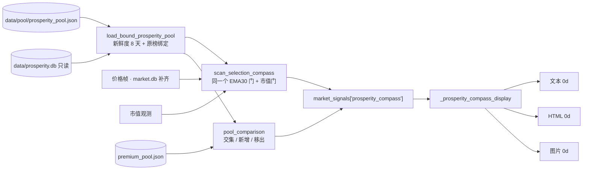
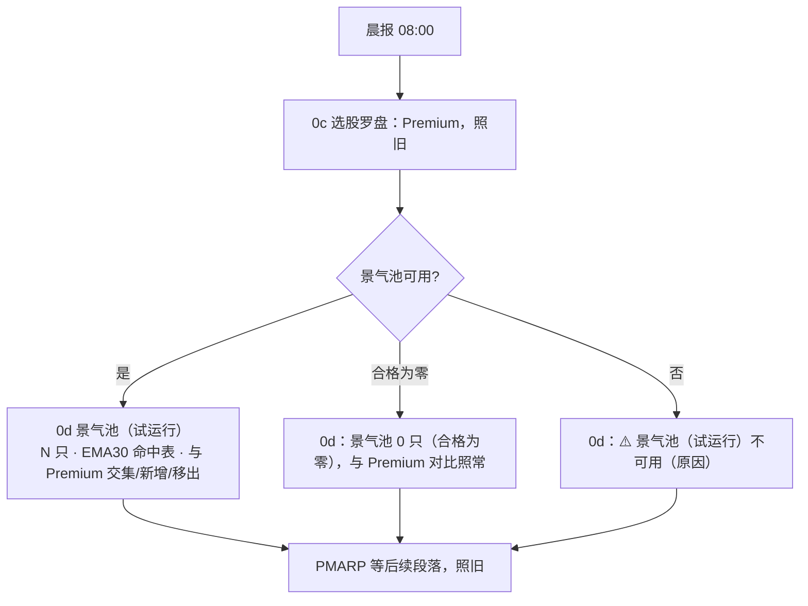

# 景气引擎 M14 晨报并行接入 Implementation Plan

**状态：2026-11-05 Plan Reviewer 第一轮 23 条已处理（§11），进入实现。**

**Goal:** 晨报新增"0d. 景气池（试运行）"一段：景气精选池成员跑与 Premium 相同的 EMA30 门，并列出与 Premium 的交集、新增、移出。Premium 照旧驱动 🔴 和 0c。
**Architecture:** 新模块 `src/data/prosperity_morning.py` 读池文件（8 天新鲜度），再对照 `prosperity.db` 原榜做北极星 §4.1 要求的两步绑定（复用 `prosperity_web.pool_binding`），返回与 Premium 池同形状的字典。`build_market_signal_report` 把它交给现成的 `scan_selection_compass`（同一个 EMA30 门 + 市值门），结果放进 `market_signals['prosperity_compass']`。文本、HTML、图片三处各加一段，共用一个 display 函数。整段包在 `try/except` 里，任何失败只让这一段显示"不可用"，不影响晨报其余部分。不改 Premium 路径，不进 `code_version`。
**Tech Stack:** Python 3.10、pandas（已有）、pytest。
**Spec:** `docs/design/prosperity-engine-north-star.md` 第五层「并行期」、§4.1「读取端要对照原榜」与「合格为零 ≠ 不可用」、模块表 #15。
**北极星对齐:** 景气北极星第五层（R16 并行过渡）。不做切换和退役（M15，Boss 看过首份体检报告后拍板）。
**基线:** 本地 main `6b1dd8cf`（含 M13，2026-11-05 快进）；分支 `prosperity/m14-morning`，worktree `.worktrees/prosperity-m14`。

## 1. 依据（2026-11-03 读代码）

- Premium 读法：`scripts/morning_report.py:1301-1306` `load_premium_pool()` → 成员集合；`:1365-1378` 给缺价格的成员从 `market.db` 补 127 行；`:1437-1471` 调 `scan_selection_compass(premium_pool=…, as_of, price_frames, market_cap_observations)`，异常时收成 `selection_compass_error`；`:1490-1500` 输出 `premium_pool` 摘要。
- `scan_selection_compass` 只用 `available / reason / members[].symbol / coverage / as_of`（`terminal/selection_compass.py:444-540`），与池的来源无关：成员 EMA30 就绪覆盖 <95% 不可用；命中股票市值观测超过 7 天不可用；命中按市值降序。景气池字典直接传入即可，**不复制 EMA30 逻辑**。
- 显示三处：文本 `format_section_selection_compass`（`:1830`，在 `:3145` 拼进正文）、HTML `build_html_payload`（`:2268`）、图片 `build_morning_visual_sections`（`:2468`）。三处都经 `_selection_compass_display`（`:1769`）保持一致。
- 现有测试 `tests/test_morning_report.py:1068` 断言图片段 slug 列表；`sample_market_signals()` 没有 `selection_compass` 键，所以段落隐藏。新段同样在键缺失时隐藏，现有测试不受影响。
- 池读取：`load_prosperity_pool(path, now=)`（`src/data/prosperity_pool.py:320`）返回 `{available, reason, members, as_of, source{code_version, content_hash}, …}`；绑定：`pool_binding(pool, stored)`（`src/data/prosperity_web.py:111`）返回 `(ranks, note)`，`ranks` 为空表示不符（或池为空——见 §5 风险 2）。
- 云端晨报 08:00 周二至周六运行；`prosperity.db` 只在周六 16:30/20:30 被写，时间不重叠。只读打开 WAL 库是安全的（`ProsperityStore(read_only=True)`，`prosperity_store.py:36-60`）。

## 2. 架构图



## 3. 业务流程（Boss 视角）



## 4. 替代方案

| 方案 | 做法 | 优点 | 缺点 | 选择 |
|---|---|---|---|---|
| **A 复用 `scan_selection_compass`** | 景气池字典直接传入 | 同一个 EMA30 门（北极星原话），零重复 | 函数名带 Premium 字样 | ✓ |
| B 新写景气 EMA30 门 | 复制 `_evaluate_ema30` 循环 | 名字干净 | 两套门会漂移，违反"用 wrapper 不重写" | |
| C 不做原榜绑定，只读池文件 | 少一个库依赖 | 简单 | 北极星 §4.1 明确要求"能读原榜的读取端"做两步；晨报在云端能读 | |

## 5. 风险自证

1. **最大风险：新段拖垮晨报。** 晨报每天发群组，不能中断。对策：整个景气块（读池、绑定、补价格、EMA30、对比）包在一个 `try/except Exception`，失败只记 `{'available': False, 'reason': 'prosperity_compass_error'}`；Premium 路径的代码不动，测试覆盖"景气块抛异常时 Premium 段照常"。
2. **空池误判为绑定失败。** `pool_binding` 对空 `members` 返回 `({}, '入池 0 只…')`，`ranks` 为空但 note 以"入池"开头。判定绑定成功用 note 前缀"未标入池"之外，不用 `ranks` 是否为空。合格为零按北极星是有效结果，显示"合格为零"，不当作不可用。
3. **静默降级。** 池文件过期、库缺失、绑定不符，都显示带原因的"不可用"，不显示为空池（北极星第五层降级规则）。
4. **耗时。** 读一张榜约 1.9 秒、绑定 0.7 秒、峰值约 0.41 GB（Plan Reviewer 实测）；EMA30 只多算约 36 只。可忽略。
6. **只读打开 WAL 库。** `ProsperityStore(read_only=True)` 是 `mode=ro` + `query_only`；写者持有 `BEGIN IMMEDIATE` 时照常可读（实测），所以不依赖"晨报与周更不重叠"。周六 08:00 晨报读到的池 as_of 是上周六（7 天，在 8 天内）。目录不可写且无 sidecar 时抛 `sqlite3.OperationalError` → `prosperity_db_unavailable`。
7. **BoardKey 用池自带的 `code_version`。** 池文件是哪个版本算出来的，就去对哪个版本的原榜；引擎周中升级后，到下个周六前池仍可读（D5：库里保留当前和上一个 live 版本）。代价是 `pool_binding` 里的 code_version 检查恒真，绑定靠 content_hash 与逐成员核对。M11/M13 用引擎当前版本，因为它们在周更后立即运行。
5. **为什么不更简单（只显示名单不跑 EMA30）**：北极星并行期原文要求"景气池成员跑同一个 EMA30 门"，为切换时比较两池的日常命中做准备。

## 6. 验收标准

| # | 项 | 通过标准 | 任务 |
|---|---|---|---|
| B1 | 读取与绑定 | 池缺失/过期/条件不符/损坏 → 对应 `prosperity_pool_*`；库缺失 → `prosperity_db_unavailable`；原榜不符（改一个成员排名）→ `prosperity_pool_board_mismatch`；合法 → `available` 且成员齐全；空池合法 → `available`、成员 0 | T1 |
| B2 | 对比 | 交集、仅景气（新增）、仅 Premium（移出）各自排序正确；Premium 不可用时对比记 `premium_unavailable`，不当成 Premium 为空 | T1 |
| B3 | 接线 | `market_signals['prosperity_compass']` 由 `scan_selection_compass` 计算；缺价格的景气成员从 `market.db` 补；景气块抛异常 → `prosperity_compass_error`，`selection_compass` 与 `premium_pool` 与不接入时完全相同 | T2 |
| B4 | 显示 | 键缺失 → 三处都不出现 0d（现有测试不变）；不可用 → 三处都是"⚠️ 景气池（试运行）不可用（原因中文）"；可用 → 文本、HTML、图片三处列与行一一对应，含排名、评级、分数、成交额排名、收盘、EMA30、市值、Premium 列"是"；合格为零 → 显示"合格为零"与对比 | T3 |
| B5 | 真实数据 | 用 11-01 快照 `/tmp/m12/prosperity.db`、10-31 池文件（时钟 2026-11-01）、本地 `market.db` 副本、`/tmp/m12/premium_pool.json`：绑定通过 36 只；EMA30 段生成；对比数字与独立 `set` 运算一致；输出三处文本人工看过 | T4 |
| B6 | 全量测试 | 与基线相同 12 failed，新增 0 | T4 |

## 7. Global Constraints

- Premium 路径（🔴、0c、`premium_pool` 摘要）行为不变。
- 不切换、不退役 Premium（M15 是 Boss 决策门）。
- 晨报发群组；本 plan 不 merge、不 push、不部署，merge 由 Boss 决定。
- 两个库都只读；不进 `code_version`。
- 不在本地跑完整晨报（issue057：`--no-telegram` 试跑会缓存盘中成交额）；真实数据验收只跑本模块的函数。

## 8. 文件结构

```
src/data/prosperity_morning.py         新建：PROSPERITY_DB_PATH、load_bound_prosperity_pool、pool_comparison
scripts/morning_report.py              修改：build_market_signal_report 景气块；_prosperity_compass_display；
                                       format_section_prosperity_compass；HTML / 图片 / 文本三处接入
tests/test_prosperity_morning.py       新建：读取、绑定、对比、显示、接线
docs/design/prosperity-engine-north-star.md、docs/runbooks/prosperity-weekly.md、ARCHITECTURE.md、docs/CHANGELOG.md
reports/prosperity/m14-morning-20261103/README.md
```

## 9. 任务

### T1：读取、绑定、对比（纯函数 + 只读库）

**Interfaces（Produces）:**

```python
PROSPERITY_DB_PATH = DATA_DIR / 'prosperity.db'      # 不加环境变量（YAGNI，§11 #20）；不放 config/settings.py（在 code_version 里）

def load_bound_prosperity_pool(pool_path=POOL_PATH, db_path=PROSPERITY_DB_PATH, *, now=None) -> dict
    # 先 load_prosperity_pool(pool_path, now=now)；不可用原样返回。
    # 库不是文件 → {'available': False, 'reason': 'prosperity_db_unavailable', 'members': []}
    # ProsperityStore(db_path, read_only=True) 取 BoardKey('weekly', pool['as_of'], F1 hash, pool['source']['code_version'])；
    # 榜不存在 → 'prosperity_board_missing'；pool_binding 的 note 不以"入池"开头 → 'prosperity_pool_board_mismatch'，带 'binding_note'
    # （正向判断，未知文案一律不信，§11 #4）。
    # 读库异常（sqlite3.Error、OSError、ValueError）→ 'prosperity_db_unavailable'。
    # 成功：返回池字典（available=True）。

def pool_comparison(prosperity: dict, premium: dict) -> dict
    # 两者都 available：{'status': 'ok', 'both': [...], 'prosperity_only': [...], 'premium_only': [...]}（三类都按代码字母序）
    # 景气不可用：{'status': 'prosperity_unavailable'}；Premium 不可用：{'status': 'premium_unavailable'}
```

- [ ] Step 0：未改动的 worktree 跑全量，存失败名单 `/tmp/m14/baseline.ids`（§11 #12）。
- [ ] Step 1：写失败测试（`tests/test_prosperity_morning.py`）：夹具照 `tests/test_prosperity_web.py` 的 `pool_store` / `fake_liquidity` / `pool_for`（`storage_batch(count=20)`）；覆盖 B1、B2 每一条。篡改用例：把第一个成员的 `grade` STRICT↔FULL 互换后直接写文件（rank+1 会先被校验器拦成 `invalid`，§11 #2）。
- [ ] Step 2：`pytest tests/test_prosperity_morning.py -q` → FAIL（模块不存在）。
- [ ] Step 3：实现。
- [ ] Step 4：通过。
- [ ] Step 5：commit `feat(prosperity-m14): bound prosperity pool reader and Premium comparison`。

### T2：接入 `build_market_signal_report`

- [ ] Step 1：写失败测试，放进 `tests/test_morning_report.py` 的 `TestSelectionCompassWiring`（§11 #22），沿用 `_stub_compass_builder_dependencies` 加该类已有的 `current_base_universe` / `get_store` / `_compute_signal_betas` stub。文件加 autouse fixture，把 `src.data.prosperity_morning.load_bound_prosperity_pool` stub 成不可用，现有 15 处测试不受影响（§11 #3）。新用例 monkeypatch 同一目标返回两成员的池；断言 `result['prosperity_compass']['available']`、`coverage['ema30_ready']`、`comparison`、`pool` 摘要（available/reason/as_of/member_count）；第二个用例让 loader 抛 `RuntimeError`，断言 `reason == 'prosperity_compass_error'` 且 `result['selection_compass']`、`result['premium_pool']` 与第一个用例相同。
- [ ] Step 2：→ FAIL。
- [ ] Step 3：实现。导入放在 `try` 块里（懒导入，§11 #5）。在 Premium 罗盘计算之后加一个块：读池；池不可用时**不调** `scan_selection_compass`，直接构造不可用 payload（§11 #3）→ 新建 `prosperity_price_frames`，只从 `price_frames` 取，不动 `selection_compass_price_frames`（§11 #14）→ 缺价格成员用 `load_price_frames_from_market_db(missing, rows_needed=SELECTION_COMPASS_PRICE_ROWS)` 补（失败只 warning）→ `_load_selection_compass_market_cap_observations(get_store(), symbols, as_of)` → `scan_selection_compass(premium_pool=pool, …)` → 附 `comparison` 与 `pool` 摘要。整个块 `try/except Exception` → `logger.warning` + `{'available': False, 'reason': 'prosperity_compass_error', 'error': 类型名, 'hits': [], 'coverage': {}}`（§11 #21）。返回字典加 `'prosperity_compass'`。
- [ ] Step 4：通过；`pytest tests/test_morning_report.py -q` 与基线相同。
- [ ] Step 5：commit `feat(prosperity-m14): compute the trial prosperity compass in the morning signals`。

### T3：三处显示

**Interfaces:** `PROSPERITY_COMPASS_COLUMNS = ['标的', '排名', '评级', '分数', '成交额排名', '收盘', 'EMA30', '当前市值', 'Premium']`；`PROSPERITY_COMPASS_WIDTHS`（9 项，§11 #7）；`PROSPERITY_COMPARISON_COLUMNS = ['类别', '代码']`；`_prosperity_compass_display(payload) -> {'state': 'hidden'|'warning'|'table', 'subtitle', 'warning'?, 'columns', 'rows', 'comparison'}`，`comparison` 为 `[[类别, 代码串], …]`；调用处经 `_safe_prosperity_display` 包一层 `try/except`，异常 → `state='warning'`、"显示异常"（§11 #1）；`format_section_prosperity_compass(payload) -> str`。
- 分数用 `prosperity_web._score`（向下取 0.1，§11 #13）。
- 池有成员但 EMA30 命中 0 只：`state='table'`、`rows=[]`，subtitle 写"命中 0 只"，对比照常（§11 #6）。
- 对比：文本多行；HTML 和图片各一个独立表（列"类别、代码"），不塞进 subtitle（§11 #8）。

- 标题统一"0d. 景气池（试运行）"，图片 slug `00d_prosperity_pool`。
- subtitle：`景气池 {n} 只（as_of {as_of}，第一档 ∩ STRICT/FULL ∩ 成交额前 100）| EMA30 {c}/{t} | 收盘价 > EMA30`；合格为零时写 `景气池 0 只（合格为零）`。
- comparison_lines：`与 Premium：交集 {x}｜新增 {y}: …｜移出 {z}: …`（代码过多时每类最多列 15 个，后面写"等 N 只"）；Premium 不可用时写 `与 Premium：Premium 不可用，不比较`。
- 原因中文：`prosperity_pool_missing` 景气池尚未生成 / `_stale` 已过期 / `_criteria_mismatch` 条件版本不匹配 / `_invalid` 数据异常 / `_board_mismatch` 与原榜不符 / `prosperity_board_missing` 库中没有对应周榜 / `prosperity_db_unavailable` 景气库不可读 / `premium_pool_invalid`（scan 对重复代码的返回）景气池数据异常 / `ema30_coverage_below_threshold` EMA30 价格覆盖不足 / `market_cap_unavailable` 当前市值数据不足 / `prosperity_compass_error` 计算异常 / 其他 暂时无法生成。
- 行按市值降序（同 0c），Premium 列为"是"或空（"✓"在部分报告字体里没有字形，本地渲染成方框）。

- [ ] Step 1：写失败测试：B4 每一条；三处列与单元格一致（文本按 ` | ` 拆、HTML block rows、图片 block rows 逐格相等）；`len(widths) == len(columns)`；畸形 payload（`close=None`）→ 三处都显示"显示异常"，其余段落照常；`sample_market_signals()` 下图片 slug 列表不变。
- [ ] Step 2：→ FAIL。
- [ ] Step 3：实现。文本在 `:3145` 的 0c 之后插入；HTML 在 `:2290` 0c 之后；图片在 `:2500` 0c 之后。
- [ ] Step 4：通过。
- [ ] Step 5：commit `feat(prosperity-m14): trial prosperity pool section in text, HTML and image reports`。

### T4：真实数据验收与文档

- [ ] Step 1：脚本 `/tmp/m14/accept.py`：`load_bound_prosperity_pool(reports/prosperity/pool-q1-20261102/pool-20261031.json, /tmp/m12/prosperity.db, now=2026-11-01T05:00Z)` → 期望 available、36 只（`m10-pool-20261101/` 下的同名文件是旧规则 45 只，会报 criteria_mismatch，§11 #10）；`MarketStore(db_path='/tmp/m13/market.db', read_only=True)` 直接取这 36 只 127 行价格与市值观测（`load_price_frames_from_market_db` 内部用全局 `get_store()`，读不到这个副本，§11 #11），as_of 取价格最新日；`scan_selection_compass`；`pool_comparison` 对 `/tmp/m12/premium_pool.json`（以 `validate` 跳过新鲜度的方式读：`json.load` 后补 `available=True`）；打印文本段并写入 `reports/prosperity/m14-morning-20261103/section.txt`；用独立 `set` 运算核对三类数字（B5）。
- [ ] Step 2：全量 `pytest tests -q`，与基线比对（B6）。
- [ ] Step 3：文档：北极星第五层并行期标"M14 已实现（分支）"、模块表 #15、完成度表；runbook 加"晨报试运行段（M14）"几行（读哪两个文件、不可用原因怎么查）；ARCHITECTURE、CHANGELOG 各一行；README 记 B5。
- [ ] Step 4：commit `docs(prosperity-m14): acceptance, north-star and runbook`。

### T5：审查

- [ ] `/code-review high`，逐条核实后修复。merge 由 Boss 决定（晨报发群组，merge 即部署）。

## 10. 自审

1. spec 覆盖：并行期"景气池成员跑同一个 EMA30 门"→ T2 复用 `scan_selection_compass`；"列出与 Premium 的交集、新增、移出"→ T1 `pool_comparison` + T3 comparison_lines；"Premium 照旧驱动 🔴 和 EMA30 段"→ Global Constraints + T2 不改 Premium 路径的断言；§4.1 读取端两步 → T1 复用 `pool_binding`；"合格为零 ≠ 不可用"→ 风险 2 + B1/B4。
2. 占位符：无。
3. 类型一致：T2 用 T1 的两个函数签名；T3 读 T2 输出的 `prosperity_compass` 字典（`available/reason/coverage/hits/comparison/pool`）。

## 11. Plan Reviewer 第一轮（2026-11-05）

23 条，全部经代码核实。采纳 22 条，#23 推迟。

| # | 问题 | 处理 |
|---|---|---|
| 1 | 显示层无异常保护，显示异常会让整份晨报变成一条错误消息 | 三处调用经 `_safe_prosperity_display`，异常 → "显示异常"；畸形 payload 测试 |
| 2 | rank+1 篡改先被校验器拦成 invalid，到不了 board_mismatch | 改为翻转 grade |
| 3 | 景气块会覆盖现有测试捕获的 scan 入参 | 池不可用不调 scan；autouse stub |
| 4 | 绑定用负向前缀判断，会 fails-open | 正向：note 以"入池"开头才算绑定。M13 `_trusted_pool` 同款一起改（独立提交） |
| 5 | 顶层导入失败会让晨报起不来 | try 内懒导入 |
| 6 | 有成员但命中 0 只时段落会静默消失 | 显示"命中 0 只"加对比 |
| 7 | 图片缺列宽，表格画不出 | `PROSPERITY_COMPASS_WIDTHS` + 长度断言 |
| 8 | 对比塞进 subtitle 会被截断 | HTML/图片独立表，文本多行 |
| 9 | "各自排序"无定义 | 三类按代码字母序 |
| 10 | 池文件同名两份 | 写死 `pool-q1-20261102/` |
| 11 | T4 取价会读到骨架库 | 直接 `MarketStore(db_path=…)` |
| 12 | 无基线步骤 | T1 Step 0 |
| 13 | `{:.1f}` 会让 64.99 显示成 65.0 | 复用 `_score` |
| 14 | 共享价格字典会被原地 update | 新建 `prosperity_price_frames` |
| 15 | 夹具引用 M13 测试文件 | 改用 `test_prosperity_web.py` 夹具 |
| 16 | BoardKey 版本取法未写理由 | §5 风险 7 |
| 17 | 原因映射缺 `premium_pool_invalid`；榜缺失与不符混为一谈 | 补映射；新增 `prosperity_board_missing` |
| 18 | WAL 表述不准 | §5 风险 6 |
| 19 | 耗时数字偏低 | §5 风险 4 更新 |
| 20 | 环境变量多余 | 去掉 |
| 21 | 失败无日志 | `logger.warning` + `error` 类型 |
| 22 | stub 清单不全 | 用例放进 `TestSelectionCompassWiring` |
| 23 | M13 与 M14 各有一份"池 + 原榜绑定" | 推迟到 M15 前统一 |
