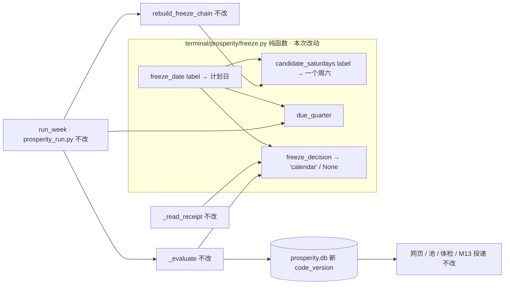
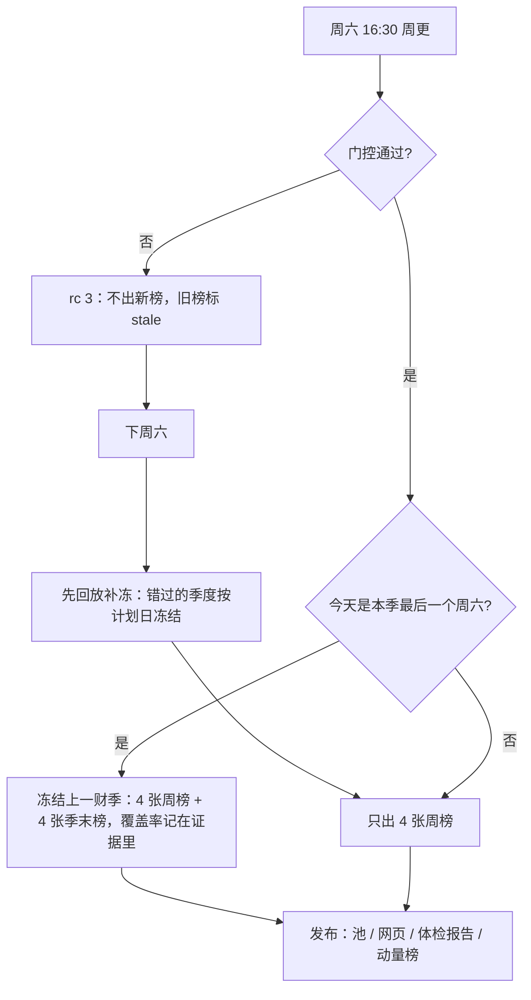

# 景气季末冻结改为自然季度最后一个周六 Implementation Plan

**Goal:** 季末榜改在每个自然季度最后一个周六冻结上一财季，覆盖率只记录、不做门槛；冻结周门控不过时，下一个出榜周六按计划日回放补冻。
**Architecture:** 只改纯函数日历规则（`terminal/prosperity/freeze.py`、`config.py`），调度、存储、发布、投递代码不动。规则变化让 `code_version` 变化；按新版本重建冻结链，旧版本整版保留（D5）。
**Tech Stack:** Python 3.10（云端）/ 3.12（本地），SQLite，pytest。
**Spec:** `docs/design/prosperity-engine-north-star.md` 第三层「季末冻结」（2026-11-13 修订，本分支第一个 commit）。
**北极星对齐:** 第三层调度与季末冻结；R7（周榜 + 季末冻结）。不改第二层打分、第四层输出规则。

## 1. 已确认的口径（Boss 2026-11-13）

| 项 | 定稿 |
|---|---|
| 冻结日 | 每个自然季度最后一个周六，冻结上一财季。2026Q3 → 2026-12-26，2026Q4 → 2027-03-27，2027Q1 → 2027-06-26 |
| 覆盖率 | 照算，写进候选证据；不推迟冻结 |
| 冻结周门控不过 | 这周不出榜（rc 3，沿用旧榜标 stale）。下一个出榜的周六先按计划日回放补冻，季末榜 `as_of` 与 `frozen_at` 都是计划日；再算本周 |
| 旧冻结链 | `13e5f9d5` 及更早版本按旧规则生成，保留不改写 |

## 2. 依据（2026-11-13 读代码）

- 冻结只有一个入口 `freeze_decision`，它被三处调用：`_evaluate`（`src/data/prosperity_run.py:233`，算冻结）、`_read_receipt`（`:122`，校验候选记录）、`rebuild_freeze_chain` 经 `candidate_saturdays`（`:278`，回放）。live 周更经 `due_quarter`（`:385`）选季度。四个函数都在 `terminal/prosperity/freeze.py`，属于 `CODE_VERSION_SOURCES` 的 `terminal/prosperity`（`terminal/prosperity/version.py:13`），改了 `code_version` 必变。
- 门控不过时的现状：`run_week` 在 `:368`/`:379` 返回 rc 3，不调用 `_evaluate`，不写候选记录。下周 `run_week` 先跑 `rebuild_freeze_chain(through=上周六)`（`:370`），它对 `due` 季度的候选周六逐个回放（`:278-299`，`cutoff` = 周日 00:00Z，`frozen_at` = cutoff，`:193`）。新规则下每季只有一个候选周六，回放必然冻结在计划日。之后 `due_quarter(本周)` 返回 None，本周只出周榜。**补冻不需要新代码**，只需要测试钉住。
- 回放补冻会跑出本季 4 张 replay 周榜加 4 张季末榜，约 75 秒（M9 报告最大单季 74.28 秒），在 `run_week` 的 7200 秒超时内。
- 没有其他代码依赖 `'forced'` / `'coverage'` 这两个返回值（`grep`：只有 `freeze.py:67,69`）。`_read_receipt` 用 `bool(p['hashes']) != (p['decision'] is not None)` 判空，返回值换成别的非空字符串不影响。
- `src/data/prosperity_history.py:338-388` 的 `FREEZE_DAYS`/`FREEZE_COVERAGE`/`freeze_coverage` 只服务 D9 数据报告 `scripts/verify_prosperity_history.py:310`（第 60/80 天覆盖率、首个 95% 日），不参与引擎冻结。这是数据研究口径，**本次不改**。
- 云端 2026-11-13 只读：HEAD 069eb5a，空闲 21G，`prosperity.db` 643 MB，版本 `13e5f9d5`（季末 + 回放周 168 张、live 8 张）与 `1d24cbda`（168 张）。本地副本一致。

## 3. 架构图



## 4. 业务流程（Boss 视角）



日历（新规则）：

| 财季 | 冻结日 | 季末后天数 |
|---|---|---:|
| 2026Q3 | 2026-12-26 | 87 |
| 2026Q4 | 2027-03-27 | 86 |
| 2027Q1 | 2027-06-26 | 87 |
| 2027Q2 | 2027-09-25 | 87 |
| 2027Q3 | 2027-12-25 | 86 |

历史重建（新版本）的 21 个冻结日：2021-09-25、2021-12-25、2022-03-26、2022-06-25、2022-09-24、2022-12-31、2023-03-25、2023-06-24、2023-09-30、2023-12-30、2024-03-30、2024-06-29、2024-09-28、2024-12-28、2025-03-29、2025-06-28、2025-09-27、2025-12-27、2026-03-28、2026-06-27、2026-09-26。

## 5. 替代方案

| 方案 | 优点 | 缺点 | 结论 |
|---|---|---|---|
| A. 只改 `freeze.py` 日历函数，调度不动（本 plan） | 改动 1 个源文件 + config；补冻沿用现有回放链，已有 21 季实测 | 补冻那一期是 replay 榜，晚一周才算出来 | **采用**（Boss 选"按计划日补冻"） |
| B. 门控不过时顺延到下一个通过的周六，用 live 数据冻结 | 补冻那一期是 live 数据 | 要改 `rebuild_freeze_chain` 区分"历史"与"漏冻"，季末榜日期不再固定 | Boss 否决 |
| C. 保留 60/95/80，只把 Q4 硬上限提前 | 改动更小 | 不是 Boss 要的固定日历；间隔仍 10–16 周 | 不采用 |

## 6. 风险自证

1. **最大风险：新版本上线到第一次冻结之间，所有下游读到的是新版本、但只有 21 张旧日历之外的新冻结链**。上线时冻结链必须先在云端按新版本重建完成（D5 流程，T4），否则 `get_frozen_params` 查不到参数包，周榜退回 `params_bootstrap`。T4 的验收是 21/21 季末榜在新版本下存在，再放第一个 live 周六。
2. **上线时机**：12-05 前上线，旧规则不会冻结 2026Q3；12-05 之后上线，旧版本多一份 2026Q3（12-05）季末榜，不影响新版本（唯一键含 `code_version`）。11-14 M13 首次自然投递前不部署。
3. **云端只能放两个版本**：现有 `13e5f9d5` + `1d24cbda`。新版本重建前要先把 `1d24cbda` 归档到本地并从云端移除（runbook「按版本归档」，需 Boss 确认）。新版本 + `13e5f9d5` 共约 0.6 GB，云端空闲 21G。
4. **M13 体检报告**：新版本第一个 live 周六，`last_health_freeze` 返回 `VERSION_CHANGED`（`prosperity_delivery.py:124`），按现有逻辑把最新冻结（2026-09-26）当新的发一次 F1 体检报告。这是期望行为，T5 核对。
5. **补冻那一期的回放自己失败**（输入健康不过）：`rebuild_freeze_chain` 返回 6，之后每周都先卡在这一季、不出新周榜，直到有人处理。这是 M9 现有的 fail-closed 行为，旧规则下也一样；runbook 第 5/6 号故障的处理方法适用。
6. **补冻榜的时点**：`frozen_at` 记计划日次日 00:00Z，和历史回放一致；数据按这个截止时点取，没有前视。它实际晚一周才算出来，榜上 mode = replay，读者能分辨。
7. **为什么不用更简单的做法**：没有更简单的。`freeze_decision` 的签名保留，是为了 `_read_receipt` 和 `_evaluate` 两处调用不改，候选记录 schema 也不变。

## 7. 验收标准

| # | 怎么判断对 | 证据 |
|---|---|---|
| A1 | 单元测试：任意财季的冻结日 = 下一自然季度最后一个周六；季末恰为周六（2028-09-30）时冻结在当天；跨年；`freeze_decision` 只在计划日返回非空，与覆盖率无关 | `pytest tests/test_prosperity_freeze.py` |
| A2 | 调度测试：冻结周门控不过 → rc 3 无榜；下周 live → 先补冻（季末榜 `as_of`、`frozen_at` 为计划日、mode replay），再出本周 4 张周榜；本周不再冻结 | `pytest tests/test_prosperity_run.py` |
| A3 | 本地真库副本按新版本重建冻结链：21 季、168 张榜，冻结日与 §4 列表逐一相同；每季候选记录 1 份；两库原件 SHA256 不变 | `reports/prosperity/freeze-calendar-20261113/rebuild.json` |
| A4 | 独立核对（只用标准库，不导入引擎）：从候选记录重算覆盖率、从日历重算冻结日，21/21 一致；篡改一份记录的 as_of 或 coverage → 退出 1 | `verify_freezes.py` 输出 |
| A5 | 用新链重跑 F1 体检报告和精选池第一档收益，数字写进证据（不设通过门槛，只报告与旧链的差异） | `health/`、`pool-returns.txt` |
| A6 | 全量测试：失败数与基线相同（12 个，breadth / morning report） | pytest 输出 |
| A7 | 云端上线后首个 live 周六：rc 0、四道门 pass、无新冻结、M13 补发体检报告（基线 2026-09-26）、20:30 `already_published` | 云端日志 + 台账 |

## 8. Global Constraints

- 主账 Google Sheet 只读（core.md #4）；本任务不碰。
- `market.db` 云端独占写入；本地研究不写 `market.db`（memory `feedback_marketdb_p3_purity`）。
- 所有开发在 worktree `.worktrees/prosperity-freeze`，分支 `prosperity/freeze-calendar`；merge、push、云端部署、云端版本归档每步单独等 Boss 确认。
- 冻结榜不可覆盖；修 bug 改 `code_version`，旧版本不改写（北极星第三层）。
- 云端只留两个 `code_version`（D5）。
- 历史补跑只写库、不发布（北极星第三层）。
- 云端 Python 3.10，无 .venv。

## 9. 文件结构

| 文件 | 职责 | 动作 |
|---|---|---|
| `terminal/prosperity/config.py:17-19` | 冻结常量 | 删 `FREEZE_START_DAYS` / `FREEZE_FORCE_DAYS` / `FREEZE_COVERAGE` |
| `terminal/prosperity/freeze.py` | 日历与冻结判断 | 新增 `freeze_date`；改 `candidate_saturdays`、`due_quarter`、`freeze_decision` |
| `tests/test_prosperity_freeze.py` | 日历单元测试 | 改写 |
| `tests/test_prosperity_run.py` | 调度测试 | 日期改为新日历；新增"漏冻补冻"测试 |
| `reports/prosperity/m9-scheduler-20261024/verify_freezes.py` | M9 独立核对 | 不改（属旧版本证据）；新核对复制到新证据目录后改日历 |
| `reports/prosperity/freeze-calendar-20261113/` | 本次证据 | coverage / qend2 / ahead 脚本已在；新增 rebuild、verify、health、pool returns |
| `docs/runbooks/prosperity-weekly.md` | 运维 | 首次投递"下一次冻结之前"的例子日期、补冻说明 |
| `docs/design/prosperity-engine-north-star.md` | 北极星 | 已修订（commit 1）；模块表加一行 |
| `ARCHITECTURE.md:201` | cron 表 | 不改（没写冻结日数字，已 grep） |

## Task 1: 日历规则

**Files:**
- Modify: `terminal/prosperity/config.py:17-19`
- Modify: `terminal/prosperity/freeze.py:9,29-34,44-48,61-70`
- Test: `tests/test_prosperity_freeze.py`

**Interfaces:**
- Produces: `freeze_date(label: str) -> str`（ISO 周六）；`candidate_saturdays(label) -> tuple[str]`（恰一个元素，= `freeze_date`）；`due_quarter(as_of, frozen_labels, start_quarter='2021Q2') -> Optional[str]`（签名不变，比较改用 `freeze_date(q) <= as_of`）；`freeze_decision(as_of, label, coverage) -> Optional[str]`（签名不变；`as_of == freeze_date(label)` 返回 `'calendar'`，其余 None；仍校验 `as_of` 是周六、coverage 在 [0, 1] 且有限）。

- [ ] Step 1: 写失败测试，替换 `tests/test_prosperity_freeze.py` 的 `test_calendar_and_forced_week`：

```python
def test_calendar_freeze_is_last_saturday_of_next_quarter():
    from terminal.prosperity.freeze import candidate_saturdays, freeze_date, freeze_decision, quarter_of
    assert tuple(str(x) for x in quarter_of('2026Q2')) == ('2026-04-01', '2026-06-30')
    assert freeze_date('2026Q3') == '2026-12-26' and freeze_date('2026Q4') == '2027-03-27'   # Q4 crosses the year
    assert freeze_date('2021Q2') == '2021-09-25' and freeze_date('2022Q3') == '2022-12-31'
    assert freeze_date('2028Q2') == '2028-09-30'                         # quarter ends on a Saturday: that day
    assert candidate_saturdays('2026Q3') == ('2026-12-26',)
    assert freeze_decision('2026-12-26', '2026Q3', .10) == 'calendar'   # coverage is recorded, never a gate
    assert freeze_decision('2026-12-26', '2026Q3', 1.0) == 'calendar'
    assert freeze_decision('2026-12-19', '2026Q3', 1.0) is None
    assert freeze_decision('2027-01-02', '2026Q3', 1.0) is None          # a missed date is replayed, not shifted


def test_new_chain_dates_match_the_north_star_list():
    from terminal.prosperity.freeze import freeze_date, quarter_labels
    assert [freeze_date(q) for q in quarter_labels('2021Q2', '2026Q2')] == [
        '2021-09-25', '2021-12-25', '2022-03-26', '2022-06-25', '2022-09-24', '2022-12-31', '2023-03-25',
        '2023-06-24', '2023-09-30', '2023-12-30', '2024-03-30', '2024-06-29', '2024-09-28', '2024-12-28',
        '2025-03-29', '2025-06-28', '2025-09-27', '2025-12-27', '2026-03-28', '2026-06-27', '2026-09-26']
```

  并把 `test_due_quarter_has_explicit_origin_and_skips_frozen` 的日期改成：`due_quarter('2026-12-19', frozen) is None`、`due_quarter('2026-12-26', frozen) == '2026Q3'`、`due_quarter('2026-12-26', frozen | {'2026Q3'}) is None`、`due_quarter('2026-12-26', frozen - {'2022Q1'}) == '2022Q1'`。`test_invalid_decision_inputs` 的 `'2026-12-05'` 改 `'2026-12-26'`、`'2026-12-04'` 改 `'2026-12-25'`。

- [ ] Step 2: `pytest tests/test_prosperity_freeze.py -v` → 预期 FAIL（`ImportError: freeze_date`）。
- [ ] Step 3: 实现。`config.py` 删三行常量。`freeze.py`：

```python
def freeze_date(label):
    """Last Saturday of the calendar quarter after `label` (Boss 2026-11-13)."""
    y, q = int(label[:4]), int(label[-1])
    end = quarter_of(f'{y + (q == 4):04d}Q{1 if q == 4 else q + 1}')[1]
    return (end - timedelta(days=(end.weekday() - 5) % 7)).isoformat()

def candidate_saturdays(label):
    return (freeze_date(label),)
```

  `due_quarter` 把 `candidate_saturdays(q)[0] <= as_of` 换成 `freeze_date(q) <= as_of`。`freeze_decision` 保留校验，判断改为 `return 'calendar' if as_of == freeze_date(label) else None`。删 import 里的三个常量。
- [ ] Step 4: `pytest tests/test_prosperity_freeze.py -v` → PASS。
- [ ] Step 5: commit `feat(prosperity): freeze on the last Saturday of the next calendar quarter`。

## Task 2: 调度测试改日历 + 漏冻补冻

**Files:**
- Test: `tests/test_prosperity_run.py:82-232`（不改 `src/data/prosperity_run.py`）

**Interfaces:**
- Consumes: Task 1 的 `freeze_date`；现有 `run_week`、`rebuild_freeze_chain`、`builder_with`、`options`。

- [ ] Step 1: 现有冻结测试里的日期按新日历换：`2026-12-05`（2026Q3 第一个候选日）→ `2026-12-26`；`2026-12-12` → `2027-01-02`，配套 `now` 改 `2027-01-09`；`fundamentals-now.json` 的 `as_of` 同步。回放链测试里 2026Q2 的候选日 `2026-08-29` / `2026-09-05` / `2026-09-19` → `2026-09-26`（单个候选日）。`test_candidate_receipt_prevents_rejudging_and_detects_pending_drift` 原本测"同季第二个候选日"，新规则每季只有一个候选日：改为两季（`start_quarter='2026Q1'`，`2026-06-27` 与 `2026-09-26`），断言语义不变（失败后恢复不重判已完成季度，输入变了报 `recovery_input_changed`）。新增：

```python
def test_missed_freeze_week_is_replayed_on_its_date_next_week(env):
    from src.data.prosperity_run import run_week
    calls = []
    build = builder_with(calls, {'2026-12-26': '2026Q3', '2027-01-02': '2026Q3'})
    quality = env[2]
    (quality / 'fundamentals-now.json').unlink()                 # 12-26: fundamentals did not refresh
    missed = run_week(**{**options(env, calls), 'saturday': '2026-12-26', 'packet_builder': build,
                         'now': lambda: datetime(2026, 12, 26, 9, tzinfo=timezone.utc)})
    assert missed.exit_code == 3 and not missed.keys
    (quality / 'fundamentals-next.json').write_text(json.dumps({'after': {'as_of': '2027-01-02T07:00:00Z',
        'coverage': {'fundamental_ready': {'ratio': .96}}}}))
    out = run_week(**{**options(env, calls), 'saturday': '2027-01-02', 'packet_builder': build,
                      'now': lambda: datetime(2027, 1, 2, 9, tzinfo=timezone.utc)})
    assert out.exit_code == 0 and len(out.keys) == 4                         # this week: weekly boards only
    finals = [BoardKey(**k) for k in out.detail['chain_keys'] if k['board_type'] == 'quarter_final']
    assert len(finals) == 4 and {k.as_of for k in finals} == {'2026-12-26'}   # the planned date, not 01-02
    assert all(env[1].get_board(k).meta.mode == 'replay'
               and env[1].get_board(k).meta.frozen_at == '2026-12-27T00:00:00Z' for k in finals)
    assert all(env[1].get_board(k).board.frozen_as_of == '2026-12-26' for k in out.keys)
    assert calls.count('2026-12-26') == 1                                   # replayed once
```

  （`BoardKey` 从 `src.data.prosperity_storage` 导入；`chain_keys` 是 `asdict(BoardKey)`，`prosperity_run.py:398`；`meta.mode`、`meta.frozen_at`、`board.frozen_as_of` 现有测试已在用。）
- [ ] Step 2: `pytest tests/test_prosperity_run.py -v` → 新测试在 Task 1 之前的代码上 FAIL（旧规则 12-26 不在 2026Q3 候选期，`chain_keys` 为空）；Task 1 之后预期 PASS。若在 Task 1 之后才写，先 `git stash` Task 1 的 `freeze.py` 确认红。
- [ ] Step 3: 无实现改动。若有失败，只按 §2 的调用链查原因，不改调度代码；需要改调度就停下来回到 plan。
- [ ] Step 4: `pytest tests/test_prosperity_run.py tests/test_prosperity_freeze.py tests/test_prosperity_store.py tests/test_prosperity_delivery.py -q` → PASS。
- [ ] Step 5: commit `test(prosperity): new freeze calendar in scheduler tests; a missed freeze is replayed on its date`。

## Task 3: 本地按新版本重建冻结链 + 独立核对

**Files:**
- Create: `reports/prosperity/freeze-calendar-20261113/verify_freezes.py`（由 M9 版复制，日历改为"下一季最后一个周六"，去掉 60/80/95 判定，改为：每季恰 1 份候选记录、`as_of` = 重算的冻结日、`decision` = `'calendar'`、coverage 从 evidence 重算一致、该日 4 张季末榜存在）
- Create: `reports/prosperity/freeze-calendar-20261113/README.md`、`rebuild.json`、`verify.txt`

- [ ] Step 1: 准备（`D="/Users/owen/CC workspace/Finance/data"`，主 checkout 的真库；worktree 里的 `data/market.db` 是 0 行骨架，不能用）：在主 checkout 跑 `./sync_to_cloud.sh --pull`；把 `$D/prosperity.db` 用 SQLite backup API 复制到 `/tmp/freeze/prosperity.db`，`.state` 一并复制；记 `$D/market.db`、`$D/prosperity.db` 的 SHA256。
- [ ] Step 2: 在 worktree 里跑 `/usr/bin/time -l "/Users/owen/CC workspace/Finance/.venv/bin/python" scripts/prosperity_weekly.py --rebuild-chain --through 2026-11-07 --db /tmp/freeze/prosperity.db --market-db "$D/market.db" --quality-dir "$D/quality"`（约 25 分钟）。记耗时、峰值内存、结果库大小。
- [ ] Step 3: `/usr/bin/python3 -I reports/prosperity/freeze-calendar-20261113/verify_freezes.py --db /tmp/freeze/prosperity.db --market-db "$D/market.db" --version <新 code_version> --out .../verify.json` → `PASS: 21 quarters`。
- [ ] Step 4: 篡改验收：复制库后改一份候选记录的 `coverage`（重写 sha256 使信封自洽）、另一份删掉 → 核对各退出 1。
- [ ] Step 5: 再算两库原件 SHA256，与 Step 1 相同。commit 证据 `docs(prosperity): freeze-calendar chain rebuild and independent check`。

## Task 4: 下游重算（报告，不设门槛）

**Files:**
- Create: `reports/prosperity/freeze-calendar-20261113/health/`（`scripts/prosperity_health.py --db /tmp/freeze/prosperity.db --market-db <market 副本> --code-version <新> --out ... --schemes F1`）
- Create: `reports/prosperity/freeze-calendar-20261113/pool-returns.txt`（`reports/prosperity/pool-q1-20261102/pool_returns.py --save` 只出新链数字，`--baseline` 用旧 `trial/q1_liq.json`，差异输出就是新旧链的对照，退出 1 属预期）

- [ ] Step 1: 跑两条命令。
- [ ] Step 2: README 写一张对照表：F1 Q1 3 季超额、Q1−Q5、精选池第一档 3 季超额，旧链 vs 新链；按 `feedback_explain_quant_reports_plainly` 的讲法写结论。
- [ ] Step 3: commit `docs(prosperity): health report and pool returns on the new freeze chain`。

## Task 5: 文档

**Files:**
- Modify: `docs/runbooks/prosperity-weekly.md:233-235`（首次投递"下一次冻结之前"改举新日历的例子；新增一段"冻结周门控不过：下周自动按计划日补冻，季末榜为 replay，体检报告随下周投递"）
- Modify: `docs/design/prosperity-engine-north-star.md` 模块依赖表加一行 `M17 季末冻结改日历`，状态随验收更新
- Modify: `.claude/ongoing.md`（主 checkout）

- [ ] Step 1: 改文档；`grep -rn "12-05\|第 60 天\|95%" docs/runbooks/prosperity-weekly.md docs/design/prosperity-engine-*.md` 确认不再描述旧规则为现行。
- [ ] Step 2: 全量测试 `pytest -q`，贴结果，与基线比。
- [ ] Step 3: `/code-review high`。
- [ ] Step 4: commit。

## 10. 上线顺序（每步等 Boss 确认）

1. merge `prosperity/freeze-calendar` → 本地 main，再 push。云端次日 06:25 自动 pull。push 选周一到周四，不选周五、周六。
2. 云端 pull 后的工作日，手动重建冻结链：`scripts/run_prosperity.sh --rebuild-chain`（拿锁，约 25 分钟），再跑 Task 3 的独立核对。不做这一步也不会出错：周六 16:30 的周更第一步就是 `rebuild_freeze_chain`，会自己重建，只是当天多花约 25 分钟，核对要事后补。
3. 云端会暂时有三个版本（新版本、`13e5f9d5`、`1d24cbda`），合计约 0.95 GB，空闲 21G 够用。按 D5 把 `1d24cbda` 归档到本地后从云端移除（runbook「按版本归档」，移除需 Boss 确认），不急。
4. 首个自然周六核对 A7。
5. 时间：11-14 首次投递核对之后才 merge。最好 12-05 前上线，最晚 12-19（12-26 冻结前一周）。晨报在新版本第一个 live 周六之前继续读旧版本的池文件和周榜，不受影响。

## 11. 自审

- spec 覆盖：冻结日 → Task 1；覆盖率只记录 → Task 1（`freeze_decision` 不看 coverage，`_evaluate` 照写 coverage）；门控不过补冻 → Task 2；旧链保留 → §10 第 2 步只归档更早版本、不动 `13e5f9d5`；依据 → 已归档脚本。
- 占位符：无 TBD。Task 2 的 `BoardKey(**d)` 与属性名标了"Step 2 前核对"，因为 `chain_keys` 序列化格式来自 `asdict(k)`（`prosperity_run.py:398`）。
- 类型一致：`freeze_date` 返回 ISO 字符串，与 `candidate_saturdays` 原返回元素类型相同；`due_quarter` 比较的是字符串，与原实现相同。
- 盲点检查（memory `feedback_plan_self_audit_blind_spots`）：①验收脚本门槛——`pool_returns.py` 与旧基线比必然退出 1，已在 Task 4 写明属预期；③文档数字——`ARCHITECTURE.md` 无冻结日数字，runbook 233-235 行有，Task 5 改；⑨并行会话——M16 分支也改北极星（4.4 与模块表第 17 行），merge 时会在模块表相邻行冲突，按两边都保留处理。
