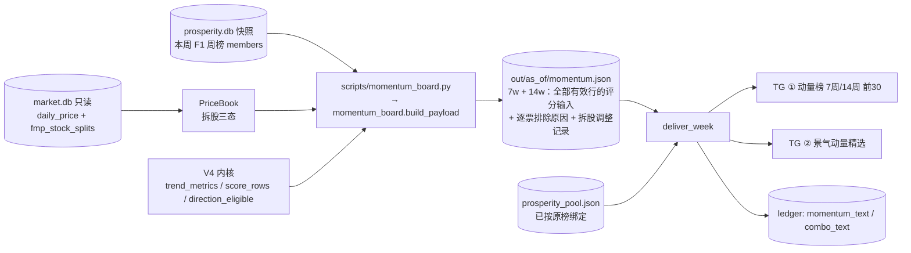
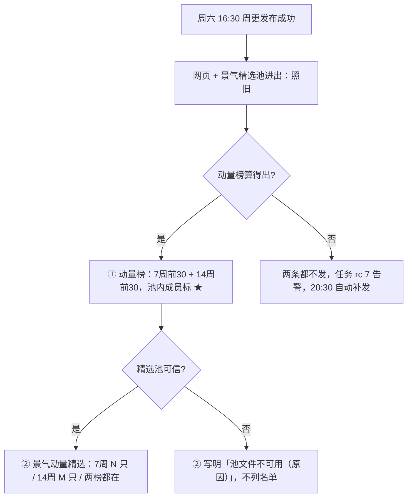

# 景气引擎 M16 动量榜与景气动量精选 Implementation Plan

**状态：Boss 2026-11-13 批准并实现；同日经窗口回测后改为单一 14 周窗口（§14）。分支 `prosperity/m16-momentum`，本地验收通过，未 merge。** 三轮审查记录见 §12，实现与 plan 的出入见 §13。**§1–§11 里的"7 周 / 14 周""两榜都在"是最初方案，以 §14 为准。**

**Goal:** 周六景气周报的 Telegram 私聊多发两条消息：①「动量榜」7 周和 14 周（V4 算法，只看上涨，各前 30）；②「景气动量精选」= 景气精选池里通过上涨资格的全部成员，带全主池动量名次。
**Architecture:** 新模块 `backtest/research/momentum_board.py` 对本周 F1 周榜的成员（Extended 主池）打 V4 分，价格经 `PriceBook` 做拆股三态处理；CLI `scripts/momentum_board.py` 把结果写成一个 JSON。`deliver_week` 用子进程跑这个 CLI（与 M11/M12 同一模式），读 JSON 后发两条文本，各记一项台账。V4 内核直接 import 现有函数，不复制、不改动。
**Tech Stack:** Python 3.10、numpy（已有）、pytest。
**Spec:** Boss 2026-11-13 口头需求 + 四项口径确认（见 §1）；V4 规则 `docs/runbooks/momentum-ls-01.md` §2。
**北极星对齐:** 景气北极星第四层「输出」，新增模块 M16（外围、可跳过）。北极星原文没有动量交叉榜，本 plan 的 Task 6 给北极星加一行模块和一段说明，请 Boss 一并审批。不改打分、不改精选池规则、不进 `code_version`。
**基线:** main `1dfe7d9f`；分支 `prosperity/m16-momentum`，worktree `.worktrees/prosperity-m16`。

## 1. 已确认的口径（Boss 2026-11-13）

| 项 | 口径 |
|---|---|
| 窗口 | 日线。7 周 = 35 个交易日（36 个收盘价），14 周 = 70 个交易日（71 个收盘价） |
| 评分池 | Extended $10B+ 主池 = 本周 F1 live 周榜的 `meta.members`（11-07 为 888 只） |
| 算法 | V4 原样：绝对涨跌幅 45% / ER 12.5% / R² 12.5% / 回撤 5% / 成交额 25%；成交额分 = 100V/(V+10 亿美元)，不改 |
| 只看上涨 | V4 多头资格：窗口收益 > 0、对数回归斜率 > 0、当前回撤 ≤ 30% |
| 交集 | 景气精选池成员 ∩ 上涨合格的全部（不设 Top N），按动量名次排序并标名次 |

我补的三个默认值，请批注：

1. **动量榜每个窗口发前 30 名。**
2. **成交额 V 的窗口等于信号窗口**（35 或 70 个交易日的 `close × volume` 均值）。原规则里成交额窗口就是信号窗口（14 天对 14 天）。
3. **不做周环比**（新进 / 移出）。需要时再加。

## 2. 依据（2026-11-13 读代码）

- V4 内核：`scripts/crypto_trend_metrics.py:57` `trend_metrics(closes)`（纯函数）；`scripts/crypto_trend_rankings.py:35` `score_rows(rows, 'v4', quote_turnover)`（全池分位后加成交额分）；`:68` `direction_eligible(row, 1, 'v4')`（多头资格）；权重 `:27`，回撤门 `:30`，半分点 `:32`。
- 云端可导入：`ssh aliyun` 上 `python3`（3.10.12）导入这三个函数成功，耗时 2.6 秒。导入会连带加载工具注册表，所以只在子进程 CLI 里导入，不进 `deliver_week` 进程。
- 拆股三态：`backtest/research/prosperity_health.py:76` `PriceBook`（日历 = SPY；`_close_on` `:160` 精确日期取价；`unresolved_overlaps` `:176`；`jumps` `:165`）。`daily_price` 有 8 处已知未复权拆股，直接用原始收盘价会算错。
- 投递：`src/data/prosperity_delivery.py:280` `deliver_week`；三项各自独立 try（`:328` / `:349` / `:370`）；`_complete` `:183` 决定是否整周已发；`_run_cli` `:242`；`md_escape` `:128`；池信任判断 `_trusted_pool`。
- `deliver_week` 运行时持有 `market_db_writer` 锁（`scripts/run_prosperity.sh`），没有并发写入方。
- 试算（本地 market.db，价格到 11-12，池 11-07 共 36 只）：7 周有效 886、上涨合格 552、池内合格 8；14 周上涨合格 341、池内合格 10。

## 3. 架构图



## 4. 业务流程（Boss 视角）



消息示意（数字取自 11-13 试算，仅示意）：

```
动量榜 2026-11-14（V4 · 只看上涨 · 价格截至 2026-11-13）
主池 888 · 有效 886 · 不可用 2

7周（35 交易日）上涨合格 552，前 30：
1. COST 87.2 +22% ★
2. LLY 85.9 +21%
…
14周（70 交易日）上涨合格 341，前 30：
1. MRNA 88.6 +311%
…
★ = 景气精选池成员
```

```
景气动量精选 2026-11-14
景气精选池 36 只 ∩ 上涨合格

7周（8）: COST #1 +22% · V #34 +9% · …
14周（10）: ABBV #7 +20% · V #22 +11% · …
两榜都在（5）: COST, V, …
#n = 全主池上涨榜名次
```

② 按段落装箱：标题 + 7周 / 14周 / 两榜都在。装得下发一条，装不下按段落拆成两条（精选池上限 100 只时会拆）。不在段落中间截断。

## 5. 替代方案

| 方案 | 做法 | 优点 | 缺点 | 选择 |
|---|---|---|---|---|
| **A 子进程 CLI + JSON** | 与 M11/M12 相同：`deliver_week` 跑 CLI，读 JSON，发文本 | 沿用现有模式；重导入隔离在子进程；CLI 可单独本地验收 | 多一个文件 | ✓ |
| B 在 `deliver_week` 进程内直接算 | 少一个 CLI | 最短 | 把 `scripts.crypto_*`、scipy、工具注册表拉进周更主进程；出错面变大 | |
| C 把 V4 内核搬到 `src/indicators/` 再共用 | 分层更干净 | — | 要动已冻结的动量多空 1 号代码，违反"用 wrapper 不重写" | |
| D 并进网页 HTML | 一个页面看全 | — | 网页有独立核对器和 12 MB 预算，改动面大；Boss 只要求发 TG | |

## 6. 风险自证

1. **最大风险：新增两项拖累已有投递。** 对策：两项放在现有三项之后，各自独立 try；CLI 失败只让这两项失败。代价：这两项不成功时整周状态是 `failed`（rc 7），20:30 重试只补缺项。这是有意的告警，不静默跳过。
2. **拆股失真。** 窗口内有未决拆股或疑似拆股跳变的股票标为不可用，不打分，消息里计数。不猜复权。
3. **缺数当成结果。** 有效股票数 / 主池 < 90% → 整榜失败（`momentum_coverage_below_floor`）；最后交易日距 as_of 超过 7 天 → `momentum_prices_stale`；日历不足 → `momentum_window_short`。门槛照抄精选池的 `COVERAGE_MIN = 0.90`、`LIQUIDITY_MAX_LAG_DAYS = 7`。
4. **榜单偏大票。** 成交额分按币圈标定，美股中位数只有 22.7 分。Boss 已选"原样保留"，消息标题写明 V4。
5. **V4 内核日后为币圈改动会连带改这张榜。** JSON 记录 `scoring` 版本和权重；测试钉住 V4 权重数值，内核一改测试就报。
6. **market.db 不拍快照，只读直连。** 快照 1.5 GB，每周多占时间和磁盘。运行时持有写锁，没有并发写；`run_week` 自己也是只读直连。体检报告的快照逻辑不动。
8. **消息超长后重试也救不回来。** 精选池上限 100 只（`LIQUIDITY_TOP`）。两个窗口全部合格时，单个窗口段约 1,900 字符、"两榜都在"段约 700 字符，合计约 4,600，超过 Telegram 的 4096。对策：② 按段落装箱成多条（见 §4）；测试用 100 只、最长代码、最长名次构造上限名单。① 固定前 30 × 2，上限约 1,700 字符，不拆。
9. **JSON 自报计数只能自洽。** JSON 不存 `valid` / `long_eligible` 这类计数，只存逐票明细；消息和核对脚本各自从明细数出来。
7. **为什么不更简单（直接用收益率排序）**：Boss 点名要动量多空 1 号的算法；V4 的 ER / R² 两项正是"趋势"部分。

## 7. 验收标准

1. `pytest tests/test_momentum_board.py tests/test_prosperity_health.py tests/test_prosperity_delivery.py tests/test_prosperity_weekly_cli.py -q` 全过；全量测试与基线相比无新增失败。
2. 本地对 11-07 周榜跑 CLI，产出 JSON。**独立核对脚本**（只用标准库，不 import 仓库代码和 numpy，按 `momentum-ls-01.md` §2 的公式重写）对两个窗口的**全部有效行**（含下跌股票）比对五项指标、总分、资格和名次，差异 0；并核对「有效 ∪ 不可用 = 周榜成员」。
3. 核对脚本的负例全部报错退出：删一行有效行；删一条不可用记录；改一个分数；把一个分数改成 NaN。
4. 用假发送器跑 `deliver_week`，打印消息原文贴给 Boss；每条 ≤ 4096 字符。另用 100 只上限名单跑一次，确认 ② 拆成两条且不丢名字。
5. 负例：池文件过期 → ② 写明原因且 ① 照发；CLI 失败 → 两项都不记台账、状态 `failed`；重跑只补缺项。
6. 证据放 `reports/prosperity/m16-momentum-20261113/`。

## 8. Global Constraints

- 所有数据库只读；不写 `market.db`、`company.db`、`prosperity.db`。
- 不改 `scripts/crypto_trend_metrics.py`、`scripts/crypto_trend_rankings.py`。
- 不进 `CODE_VERSION_SOURCES`；不改打分、精选池规则、网页、晨报。
- 云端 Python 3.10：不用 3.11+ 语法。
- Telegram 只发 `channel='private'`。
- merge、push、云端生效各自单独等 Boss 确认。

## 9. 文件结构

| 文件 | 动作 | 职责 |
|---|---|---|
| `backtest/research/prosperity_health.py` | 改 | `PriceBook` 加 `window_closes`（精确日期的拆股已处理收盘序列） |
| `backtest/research/momentum_board.py` | 新建 | 取窗口、打 V4 分、组装 JSON payload |
| `scripts/momentum_board.py` | 新建 | CLI：读周榜成员 + market.db → 写 JSON |
| `src/data/prosperity_delivery.py` | 改 | 两个文本函数；`deliver_week` 加两项；`_complete` 加两个键 |
| `tests/test_momentum_board.py` | 新建 | 内核包装与 payload 的测试 |
| `tests/prosperity_fixtures.py` | 改 | 新增 `seed_market(path, symbols, last_day)`：建带 SPY 日历和 80 个交易日行情的最小 `market.db` |
| `tests/test_prosperity_health.py`、`tests/test_prosperity_delivery.py` | 改 | 新增用例；`env` 夹具的行情库由零字节改为 `seed_market`；既有断言里的 `sent` 元组和完成台账补新两项 |
| 北极星、`ARCHITECTURE.md`、`docs/runbooks/prosperity-weekly.md` | 改 | 模块行、投递说明 |
| `reports/prosperity/m16-momentum-20261113/` | 新建 | 独立核对脚本、消息原文、运行记录 |

---

### Task 1: `PriceBook.window_closes`

**Files:** Modify `backtest/research/prosperity_health.py`（`window_return` 之后）；Test `tests/test_prosperity_health.py`。

**Interfaces:**
- Produces: `PriceBook.window_closes(symbol: str, start_i: int, end_i: int) -> Tuple[Optional[np.ndarray], str]`。成功返回 `calendar[start_i..end_i]` 每一天的拆股已处理收盘价（长度 `end_i - start_i + 1`）和 `'ok'`；否则 `(None, reason)`，reason ∈ `no_price` / `price_gap` / `split_unresolved` / `split_suspect`。判定顺序与 `window_return` 一致。不向前填充。

- [ ] Step 1: 写失败测试（沿用该文件现有的 `book(closes, splits)` 夹具和 `CAL`）

```python
def test_window_closes_exact_dates_and_reasons():
    closes = {'A': [(d, 10.0 + i) for i, d in enumerate(CAL[:8])],
              'GAP': [(d, 5.0) for i, d in enumerate(CAL[:8]) if i != 3]}
    b = book(closes)
    got, why = b.window_closes('A', 2, 6)
    assert why == 'ok' and got.tolist() == [12.0, 13.0, 14.0, 15.0, 16.0]
    assert b.window_closes('GAP', 2, 6) == (None, 'price_gap')
    assert b.window_closes('NONE', 2, 6) == (None, 'no_price')


def test_window_closes_split_states():
    half = [(d, 100.0 if i < 4 else 50.0) for i, d in enumerate(CAL[:8])]
    adjusted = book({'S': half}, {'S': [(CAL[4], 2.0)]})            # recorded 2:1, one matching jump
    got, why = adjusted.window_closes('S', 0, 7)
    assert why == 'ok' and got.tolist() == [50.0] * 8
    assert book({'S': half}).window_closes('S', 0, 7) == (None, 'split_suspect')   # jump, no record
```

- [ ] Step 2: `pytest tests/test_prosperity_health.py -k window_closes -v` → FAIL（`AttributeError: window_closes`）
- [ ] Step 3: 实现：序列不存在 → `no_price`；对 `calendar[start_i..end_i]` 逐日 `_close_on`，任一为 `None` → `price_gap`；`unresolved_overlaps` → `split_unresolved`；`jumps` 里有 `split_suspect` → `split_suspect`；否则返回数组。
- [ ] Step 4: 同一命令 → PASS；`pytest tests/test_prosperity_health.py -q` 全过
- [ ] Step 5: `git commit -m "feat(prosperity-m16): PriceBook.window_closes, exact-date split-resolved series"`

### Task 2: 动量榜内核包装

**Files:** Create `backtest/research/momentum_board.py`；Test `tests/test_momentum_board.py`。

**Interfaces:**
- Consumes: `trend_metrics`、`score_rows`、`direction_eligible`、`V4_WEIGHTS`（§2）。
- Produces:
  - 常量 `WINDOWS = {'7w': 35, '14w': 70}`、`TOP_N = 30`、`COVERAGE_MIN = 0.90`、`MAX_LAG_DAYS = 7`、`SCHEMA_VERSION = 1`
  - `score_window(closes: Mapping[str, np.ndarray], dollar_volume: Mapping[str, float]) -> List[dict]`：返回**全部有效行**（含下跌股票，它们是分位的输入），按 `(-score, symbol)` 排序。每行键：`symbol, score, return, er, r_squared, slope, drawdown, dollar_volume, eligible, rank`。`eligible` 为多头资格；`rank` 只给合格行，从 1 起连续，不合格为 `None`。
  - `longs(rows) -> List[dict]`：合格行，按 `rank` 升序。

- [ ] Step 1: 写失败测试

```python
import numpy as np
import pytest
from backtest.research import momentum_board as mb
from scripts.crypto_trend_rankings import V4_WEIGHTS


def _path(start, end, n=36):
    return np.linspace(start, end, n)


def test_v4_weights_are_the_frozen_ones():
    assert V4_WEIGHTS == {'absolute_return': .45, 'er': .125, 'r_squared': .125,
                          'drawdown': .05, 'quote_volume': .25}
    assert mb.WINDOWS == {'7w': 35, '14w': 70} and mb.TOP_N == 30


def test_score_window_longs_only_ranked_by_score():
    closes = {'UP': _path(100, 140), 'UP2': _path(100, 110), 'DOWN': _path(100, 60), 'FLAT': np.full(36, 50.0)}
    rows = mb.score_window(closes, {s: 5e8 for s in closes})
    assert {r['symbol'] for r in rows} == set(closes)             # decliners stay: they are percentile inputs
    top = mb.longs(rows)
    assert [r['symbol'] for r in top] == ['UP', 'UP2']             # DOWN and FLAT fail the long gate
    assert [r['rank'] for r in top] == [1, 2] and top[0]['score'] > top[1]['score']
    assert top[0]['return'] == pytest.approx(0.40)
    assert all(r['rank'] is None and not r['eligible'] for r in rows if r['symbol'] in ('DOWN', 'FLAT'))


def test_score_window_percentiles_use_the_whole_pool():
    base = {'UP': _path(100, 140), 'UP2': _path(100, 110)}
    alone = mb.longs(mb.score_window(base, {s: 5e8 for s in base}))
    wide = {**base, 'DOWN': _path(100, 30)}
    crowded = mb.longs(mb.score_window(wide, {s: 5e8 for s in wide}))
    assert crowded[0]['score'] != alone[0]['score']                # DOWN changes UP's percentile


def test_score_window_drawdown_gate_and_tie_order():
    peak = np.concatenate([_path(100, 300, 30), _path(290, 150, 6)])    # +50% but 50% off the high
    closes = {'B': _path(100, 120), 'A': _path(100, 120), 'PEAK': peak}
    rows = mb.score_window(closes, {s: 1e9 for s in closes})
    assert [r['symbol'] for r in mb.longs(rows)] == ['A', 'B']     # tie broken by symbol; PEAK gated out
    assert len(rows) == 3
```

- [ ] Step 2: `pytest tests/test_momentum_board.py -v` → FAIL（`ModuleNotFoundError`）
- [ ] Step 3: 实现 `score_window`：每只 `trend_metrics` → `dict(symbol, status='ok', **metrics)`；`score_rows(rows, 'v4', dollar_volume)`；每行标 `eligible = direction_eligible(row, 1, 'v4')`；按 `(-score, symbol)` 排序，合格行依次编 `rank`。`trend_metrics` 或 `score_rows` 抛错不吞，让它失败。
- [ ] Step 4: 同一命令 → PASS
- [ ] Step 5: `git commit -m "feat(prosperity-m16): V4 long-only momentum scoring over a daily window"`

### Task 3: payload 组装与 CLI

**Files:** Modify `backtest/research/momentum_board.py`；Create `scripts/momentum_board.py`；Test `tests/test_momentum_board.py`。

**Interfaces:**
- Consumes: `PriceBook.window_closes`（Task 1）、`score_window`（Task 2）。
- Produces:
  - `build_payload(*, book, dollar_volumes: Callable[[Sequence[str]], Mapping[str, float]], symbols: Sequence[str], as_of: str, generated_at: str) -> dict`
  - `load_dollar_volumes(market, symbols, days: Sequence[str]) -> Dict[str, float]`：`AVG(close*volume)`，只返回这些天全部有行且 `volume >= 0` 的股票。
  - payload：`{schema_version, as_of, generated_at, price_date, scoring: 'v4', weights, universe: {count, symbols: [...]}, boards: {'7w': {days, window: [first, last], scored: [score_window 的全部行], unavailable: {symbol: reason}, adjustments: [{symbol, date, factor}]}, '14w': {...}}}`
    - `scored` 是完整评分输入：每只有效股票的五项指标、成交额、总分、资格、名次。
    - `unavailable` 逐票给原因：`no_price` / `price_gap` / `split_unresolved` / `split_suspect` / `volume_missing`。
    - `adjustments` 列出窗口内实际做过的拆股调整（取自 `PriceBook.adjustments`），核对脚本据此还原价格。
    - 不存计数字段。`scored` 与 `unavailable` 的并集必须等于 `universe.symbols`，`build_payload` 返回前自检，不等则抛 `momentum_universe_mismatch`。
    - 写 JSON 用 `allow_nan=False`。
  - CLI：`scripts/momentum_board.py --db <prosperity 快照> --market-db <market.db> --code-version <v> --as-of <周六> --out <json>`；成员取本周 F1 live 周榜 `meta.members`；原子写文件。退出码 0 成功，6 任何失败（最后一行 stderr 是原因）。
  - 测试夹具 `tests/prosperity_fixtures.py::seed_market(path, symbols, last_day, days=80) -> Path`：建 `daily_price`、`fmp_stock_splits` 两表（列与真库一致），写入 SPY 和每只股票 `days` 个工作日的收盘价与成交量，价格逐日小幅上行。

- [ ] Step 1: 写失败测试（`_book(closes)` 用 `PriceBook(closes=…, splits={}, calendar=CAL)`，`CAL` 为 80 个工作日，SPY 在其中）

```python
def test_build_payload_windows_and_unavailable(tmp_path):
    cal = CAL                                                       # 80 weekdays ending 2026-11-06
    closes = {s: [(d, 100.0 + k * (i + 1)) for i, d in enumerate(cal)] for k, s in enumerate(SYMS, 1)}  # 10 risers
    closes['SHORT'] = closes['S01'][-20:]                           # not enough history
    book = PriceBook(closes=closes, splits={}, calendar=cal)
    symbols = [*SYMS, 'SHORT']
    out = mb.build_payload(book=book, dollar_volumes=lambda days: {s: 1e9 for s in symbols},
                           symbols=symbols, as_of='2026-11-07', generated_at='2026-11-07T09:00:00Z')
    b7, b14 = out['boards']['7w'], out['boards']['14w']
    assert out['price_date'] == cal[-1] and out['universe'] == {'count': 11, 'symbols': sorted(symbols)}
    assert b7['window'] == [cal[-36], cal[-1]] and b14['window'] == [cal[-71], cal[-1]]
    assert b7['unavailable'] == {'SHORT': 'price_gap'} and len(b7['scored']) == 10
    assert len(mb.longs(b7['scored'])) == 10 and b7['adjustments'] == []
    for board in (b7, b14):                                         # every member is accounted for, once
        assert sorted([r['symbol'] for r in board['scored']] + list(board['unavailable'])) == sorted(symbols)
    assert not ({'valid', 'long_eligible', 'longs'} & set(b7))     # no self-reported counts


def test_build_payload_reports_split_adjustments():
    cal = CAL
    split = [(d, 200.0 if i < 60 else 100.0 + (i - 60)) for i, d in enumerate(cal)]    # 2:1 on cal[60]
    book = PriceBook(closes={'S': split, 'T': [(d, 50.0 + i) for i, d in enumerate(cal)]},
                     splits={'S': [(cal[60], 2.0)]}, calendar=cal)
    out = mb.build_payload(book=book, dollar_volumes=lambda days: {'S': 1e9, 'T': 1e9}, symbols=['S', 'T'],
                           as_of='2026-11-07', generated_at='x')
    assert out['boards']['7w']['adjustments'] == [{'symbol': 'S', 'date': cal[60], 'factor': 2.0}]
    assert next(r for r in out['boards']['7w']['scored'] if r['symbol'] == 'S')['return'] > 0


def test_build_payload_fails_closed():
    book = PriceBook(closes={'A': [(d, 10.0) for d in CAL]}, splits={}, calendar=CAL)
    with pytest.raises(ValueError, match='momentum_coverage_below_floor'):
        mb.build_payload(book=book, dollar_volumes=lambda days: {}, symbols=['A', 'B', 'C'],
                         as_of='2026-11-07', generated_at='x')
    with pytest.raises(ValueError, match='momentum_prices_stale'):
        mb.build_payload(book=book, dollar_volumes=lambda days: {'A': 1.0}, symbols=['A'],
                         as_of='2026-12-01', generated_at='x')
    with pytest.raises(ValueError, match='momentum_window_short'):
        mb.build_payload(book=PriceBook(closes={'A': [(d, 10.0) for d in CAL[:30]]}, splits={}, calendar=CAL[:30]),
                         dollar_volumes=lambda days: {'A': 1.0}, symbols=['A'], as_of=CAL[29], generated_at='x')
```

  另加一条：缺成交额的股票记为 `unavailable[symbol] == 'volume_missing'`。CLI 测试用 `seed_market` 建行情库、`storage_batch` 建周榜，以真实子进程运行：断言退出码 0、JSON 的 `universe.symbols` 等于周榜成员；周榜缺失时退出码 6；行情库是零字节文件时退出码 6。

- [ ] Step 2: `pytest tests/test_momentum_board.py -v` → 新用例 FAIL
- [ ] Step 3: 实现。`end_i` = 日历中 ≤ as_of 的最后一天；距 as_of > 7 天 → `momentum_prices_stale`；`end_i < 70` → `momentum_window_short`。每个窗口：逐只 `window_closes(sym, end_i - L, end_i)`，失败把 `symbol → reason` 记入 `unavailable`；成交额取窗口后 L 天，缺 → `volume_missing`；有效数 / `len(symbols)` < 0.90 → `momentum_coverage_below_floor`；其余交 `score_window`。`adjustments` 取 `book.adjustments` 中股票在 `scored` 里、日期落在窗口 `(first, last]` 内的记录。
- [ ] Step 4: 同一命令 → PASS
- [ ] Step 5: `git commit -m "feat(prosperity-m16): momentum board payload and CLI"`

### Task 4: 两条消息的文本

**Files:** Modify `src/data/prosperity_delivery.py`（`pool_text` 之后）；Test `tests/test_prosperity_delivery.py`。

**Interfaces:**
- Produces:
  - `momentum_text(payload: dict, pool: Optional[Sequence[str]]) -> str`（`pool=None` 表示池不可信，不标 ★、不写图例）
  - `combo_messages(payload: dict, pool: Optional[Sequence[str]], reason: Optional[str]) -> List[str]`：段落依次为「标题 + 7周」「14周」「两榜都在 + 图例」，按顺序贪心装箱，每条 ≤ `MESSAGE_LIMIT = 4096`；后续条以 `*景气动量精选 <as_of>（续）*` 开头。
  - 两者都用 `md_escape` 处理可变部分，长度按转义后的文本计。单个段落自身 > 4096 抛 `ValueError('message_too_long')`（上限名单下不会发生，测试钉住）。
  - 有效数、不可用数、上涨合格数都从 `scored` / `unavailable` 明细数出来。

- [ ] Step 1: 写失败测试

```python
def _payload(n=40, down=840, symbols=None):
    names = symbols or [f'S{i:02d}' for i in range(1, n + 1)]
    scored = [{'symbol': s, 'rank': i, 'eligible': True, 'score': 90.0 - i * 0.01 if symbols else 90.0 - i,
               'return': 0.10 + i / 100} for i, s in enumerate(names, 1)]
    scored += [{'symbol': f'D{i:03d}', 'rank': None, 'eligible': False, 'score': 20.0, 'return': -0.1}
               for i in range(down)]
    board = {'days': 35, 'window': ['2026-09-17', '2026-11-06'], 'scored': scored,
             'unavailable': {f'U{i}': 'price_gap' for i in range(8)}, 'adjustments': []}
    return {'as_of': '2026-11-07', 'price_date': '2026-11-06', 'universe': {'count': len(scored) + 8},
            'boards': {'7w': board, '14w': {**board, 'days': 70}}}


def test_momentum_text_top30_and_stars():
    text = d.momentum_text(_payload(), ['S02', 'S35'])
    assert text.startswith('*动量榜 2026-11-07*') and '价格截至 2026-11-06' in text
    assert '主池 888 · 有效 880 · 不可用 8' in text
    assert '*7周*（35 交易日）上涨合格 40，前 30' in text and '*14周*（70 交易日）' in text
    assert '2. S02 88.0 +12% ★' in text and '30. S30 ' in text and 'S31' not in text
    assert len(text) <= 4096
    assert '★' not in d.momentum_text(_payload(), None)


def test_combo_messages_list_every_eligible_member_with_rank():
    [text] = d.combo_messages(_payload(), ['S35', 'S02', 'ZZZ', 'D001'], None)   # D001 is scored but falling
    assert text.startswith('*景气动量精选 2026-11-07*') and '景气精选池 4 只' in text
    assert '*7周*（2）: S02 #2 +12% · S35 #35 +45%' in text
    assert '*两榜都在*（2）: S02, S35' in text and 'D001' not in text


def test_combo_messages_empty_and_untrusted_pool():
    assert '*7周*（0）: 无' in d.combo_messages(_payload(), ['ZZZ'], None)[0]
    [text] = d.combo_messages(_payload(), None, 'prosperity_pool_stale')
    assert '池文件不可用（prosperity\\_pool\\_stale）' in text and '#' not in text


def test_combo_messages_split_at_the_pool_cap():
    """Review P2-2: 100 members (LIQUIDITY_TOP), all eligible in both windows, widest tokens."""
    names = [f'BRK-{i:02d}' for i in range(100)]                    # 6-char symbols
    payload = _payload(symbols=names, down=700)
    for board in payload['boards'].values():
        for row in board['scored'][:100]:
            row['rank'] += 700                                      # 3-digit ranks
            row['return'] = 12.34                                   # '+1234%'
    parts = d.combo_messages(payload, names, None)
    assert len(parts) == 2 and all(len(p) <= 4096 for p in parts)
    assert parts[1].startswith('*景气动量精选 2026-11-07（续）*')
    joined = '\n'.join(parts)
    assert all(joined.count(n + ' #') == 2 for n in names)          # each name once per window, none lost
    assert len(d.momentum_text(payload, names)) <= 4096
```

- [ ] Step 2: `pytest tests/test_prosperity_delivery.py -k "momentum_text or combo_messages" -v` → FAIL
- [ ] Step 3: 实现两个函数，格式见 §4 示意。
- [ ] Step 4: 同一命令 → PASS
- [ ] Step 5: `git commit -m "feat(prosperity-m16): momentum and combo message text"`

### Task 5: 接入 `deliver_week`

**Files:** Modify `src/data/prosperity_delivery.py`（`_complete` `:183`；`health` 段之后加一段）；Test `tests/test_prosperity_delivery.py`。

**Interfaces:**
- Consumes: Task 3 CLI、Task 4 文本函数、已有的 `members` / `pool_reason` / `by_rank`。
- Produces: 台账项 `momentum_text`、`combo_text`（各带 `sent_at`、`code_version`；`combo_text` 另记 `parts`）；`_complete` 要求五个键；常量 `MOMENTUM_TIMEOUT_SECONDS = 600`。

行为：两项任一未发 → 跑一次 CLI，写 `out/<as_of>/momentum-<YYYYMMDD>.json`（`--market-db` 传实库路径，只读）→ 读 JSON → 未发的项各自发送并立即写台账。CLI 或读取失败：`fail('momentum', exc)`，两项都不记。`combo_text` 在 ① 发送失败时仍尝试发送（两项独立）。`combo_text` 有多条时全部发成功才记台账；中途失败则不记，重试时整项重发（at-least-once，与现有投递语义一致）。

**`env` 夹具改动（审查 P2-3）：** `tests/test_prosperity_delivery.py:143-144` 的零字节 `market.db` 换成 `seed_market(tmp_path / 'market.db', symbols=周榜成员, last_day='2026-10-02')`。原因：`test_real_web_cli_integration`（`:366`）用真实 `subprocess.run`，新增的动量 CLI 在零字节行情库上必然失败。改后该测试同时断言 `out/<WEEK>/momentum-20261003.json` 存在、`universe.symbols` 等于周榜成员、`out.sent` 以两项新消息结尾。体检报告路径对行情库只做 `snapshot`，有表的库同样可用；`:268` 断言（体检用快照路径而非实库）保持不变。

- [ ] Step 1: 写失败测试。`FakeRun` 增加一支：脚本名以 `momentum_board.py` 结尾时把 `_payload()` 写进 `--out`（`momentum_rc` 可设非零）。

```python
def test_deliver_sends_momentum_and_combo_last(env):
    run, send = FakeRun(), FakeSend()
    out = deliver(env, run, send)
    assert out.status == 'delivered' and out.sent[-2:] == ('momentum_text', 'combo_text')
    assert run.scripts()[-1] == 'momentum_board.py'
    assert send.msgs[-2].startswith('*动量榜') and send.msgs[-1].startswith('*景气动量精选')
    cmd = next(c for c, _ in run.calls if c[1].endswith('momentum_board.py'))
    assert cmd[cmd.index('--market-db') + 1] == str(env['market'])          # live path, no snapshot
    assert deliver(env, FakeRun(), FakeSend()).status == 'already_delivered'


def test_momentum_cli_failure_keeps_other_items_and_retries(env):
    out = deliver(env, FakeRun(momentum_rc=6), FakeSend())
    assert out.status == 'failed' and 'momentum_board.py rc=6' in out.error
    assert 'web' in out.sent and 'momentum_text' not in out.sent and 'combo_text' not in out.sent
    again = deliver(env, FakeRun(), FakeSend())
    assert again.status == 'delivered' and again.sent == ('momentum_text', 'combo_text')


def test_untrusted_pool_still_sends_board_and_says_why(env):
    env['pool'].unlink()
    send = FakeSend()
    out = deliver(env, FakeRun(), send)
    assert out.sent[-2:] == ('momentum_text', 'combo_text')
    assert '★' not in send.msgs[-2] and '池文件不可用' in send.msgs[-1]


def test_combo_second_part_failure_resends_the_whole_item(env, monkeypatch):
    monkeypatch.setattr(d, 'combo_messages', lambda *a, **k: ['*景气动量精选 part1*', '*景气动量精选 part2*'])
    first = FakeSend(fail_on={5})                                   # web, pool, baseline, momentum, part1 ok; part2 fails
    out = deliver(env, FakeRun(), first)
    assert out.status == 'failed' and 'combo_text' in out.error and 'combo_text' not in out.sent
    assert 'combo_text' not in d.read_ledger(env['dir'], WEEK)['items']
    again = FakeSend()
    assert deliver(env, FakeRun(), again).sent == ('combo_text',)
    assert again.msgs == ['*景气动量精选 part1*', '*景气动量精选 part2*']
    assert d.read_ledger(env['dir'], WEEK)['items']['combo_text']['parts'] == 2
```

  （`fail_on` 的序号在实现时按 `FakeSend` 的实际调用次序核对后写死。）

  同时更新既有用例：凡断言 `out.sent == (...)` 完整元组或用"完整台账"预置的地方（`tests/test_prosperity_delivery.py:211-299, 410-413, 484` 及 `seed_previous`），按新顺序补上两项。这部分只改期望值。`test_real_web_cli_integration` 不属于这一类，按上面的夹具改动处理。

- [ ] Step 2: `pytest tests/test_prosperity_delivery.py -q` → 新用例 FAIL
- [ ] Step 3: 实现。
- [ ] Step 4: `pytest tests/test_prosperity_delivery.py tests/test_prosperity_weekly_cli.py -q` → PASS
- [ ] Step 5: `git commit -m "feat(prosperity-m16): deliver momentum board and prosperity-momentum picks"`

### Task 6: 文档与验收证据

**Files:** Modify `docs/design/prosperity-engine-north-star.md`（模块表加 #17 M16；§4 输出层加一段）、`ARCHITECTURE.md`（景气引擎行、周六 16:30 行）、`docs/runbooks/prosperity-weekly.md`（投递一节：两项新消息、失败原因三种、单独运行 CLI 的命令）；Create `reports/prosperity/m16-momentum-20261113/{verify.py,accept.py,README.md}`。

- [ ] Step 1: 本地对 11-07 跑 CLI（worktree 先软链 live `data/`，只读）：
  `python scripts/momentum_board.py --db data/prosperity.db --market-db data/market.db --code-version <当前> --as-of 2026-11-07 --out /tmp/m16/momentum.json`，记录耗时。
- [ ] Step 2: `verify.py`：用 `/usr/bin/python3 -I` 运行，**只用标准库**（`sqlite3`、`json`、`math`），不 import 仓库代码，也不用 numpy。系统 Python 没有 numpy（实测 `ModuleNotFoundError`）；纯标准库重写同时让核对实现与生产实现更不同构。参数：`--json --market-db --db --code-version --as-of`。逐项检查：
  1. **成员完整**：直接用 sqlite3 从 `prosperity.db` 读本周 F1 live 周榜的 `members_json`；每个窗口断言 `scored ∪ unavailable == 成员` 且两者不相交。
  2. **窗口**：自己按 SPY 日历算出 36 / 71 个交易日，与 JSON 的 `window` 一致。
  3. **价格还原**：对每只 `scored` 股票读原始收盘价，按 JSON `adjustments` 里列出的记录除以因子，得到评分序列；序列必须每天有值。
  4. **重算**：五项指标、全池分位（对全部 `scored` 行）、成交额分、总分、资格、名次，逐行对比。浮点项容差 1e-9；资格与名次必须完全相等。**先断言 JSON 与重算值都是有限数，再比容差**（NaN 会让容差比较恒真）。
  5. **不可用原因**：`no_price` / `price_gap` / `volume_missing` 三种由脚本独立复核（窗口内确实缺行）；`split_unresolved` / `split_suspect` 和 `adjustments` 不重判，逐条打印代码、日期、因子供人工看。
  6. 输出 `checked N scored rows, M unavailable; differences: 0`；有任何差异则退出码 1。
- [ ] Step 3: 核对脚本负例（`accept.py` 里对 JSON 副本逐一改动后重跑 `verify.py`，每个都必须退出码 1）：删一行 `scored`；删一条 `unavailable`；把一个 `score` 加 0.01；把一个 `score` 改成 NaN；删一条 `adjustments`（有拆股调整时）。
- [ ] Step 3b: `accept.py`：假发送器跑 `deliver_week`（池文件从云端 scp 到 `/tmp`），打印消息原文和长度；用 100 只上限名单跑一次 `combo_messages`；再跑验收标准 5 的负例。
- [ ] Step 4: 全量 `pytest -q`，与基线失败清单对比。
- [ ] Step 5: 改三份文档；`git commit -m "docs(prosperity-m16): north-star row, runbook, acceptance evidence"`

## 10. 上线顺序（每步等 Boss 确认）

1. `/code-review high` → 处理意见。
2. merge 到 main。
3. push（云端次日 06:25 自动拉取）。
4. 首个自然周六核对两条消息。

**一个要 Boss 定的时间点：** 明天（11-14）是 M13 的首次自然投递。我建议 M16 在那之后再 merge，首发落在 11-21，两件事不互相干扰。

## 11. 自审

- spec 覆盖：7 周 / 14 周动量榜（T2、T3）；只看上涨（T2）；与景气精选取交集（T4、T5）；发 TG（T5）；动量多空 1 号算法原样（T2 钉权重，T6 独立核对）。
- 占位符：无。
- 类型一致：`window_closes` 返回 `(ndarray | None, str)`，T3 按此使用；`score_window` 行键与 T4 文本读取的 `symbol / rank / eligible / score / return` 一致；payload 键 `boards['7w'|'14w'].scored / unavailable / adjustments` 在 T3、T4、T5、T6 一致；`combo_messages` 返回 `List[str]`，T5 按列表发送。

## 12. 审查记录

### 第一轮（2026-11-13，外部审查，2 个子代理分审计算与投递）

四项 P2，逐条核实后全部采纳。审查未发现 V4 评分顺序或窗口长度错误。

| # | 问题 | 核实 | 处理 |
|---|---|---|---|
| 1 | JSON 只有上涨合格名单和原因计数，独立核对缺完整输入 | 成立：分位要用全部有效行，原 JSON 无法重建有效集合 | JSON 改存全部有效行的评分输入、逐票排除原因、拆股调整记录，去掉自报计数（T2、T3）；核对脚本加成员完整性检查和五个删改负例（T6） |
| 2 | 交集消息超 4096 后直接失败，重试无法恢复 | 成立：精选池上限 100 只，实测上限名单约 4,600 字符 | `combo_text` 改为 `combo_messages`，按段落装箱成多条；加 100 只上限用例和分条失败重发用例（T4、T5，风险 8） |
| 3 | `test_real_web_cli_integration` 走真实子进程，行情库夹具是零字节 | 成立：`tests/test_prosperity_delivery.py:143-144, 366` | 新增 `seed_market` 夹具（SPY 日历 + 80 个交易日），`env` 改用它；该测试加动量 JSON 断言（T3、T5） |
| 4 | `/usr/bin/python3 -I` 没有 numpy | 成立：实测 `ModuleNotFoundError` | 核对脚本改为纯标准库，仍用 `/usr/bin/python3 -I`。没有采用"换 `.venv/bin/python -I`"：纯标准库既解决依赖，又让核对实现与生产实现（numpy）更不同构 |

### 第二轮（2026-11-13，`/code-review high`，实现后）

8 条，无崩溃类缺陷。逐条核实：采纳 6 条，不改 2 条。

| # | 问题 | 处理 |
|---|---|---|
| 1 | 精选池成员无法评分（拆股未决、缺价）时，交集消息把它静默丢掉，看起来像"没涨" | **采纳**。该窗口行尾加 `未评分（n）: 代码（原因）` 和图例。与 fails-open 反模式同族 |
| 2 | 价格过期门 7 天太松：周三到周五断更仍会出榜 | **采纳，门槛 7 → 3 天**。榜单日是周六，正常差 1 天，周四周五连休差 3 天。这改了已批准的"照抄精选池 7 天"；**Boss 2026-11-13 确认 3 天** |
| 3 | 美股榜 import 币圈研究脚本，导入链长，脚本一坏周六任务 rc 7 | **不改**。plan §5 方案 C 已权衡：不动冻结的动量多空 1 号代码。导入只发生在子进程，失败会告警，不会静默出错。以后要解耦需单独立项 |
| 4 | `COVERAGE_MIN`、`MAX_LAG_DAYS` 重复声明 | **采纳**。`COVERAGE_MIN` 改为 import 精选池的定义；`MAX_LAG_DAYS` 有意不同，注释写明 |
| 5 | `momentum_board.TOP_N` 没有生产代码用 | **采纳**。删除；测试改钉 `prosperity_delivery.MOMENTUM_TOP` |
| 6 | `_long_rows` 与 `momentum_board.longs` 重复；CLI 的 `board_members` 与投递的 `_load_board` 重复 | **部分采纳**。`longs` 只有测试在用，删掉，生产代码只剩 `_long_rows` 一份。`board_members` 保留：共用就得让 CLI import 投递模块（连带 Telegram），四行重复更便宜 |
| 7 | `window_closes` 不查下标范围，负的起点会返回空序列和 `ok` | **采纳**。越界抛 `window_out_of_range`。`window_return` 是 M12 既有代码，本次不动 |
| 8 | 装箱循环在首段放不下时会单独发一条只有标题的消息 | **采纳**。标题并入首段；首段放不下直接报 `message_too_long` |

### 第三轮（2026-11-13，外部审查 `5d2f4b9a`，2 个子代理）

两项 P2，逐条复现后全部采纳。上一轮四项确认已修。

| # | 问题 | 核实 | 处理 |
|---|---|---|---|
| 1 | CLI 的 `--out` 与 `--db` 或 `--market-db` 同路径时，`os.replace` 会把输入库换成 JSON | 成立：新增的 6 个碰撞用例修复前全部失败（退出码 0） | 复用 `scripts/prosperity_web.py::_overwrites_input`（按文件身份比较，覆盖侧文件、大小写写法）；冲突时退出码 4，不写文件。投递路径本来就不会撞（输入不得在投递目录内），这次堵的是手动运行 |
| 2 | 核对脚本放行零覆盖率：两个窗口清空、全部标 `split_suspect` 仍退出 0 | 成立 | 核对脚本独立检查每窗有效数 ≥ 成员数 90%；另要求每条拆股排除有原始数据佐证。新增 3 个负例（空榜、低于 90%、单只无证据标拆股），均退出码 1 |

### 第四轮（2026-11-13，`/code-review high`，只审"改为单一 14 周"这个 commit）

7 条，无逻辑缺陷，全部采纳。审查另确认回测没有前视，4,065 次 14 周入选都有持有周价格。

| # | 问题 | 处理 |
|---|---|---|
| 1 | 入库的 `evaluate.py` 复现不出 `eval_full.json`：样本数门槛 8 周会丢掉 7 周的 2025 下跌段（当时是手工补的数） | 门槛改为 4 周，重跑；新文件与原文件逐项一致，现在可原样复现 |
| 2 | **选 14 周的依据写得比数据强**：开发段"第一"实为与 5 周并列（+3.7% 对 +3.6%）；"相邻窗口都好"只有 12 周一侧成立；"2–4 周两段都差"对 4 周的验证段不成立（+12.4%） | 北极星、回测 README、plan §14、代码注释全部改写成实际情况，并已向 Boss 更正 |
| 3 | `combo_messages` 留着多窗口的分条逻辑，单窗口下走不到；标签用字符串替换拼出，同一条消息里"14 周"与"14周"不一致 | 改回单条 `combo_text`，标签写死为"14周"；删掉只为走不到的路径而写的测试 |
| 4 | 验收脚本两处 `all()` 在没有匹配行时恒为真 | 改为先断言恰好一行 `*14周*`，再比名单 |
| 5 | 核对脚本头注释仍写"两个窗口"；回测页面把被取代的双窗口标成"现行" | 注释改正；页面改标"原方案 7∩14" |
| 6 | `_read_momentum` 的榜单键检查没有测试 | 加用例：带 7w+14w 的旧 JSON、只有 7w 的 JSON 都被拒 |
| 7 | 窗口在打分模块、投递模块、核对脚本三处各写一份 | 核对脚本有意独立；打分与投递之间加一个测试把两处钉在一起（另有真实 CLI 集成测试兜底） |

## 13. 实现与 plan 的出入（2026-11-13）

| # | plan 原文 | 实际 | 原因 |
|---|---|---|---|
| 1 | `momentum_board.TOP_N = 30`、`momentum_board.longs` | 只保留 `prosperity_delivery.MOMENTUM_TOP = 30` 和 `_long_rows` | 前 30 是显示口径；投递进程不 import 动量模块（它会连带加载工具注册表），常量放在用它的地方 |
| 2 | 动量榜首部一行"主池 · 有效 · 不可用" | 有效 / 不可用写在每个窗口的标题行 | 两个窗口的有效数不同（11-07：7 周 886，14 周 885），一行写不对 |
| 3 | 新夹具 `seed_market` 自建两张表 | `seed_market` 包一层现成的 `seed_db` + `seed_prices` | 现有夹具已能建真库同构的行情库 |
| 4 | T3 先写测试再实现 `build_payload` | `build_payload` 与 T2 同一次写出，测试随后补 | 顺序倒了；补做 6 个变异检查（去掉覆盖率门、过期门、成交额窗口错一天、缺成交额放行、丢拆股调整、窗口少一天），每个都有测试报错 |
| 5 | 验收 4：100 只上限名单"确认拆成两条" | 真实代码的 100 只名单为 1 条 3,685 字符，未拆；最长代码的上限情形由单元测试覆盖（拆 2 条） | 真实代码比最坏情形短 |
| 6 | 核对负例 5 个 | 7 个（加"翻转资格""有效行挪到不可用"） | 多覆盖两种篡改 |
| 7 | 价格过期门 `MAX_LAG_DAYS = 7`（照抄精选池） | `MAX_LAG_DAYS = 3` | 第二轮审查 #2；Boss 2026-11-13 确认 |
| 8 | 交集消息只列上涨合格成员 | 另列无法评分的精选池成员及原因 | 第二轮审查 #1 |

## 14. 改为单一 14 周窗口（2026-11-13，Boss 拍板）

**定稿口径：动量榜只发 14 周（70 个交易日）前 30；景气动量精选 = 景气精选池 ∩ 14 周上涨合格。** 不再有 7 周榜和"两榜都在"。

依据（`reports/prosperity/m16-window-backtest-20261113/`）：

- 用引擎 replay 模式把 F1 周榜回放到 2021-09-04，共 271 张（212 张新回放 + 35 张 2026 年回放 + 库里已有的 24 张），写在库副本上，真库只读。
- 13 个单窗口（10–126 个交易日）与"7 周 ∩ 14 周"对比；每周一收盘等权换仓，270 周。开发段 2024-07 之前 148 周，验证段之后 122 周；规则在看结果前定下。

| 窗口 | 全程年化 | 最大回撤 | alpha 年化 | 开发段 alpha | 验证段 alpha | 周换手 |
|---|---:|---:|---:|---:|---:|---:|
| 14 周 | +23.7% | −26.5% | +11.3% | +3.7% | +19.2% | 15% |
| 7 周 ∩ 14 周 | +21.5% | −31.6% | +10.9% | +1.0% | +22.2% | 21% |
| 7 周 | +13.1% | −28.7% | +3.3% | −0.3% | +6.9% | 21% |
| 景气池全体 | +16.4% | −27.0% | +3.5% | +1.2% | +5.0% | 8% |

结论与边界：把周榜回放到 2021-09，共 270 周，比较 13 个单窗口（2–25 周）。按选股 alpha 看，14 周和 5 周并列最高：开发段（2024-07 前）+3.7% 对 +3.6%，验证段 +19.2% 对 +19.9%，差距都在噪声以内。选 14 周而不是 5 周的理由：相邻的 12 周同样好（5 周两侧的 4 周、6 周都差），周换手更低（15% 对 25%），最大回撤更小（−26.5% 对 −30.5%）。与原来的双窗口相比 alpha 相当（+11.3% 对 +10.9%），规则更简单。证据的强度有限：开发段里没有任何窗口明显有效，14 周另一侧的 17 周在开发段是负的，"相邻窗口都好"只在验证段成立；全程 alpha 的 t 值约 1.4，共试了 14 个方案。2–3 周的短窗口两段都差；4 周开发段为负、验证段尚可。熊市无保护（2022 下跌段 −20.9%，SPY −24.6%；2025-02 至 03 下跌段 −26.5%，SPY −17.5%）。回放是近似点时，不含成本和分红。

代码改动：`momentum_board.WINDOWS = {'14w': 70}`；`prosperity_delivery.MOMENTUM_WINDOWS` 只留 14 周；`combo_messages` 改回单条的 `combo_text`（满 100 只约 2,300 字符，不需要分条），台账项不再记 `parts`；核对脚本、验收脚本、测试同步。

## 15. 交集改为动量榜前 30（2026-11-13，Boss 拍板）

**定稿口径：景气动量精选 = 景气精选池 ∩ 14 周动量榜前 30**，即动量榜标 ★ 的行，仍单独成条发出。取代 §14 的"池内 14 周上涨合格的全部"。

依据：同一套 270 周回放（`reports/prosperity/m16-window-backtest-20261113/evaluate_top30.py`），每周换仓年化 +34.2%、alpha +20.6%（开发段 +14.3%、验证段 +26.4%），旧口径 +23.7% / +11.3%；平均 5.9 只、1 周空仓、周换手 21%、最大回撤 −36.7%（旧 −26.5%）。t 约 1.7，不显著；Boss 在看到上表之前定的口径，算第 15 个试验方案。窗口没有按新口径重选：新口径下 14 周两侧的 12 周、17 周开发段 alpha 只有 +3.4%、−0.2%，"邻窗口也好"只对旧口径成立。

代码改动：`combo_text` 与 `momentum_text` 共用 `_top_rows(board)`（上涨榜前 `MOMENTUM_TOP` 行），精选取它与精选池的交集，标题改为"∩ 14周动量榜前 30"；未评分成员照旧单列。测试改为前 30 口径，并加一条"交集 = 动量榜 ★ 行"。验收脚本期望名单同步，11-07 真实快照重跑：PLTR、V，两库 SHA256 不变。

同日另定（不在本分支）：季末冻结改为每个自然季度最后一个周六，冻结上一财季；改北极星第三层，另起 plan。

审查（`/code-review high` d62a9ccd，2026-11-13）：7 条全部成立。已修：北极星"为什么是 14 周"补新口径下的窗口数字、"边界"不再说没回测过、试验次数改 15；`MOMENTUM_TOP` 注释和测试写明它同时决定选股；两条消息共用 `_top_rows`；`evaluate_top30.py` 跳过历史不足的周、换手定义与 `evaluate.py` 一致（数字不变）；下跌段写明是行业押注。
