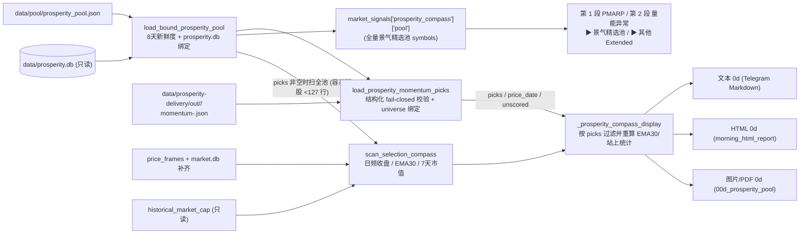
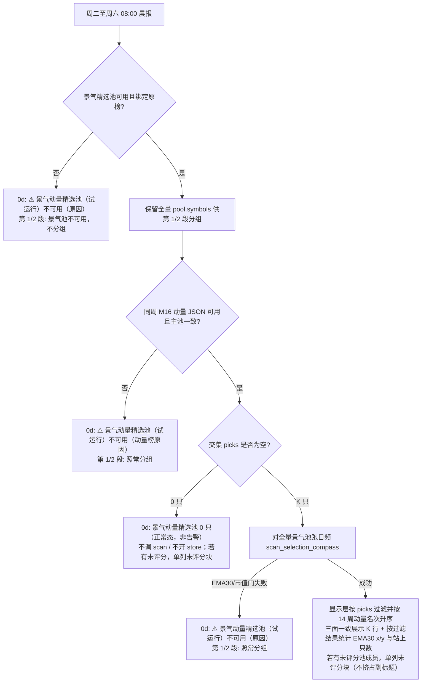

# 晨报 0d 切换为景气动量精选池 Implementation Plan (v2)

> **模式**: `/goal` 全托管（bounded 路径 + 双脑独立研究 + 独立 Plan Review 门禁 + 隔离 worktree TDD 实现 + 主控异构审查 + 浏览器视觉验收）。
> **分支 / Worktree**: `morning/0d-prosperity-momentum` @ `.worktrees/morning-0d-prosperity-momentum`（基线 `main` `27ff36c9`；worktree 定向基线 `282 passed, 1 skipped`）。
> **审查状态**: 已过独立 Plan Review（`devin/claude-fable-5-2`，1×P1 / 5×P2 / P3 全部修正入稿，见文末「Plan Review 审查记录」）。

**Goal:** 将美股晨报 0d 段落从展示全量景气精选池（~35 只）与 Premium 对比，切换为只显示 M16「景气动量精选池」（`景气精选池 ∩ 14周动量榜前 30`，按全主池动量名次升序，保留日频收盘/EMA30/相对EMA30/当前市值），同时保持第 1 段 PMARP 与第 2 段量能异常继续按全量景气精选池分组、Premium 仍照旧驱动 🔴。

**Architecture:** 复用周六 M16 投递已落盘的 `data/prosperity-delivery/out/<as_of>/momentum-<YYYYMMDD>.json`（由已绑定的 `prosperity_pool.json` 的 `as_of` 推出路径，不改周六 cron 与发布链路）。`src/data/prosperity_morning.py` 新增 `load_prosperity_momentum_picks(pool, delivery_dir=...)`，做结构化 fail-closed 校验（schema/窗口/NaN/分片/90% 覆盖/连续名次/排序与正收益一致/symbol 字符白名单）并与 `pool['universe']`（`count` + `symbols_sha256`）绑定，复用 `prosperity_delivery._top_rows` 求交集与池内 `unscored` 名单。`scripts/morning_report.py::_build_prosperity_compass` 在动量榜可用且交集非空时**保持对全量景气池执行 `scan_selection_compass`**（避免 SPCX 等上市 71–126 天新股在 <20 只交集上触发 EMA30 95% 门零容忍，见 Plan Review P1-1），0 命中或动量不可用时跳过扫描；三面输出（文本 / HTML / 图片）共用单一 `_prosperity_compass_display` 契约，在显示层按 `momentum['picks']` 过滤 `members` 并从过滤后行重算 `EMA30 x/y` 与站上只数；未评分池成员以独立块展示（不塞副标题防 PNG 截断）；移除 Premium 对比块与 Premium 列。

**Tech Stack:** Python 3.10+（云端 3.10.12 兼容）、pandas、pytest、Pillow（视觉图）、`terminal/morning_html_report.py`。

**Spec:** Boss 2026-11-19 指令「现在美股日报的0d，切换为只显示景气动量精选池，一口气做完」；M16 定义见 `docs/design/prosperity-engine-north-star.md` §4.4 与 `src/data/prosperity_delivery.py:41-46, 174-234`。

**北极星对齐:** 对应 `docs/design/prosperity-engine-north-star.md` 第四层 §4.4（M16 边界：从"不进网页和晨报"更新为"不进网页；晨报 0d 切换为只显示景气动量精选池"）与第五层「晨报过渡 · 并行期」及完成度表 `:331`。不改动景气打分内核、`code_version`（`13e5f9d5183f1b8e` 保持不变）或 M15 切换/退役门禁。

---

## 架构图（Mermaid）



## 业务流程图（Mermaid）



---

## 替代方案与双脑对照

脑 A（主控 Antigravity）与脑 B（`devin/claude-fable-5-2`，只读盲审 + 独立 Plan Review）综合结论：

### 方案维度 1：景气动量精选池的数据来源（双脑强共识 → 方案 A）

| 方案 | 做法 | 优点 | 缺点 | 选择 |
|---|---|---|---|---|
| **A. 读周六 M16 已落盘 JSON** | 按绑定池的 `as_of` 读取 `data/prosperity-delivery/out/<as_of>/momentum-<YYYYMMDD>.json`，校验绑定后复用 `_top_rows` 求交集 | 周六链路零改动；不改 `code_version`；上线次日即可消费 2026-11-14 现成产物；与周六私聊「景气动量精选」100% 一致；符合 270 周周频回测口径；import 链干净 | 依赖 `prosperity-delivery/out/` 保留 2 周策略与周六动量 CLI 成功 | **✓（双脑一致）** |
| B. 周六新增独立 `prosperity_momentum_pool.json` | 改 `prosperity_weekly.py` / `deliver_week` 增加新产物与校验器 | 池文件统一放在 `data/pool/` | 改周六链路；本周五/周六（11-21 16:30 前）无新文件；YAGNI | 否 |
| C. 晨报每日现算 14 周 V4 动量 | 晨报 import `momentum_board.build_payload` + `PriceBook` | 无跨目录文件依赖 | 把冻结的 `scripts/crypto_trend_*` 拉进晨报；每日载入 888 只全史价格；改变周频回测口径 | 否 |

### 方案维度 2：EMA30 门扫描范围（双脑交锋 → 采纳 Plan Review P1-1 实证结论：picks 非空时扫全池）

- **初稿（脑 A）**：只把交集 `picks` 送入 `scan_selection_compass`。
- **Plan Review P1-1 云端实证推翻**：`SELECTION_COMPASS_PRICE_ROWS = 127`（`scripts/broad_market_scan.py:386-388` 不足 127 行直接丢弃帧），而 M16 动量榜只需 71 个收盘。云端现网 **SPCX**（2026-06-12 上市，目前 111 行，景气池排名 17、STRICT、本周动量 #54）在 11-17/18/19 连续 3 天使全池 `ema30_ready = 34/35 (97.1%)`。若只扫 4–5 只交集，SPCX 一旦进前 30 即 `4/5 = 80% < 95%`，整周 0d 瘫痪。
- **终局方案（v2）**：
  - 动量不可用或 `picks == []` 时，直接跳过 `scan_selection_compass` 与 `market.db` 查询；
  - `picks` 非空时，保持 `scan(premium_pool=pool, ...)` 扫全量景气池（34/35 = 97.1% ≥ 95%，SPCX 进前 30 只在该行显示 `—`，不连坐整段），并在显示层按 `momentum['picks']` 过滤 `members`，以过滤后成员重新计算副标题中的 `EMA30 x/y` 与 `站上EMA30 z 只`！

### 黄灯默认假设（`/goal` 全托管记入 `.claude/ongoing.md` 待 Boss 回来确认）

1. **删除 Premium 对比块与表格末列「Premium」**（双脑一致）：Boss 指令为「只显示景气动量精选池」，原对比块比较全池 35 只 vs Premium 40 只，放在动量精选段下文不对题。第 1/2/D 段的 🔴 仍由 `premium_pool` 驱动不变。
2. **保留日频 EMA30 三列（`收盘` / `EMA30` / `相对EMA30`）与 `当前市值`，共 10 列**：
   `["标的", "动量名次", "14周涨幅", "景气排名", "评级", "景气分", "收盘", "EMA30", "相对EMA30", "当前市值"]`；按 `动量名次` 升序（与周六私聊一致）。
3. **第 1 段 PMARP 与第 2 段量能异常分组不变**（双脑一致）：继续按全量 `景气精选池`（~35 只）分组（`▶ 景气精选池` / `▶ 其他 Extended`）。
4. **标题用 `0d. 景气动量精选池（试运行）`**：延续试运行期命名习惯并呼应北极星 §4.4（参考名单，t≈1.7 不显著）。

---

## 风险自证

1. **最大风险：周六动量 JSON 缺失/损坏/错周导致静默误报或拖垮晨报。**
   - 对策：`load_prosperity_momentum_picks` 全路径结构化 fail-closed（参考 `prosperity_pool.py:324-332`，外层捕获 `OSError`/`UnicodeDecodeError`/`ValueError`/`TypeError`/`KeyError`/`OverflowError`/`RecursionError`/`json.JSONDecodeError`），严格校验 NaN/Infinity、schema_version=1、scoring=='v4'、as_of 合法且与池一致、`universe` 的 `count` 与重算 `symbols_sha256` 等于 `pool['universe']`、price_date 滞后 ≤3 天且等于 `window[1]`、`boards` 键严格为 `{'14w'}`、`days == 70`、symbol 仅含 `[A-Z0-9.-]`、`scored` 按 `(-score, symbol)` 排序、合格行 `return > 0` 且名次为 `1..k` 连续整数、`scored ∪ unavailable == universe.symbols` 且不相交、覆盖率 ≥ `COVERAGE_MIN (0.90)`。绝不回退读上一周目录，绝不静默退回全池。
2. **Telegram Legacy Markdown 下划线断发（issue 016）。**
   - 对策：`unscored` 原因码全量映射纯中文，未知原因写 `"原因未知"`；symbol 白名单 `^[A-Z0-9.-]+$` 从结构上封死下划线；保留「0d 文本无 `_` 且不改变全文 `_` 奇偶性」的回归测试。
3. **PNG 副标题超宽截断（Plan Review P2-2）。**
   - 对策：主副标题只放「精选池摘要 + EMA30 覆盖 + 站上只数」（实测 ≤1950px < 2248px）；`unscored` 独立成字段 `unscored_rows`：文本面单起一行，HTML 与 PNG 仅在 `unscored` 非空时附加两列副表（`["标的", "原因"]`），彻底杜绝截断；新增单测在最坏情形（30 只入选）下断言 `_fit_text(subtitle, font, content_w) == subtitle`。
4. **跨模块常量漂移。**
   - 对策：`MOMENTUM_SCHEMA_VERSION`、`MOMENTUM_WINDOW`、`MOMENTUM_TOP`、`MOMENTUM_LABEL`、`_top_rows` 直接从 `src.data.prosperity_delivery` 懒/按需导入；`COVERAGE_MIN`、`_universe`、`_day`、`_is_int`、`_finite` 直接导入自 `src.data.prosperity_pool`；`PROSPERITY_DELIVERY_DIR` 放 `src/data/prosperity_morning.py`（绝不放 `config/settings.py`！）并用单测钉死与 `scripts/run_prosperity.sh` 的 `--delivery-dir` 一致；`MOMENTUM_WINDOW_DAYS=70` 与 `MOMENTUM_MAX_LAG_DAYS=3` 用单测钉死与 `backtest/research/momentum_board.py` 一致。
5. **新股 <127 行导致交集 EMA30 门零容忍（Plan Review P1-1）。**
   - 对策：picks 非空时保持全池扫描 `scan(premium_pool=pool, ...)`，显示层按 picks 过滤并重算 `EMA30 x/y` 与 `站上EMA30 z 只`；专门加回归测试模拟 1 只入选新股 `above=None`（如 SPCX 场景）仍正常渲染全表且不报错。

---

## 验收标准

| # | 项 | 通过标准 | 对应任务 |
|---|---|---|---|
| A1 | 动量读取与绑定 | 池不可用透传原 reason；JSON 缺失 → `prosperity_momentum_missing`；缺 `as_of`/损坏/NaN/RecursionError/错 schema/错窗口键/错 days/错 scoring/过期或未来 price_date/`window[1] != price_date`/非法 symbol/覆盖率 <90%/分片不齐/非连续名次/排序不符 `(-score, symbol)`/合格行 `return <= 0`/bool 冒充 int → `prosperity_momentum_invalid`；合法 `as_of` 与池不符或 `universe`（数量或哈希）不符 → `prosperity_momentum_pool_mismatch`；合法交集按 `momentum_rank` 升序返回；0 命中与池 0 成员均返回 `available=True, picks=[]`；池成员在 `unavailable` 返回 `unscored`；只读不改文件 | T1 |
| A2 | 常量与路径钉死 | 单测断言 `PROSPERITY_DELIVERY_DIR` 与 `scripts/run_prosperity.sh` 的 `--delivery-dir` 一致；`MOMENTUM_WINDOW_DAYS`、`MOMENTUM_MAX_LAG_DAYS` 与 `backtest/research/momentum_board.py` 一致；`code_version()` 仍等于 `13e5f9d5183f1b8e` | T1 |
| A3 | 晨报编排接线 | `_build_prosperity_compass` 在 picks 非空时保持全池扫描（兼容 SPCX 等新股，且兼容 `name == "景气精选池"` 桩）；`picks=[]` 时跳过 `scan` 且不打开 `get_store()`；动量不可用时跳过 `scan`、返回含 `coverage: {}, hits: []` 的标准不可用形态，且保留 `pool.symbols` 供第 1/2 段分组；`scan` 抛异常时同样保留 `pool.symbols`；不触碰 `premium_pool` / `pmarp` / `volume_anomaly`；删除 `pool_comparison` 与本 task 同提交保持每提交全绿 | T2 |
| A4 | 三面显示一致 | 文本 / HTML / 图片三面共享 `_prosperity_compass_display`：10 列单元格逐格相等；`len(widths) == len(columns) == 10`；按 `momentum_rank` 升序；从过滤后成员重算 `EMA30 x/y` 与 `站上EMA30 z 只`（含 SPCX 样式 `above=None` 回归用例）；无 Premium 对比块、无 Premium 列；0 命中正常显示空表态；`unscored` 经中文映射在文本单行 / HTML 与 PNG 独立副表展示且无 `_`；最坏 30 只入选时 PNG `_fit_text(subtitle, ...)` 零截断；缺 `momentum` 或缺成员或 `NaN` 退化为警告不拖垮整份晨报；`TestProsperitySignalSplit` 原样全绿 | T3 |
| A5 | 真实数据验收 + 浏览器视觉验收 | 拉取云端 2026-11-14 `prosperity_pool.json`、`momentum-20261114.json`、`morning_20261119_080127.json` 到临时目录（配合只读 `.backup` 快照），渲染 0d 文本、完整晨报 HTML 与 PNG；独立纯 Python 核对 4 只标的（`ABBV #5, V #21, COST #23, MDT #27`）、EMA30 与市值差异 0；独立核对第 1/2 段仍按 35 只全池切分、错组 0；输入库 SHA256 不变；本地起 HTTP 预览并用 `browser` subagent 真机打开 HTML 检查 0d 表格排版与控制台零报错，留存截图 | T4 |
| A6 | 测试套件与兼容检查 | 定向套件全绿；全量 `pytest tests -q` 与 worktree 基线相比 0 新增失败；用低版本 Python（`/usr/local/bin/python3.11` 或 `/usr/bin/python3`）做语法编译检查（无 3.11+/3.12+ 语法），并注明云端 Python 3.10.12 最终核验待合并部署后执行 | T4 |

---

## Global Constraints

- 所有数据库（`market.db`、`prosperity.db`、`company.db`）在晨报路径只读；不改写主 checkout 数据。
- 不修改 `terminal/prosperity/version.py:CODE_VERSION_SOURCES` 内的任何文件（含 `config/settings.py`！`PROSPERITY_DELIVERY_DIR` 必须定义在 `src/data/prosperity_morning.py`，绝不放 `config/settings.py`）；`code_version` 保持 `13e5f9d5183f1b8e`。
- 不修改已冻结的 `scripts/crypto_trend_metrics.py`、`scripts/crypto_trend_rankings.py`。
- 不修改周六调度与投递链路（`scripts/run_prosperity.sh`、`scripts/prosperity_weekly.py`、`src/data/prosperity_delivery.py`、`scripts/momentum_board.py`）。
- 不修改 `terminal/selection_compass.py`、`terminal/morning_html_report.py`。
- 云端运行环境为 Python 3.10.12：禁止使用 Python 3.11+ 语法（如 f-string 同引号嵌套、`datetime.fromisoformat` 紧凑格式等，日期解析一律走 `prosperity_pool._day`）。
- 不在本地执行真实 `morning_report.py` 全流程（issue 057）；真实验收只调用本模块函数与渲染函数。
- 严禁在 worktree 外修改文件；严禁 `merge`、`push` 或部署到云端（红灯，等 Boss 回来确认）。
- 仅使用主仓库 `.venv` 绝对路径运行 pytest：`/Users/owen/CC workspace/Finance/.venv/bin/python -m pytest`。

---

## 文件清单

| 文件 | 动作 | 职责 |
|---|---|---|
| `src/data/prosperity_morning.py` | 修改 | 更新模块 docstring；新增 `PROSPERITY_DELIVERY_DIR`、`MOMENTUM_WINDOW_DAYS`、`MOMENTUM_MAX_LAG_DAYS`、`momentum_board_path`、`load_prosperity_momentum_picks`；在 Task 2 移除不再使用的 `pool_comparison` 与 `_symbols` |
| `scripts/morning_report.py` | 修改 | 更新 `_build_prosperity_compass`（`:506-558` 及调用点 `:1469`、docstring `:1334-1335`）、0d 段注释与常量/原因表/未评分映射/显示契约（`:1694-1818`）、HTML 块（`:2304-2321`）、视觉块（`:2522-2540`）；删除 `PROSPERITY_COMPARISON_*` 与 `_prosperity_comparison` / `_prosperity_symbol_list` |
| `tests/test_prosperity_morning.py` | 修改 | 保留 B1 绑定测试；T1 新增动量读取/校验/绑定/交集/空池/未评分/常量钉死测试；T2 移除旧 B2 `pool_comparison` 测试 |
| `tests/test_morning_report.py` | 修改 | `isolate_prosperity_pool_io`（`:45-49`）补隔离 `load_prosperity_momentum_picks`；重写 0d 接线与显示测试（`:3242-3565`、`:3652-3672`、`:3706-3733`）；保持 `TestProsperitySignalSplit`（`:3589-3647`）原样通过 |
| `docs/design/prosperity-engine-north-star.md` | 修改 | 更新 §4.4 边界（`:236`）、第五层并行期（`:244-249`）、模块表（`:306-308`）与完成度表（`:331`），明确标明分支待 merge 状态 |
| `docs/runbooks/prosperity-weekly.md` | 修改 | 更新投递目录说明（`:229`）、动量重跑提示（`:253`）与「晨报试运行段（M14）」（`:273-293`）：三份只读输入、三个动量不可用原因排查与手工补跑 `momentum_board.py` 命令 |
| `ARCHITECTURE.md` | 修改 | 更新 M14 描述（`:62`）与 08:00 晨报 cron 行（`:196`） |
| `docs/CHANGELOG.md` | 修改 | 顶部新增 2026-11-19 条目（明确标明分支待 merge） |
| `reports/prosperity/morning-0d-momentum-20261119/` | 新建 | 真实验收脚本 `accept.py`、`README.md`（注明历史 `pool-display-20261109/accept.py` 签名变更说明）、`section-0d.txt`、`result.json` |

---

## 任务拆解（TDD）

### Task 1: `prosperity_morning.py` 动量精选读取与结构化 fail-closed 校验

**Files:**
- Modify: `src/data/prosperity_morning.py:1-67`（注意：本 Task 暂不删 `pool_comparison`，保持 `test_morning_report.py` 在本提交点上全绿，见 P2-1）
- Test: `tests/test_prosperity_morning.py:1-154`

**Interfaces:**
- Consumes:
  - `src.data.prosperity_pool`: `COVERAGE_MIN` (`:37`), `POOL_PATH` (`:28`), `POOL_SCHEME_ID` (`:29`), `_day` (`:104`), `_finite` (`:190`), `_is_int` (`:186`), `_universe` (`:131`), `load_prosperity_pool` (`:320`)
  - `src.data.prosperity_delivery`: `MOMENTUM_SCHEMA_VERSION` (`:46`), `MOMENTUM_TOP` (`:41`), `MOMENTUM_WINDOW` (`:43`), `_top_rows` (`:179`)
- Produces:
  - `PROSPERITY_DELIVERY_DIR = DATA_DIR / 'prosperity-delivery'`
  - `MOMENTUM_WINDOW_DAYS = 70`
  - `MOMENTUM_MAX_LAG_DAYS = 3`
  - `momentum_board_path(as_of: str, delivery_dir=PROSPERITY_DELIVERY_DIR) -> Path`: 先调 `_day(as_of)` 校验严格 `YYYY-MM-DD`，返回 `Path(delivery_dir) / 'out' / as_of / f'momentum-{as_of.replace("-", "")}.json'`
  - `load_prosperity_momentum_picks(pool: dict, delivery_dir=PROSPERITY_DELIVERY_DIR) -> dict`:
    - 不可用返回：`{'available': False, 'reason': <str>, 'picks': [], 'unscored': []}`（读/解析异常可附 `'error': type(exc).__name__`）
    - 可用返回：
      ```python
      {
          'available': True,
          'reason': None,
          'as_of': as_of,
          'price_date': price_date,
          'window': MOMENTUM_WINDOW,
          'days': MOMENTUM_WINDOW_DAYS,
          'top_n': MOMENTUM_TOP,
          'picks': [
              {'symbol': str, 'momentum_rank': int, 'momentum_score': float, 'momentum_return': float},
              ...  # strictly ordered by momentum_rank asc (1..MOMENTUM_TOP)
          ],
          'unscored': [
              {'symbol': str, 'reason': str},
              ...  # pool members present in board['unavailable'], sorted by symbol
          ],
      }
      ```

**结构化 fail-closed 校验顺序（P2-4 + P3 加固）:**
- 内部异常 `_MomentumPoolMismatch(ValueError)` 专门映射 `'prosperity_momentum_pool_mismatch'`；所有其余 `(OSError, UnicodeDecodeError, ValueError, TypeError, KeyError, OverflowError, RecursionError, json.JSONDecodeError)` 统一落为 `'prosperity_momentum_invalid'`（读/解码/结构异常附 `error=type(exc).__name__`）。
1. 池入口校验：`isinstance(pool, dict)` 且 `pool.get('available')` 为 True → 否则直接透传 `pool.get('reason') or 'prosperity_pool_invalid'`。
2. 校验 `as_of = pool.get('as_of')` 经 `_day` 合法、`pool.get('universe')` 为 dict 且含 `count` 与 `symbols_sha256`、`pool.get('members')` 为 list 且每个元素为 dict 并有合法无重复 symbol（正则 `^[A-Z0-9.-]+$`）→ 否则返回 `'prosperity_pool_invalid'`。
3. `path = momentum_board_path(as_of, delivery_dir)`；若 `not path.is_file()` → 返回 `'prosperity_momentum_missing'`。
4. 读取并用 `json.loads(..., parse_constant=_reject_non_finite)` 解析；顶层须为 dict、`schema_version == MOMENTUM_SCHEMA_VERSION`、`scoring == 'v4'`、`isinstance(boards, dict)`、`set(boards) == {MOMENTUM_WINDOW}`。
5. `as_of` 字段校验：先对 `payload.get('as_of')` 调 `_day`（缺失或非法格式 → `invalid`），再比 `payload['as_of'] != as_of` → `_MomentumPoolMismatch`。
6. `universe` 绑定校验：`universe` 为 dict、`symbols` 为非空 list，全部符合 `^[A-Z0-9.-]+$` 且无重复、`_is_int(universe.get('count'))` 且等于 `len(symbols)` → 否则 `invalid`；重算 `_universe(symbols)`，若 `count` 或 `symbols_sha256` 与 `pool['universe']` 不等 → `_MomentumPoolMismatch`。
7. `price_date` 与 `window` 校验：`price_day = _day(payload.get('price_date'))`，`0 <= (_day(as_of) - price_day).days <= MOMENTUM_MAX_LAG_DAYS`；`window = board.get('window')` 为长度 2 的合法日期列表且 `_day(window[0]) < _day(window[1]) == price_day`。
8. `board = boards[MOMENTUM_WINDOW]` 行级与整体校验：
   - `_is_int(board.get('days')) and board['days'] == MOMENTUM_WINDOW_DAYS`
   - `isinstance(board.get('scored'), list)`、`isinstance(board.get('unavailable'), dict)`
   - `unavailable` 中每个 key 符合 `^[A-Z0-9.-]+$`、value 为非空 str
   - `scored` 中每行 `r` 为 dict：`symbol` 符合 `^[A-Z0-9.-]+$` 且无重复、`type(r.get('eligible')) is bool`、`_finite(r.get('score'))`、`_finite(r.get('return'))`；若 `r['eligible']` 为 True 则 `_is_int(r.get('rank')) and r['rank'] >= 1 and r['return'] > 0`，否则 `r.get('rank') is None`
   - `scored` 排序等于 `sorted(scored, key=lambda r: (-r['score'], r['symbol']))`
   - 完备分片：`scored_syms.isdisjoint(unavail_syms)` 且 `(scored_syms | unavail_syms) == set(symbols)`
   - 覆盖率门：`len(scored_syms) >= COVERAGE_MIN * len(symbols)`
   - 连续名次：`sorted(r['rank'] for r in scored if r['eligible']) == list(range(1, n_eligible + 1))`
9. 交集与未评分：用 `_top_rows(board)` 取前 `MOMENTUM_TOP` 合格行，挑出 `r['symbol'] in pool_symbols` 构成 `picks`；从 `board['unavailable']` 挑出 `s in pool_symbols` 按 symbol 排序构成 `unscored`。

- [ ] Step 1: 在 `tests/test_prosperity_morning.py` 保留 B1 与旧 B2 测试，新增 Task 1 全部失败测试：
  - 合法 JSON 命中交集：按 `momentum_rank` 升序，含 `symbol/momentum_rank/momentum_score/momentum_return`，第 31 名池成员不入选，非池前 30 不入选。
  - 0 命中（池有成员但均不在前 30；以及池本身 0 成员 `合格为零`）→ `available=True, picks=[], unscored=[]`。
  - 未评分池成员 → 列入 `unscored`（按 symbol 排序），非池未评分不列入。
  - 缺失 JSON → `prosperity_momentum_missing`；池不可用透传原 reason；池缺 `universe`/成员非法 → `prosperity_pool_invalid`。
  - 绑定失败：合法但不同的 `as_of`、`universe.symbols` 增删一只导致 `symbols_sha256` 不符 → `prosperity_momentum_pool_mismatch`。
  - 数据异常（parametrize）：损坏 JSON、含 `NaN`、缺 `as_of`、错 `schema_version`、多出 `7w` 窗口、`days=35`、错 `scoring`、`price_date` 滞后 4 天、`price_date` 晚于 `as_of`、`window[1] != price_date`、含下划线 symbol（`BRK_B`）、分片漏成员、分片重复成员、有效覆盖率 <90%、合格行名次断号/重复、合格行 `rank=True`、合格行 `return <= 0`、不合格行带非 None rank、`scored` 乱序 → 全部返回 `prosperity_momentum_invalid`。
  - 常量钉死：`PROSPERITY_DELIVERY_DIR` 相对 `DATA_DIR` 与 `scripts/run_prosperity.sh` 的 `--delivery-dir` 一致；`MOMENTUM_WINDOW_DAYS` 与 `MOMENTUM_MAX_LAG_DAYS` 等于 `backtest.research.momentum_board` 的 `WINDOWS['14w']` 与 `MAX_LAG_DAYS`。
  - 只读验证：读取前后 JSON 字节不变。
- [ ] Step 2: 跑 `"/Users/owen/CC workspace/Finance/.venv/bin/python" -m pytest tests/test_prosperity_morning.py -v` → 确认新测试 FAIL。
- [ ] Step 3: 在 `src/data/prosperity_morning.py` 实现最小完整代码。
- [ ] Step 4: 跑 `tests/test_prosperity_morning.py` 与 `tests/test_morning_report.py` → 确认全绿（确保本提交点无破坏）。
- [ ] Step 5: `git add src/data/prosperity_morning.py tests/test_prosperity_morning.py && git commit -m "feat(prosperity-0d): load and validate weekly M16 momentum picks"`

---

### Task 2: `morning_report.py` `_build_prosperity_compass` 接入动量精选池并移除 `pool_comparison`

**Files:**
- Modify: `scripts/morning_report.py:506-558`、`:1334-1335`、`:1468-1471`
- Modify: `src/data/prosperity_morning.py`（删除不再使用的 `pool_comparison` 与 `_symbols`，更新模块 docstring `:1-6`）
- Test: `tests/test_prosperity_morning.py`（删除旧 B2 `pool_comparison` 测试）
- Test: `tests/test_morning_report.py:45-49`、`TestProsperityCompassWiring`（`:3407-3521`）、`TestProsperityCompassReviewFixes::test_loader_diagnostics_reach_the_saved_payload`（`:3555-3565`）、`TestProsperitySplitReviewFixes`（`:3649-3672`）、`TestSelectionCompassRemoved`（`:3688-3715`）

**Interfaces:**
- Consumes: `prosperity_morning.load_bound_prosperity_pool()`、`prosperity_morning.load_prosperity_momentum_picks(pool)`、`scan_selection_compass`
- Produces:
  - `_build_prosperity_compass(price_frames: dict, as_of: str, scan) -> dict`（去掉已无用的 `premium_pool` 参数，调用点 `:1469` 同步更新）
  - 返回字典形态：
    - `pool`：全量景气精选池摘要 `{available, reason, as_of, generated_at, member_count, symbols}`（**原样保留，第 1/2 段 `_prosperity_split` 不变**）
    - `momentum`：摘要 `{available, reason, as_of, price_date, window, days, top_n, pick_count, picks, unscored}`（失败时 `{available: False, reason: ..., picks: [], unscored: []}`，如有 `error` 则附带）
    - `pool` 不可用：返回 `available=False, reason=pool['reason'], coverage={}, hits=[], pool=summary, momentum=None`（附 `binding_note`/`error`；不读动量、不调 `scan`、不查 DB）
    - `pool` 可用但 `momentum` 不可用：返回 `available=False, reason=momentum['reason'], coverage={}, hits=[], pool=summary, momentum=momentum_summary`（**不调 `scan`、不查 DB，但保留有效 `pool` 供第 1/2 段分组！**）
    - 两者均可用且 `momentum['picks']` 为空：直接返回 `available=True, reason=None, coverage={"ema30_ready": {"covered": 0, "total": 0, "ratio": 0.0}}, hits=[], members=[], pool=summary, momentum=momentum_summary`（不调 `scan`、不打开 `get_store()`）
    - 两者均可用且 `momentum['picks']` 非空：对全量景气池 `symbols` 补缺失价格与查市值（与现网一致，容忍 SPCX 等 <127 行新股），调用 `scan(premium_pool=pool, as_of=as_of, price_frames=frames, market_cap_observations=...)`，返回 `{**compass, "pool": summary, "momentum": momentum_summary}`。
    - 异常兜底：`except Exception` 记 warning 并返回 `available=False, reason="prosperity_compass_error", error=type(exc).__name__, coverage={}, hits=[]`，若 `summary` 已构出则保留 `pool=summary`，若 `momentum_summary` 已构出则保留 `momentum=momentum_summary`。
    - 不再生成或返回 `comparison`。

- [ ] Step 1: 更新测试：
  - `tests/test_prosperity_morning.py` 移除旧 B2 `pool_comparison` 测试。
  - `tests/test_morning_report.py:45-49` 的 `isolate_prosperity_pool_io` 同步 stub `src.data.prosperity_morning.load_prosperity_momentum_picks`。
  - 重写 `TestProsperityCompassWiring`、更新 `test_loader_diagnostics_reach_the_saved_payload`、`TestProsperitySplitReviewFixes::test_failed_0d_calculation_still_splits_on_a_valid_pool` 覆盖：
    1. 合法池（3 只：`BOTH, NEWP, EXTRA`）+ 合法动量（交集 2 只：`NEWP #5`, `BOTH #21`，未评分 1 只 `EXTRA`）：全池走 `scan`（3 只补帧 + 市值），`trial['available'] is True`，`trial['pool']['symbols']` 为全量 3 只，`trial['momentum']['picks']` 为 2 只，`trial['momentum']['unscored']` 为 `[{'symbol': 'EXTRA', 'reason': 'split_unresolved'}]`，无 `comparison` 键。
    2. 合法池 + 0 命中交集（`picks=[]`）：`trial['available'] is True, trial['members'] == [], trial['hits'] == []`，不调 `scan`、不补价格、不打开 `get_store()`。
    3. 合法池 + 动量不可用（`prosperity_momentum_missing`，含诊断 `error` 透传）：跳过 `scan` 与 DB，`trial['available'] is False, trial['reason'] == 'prosperity_momentum_missing', trial['coverage'] == {}, trial['hits'] == []`，`trial['pool']['available'] is True` 且 `symbols` 保留全量池，验证第 1/2 段仍正常分组。
    4. 池不可用：既不调动量读取也不调 `scan`。
    5. `scan` 抛异常：`prosperity_compass_error`，`pool.symbols` 与 `momentum` 仍保留，第 1/2 段照常分组，`premium_pool` 不受影响。
    6. loader 诊断信息（`binding_note`、`error`）透传到 `prosperity_compass`。
- [ ] Step 2: 跑 `"/Users/owen/CC workspace/Finance/.venv/bin/python" -m pytest tests/test_prosperity_morning.py tests/test_morning_report.py -k "TestProsperityCompassWiring or TestProsperitySplitReviewFixes or TestSelectionCompassRemoved or test_loader_diagnostics_reach_the_saved_payload" -v` → 确认新测试 FAIL。
- [ ] Step 3: 修改 `scripts/morning_report.py:506-558`、`:1334-1335`、`:1468-1471` 与 `src/data/prosperity_morning.py`（删 `pool_comparison` / `_symbols`、改 docstring）。
- [ ] Step 4: 重跑上述测试 → 确认 PASS。
- [ ] Step 5: `git add src/data/prosperity_morning.py scripts/morning_report.py tests/test_prosperity_morning.py tests/test_morning_report.py && git commit -m "feat(prosperity-0d): wire M16 momentum picks into morning compass builder"`

---

### Task 3: 三面显示契约（文本 / HTML / 图片）切换为景气动量精选池

**Files:**
- Modify: `scripts/morning_report.py:1694-1818`、`:2304-2321`、`:2522-2540`
- Test: `tests/test_morning_report.py:3242-3404`、`:3523-3555`、`:3668-3672`、`:3716-3733`

**Interfaces & Display Contract:**
- `PROSPERITY_COMPASS_TITLE = "0d. 景气动量精选池（试运行）"`
- `PROSPERITY_COMPASS_COLUMNS = ["标的", "动量名次", "14周涨幅", "景气排名", "评级", "景气分", "收盘", "EMA30", "相对EMA30", "当前市值"]`
- `PROSPERITY_COMPASS_WIDTHS = [170, 150, 160, 150, 140, 130, 190, 170, 160, 170]`（长度 10）
- `PROSPERITY_MEMBERS_TITLE = "按 14 周动量名次排序"`
- `PROSPERITY_UNSCORED_TITLE = "0d. 未评分标的（不代表没涨）"`（HTML block heading）
- `PROSPERITY_UNSCORED_BLOCK_TITLE = "未评分标的（不代表没涨）"`（PNG block title）
- `PROSPERITY_UNSCORED_COLUMNS = ["标的", "原因"]`
- `PROSPERITY_UNSCORED_WIDTHS = [300, 1948]`
- `PROSPERITY_COMPASS_REASON_LABELS` 新增：
  - `"prosperity_momentum_missing": "动量榜尚未生成"`
  - `"prosperity_momentum_invalid": "动量榜数据异常"`
  - `"prosperity_momentum_pool_mismatch": "动量榜与景气池不符"`
- `MOMENTUM_UNSCORED_REASON_LABELS`（纯中文，无下划线）：
  - `"no_price": "缺价"`, `"price_gap": "价格缺口"`, `"split_unresolved": "拆股未决"`, `"split_suspect": "疑似拆股"`, `"volume_missing": "缺成交额"`；未知原因一律 `"原因未知"`。
- 删除 `PROSPERITY_COMPARISON_TITLE`、`PROSPERITY_COMPARISON_COLUMNS`、`PROSPERITY_COMPARISON_WIDTHS`、`PROSPERITY_COMPARISON_LIMIT`、`_prosperity_symbol_list`、`_prosperity_comparison`，以及文本/HTML/视觉三处对 `comparison_summary` / `comparison` 的渲染代码；更新 `:1694` 注释。
- `_prosperity_warning(reason)`：`"⚠️ 景气动量精选池（试运行）不可用（{}）"`（`_prosperity_split` 保持 `"景气池不可用（{}），本段不分组"` 不变）。
- `_prosperity_compass_display(payload)`:
  - 懒导入 `MOMENTUM_TOP`（自 `src.data.prosperity_delivery`）与 `_score`（自 `src.data.prosperity_web`），同 `:1759-1760` 模式。
  - `payload is None` → `{"state": "hidden"}`
  - `not payload.get("available")` → `_prosperity_warning(payload.get("reason"))`
  - `momentum = payload.get("momentum") or {}`；若 `not momentum.get("available")` → `_prosperity_warning(momentum.get("reason") or "prosperity_momentum_invalid")`（防旧 payload 静默渲染全池）
  - 按 `momentum["picks"]` 过滤 `payload["members"]`：
    - 建 `members_by_symbol = {m["symbol"]: m for m in payload["members"]}`
    - 按 `(p["momentum_rank"], p["symbol"])` 排序遍历 `picks`；每只 pick 必须存在于 `members_by_symbol`（否则抛 `ValueError` → `"显示异常"`），合并 `member` 字段与 `p` 的 `momentum_rank` / `momentum_return`
    - 严格校验 `momentum_rank`（正整数非 bool）、`momentum_return`（有限实数非 bool）、`rank`（正整数非 bool）、`grade`（非空 str）、`above is True` 时 `close`/`ema30` 非 None
  - 从过滤后的 `picked_rows` 重算 EMA30 统计（P1-1）：
    - `ema_covered = sum(m.get("above") is not None for m in picked_rows)`
    - `ema_total = len(picked_rows)`
    - `above_count = sum(m.get("above") is True for m in picked_rows)`
  - 副标题（绝不塞 `unscored`，确保 PNG 2248px 零截断）：
    - `pool_count = pool.get("member_count", 0)`、`pick_count = len(picked_rows)`、`top_n = momentum.get("top_n", MOMENTUM_TOP)`、`as_of = pool.get("as_of")`、`price_date = momentum.get("price_date")`
    - `pool_count == 0`：`head = "景气动量精选池 0 只（景气池合格为零，截至 {}，动量价至 {}）".format(as_of, price_date)`
    - 否则：`head = "景气动量精选池 {} 只（截至 {}，景气池 {} 只 ∩ 14周动量榜前 {}，动量价至 {}）".format(pick_count, as_of, pool_count, top_n, price_date)`
    - `subtitle = "{} | EMA30 {}/{} | 站上EMA30 {} 只".format(head, ema_covered, ema_total, above_count) if pick_count > 0 else head`
  - `unscored_rows`：对 `momentum.get("unscored") or []` 生成 `[[str(item["symbol"]), MOMENTUM_UNSCORED_REASON_LABELS.get(item.get("reason"), "原因未知")] for item in unscored]`；三面渲染：
    - **文本**：若 `unscored_rows` 非空，在表格后（空表则在副标题后）追加一行 `"未评分（{} 只，不代表没涨）: {}".format(len(unscored_rows), "、".join("{}（{}）".format(s, r) for s, r in unscored_rows))`
    - **HTML**：若 `unscored_rows` 非空，紧跟 0d 主表追加块 `{"heading": PROSPERITY_UNSCORED_TITLE, "columns": PROSPERITY_UNSCORED_COLUMNS, "rows": [dict(zip(PROSPERITY_UNSCORED_COLUMNS, r)) for r in unscored_rows]}`
    - **图片**：若 `unscored_rows` 非空，在 `00d_prosperity_pool` section 的 `blocks` 追加 `{"title": PROSPERITY_UNSCORED_BLOCK_TITLE, "columns": PROSPERITY_UNSCORED_COLUMNS, "widths": PROSPERITY_UNSCORED_WIDTHS, "grouped": False, "rows": [{"cells": r} for r in unscored_rows]}`

- [ ] Step 1: 在 `tests/test_morning_report.py` 重写 `TestProsperityCompassDisplay`、`TestProsperityCompassAllMembers`（更新为动量筛选 + SPCX 未就绪三态用例）、`TestProsperityCompassReviewFixes` 与 `TestSelectionCompassRemoved::test_saved_payload_with_the_old_key_renders_no_0c_on_any_face`：
  - 断言三面 10 列单元格逐格一致，按 `momentum_rank` 升序；`len(widths) == len(columns) == 10`；无 `与 Premium 对比` 块、无 `Premium` 列；全池 35 只中非交集标的不出现在 0d。
  - 断言 SPCX 样式场景：交集含 `上方`、`下方`、`—`（`above=None`, `close=None`, `ema30=None`, `marketCap=None`）三态，保持 `momentum_rank` 升序，副标题 EMA30 覆盖与站上只数按过滤后交集准确统计（如 `EMA30 2/3 | 站上EMA30 1 只`）。
  - 断言所有新旧 `reason`（含 3 个新动量 reason 与未知 reason）的三面告警文案。
  - 断言 0 命中（池 35 只但交集 0 只，以及池合格为零 0 只）均显示正常空表态而非告警。
  - 断言 `unscored`（含已知中文原因与未知原因）在文本单行 / HTML 独立块 / PNG 独立块三面一致展示，且 0d 文本无 `_`、不改变整份晨报 `_` 计数（issue 016）；无 `unscored` 时不生成副表。
  - 断言最坏情形（30 只入选、长日期）下，PNG 副标题经 `mr._fit_text(subtitle, mr._load_visual_font(32), mr._VISUAL_WIDTH - mr._VISUAL_MARGIN * 2) == subtitle`（零截断，P2-2）。
  - 断言旧 payload 缺 `momentum`、或 `picks` 中某票不在 `members`、或 `momentum_return=NaN`、或 `above=True` 且 `close=None` 均安全退化为警告，其余晨报段落照常渲染。
  - 确认 `TestProsperitySignalSplit` 原样全绿。
- [ ] Step 2: 跑 `"/Users/owen/CC workspace/Finance/.venv/bin/python" -m pytest tests/test_morning_report.py -k "Prosperity or SelectionCompassRemoved" -v` → 确认新测试 FAIL。
- [ ] Step 3: 修改 `scripts/morning_report.py:1694-1818`、`:2304-2321`、`:2522-2540`。
- [ ] Step 4: 重跑上述测试与整个 `tests/test_morning_report.py` → 确认全绿。
- [ ] Step 5: `git add scripts/morning_report.py tests/test_morning_report.py && git commit -m "feat(prosperity-0d): display only prosperity-momentum picks across text, HTML and PNG"`

---

### Task 4: 文档对齐 + 真实云端快照验收 + 浏览器视觉验收 + 全量回归

**Files:**
- Modify: `docs/design/prosperity-engine-north-star.md:236, 244-249, 306-308, 331`
- Modify: `docs/runbooks/prosperity-weekly.md:229, 253, 273-293`
- Modify: `ARCHITECTURE.md:62, 196`
- Modify: `docs/CHANGELOG.md`（顶部新增 2026-11-19 条目，标明分支待 merge）
- Create: `reports/prosperity/morning-0d-momentum-20261119/accept.py`、`README.md`、`section-0d.txt`、`result.json`

- [ ] Step 1: 编写只读真实验收脚本 `reports/prosperity/morning-0d-momentum-20261119/accept.py`，对云端 2026-11-14 真实产物（拷贝到 `/tmp/morning-0d-accept/`：`prosperity_pool.json`、`momentum-20261114.json`、`morning_20261119_080127.json` + 本地 `prosperity.db`/`market.db` `.backup` 快照，全只读）运行：
  1. 独立纯 Python 核对交集名单（`ABBV #5, V #21, COST #23, MDT #27`）、14 周涨幅、EMA30 值与 7 天市值，差异为 0；
  2. 独立核对第 1 段 PMARP 与第 2 段量能异常仍按全量 35 只景气精选池切分，错组 0；
  3. 产出真实 `section-0d.txt`、`morning_report_2026-11-18.html` 与全套 PNG；
  4. 核对文本面无 `_`、无「与 Premium 对比」；
  5. 核对运行前后两个快照库 SHA256 不变。
- [ ] Step 2: 更新 `docs/design/prosperity-engine-north-star.md`（标明分支未 merge）、`docs/runbooks/prosperity-weekly.md`（含 `:229, 253, 273-293` 及手工补跑 `momentum_board.py` 命令）、`ARCHITECTURE.md`（不写易腐数字）、`docs/CHANGELOG.md`（标明分支未 merge）。
- [ ] Step 3: 运行 `accept.py`，确认 `result.json` 全部核对 0 差异；由主控在本地对生成的 `morning_report_2026-11-18.html` 起只读静态预览并用 `browser` subagent 真机打开检查 0d 表格排版与控制台零报错，留存截图。
- [ ] Step 4: 跑定向与全量 pytest、验证 `code_version() == '13e5f9d5183f1b8e'`、用本机低版本 Python 做语法编译检查。
- [ ] Step 5: `git add docs/design/prosperity-engine-north-star.md docs/runbooks/prosperity-weekly.md ARCHITECTURE.md docs/CHANGELOG.md reports/prosperity/morning-0d-momentum-20261119/ && git commit -m "docs(prosperity-0d): north-star, runbook, architecture, changelog and acceptance evidence"`

---

## Plan Review 审查记录（2026-11-19，独立只读 `devin/claude-fable-5-2`）

| 级别 | # | 发现 | 处理（已落入 v2） |
|---|---|---|---|
| **P1** | 1 | 只扫交集时 EMA30 95% 门对 <20 只零容忍；云端现网 SPCX（111 行 < 127 行）连续三天使全池为 34/35，一旦进前 30 即整周瘫痪 0d | 采纳：picks 非空时保持 `scan(premium_pool=pool, ...)` 扫全池；显示层按 picks 过滤并重算 `EMA30 x/y` 与站上只数；新增 SPCX 未就绪回归用例 |
| **P2** | 1 | T1 删除 `pool_comparison` 会导致 T1 提交点上 `test_morning_report.py` 变红 | 采纳：删除 `pool_comparison` 移至 T2 同提交 |
| **P2** | 2 | PNG 副标题超 2248px 即截断；加 1 只未评分即达 2364px 截断原因 | 采纳：`unscored` 拆出副标题，文本单行、HTML/PNG 独立两列副表（仅非空显示）；新增最坏情形 `_fit_text` 零截断测试 |
| **P2** | 3 | 本机 Python 3.13 `ast.parse(feature_version=(3,10))` 不拦 3.12 f-string 特性 | 采纳：改用低版本 Python 编译检查 + 日期一律走 `_day`，报告注明云端 3.10.12 最终复验 |
| **P2** | 4 | loader 异常捕获只枚举少量异常，漏 `RecursionError`/`KeyError`/`TypeError` | 采纳：参照 `prosperity_pool.py:331` 外层统一结构化兜底 |
| **P2** | 5 | 文档漏 `north-star.md:331`、`prosperity-weekly.md:229,253`、`CHANGELOG.md`、代码注释/docstring | 采纳：全部补入文件清单与 T2/T3/T4 |
| **P3** | — | 校验加固（`scored` 排序、`return > 0`、`window[1]==price_date`、缺 `as_of` 归 invalid）、symbol 字符白名单防 `_`、懒导入 `MOMENTUM_TOP`、`PROSPERITY_DELIVERY_DIR` 禁入 `settings.py`、不可用返回补 `coverage/hits`、修 T2 `-k` 覆盖与基线记录 | 全部采纳落入 v2 |

---

## 自审三项

1. **Spec 覆盖**：0d 只显示景气动量精选池（T1+T2+T3）；三面一致（T3）；不破坏第 1/2 段景气精选池分组与 🔴 Premium 标记（T2+T3+A5）；SPCX 等新股不打垮 0d（P1-1）；不改 `code_version` 与冻结动量算法（A2+Global Constraints）；北极星、runbook、ARCHITECTURE、CHANGELOG 同步更新（T4）。
2. **占位符扫描**：无 TBD / 稍后实现 / 适当错误处理等模糊措辞；所有函数名、字段名、错误码、列名、断言均已写明。
3. **类型与签名对齐**：所有现有引用已逐行核对并通过独立 Plan Reviewer 源码交叉验证；T1/T2/T3 契约一致。
