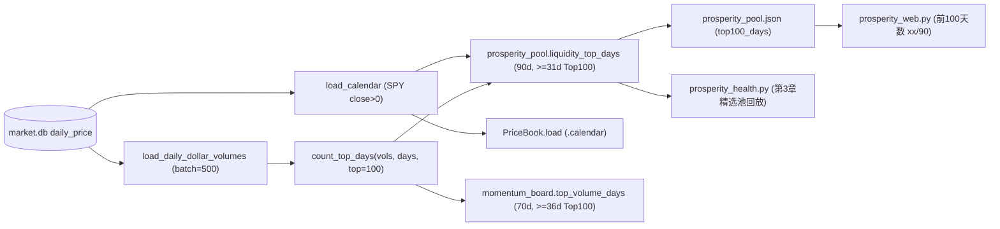

# 景气精选池流动性准入升级（90日 > 30天进当日前100） Implementation Plan

**Goal:** 将景气精选池流动性准入改为「近 90 个交易日中超过 30 天（`>= 31` 天）进入主池成员当日原始成交额前 100 名」，网页同步改为显示 `前100天数`（`xx/90`），体检第 3 章对照与活文档同步对齐。
**North Star / Spec:** 对齐 `docs/design/prosperity-engine-north-star.md` §4.1（精选池文件）、§4.2（网页榜单）、§4.3（体检报告）。
**Architecture & Tradeoffs:**
1. **单一真值源（选更简基线）**：将交易日历 `load_calendar`（`SPY` 收盘 `> 0`）、分批逐日成交额加载 `load_daily_dollar_volumes`（`_QUERY_BATCH = 500`）和逐日 Top-N 计数 `count_top_days(day_volumes, days, top)` 统一放进 `src/data/prosperity_pool.py`；`backtest/research/momentum_board.py` 与 `backtest/research/prosperity_health.py` 直接调用，零重复算子、无循环依赖。
2. **双脑减法取舍**：① 砍掉 Neon 初稿保留的 `members[*].avg_dollar_volume`（全仓无任何消费方读取，纯冗余字段）；② 采纳 Fable 的单日最低覆盖率 `coverage.liquidity_daily`（窗口 90 天中任一天有成交额成员占比 `< 90%` 即拦停发布，可拦截 Neon 初稿「90日内满5天」漏放的单日行情半截故障）；③ 在 `momentum_board.py` 保留一行 `top_volume_days` 包装读取模块级 `TOP_VOLUME_RANK`，使 `tests/test_momentum_board.py`（含 `monkeypatch` 测试）与 `prosperity_delivery.py` / `prosperity_morning.py` / `morning_report.py` / `selection_compass.py` 生产代码保持 **0 行改动**；④ 砍掉双版本池兼容分支，保持 `POOL_SCHEMA_VERSION = 1`、只换 `criteria.liquidity`，旧池文件自动报 `prosperity_pool_criteria_mismatch`。
**Tech Stack & Constraints:**
- 运行版本：云端 Python `3.10.12`，本地主 `.venv`；SQLite 分批绑定 `<= 590` 参数（`< 999`）。
- 数据库边界：对 `market.db`、`prosperity.db` 严格只读；不触碰 `terminal.prosperity.version.CODE_VERSION_SOURCES`（分支基点与分支头 `code_version()` 值恒等，不重建历史榜）。
- 子集硬约束：同一 `as_of`、同一 `members`、**同一份 `market.db` 快照**下，当动量榜与选池均通过各自滞后门控时，动量 70 日窗口恒为选池 90 日窗口的 `window[-70:]`，逐日前 100 口径完全相同，数学恒满足 `U70 (>=36/70) ⊆ 选池流动性准入 (>=31/90)`。

## 流程简图

## 不变量与故障边界

- **跨模块状态与契约绑定点**：
  - **真值源**：`prosperity.db` 当周 `F1` `live` 周榜 + `market.db` `daily_price`。
  - **合并与绑定规则**：`validate_prosperity_pool` 校验单文件结构、`criteria == criteria_payload()`、`ranked` 与 `liquidity_daily` 覆盖率 `>= 0.90`、窗口跨度 `< 160` 日历天与 `31 <= top100_days <= 90`；读取端（`prosperity_web.pool_binding`、`prosperity_morning.load_bound_prosperity_pool`、`prosperity_delivery._trusted_pool`）继续经 `board_mismatch` + 逐成员核对 `rank`/`grade` 并校验 `note.startswith('入池')`。
  - **数据级不变量**：
    1. **I1（窗口嵌套）**：同一 `as_of`（滞后 `<= 3` 天）且基于同一份 `market.db` 快照下，动量 70 日窗口 `==` 选池 90 日窗口后 70 天。
    2. **I2（算子同源）**：选池与动量共用 `load_daily_dollar_volumes` 与 `count_top_days(..., top=100)`，并列按代码升序。
    3. **I3（子集守恒）**：`LIQUIDITY_DAYS (90) >= 70` 且 `LIQUIDITY_MIN_TOP_DAYS (31) <= min_top_volume_days(70) (36)`，同一快照下 `U70 ⊆ 选池流动性准入` 恒成立。
    4. **I4（保序与上界）**：`members` 严格按景气 `rank` 升序去重；池成员数 `selected <= min(eligible, floor(100 * 90 / 31) = 290) <= tier_cut`（不再固定 `<= 100`）。
    5. **I5（版本与动量零漂移）**：分支前后 `code_version()` 相等；同一快照上 `scripts/momentum_board.py` 除 `generated_at` 外输出逐字节一致。
- **故障模型（三档划界）**：
  1. **必须自动拦停并支持同周重试恢复的单故障**：`SPY` 交易日 `< 90`（`liquidity_window_short`）、最后交易日距 `as_of` `> 7` 天（`liquidity_prices_stale`）、90 日内任一天有成交额的成员占比 `< 90%`（`pool_liquidity_coverage_below_floor`）→ 发布挂点抛 `ValueError`，周更退出码 `5`、保留旧池文件；行情补齐后 `20:30` 重试自动只补发布。
  2. **只拒读/告警、不自愈的故障**：旧规则池文件（`PoolCriteriaMismatch` → `prosperity_pool_criteria_mismatch`）、字段越界/非整数/`NaN`（`prosperity_pool_invalid`）、池与原榜计数或成员不符（`prosperity_pool_board_mismatch` / 网页写 `未标入池：原因`）；`combo_text` 若因主池未来大幅扩容超 4096 字符则由现有 `_counted` 抛 `message_too_long` 拦停。
  3. **明确不支持的拓扑**：无锁多进程并发写同一 `prosperity_pool.json`；极端情况下 `pool_text`（290 只全换手约 6,191 字符）超过 Telegram 4096 上限（实盘每期约 21–41 只、远低于上限，本次保持 `prosperity_delivery.py` 零改动）；池文件内 `top100_days` 被人工改为另一合法整数（`31..90`）时，无 `market.db` 的轻量读取端不重算行情，由独立核对脚本 `verify_pool_days.py` 复算拦截；隔数日手动重建池文件且期间历史价格发生回补时，与当周已写出的 `momentum-*.json` 所基于的行情快照可能出现轻微偏差（同现有 runbook 说明）。

## 验收标准

- **A1（单测套件）**：`pytest` 运行 `test_prosperity_pool.py`、`test_prosperity_web.py`、`test_prosperity_delivery.py`、`test_prosperity_morning.py`、`test_prosperity_health.py`、`test_morning_report.py`、`test_momentum_board.py`、`test_prosperity_web_cli.py`、`test_prosperity_health_cli.py`、`test_prosperity_weekly_cli.py`、`test_run_prosperity_wrapper.py` 全部 PASS。
- **A2（零触碰边界）**：`git diff main..HEAD -- tests/test_momentum_board.py src/data/prosperity_delivery.py src/data/prosperity_morning.py scripts/morning_report.py terminal/selection_compass.py` 为空；分支基点与 `HEAD` 的 `code_version()` 完全相等。
- **A3（动量输出恒等）**：基于本地快照运行 `scripts/momentum_board.py --as-of 2026-11-21 --code-version 13e5f9d5183f1b8e`，分支前后输出除 `generated_at` 外完全一致。
- **A4（Python 3.10 兼容）**：全部修改与新增 `.py` 文件通过 `ast.parse(..., feature_version=(3, 10))`。
- **A5（整页 + 选池独立零依赖核对与篡改负例）**：纯标准库脚本 `python3 -I reports/prosperity/pool-top100-days-20261127/verify_pool_days.py`（继承 `m11` 整页 72,580 行核对，并新增从 `market.db` 独立 SQL 复算 90 日窗口、`top100_days`、`daily_min`、应入池名单及可选 `--momentum` 70 日计数与子集包含）在本地真实快照 `2026-11-21` 上输出 `differences: 0`（窗口 `2026-07-17`..`2026-11-20`，入池 33 只含 `HPE`、不含 `MDT`/`RTX`，`U70` 90 只全在达标 103 只内）；5 类篡改负例（成员 `top100_days - 1`、删成员、`min_top_days` 改 `30`、HTML 单元格改 `67/90`、动量 JSON `top100_days + 1`）全部退出码 `1`。
- **A6（文档与旧术语清零）**：`grep -rn "成交额排名\|avg_dollar_volume\|dollar_volume_rank\|liquidity_ranks" src backtest/research docs/design/prosperity-engine-*.md docs/runbooks/prosperity-weekly.md ARCHITECTURE.md` 仅余明确标注历史的说明句。

## 任务拆解（Tasks 1..6）

### Task 1: 共享日历与逐日前 100 计数算子接线
- **Files:** Modify `src/data/prosperity_pool.py`, `backtest/research/momentum_board.py`, `backtest/research/prosperity_health.py`; Test `tests/test_prosperity_pool.py`, `tests/test_momentum_board.py`（只跑不改）
- **Contract:**
  - `prosperity_pool.py` 定义 `CALENDAR_SYMBOL = 'SPY'`、`_QUERY_BATCH = 500`、`load_calendar(market) -> List[str]`、`load_daily_dollar_volumes(market, symbols, days) -> Dict[str, Dict[str, float]]`、`count_top_days(day_volumes, days, top: int) -> Dict[str, int]`。
  - `momentum_board.py` 导入 `LIQUIDITY_TOP, count_top_days, load_daily_dollar_volumes`，设 `TOP_VOLUME_RANK = LIQUIDITY_TOP`，保留包装 `def top_volume_days(day_volumes, days): return count_top_days(day_volumes, days, TOP_VOLUME_RANK)`。
  - `prosperity_health.py` 导入 `CALENDAR_SYMBOL, load_calendar`，替换 `PriceBook.load` 内建日历 SQL。
- **TDD Steps:**
  1. 在 `tests/test_prosperity_pool.py` 写失败测试断言 `count_top_days` 并列按代码升序与缺日跳过、`load_calendar` 仅取 `SPY close > 0`、`PriceBook.load(...).calendar == tuple(load_calendar(...))`、`mb.load_daily_dollar_volumes is pool.load_daily_dollar_volumes`，运行确认 FAIL。
  2. 实现上述共享函数与接线，运行 `pytest tests/test_prosperity_pool.py tests/test_momentum_board.py` 确认全绿（`test_momentum_board.py` 零改动）。
  3. 显式 `git add` 提交。

### Task 2: 90日 `>=31` 天选池计算、池文件契约与校验器
- **Files:** Modify `src/data/prosperity_pool.py`; Test `tests/test_prosperity_pool.py`
- **Contract:**
  - 常量：`LIQUIDITY_TOP = 100`、`LIQUIDITY_DAYS = 90`、`LIQUIDITY_MIN_TOP_DAYS = 31`、`LIQUIDITY_MAX_SPAN_DAYS = 160`（实测最大 `90` 交易日跨度 `133` 天 + `7` 天允许滞后 = `140` 天，取 `160`）、`LIQUIDITY_MAX_LAG_DAYS = 7`。
  - `LiquidityResult(as_of: str, window: Tuple[str, ...], top_days: Mapping[str, int], daily_min: int)` 与 `liquidity_top_days(market, symbols, as_of) -> LiquidityResult`（空成员报 `liquidity_no_members`，日历 `< 90` 天报 `liquidity_window_short`，末日滞后 `> 7` 天报 `liquidity_prices_stale`，`daily_min = min(每天有合法成交额的成员数)`）。
  - `criteria_payload()['liquidity'] = {'metric': 'top_dollar_volume_days', 'calendar': CALENDAR_SYMBOL, 'trading_days': LIQUIDITY_DAYS, 'min_top_days': LIQUIDITY_MIN_TOP_DAYS, 'top': LIQUIDITY_TOP}`。
  - `build_pool`：`coverage` 含 `liquidity_daily: _stat(liquidity.daily_min, universe['count'])` 与 90 日 `trading_window`；入选条件 `liquidity.top_days.get(r.symbol, 0) >= LIQUIDITY_MIN_TOP_DAYS`；每个 `member` 写入 `'top100_days': liquidity.top_days[r.symbol]`（移除 `dollar_volume_rank` 与 `avg_dollar_volume`）。
  - `validate_prosperity_pool`：检查 `('ranked', 'liquidity_daily')` 覆盖率均 `>= 0.90`（低于门槛仍报 `pool_liquidity_coverage_below_floor`）；`_window_error` 检查 `(day - first).days >= LIQUIDITY_MAX_SPAN_DAYS`；每个 `member` 要求 `_is_int(m.get('top100_days')) and 31 <= m['top100_days'] <= 90`。
- **TDD Steps:**
  1. 在 `tests/test_prosperity_pool.py` 改写/新增失败测试：`30` 天不入而 `31` 天入、`daily_min` 计算与 `< 0.90` 拒收、旧 `criteria` 报 `prosperity_pool_criteria_mismatch`、`top100_days` 为 `30`/`91`/`31.0`/`True`/缺失报 `prosperity_pool_invalid`、**`U70 ⊆ 选池` 端到端构造测试**（含一只「前20天进榜20次+后70天进榜11次=31/90但11/70」的特制股票验证单向真子集，并钉死常量不等式），运行确认 FAIL。
  2. 实现 `liquidity_top_days`、`criteria_payload`、`build_pool`、`validate_prosperity_pool`、`pool_publisher`，运行 `pytest tests/test_prosperity_pool.py` 全绿。
  3. 显式 `git add` 提交。

### Task 3: 网页 `前100天数`（`xx/90`）与下游测试夹具对齐
- **Files:** Modify `src/data/prosperity_web.py`, `tests/test_prosperity_web.py`, `tests/test_prosperity_delivery.py`, `tests/test_prosperity_morning.py`, `tests/test_morning_report.py`
- **Contract:**
  - `WebRow.pool_rank` 改为 `pool_days: Optional[int]`；`board_page(..., pool_days=)`。
  - `pool_binding(pool, stored)` 返回 `({m['symbol']: m['top100_days'] for m in members}, f'入池 {len(members)} 只（第一档 ∩ STRICT/FULL ∩ 近 {LIQUIDITY_DAYS} 个交易日至少 {LIQUIDITY_MIN_TOP_DAYS} 天进当日成交额前 {LIQUIDITY_TOP}，as_of {board.as_of}）')`。
  - `_table` 与 `_pool_list` 末列表头改为 `'前100天数'`，入池行单元格渲染 `f'{r.pool_days}/{LIQUIDITY_DAYS}'`（如 `68/90`），未入池为空。
  - `test_prosperity_delivery.py` 更新 `_liquidity` 夹具、`env` 中 `seed_market` 显式传 `days=100`，并将 `:638` 消息长度测试改为按当前约 856 主池下「上榜 `<= 39` 只 + 未评分 `<= 85` 只（主池 10% 覆盖率下限）= `124` 只」校验 `<= 4096`（超限由 `:657` `message_too_long` 覆盖）；`test_morning_report.py:3256, 3530, 3698` 夹具字段同步为 `top100_days`。
- **TDD Steps:**
  1. 先改 `tests/test_prosperity_web.py`（断言表头 `前100天数` 出现 2 次、`成交额排名` 0 次、单元格为 `f'{days}/90'`）与下游夹具，运行确认 FAIL。
  2. 修改 `src/data/prosperity_web.py`，运行上述测试确认全绿。
  3. 显式 `git add` 提交。

### Task 4: 体检报告第 3 章精选池回放对齐
- **Files:** Modify `backtest/research/prosperity_health.py`; Test `tests/test_prosperity_health.py`, `tests/test_prosperity_health_cli.py`
- **Contract:**
  - `load_pool_liquidity(market, views) -> Dict[str, Optional[Dict[str, int]]]` 调用 `liquidity_top_days(market, symbols, v.as_of).top_days`（异常记 `None`）。
  - `pool_members(view, top_days)` 过滤 `r.rank <= cut and r.grade in POOL_GRADES and top_days.get(r.symbol, 0) >= LIQUIDITY_MIN_TOP_DAYS`。
- **TDD Steps:**
  1. 更新 `tests/test_prosperity_health.py` 中 `test_pool_replay_matches_build_pool_members`（验证 `30` 天剔除、`31` 天保留且与 `build_pool` 成员序列严格一致）与 `test_load_pool_liquidity_*`，运行确认 FAIL。
  2. 修改 `backtest/research/prosperity_health.py`，运行 `pytest tests/test_prosperity_health.py tests/test_prosperity_health_cli.py` 全绿。
  3. 显式 `git add` 提交。

### Task 5: 整页 + 选池独立零项目依赖核对器与真实快照篡改验收
- **Files:** Create `reports/prosperity/pool-top100-days-20261127/verify_pool_days.py`, `reports/prosperity/pool-top100-days-20261127/accept.py`
- **Contract:**
  - `verify_pool_days.py`（`python3 -I` 纯标准库，基于 `m11` `verify_web.py` 复制演进，保留全部 72,580 行整页核对）：新增 `--market-db` 与可选 `--momentum`，用独立 `BETWEEN` SQL 从 `market.db` 复算 `SPY` 90 日窗口、逐日前 100 天数、`daily_min`、应入池成员与 `top100_days`，核对 `prosperity_pool.json`、静态网页 HTML（整页 + 页首表 + F1 周榜 `xx/90`）及动量 JSON 的 `U70 ⊆ 达标集` 与逐票 70 日计数；任何 `NaN`/`bool`/类型错位或值差异均计入 `differences` 并退出 `1`。
  - `accept.py` 在本地快照 `2026-11-21` 上跑正例（`differences: 0`）与 A5 五项篡改负例（均退出 `1`），生成 `acceptance.json`（不把大体积 HTML 提交进 git）。
- **TDD Steps:**
  1. 编写 `verify_pool_days.py` 与 `accept.py`，先构造五项篡改负例验证每一项均真实触发 `rc == 1`。
  2. 在真实本地快照上运行通过并显式 `git add` 提交脚本与 `acceptance.json`。

### Task 6: 活文档同步与全量回归收口
- **Files:** Modify `docs/design/prosperity-engine-north-star.md`, `ARCHITECTURE.md`, `docs/runbooks/prosperity-weekly.md`, `docs/design/prosperity-engine-requirements.md`
- **Contract:**
  - 同步规则描述（90 日 `>= 31` 天进当日前 100、网页 `前100天数` `xx/90`、21 季体检回放实测每期只数与 3 季超额、新整页+选池核对脚本命令、过渡期处理说明），保留归档脚本 `m11-web-20261102/verify_web.py` 原件不改并在 runbook 注明仅适用 `2026-11-21` 及以前旧页面。
  - 运行 A1–A6 全部检查收口。
