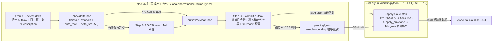

# Stock Theme M3 (Out-of-Repo Sandwich Sync CLI & Cloud Writer) Implementation Plan

**Goal:** 实现单文件同步 CLI `scripts/theme_basket_sync.py`，打通本机只读差集检测与长文本剥离（`--detect-delta`）、仓外三目录确定性预演与重放（`--commit-outbox` / `--sync-config` / `--replay-pending`）、云端持锁幂等落库与备份及 Telegram 摘要（`--apply-cloud-stdin`）以及私密票加解锁（`--lock-private` / `--unlock-private`），同步刷新北极星 M2.5 定稿说明。

**North Star / Spec:** `docs/design/stock-theme-north-star.md`（第三层：周日仓外三明治同步层；结合 M2 `src/data/theme_basket_store.py` 与 Boss M2.5 拍板结论）。

**Architecture & Tradeoffs:**
1. **单模块内聚，零多余抽象**：全部 CLI 模式与纯函数集中在 `scripts/theme_basket_sync.py`，外部依赖（DB 路径、交换目录、锁文件路径、Sheet XLSX 获取器、SSH 执行器、`--pull` 执行器、当前日期）全部支持函数参数或 CLI 参数注入，单测零网络零真 SSH 即可全覆盖；不拆子包、不引入后台守护进程。
2. **基于实测的 4 项减法校准**：(a) 因 `security_master.updated_at` 在无行变化周不推进，本地新鲜度改查 `market.db` 文件 `mtime`（36h 阈值，过期尝试一次 `--pull`，仍旧标 `WARN` 继续）；(b) 宽松只读扫 Sheet `Summary_OSV` 仅读 `Stock Ticker`、`Market`、`Shares > 0`，忽略 `Last Price` 的 `#N/A` 且绝不落盘股数/金额/Sheet ID；(c) 遵照 Boss M2.5 决策，Step A 剥离 `company_profile.description`，对无需模型判断的异构资产（`etf/fund_cef/crypto/custom_basket/other`、次级作废股与 `overrides.json` 已锁定的 49 只公开巨头）直接生成确定性 `auto_rows`，Step C 强制以 `delta.json` 的确定性元数据覆盖模型输出；(d) 因本机 `.env` 无 `TELEGRAM_*` 而云端 `.env` 完整，Telegram 周摘要改由云端 `--apply-cloud-stdin` 在释放写锁后发送，且纯 0 行且字典未变的心跳包跳过 `1.5 GB` 整库备份。
3. **双脑盲写降级说明**：第 3 步 Fable（`devin/claude-fable-5-2[1m]`）因 Devin 周配额耗尽返回 `HTTP 429`，按 `dev-loop` 规范重试 1 次仍返回 `429`，触发**单脑降级 + Fable 计划复核降级**，由 Neon 对照源码逐行核验契约后定稿。

**Tech Stack & Constraints:**
- **双端版本兼容（硬红线）**：本机 `.venv` 为 Python `3.13.1` / SQLite `3.53.4`；云端 `/root/workspace/Finance` 使用系统 `/usr/bin/python3`（`Python 3.10.12` + `SQLite 3.37.2`）。严禁使用 Python 3.11+ 特性（如 `datetime.UTC`、`tomllib`、`StrEnum`）及 SQLite 3.38+ 语法（`->>`、`IS DISTINCT FROM`、`unixepoch()`、`datetime('now','subsec')`、`concat()`、`format()`、`RIGHT/FULL JOIN`）。
- **`code_version()` 恒等**：严禁修改或让被哈希模块导入新文件，实施前后 `terminal.prosperity.version.code_version()` 必须保持 `4c9da30bd5001102`（`terminal/prosperity/version.py:17-35`）。
- **本地生产库只读与零残留句柄**：本机对 `market.db` 与 `company.db` 一律使用 `sqlite3.connect(f"file:{path}?mode=ro", uri=True)` + `contextlib.closing` 短连接即查即关；严禁在本地生产 `data/market.db` 产生写操作或残留句柄。
- **主账 Sheet 只读与脱敏**：复用 `portfolio/holdings/sheet_book.py:271` 的 `download_sheet_xlsx` 下载字节流，若环境变量无 `PORTFOLIO_SHEET_ID` 则只读解析主仓 `<main_repo>/.env` 提取该键（不写入日志/终端/JSON/异常消息）；任何下载或解析异常降级为 `sheet_status="UNKNOWN"` 写入 `warnings`。
- **云端共享写锁与备份契约**：云端锁路径与 `scripts/backfill_extended_fundamentals.py:96-103` 完全一致：`Path(os.environ.get("FINANCE_CRON_LOCK_DIR", "/tmp/finance-cron-locks")) / "resource-market_db_writer.lock"`，等待上限 `15.0s`，超时零修改退出码 `75`（`EXIT_LOCK_BUSY = 75`）；实质写入前在锁外执行 `sqlite3.Connection.backup()` + `PRAGMA quick_check == 'ok'` 生成 `market.db.backup-<UTC14>-auto-theme-sync`（校验剩余磁盘 `>= logical_bytes * 1.5`，`keep=2` 压缩并清理旧份，对齐 `scripts/build_company_concept_registry.py:1430`）。

## 架构与流程简图

## 不变量与故障边界

- **状态合并点**：
  1. **三路股票池归一（`Extended ∪ Sheet ∪ watchlist`）**：真值源为 `market.db:extended_membership`（全历史去重 `SELECT DISTINCT symbol` 以覆盖活跃池、10 日百亿市值兜底池及 `as_of` 回放池）、主账 `Summary_OSV`（`Shares > 0`）、`company.db:watchlist`；按「剥衍生品后缀 → 跨市场前缀补零（`HK:4位`/`KR:6位`/`CN:6位`/`CRYPTO:`）→ 剥美股交易所前缀 → 联合 `overrides.json:supplemental_aliases` + `symbol_aliases.json` + `security_master.share_class_of` 折叠主代码 → 同 CIK 去重」确定性合一；`sources` 字段仅标 `"extended"` 与 `"overlay"`（不区分私密 Sheet 与 watchlist）。
  2. **Step B 输出 ↔ Step A 元数据合并**：真值源为 `inbox/delta.json`；Step C 验 `generated_date == 今日(Asia/Shanghai)`、`delta_sha256` 双端恒等且 `classifications` 代码集合 `⊆ missing_symbols`（且内部无重）；强制用 `delta.json` 中的 `symbol, cik, asset_kind, in_us_basket_calc, profile_sector, profile_industry, company_name_snapshot` 覆盖提交行，仅采信 `{l2_id, cross_themes, pi_bucket, business_note, agreement_status}`（禁 `'locked'`；当 `in_us_basket_calc == 0` 时强制清空 `cross_themes`）；坏行经 `:memory:` 预演剥离进告警后再封存 `clean_rows` 与 `payload_id`。
  3. **本机 `pending/` ↔ 云端 `theme_sync_commits`**：一旦封存 `(clean_rows, payload_id)` 落入 `pending/<payload_id>.json`，`--replay-pending` 保持原 `rows` 与 `payload_id` 不变，仅用最新 `baskets.json` + `overrides.json` 组装信封重发，确保「云端已提交但 SSH 回包断连」场景下重放命中有记录 `payload_id`（`replayed=True`，0 重复插入、0 误隔离）。
- **故障模型（三档划界）**：
  1. **必须自动处理的单故障**：本地 `market.db` 超 36h 陈旧（自动尝试一次 `--pull`，失败标 `WARN` 继续）；Google Sheet 网络失败或 `#N/A`（忽略价格列 `#N/A`，网络/表头异常标 `sheet_status="UNKNOWN"` 继续）；Step B 漏标个别代码或输出非法 `l2_id`/`pi_bucket`（`:memory:` 预演逐行隔离坏行，合格行照常上云）；云端 `market_db_writer` 锁忙（`rc=75`）或 SSH 断连（自动存入 `pending/<payload_id>.json` 并清理 `outbox/payload.json` 防 `WatchPaths` 死循环）。
  2. **只停机/告警、不自愈的故障**：`baskets.json` 或 `overrides.json` 本身 schema/触发器校验失败（本地 `:memory:` 预演直接拒绝退出 `1`，不发云端）；`outbox/payload.json` 的 `delta_sha256` 不匹配、非今日 `delta` 或含越界代码（硬拒绝退出 `1`）；云端磁盘剩余不足 `logical * 1.5` 或备份 `quick_check != 'ok'`（中止写入退出 `1`）。
  3. **明确不支持的拓扑**：多台本机同时共用同一仓外交换目录并发跑 Step A/C；在非 `FINANCE_ENV=cloud` 环境对受保护生产 `market.db` 执行写操作。

## 验收标准

1. **代码归一与 7 类 `asset_kind` 精确性**：单测覆盖真实异构样本（`NASDAQ:NVDA`、`BATS:DRAM`、`HKG:0700`、`1548.HK`、`00700.HK`、`KRX:000660`、`KOSDAQ:083450`、`603259.SS`、`Market=CRYPTO` 的 `BTC` vs 美股 `BTC`、`MU CALL`/`SOX PUT`/`NVDA LEAPS`、`GOOGL→GOOG`、`SOXX`、`DXYZ`、`ABBNY`、`FITB-PA`/`FITB-PM`、`TEST`），归一结果与 `asset_kind`、`in_us_basket_calc` 100% 符合契约。
2. **M2.5 安全边界**：真实本机 `market.db` 跑 `--detect-delta` 产出的 `delta.json` 零 `description` 键、零 `PORTFOLIO_SHEET_ID`/URL/股数/市值泄露；Step C 面对篡改了 `asset_kind`/`in_us_basket_calc`/`cik` 的恶意 `payload.json` 强制还原为 `delta.json` 真值，越界代码或错哈希硬拒绝退出非零。
3. **双段信封、锁忙留存与重放幂等**：模拟 `rc=75` 时合格载荷落入 `pending/<payload_id>.json` 且 `outbox/payload.json` 已移走；随后 `--replay-pending` 成功上云并删除 `pending` 文件；重复提交同一 `payload_id` 返回 `replayed=True` 且历史表不重复追加。
4. **云端真实环境冒烟（Python 3.10.12 + SQLite 3.37.2）**：在 `aliyun` `/tmp` 隔离库（`--no-telegram`）实跑 `--apply-cloud-stdin`（含条件备份与 `keep=2` 清理、0 行心跳跳过备份）及 `--lock-private` / `--unlock-private`（含本机 `db_locked_backup/db_locked_latest.json` 落盘），全部退出码 `0`。
5. **全局守恒**：`code_version() == "4c9da30bd5001102"`；本机 `data/market.db` 零写入、`wal_bytes == 0`、零残留打开句柄；全套回归测试全绿。

## 任务拆解（Tasks 1..3）

### Task 1: 代码归一化、宽松只读 Sheet 扫描与 `--detect-delta`（Step A）

- **Files:**
  - Create: `scripts/theme_basket_sync.py`
  - Create: `tests/test_theme_basket_sync.py`
- **Contract:**
  - 默认仓外目录：`DEFAULT_EXCHANGE_DIR = Path.home() / ".local" / "share" / "finance-theme-sync"`，自动创建 `inbox/`、`outbox/`、`pending/`、`db_locked_backup/`（目录权限 `0o700`，原子写文件权限 `0o600`）。
  - `normalize_instrument(raw_symbol: str, market: str = "US", *, as_of_date: str, aliases: Sequence[Mapping[str, Any]], supplemental_aliases: Sequence[Mapping[str, Any]], share_class_map: Mapping[str, str], known_us_symbols: AbstractSet[str] = frozenset()) -> Optional[NormalizedInstrument]`：
    - `NormalizedInstrument`（`NamedTuple`）：`(canonical_symbol: str, wrapper_kind: str, raw_symbol: str, market: str)`，`wrapper_kind in ("equity", "leaps", "call", "put")`。
    - 规则：(1) 去首尾空白并大写，匹配末尾 `\s+(LEAPS|CALL|PUT)$` 提取 `wrapper_kind` 与底层串；(2) 若以 `HKG:`/`HK:` 开头、`.HK` 结尾或 `market == "HK"`：纯数字代码 `< 10000` 格式化为 `f"HK:{int(code):04d}"`（如 `700`/`0700`/`00700` → `HK:0700`，`9992`/`09992` → `HK:9992`），`>= 10000` 保留原数字 `f"HK:{int(code)}"`；(3) `KRX:`/`KOSDAQ:`/`KR:`、`.KS`/`.KQ` 或 `market == "KR"` → 纯数字补齐 6 位 `f"KR:{code.zfill(6)}"`；(4) `SHA:`/`SHE:`/`SSE:`/`SZSE:`/`CN:`、`.SS`/`.SZ` 或 `market == "CN"` → 纯数字补齐 6 位 `f"CN:{code.zfill(6)}"`；(5) `CRYPTO:` 前缀或 `market == "CRYPTO"` → 统一输出 `f"CRYPTO:{code}"`；(6) 剥离美股交易所前缀 `^(NASDAQ|NYSE|AMEX|NYSEAMERICAN|NYSEARCA|BATS|ARCA|CBOE|OTC|OTCMKTS):`，若代码形如 `BRK.B` 且将 `.` 换 `-` 后在 `known_us_symbols` 中则归一为 `BRK-B`；(7) 美股代码循环应用（最多 5 跳防环）：先查生效的 `supplemental_aliases`（`effective_from is None or effective_from <= as_of_date`），再调 `src.data.symbol_aliases.resolve_alias(sym, as_of_date, list(aliases))`（返回 `None` 则整体返回 `None`），再查 `share_class_map`。
  - `classify_asset_kind(symbol: str, *, sm_row: Optional[Mapping[str, Any]], profile_meta: Optional[Mapping[str, Any]], extra_etfs: AbstractSet[str]) -> Tuple[str, int]`：
    - 返回 `(asset_kind, in_us_basket_calc)`：
      - `HK:/KR:/CN:` 前缀 → `("non_us_equity", 0)`；
      - `CRYPTO:` 前缀 → `("crypto", 0)`；
      - `symbol in {"DRAM", "SOX"}` → `("custom_basket", 0)`；
      - `sm_row.is_etf == 1` 或 `sm_row.reason == "etf"` 或 `profile_meta.isEtf is True` 或 `symbol in extra_etfs` → `("etf", 0)`；
      - `sm_row.is_fund == 1` 或 `sm_row.reason == "fund"` 或 `profile_meta.isFund is True` → `("fund_cef", 0)`；
      - `sm_row.reason == "non_common_instrument"` 或匹配美股优先股/权证/单元形态 `^[A-Z0-9]+-(P[A-Z0-9]*|WS|WT|U|UN)$` 或（`sm_row is None` 且 `profile_meta is None`）或（`sm_row.reason == "missing_profile"` 且无 `company_name` 且 `profile_meta is None`）→ `("other", 0)`；
      - 其余 → `("us_equity", 1)`。
  - `scan_sheet_tickers_tolerant(xlsx_bytes: bytes) -> List[Tuple[str, str]]`：只读打开 `Summary_OSV` 页，前 15 行定位含 `Stock Ticker`、`Market`、`Shares` 的表头行，仅保留 `Shares > 0` 的行返回 `(raw_ticker, market)` 列表（完全不读价格/成本/市值列，忽略 `#N/A`）。
  - `detect_delta(*, market_db_path: Path, company_db_path: Path, exchange_dir: Path, baskets_path: Path, overrides_path: Path, aliases_path: Path, report_concepts_path: Optional[Path] = None, today: Optional[str] = None, max_db_age_hours: float = 36.0, auto_pull_stale: bool = True, pull_runner=..., sheet_xlsx_fetcher=..., skip_sheet: bool = False) -> Dict[str, Any]`：
    - 先删除 `exchange_dir / "outbox"` 下所有现存文件；检查 `market_db_path` 的 `mtime` 新鲜度；只读短连接扫描三源；剥离 `company_profile.description`；同批未入库活跃 `us_equity` 若出现非空重复 `cik`，保留高优先级主码（`overrides` 锁定 > `eligible==1` > 活跃 `extended_membership` > 字典序），其余归入 `auto_rows` 并设 `is_superseded=1, superseded_by=winner, in_us_basket_calc=0`；
    - 未入库标的中，`asset_kind in {"etf","fund_cef","crypto","custom_basket","other"}`、同 CIK 次级码、以及 `overrides.json:locked_stocks` 中的公开巨头直接生成确定性 `auto_rows`；其余未入库 `us_equity` 与 `non_us_equity` 写入 `missing_symbols`；已入库活跃 `us_equity` 若非空 `profile_sector` 或 `profile_industry` 较库内非空快照变化则写入 `pivot_candidates`；
    - 原子写入 `inbox/delta.json`（含 `delta_sha256`）；当 `missing_symbols == [] and pivot_candidates == []` 时同步原子写入 0 分类行 `outbox/payload.json`。
- **TDD Steps:**
  1. 在 `tests/test_theme_basket_sync.py` 编写 Task 1 单元测试（覆盖全部市场/后缀/期权包装/`BTC` 隔离/别名折叠、`Summary_OSV` 含 `#N/A` 价格行的宽松扫描、Sheet 异常降级 `UNKNOWN` 且报错不含假 Sheet ID、`delta.json` 彻底不含 `description`、同 CIK 次级码自动标 `is_superseded=1`、0 待标自动写 `outbox/payload.json`、清空旧 `outbox/payload.json`），运行 `pytest tests/test_theme_basket_sync.py` 确认 FAIL。
  2. 在 `scripts/theme_basket_sync.py` 实现上述纯函数与 `--detect-delta` 子命令，运行 `pytest tests/test_theme_basket_sync.py` 确认 PASS。
  3. 显式提交：`git add scripts/theme_basket_sync.py tests/test_theme_basket_sync.py && git commit -m "feat(theme): add M3 delta detection and symbol normalization"`。

### Task 2: 云端 `--apply-cloud-stdin`（锁外条件备份 + 15s 写锁 + Telegram 摘要）与私密票加解锁

- **Files:**
  - Modify: `scripts/theme_basket_sync.py`
  - Modify: `tests/test_theme_basket_sync.py`
- **Contract:**
  - `backup_sqlite_wal_safe(db_path: Path, *, label: str = "auto-theme-sync", keep: int = 2, now: Optional[datetime] = None) -> Optional[Path]`：若 `db_path` 存在，校验剩余磁盘 `>= logical_bytes * 1.5`，用 `sqlite3.Connection.backup()` 写入同目录 `.partial` 临时文件并跑 `PRAGMA quick_check == "ok"`，`os.link` 原子发布为 `<db_name>.backup-<UTC14>-<label>`，保留最新 `keep` 份同 label 备份（次新份自动 `.gz` 压缩，超出 `keep` 删除）。
  - `apply_cloud_envelope(envelope: Mapping[str, Any], *, db_path: Path, lock_path: Path, lock_timeout_sec: float = 15.0, send_telegram_fn=..., force_no_telegram: bool = False, now: Optional[datetime] = None) -> Tuple[int, Dict[str, Any]]`：
    - 校验 `os.environ.get("FINANCE_ENV") == "cloud"`（对受保护生产路径由 `open_writer(..., cloud_authoritative=True)` 双重把关；非生产临时路径在测试中可通过 `--allow-noncloud-test-db` 或环境变量显式放行，默认 CLI `--apply-cloud-stdin` 仍要求 `FINANCE_ENV == "cloud"`）；
    - 校验 `schema_version == 1` 与 `compute_payload_id(rows) == payload_id`；
    - 锁外只读探针判断是否发生实质变更（`theme_sync_commits` 表不存在、或 `len(rows) > 0` 且 `payload_id` 未提交过、或最新 `taxonomy_sha256` 与本次 `compute_taxonomy_sha256` 不同）；仅实质变更时调 `backup_sqlite_wal_safe(..., keep=2)`，纯 0 行且字典未变的心跳跳过备份；
    - 用 `fcntl.flock`（`LOCK_EX | LOCK_NB` 轮询至 `lock_timeout_sec=15.0s`）获取 `lock_path`；超时未拿到锁立即返回 `(75, {"ok": False, "error": "lock_busy"})`，零数据库写入；
    - 锁内短连接调用 `theme_basket_store.apply_envelope(...)` 并立即关库释放锁；
    - 锁释放后，若 `envelope.get("send_telegram", True)` 且 `not force_no_telegram`，拼装简明中文周摘要调用 `send_telegram_fn(msg, channel="private")`（发送异常捕获记入返回字典 `telegram_error`，不回滚已提交事务）；返回 `(0, result_dict)`。
  - 私密持仓锁定 CLI：
    - 云端执行模式（`--cloud-local` 配合 `--lock-private SYMBOL --l2 L2_ID [--cross THEME_ID[:ROLE] ...] [--note TEXT]` 或 `--unlock-private SYMBOL`）：持同一 `15s` 写锁调用 `lock_private_symbol` / `unlock_private_symbol`，查询当前全部 `source='db_locked'` 行及其跨界表快照随 JSON stdout 返回；
    - 本机默认模式（不带 `--cloud-local`）：通过 SSH 调用云端 `--cloud-local`，收到成功 JSON 后将 `db_locked_rows` 原子写入 `<exchange_dir>/db_locked_backup/db_locked_latest.json`（`0600`），并在未设 `--no-pull` 时触发一次 `--pull`。
- **TDD Steps:**
  1. 在 `tests/test_theme_basket_sync.py` 新增 Task 2 测试（实质变更触发 WAL 备份 + `keep=2` 自动 gzip 旧份并清理第 3 份；0 行且字典未变心跳跳过备份；外部进程持有 `flock` 时超时返回 `75` 且数据库零改动；Telegram 在锁释放后调用且发送失败不影响退出码 `0`；`--lock-private` 拒绝公开 `override` 票、成功锁定私密票并把最新 `db_locked` 快照写入 `db_locked_backup/db_locked_latest.json`、随后 `--unlock-private` 降级回 `needs_spot_check`），运行 pytest 确认 FAIL。
  2. 在 `scripts/theme_basket_sync.py` 实现 Task 2 逻辑与 CLI 分支，运行 pytest 确认 PASS。
  3. 显式提交：`git add scripts/theme_basket_sync.py tests/test_theme_basket_sync.py && git commit -m "feat(theme): add M3 cloud locked apply, WAL backup, and private lock CLI"`。

### Task 3: 本机 Step C（`--commit-outbox` / `--sync-config` / `--replay-pending`）与北极星文档同步

- **Files:**
  - Modify: `scripts/theme_basket_sync.py`
  - Modify: `tests/test_theme_basket_sync.py`
  - Modify: `docs/design/stock-theme-north-star.md`
- **Contract:**
  - `commit_outbox(*, exchange_dir: Path, baskets_path: Path, overrides_path: Path, market_db_path: Path, today: Optional[str] = None, ssh_runner=..., pull_runner=..., send_telegram: bool = True, skip_pull: bool = False) -> int`：
    - 硬门控校验：(1) `inbox/delta.json` 与 `outbox/payload.json` 均存在；(2) `delta["generated_date"] == today_shanghai`；(3) 重算 `delta` 规范化哈希等于 `delta["delta_sha256"]` 且等于 `payload["delta_sha256"]`；(4) `classifications` 无重复 `symbol` 且 `set(submitted) <= set(missing_by_symbol)`；任一不满足立即退出 `1`（保留现场供排查）；
    - 确定性元数据覆盖：逐条以 `delta["missing_symbols"][sym]` 的确定性字段覆盖模型输出，校验 `agreement_status in {"single_pass_weekly","dual_agreed","needs_spot_check","disagreed"}`（缺省 `"single_pass_weekly"`），`in_us_basket_calc == 0` 时强制 `cross_themes = []`，缺失 `pi_bucket` 时按有效 `l2_id` 的 `default_pi_bucket` 或 `asset_kind_default_pi_bucket` 填充；
    - `:memory:` 预演：用 `open_writer(":memory:")` + `apply_envelope` 预演 `delta["auto_rows"] + merged_classifications`；若字典本身报错退出 `1`；剥离 `mem_res.quarantined` 坏行记入 `local_quarantined`，对剩余 `clean_rows` 计算封存 `payload_id = compute_payload_id(clean_rows)`；
    - 先按序重放 `pending/*.json`，再发送本次双段信封至云端 `--apply-cloud-stdin`：
      - 若云端返回 `rc == 0` 且 `ok == True`：删除 `outbox/payload.json`（及对应 `pending` 文件）；除非 `skip_pull=True`，校验本地主仓 `market.db` 零打开句柄且 `-wal` 为 0 字节后执行 `pull_runner()`，返回 `0`；
      - 若云端返回 `rc == 75` 或 SSH/网络失败：将封存包原子写入 `pending/<payload_id>.json` 并删除 `outbox/payload.json`（防 `WatchPaths` 死循环重入），返回 `75`（锁忙）或 `1`（传输失败）。
  - `sync_config(...) -> int`：组装 `rows=[]` 的双段信封直发云端 `--apply-cloud-stdin`，成功后按同规则执行 `--pull`。
  - `replay_pending(...) -> int`：按 `(created_at, filename)` 顺序读取 `pending/*.json`，保持封存 `rows` 与 `payload_id` 原样不变，搭配当前最新 `baskets.json` + `overrides.json`（先在 `:memory:` 校验字典合法性）重发云端；每成功一包删除对应文件，全部成功后执行一次 `--pull`。
  - 同步更新 `docs/design/stock-theme-north-star.md`（第三层 Step A/B/C 与第 6 节完成度表）：写明 Boss M2.5 实测拍板结论（保持周日无人值守，Step A 用 `market.db` 文件 `mtime` 锚定新鲜度并剥离 `description` 长文本，Step C 强制覆盖确定性元数据，Telegram 摘要在云端写锁释放后发送，M1/M2/M2.5 状态更新为已完成）。
- **TDD Steps:**
  1. 在 `tests/test_theme_basket_sync.py` 新增 Task 3 端到端闭环测试（错 `delta_sha256` / 跨日旧 `delta` / 越界幻觉代码硬拒绝；篡改 `asset_kind` 被强制还原；1 条坏 `l2_id` 行被本地 `:memory:` 隔离而同批好行正常上云；模拟首次 `rc=75` 落入 `pending/` 并清理 `outbox/`、二次 `--replay-pending` 直连本地模拟云端库成功落库并幂等去重；`--sync-config` 0 行同步 99 篮子 + 49 锁定巨头；`code_version()` 恒等校验），运行 pytest 确认 FAIL。
  2. 实现 `--commit-outbox`、`--sync-config`、`--replay-pending` 并更新 `docs/design/stock-theme-north-star.md`，运行全量相关测试确认 PASS。
  3. 显式提交：`git add scripts/theme_basket_sync.py tests/test_theme_basket_sync.py docs/design/stock-theme-north-star.md && git commit -m "feat(theme): complete M3 outbox commit, pending replay, and north-star sync"`。
